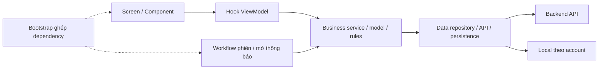
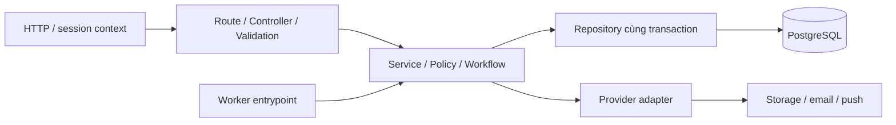
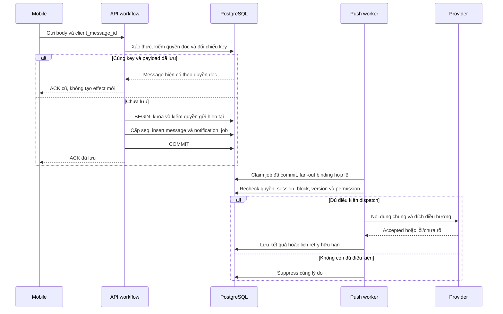

# StudentMart — Cấu trúc source và kiến trúc

**Ngày đối chiếu:** 07/11/2026. Kế thừa [solution tree](../docs/solution_tree.md); hiện trạng cập nhật bằng source và [technical decisions](../docs/technical-decisions.md). Các tên file/workflow chưa có được ghi rõ là dự kiến.

Liên quan: [stack](tech-stack.md), [luồng](user-flow.md), [schema](schema-database.md), [kế hoạch phát triển](work-flow.md).

## 1. Quyết định kiến trúc

StudentMart dùng **Three-Layer theo feature/module**. Mobile áp dụng MVVM nhẹ: Screen → hook ViewModel → business service → repository. Backend dùng Controller → Service/Workflow → Repository. Backend là một ứng dụng chia module; worker dùng chung nghiệp vụ và DB, không cần microservices cho phạm vi hiện tại.

Presentation–Business–Data là ranh giới trách nhiệm trong từng app, không phải ba máy chủ. Business gọi data theo hướng thực dụng đã chọn; không khẳng định đang triển khai Clean Architecture đầy đủ hoặc bắt interface/use-case class cho từng CRUD.

## 2. Cây repository và mức hoàn chỉnh

```text
StudentMart/
├── mobile/
│   ├── App.tsx                         # Có: Expo shell
│   ├── app.json, package.json, tsconfig.json
│   ├── assets/
│   ├── src/
│   │   ├── features/                   # Có khung, chưa có nghiệp vụ
│   │   │   ├── auth/
│   │   │   ├── listings/
│   │   │   ├── chat/
│   │   │   ├── notifications/
│   │   │   ├── profile/
│   │   │   └── moderation/
│   │   ├── business/workflows/         # Có khung
│   │   ├── shared/{presentation,data,config}/
│   │   ├── bootstrap/
│   │   └── navigation/
│   └── tests/{unit,integration}/       # Có khung
├── backend/
│   ├── package.json, tsconfig.json
│   ├── src/
│   │   ├── bootstrap/{app.ts,server.ts} # Có: Fastify và /health
│   │   ├── shared/config/env.ts        # Có: validate runtime env
│   │   ├── modules/                    # 9 module, còn là khung
│   │   ├── business/workflows/         # Khung transaction liên module
│   │   ├── workers/
│   │   └── shared/                     # http, database, providers, logging
│   ├── database/{migrations,seeds,reference-data}/
│   └── tests/
│       ├── unit/bootstrap.test.ts      # Có: health/config
│       ├── integration/
│       └── support/
├── doc/                                # Bộ tài liệu tổng hợp lần này
├── docs/                               # Schema, solution tree, BL, decisions chi tiết
├── StudentMart.wiki/                    # Bản local yêu cầu/nghiên cứu
├── stephen-skills/                      # Hướng dẫn; không phải source ứng dụng
├── package-lock.json                   # Ở root; không thay lockfile riêng mỗi app
└── README.md
```

Ký hiệu `{...}` rút gọn các mục cùng cấp. Mỗi feature/module khung có `presentation/`, `business/`, `data/`, giữ bằng `.gitkeep`. Không coi việc có thư mục là bằng chứng logic đã được viết. Các mô tả scaffold cũ trong tài liệu nguồn không phủ nhận manifests/entrypoints hiện có.

## 3. Mobile: trách nhiệm và chiều import



| Vị trí | Trách nhiệm | Quy tắc |
|---|---|---|
| `features/<feature>/presentation/` | Screen, component, hook ViewModel, state/action UI | Screen không gọi HTTP/storage; VM không tự quyết định quyền server |
| `features/<feature>/business/` | Model/rules/service client, điều phối state nghiệp vụ client | Không import JSX, navigation hoặc ViewModel |
| `features/<feature>/data/` | API DTO, mapping khi cần, repository và persistence feature | Không import screen/hook UI |
| `business/workflows/` | Session switch/logout, xử lý notification qua nhiều feature | Không tạo phụ thuộc vòng giữa feature |
| `shared/presentation/` | UI loading/empty/error/confirm và theme | Chỉ dùng lại UI thực sự chung |
| `shared/data/` | HTTP, storage theo account, media và catalog adapters | Không giấu rule quyền/verify trong HTTP helper |
| `bootstrap/`, `navigation/` | Ghép dependency/provider và route theo router sẽ chọn | Route guard phục vụ UX; backend vẫn kiểm quyền |

| Feature | Màn hình/hành vi đích | Hợp đồng cần dùng |
|---|---|---|
| auth | Sign up/in/out, verify tùy chọn, state phiên | Session + OTP; namespace account |
| listings | Danh sách/filter, chi tiết, editor chung ba loại, tin của tôi, nháp | Catalog/media/listings API và local draft |
| chat | Inbox, conversation/composer, unread, pending/retry | Membership/history/send/read cursor |
| notifications | Permission, registration/binding, tap notification | OS/provider adapter + workflow mở chat |
| profile | Hồ sơ riêng/công khai, edit/avatar, giải thích nhãn | Public projection và media |
| moderation | Report, block, danh sách/chi tiết/quyết định admin tối thiểu | Report/block/admin APIs |

Ví dụ tên file **sẽ viết** cho listings: `ListingEditorScreen.tsx`, `useListingEditorViewModel.ts`, `listing.service.ts`, `listings.repository.ts`, `drafts.repository.ts`. Giữ ba tầng, chỉ chia thêm thư mục khi số file thực tế cần; không dựng thêm web admin riêng.

Logout/switch phải dừng sync, khóa/dọn cache, nháp/pending của A và thu hồi binding trước khi hiển thị dữ liệu B. Pending của A không được tự gửi bằng session B. State hook không tự thay được persistence.

## 4. Backend: module và ownership



Controller xử lý biên HTTP và ánh xạ lỗi. Business không phụ thuộc request/response Fastify; repository không trả HTTP response hoặc tự cấp quyền. `shared/http/` cấp actor/context, policy module quyết định thao tác được phép.

| Module | Bảng sở hữu theo thiết kế | Số |
|---|---|---:|
| users | `users` | 1 |
| auth | `user_credentials`, `installations`, `auth_sessions`, `school_email_verifications`, `school_email_otps` | 5 |
| catalog | `schools`, `school_email_domains`, `areas`, `categories` | 4 |
| media | `media_assets` | 1 |
| listings | `listings`, `listing_photos`, `listing_state_changes` | 3 |
| chat | `conversations`, `conversation_participants`, `messages` | 3 |
| moderation | `user_blocks`, `reports`, `moderation_actions`, `account_restrictions` | 4 |
| notifications | `push_subscriptions`, `notification_jobs`, `push_deliveries` | 3 |
| analytics | `analytics_events` | 1 |
| **Tổng** | **25 bảng, mỗi bảng đúng một owner** | **25** |

Ownership là quyền chịu trách nhiệm ghi và thay đổi schema trong thiết kế, không phải phân quyền SQL đã triển khai. Module khác dùng public service/repository operation được thống nhất; không tự ghi private table của module khác.

## 5. Public interface và composition root

Hiện `buildApp()` trong [app.ts](../backend/src/bootstrap/app.ts) mới tạo Fastify và đăng ký `/health`. [server.ts](../backend/src/bootstrap/server.ts) đọc config rồi listen. Khi thêm chức năng, bootstrap ghép repositories/providers/services/workflows, đăng ký routes và quản lý lifecycle. Worker entrypoint cũng được ghép tại đây hoặc composition root riêng nếu sau này tách process.

| Biên module dự kiến | Trách nhiệm hợp đồng |
|---|---|
| auth | Resolve actor/session hiện hành; login/logout/rotation nhất quán installation |
| catalog | Lookup active cho lựa chọn mới, giữ tham chiếu lịch sử |
| media | Xác nhận asset READY, đúng owner/purpose; cấp quyền dùng asset trong transaction |
| listings | Public detail/search, publish/update/state và xác nhận context chủ tin |
| chat | Tạo/lấy conversation, quyền history/send, cấp seq/read cursor và reconcile key |
| moderation | Policy tương tác, block/restriction, report và áp quyết định |
| notifications | Tạo outbox qua repository trong tx chung; binding/eligibility/delivery |
| users / analytics | Public profile an toàn / event whitelist và nguồn actor tin cậy |

Tên method/DTO cụ thể chưa chốt; không tạo port/interface chỉ để có một abstraction cho mỗi lớp. Thêm interface ở chỗ cần fake/provider thay thế hoặc module boundary rõ. Dữ liệu actor/clock/transaction được truyền tường minh theo contract; không hardcode userId trong nghiệp vụ.

## 6. Workflow và transaction liên module

Các tên bên dưới là **file dự kiến** dưới `backend/src/business/workflows/`, chưa có implementation.

| Workflow | Module phối hợp | Commit và bất biến |
|---|---|---|
| `session-lifecycle.workflow.ts` | auth + notifications | Revoke phiên/subscription cũ, tăng binding version, tạo liên kết mới đúng account |
| `publish-listing.workflow.ts` | listings + media + catalog + moderation | Validate actor/lookup/ảnh, listing + photos + history cùng commit; key/hash chống trùng |
| `open-conversation.workflow.ts` | chat + listings + moderation | Tin mở khi tạo mới, đúng owner, không self/block, đúng hai participant; unique khi concurrent |
| `send-message.workflow.ts` | chat + listings + moderation + notifications | Quyền hiện tại, seq + message + outbox cùng commit; ACK sau commit |
| `apply-moderation.workflow.ts` | moderation + listings và effect liên quan | Action + report status + effect/audit đúng target cùng commit |

Repository nhận cùng transaction context do workflow quản lý; module không tự commit giữa một use case liên module. Không commit message rồi mở transaction khác để insert notification_job. Khóa/gate phải dùng chung giữa thao tác tương tác và thay đổi quyền, theo phương án ở [schema gốc §7.4](../docs/schema.md).

## 7. Runtime tiêu biểu



Provider lỗi không rollback message đã commit. Worker không tự chuyển job của A sang subscription B sau account switch. Push nhận trước logout có thể còn trên OS; vì vậy payload phải chung và tap luôn xác thực lại. Gate dispatch/logout/block cần được thiết kế với timeout và kiểm race; row lock đơn lẻ chưa chứng minh external push đúng một lần.

Publish tương tự: mobile giữ draft/key → upload READY → workflow validate → listing/photos/history cùng commit → ACK → mobile dọn nháp theo UX. Chưa nhận ACK thì đối chiếu key cũ; không tạo lần publish mới mù quáng.

## 8. Triển khai và ranh giới dữ liệu

Đích logic gồm mobile, một API và công việc nền cùng codebase, PostgreSQL, storage/email/push provider. Có thể khởi đầu worker cùng process theo solution tree; lựa chọn chạy riêng phải kèm lifecycle, retry và vận hành. Hosting/domain/TLS/backup/CI chưa chốt.

Server giữ 25 bảng; thiết bị giữ 3 entity draft/photo/pending theo account; nhật ký nghiên cứu giữ riêng; presence là trạng thái tạm có hạn. Không đưa chat, email trường, OTP hoặc token vào analytics/log. Admin không có quyền đọc toàn bộ chat chỉ vì có role ADMIN.

## 9. Lộ trình từ hiện trạng đến đích

| Bước | Giữ lại | Cần bổ sung | Kiểm tra khi có code |
|---|---|---|---|
| Nền tảng | Fastify health/config/test, Expo shell và cây ba tầng | Lockfile từng app, các quyết định/toolchain còn mở, CI và DB test | Build/typecheck thực, app target, health và runner |
| Dữ liệu/auth | Ownership và schema proposal | Migration/trigger/seed, session, policy, lookup/media | FK/UQ/concurrent/revoke; fake provider |
| Tin/chat | Chín module và sáu feature đúng trách nhiệm | Editor/draft/search/lifecycle, membership/message/unread/outbox | Mất ACK, race, đúng actor và transaction |
| Tích hợp | Verify/push/report/admin/analytics trong scope đầu | Provider/binding/worker/tap, policy đã duyệt | Device lifecycle/permission, account switch, audit |
| Bàn giao | R/US/UF/TASK/BL hiện có | Bản cài, evidence, nhật ký pilot và quyết định cập nhật | TASK-24 trước TASK-09 |

Không đổi namespace thư mục hoặc migrate dữ liệu trong nhiệm vụ viết doc. Khi đổi một policy, rà cả API, worker, mobile state và schema liên quan, giữ progress cũ có bằng chứng.

## 10. Checklist review kiến trúc

- Screen → ViewModel → service → repository; data không import UI.
- Controller không chứa SQL/nghiệp vụ; service không phụ thuộc HTTP response.
- Mỗi bảng có một module owner; phối hợp qua contract, không import private file tùy tiện.
- Transaction liên module dùng cùng context, có rollback/race test khi triển khai.
- Quyền đọc/gửi và tạo chat mới/chat cũ tách riêng; không gate theo verify.
- Session/binding/local account isolation nhất quán; tap kiểm quyền trước tải nội dung.
- Tên file dự kiến không bị trình bày là code đã tồn tại; không đánh dấu nghiệp vụ đạt chỉ nhờ bootstrap.
