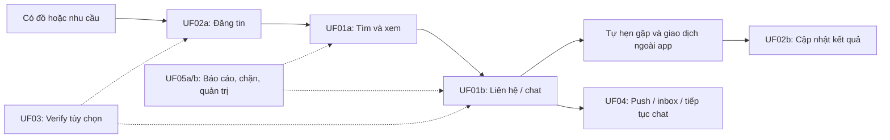
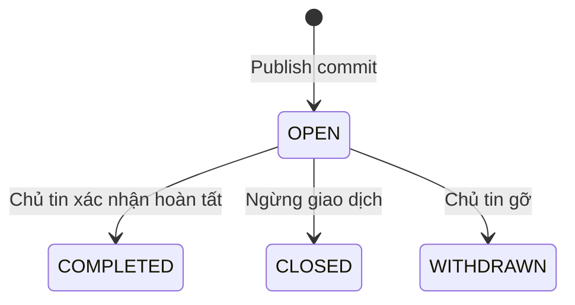

# StudentMart — Luồng người dùng, quyền và phục hồi

**Ngày đối chiếu:** 07/11/2026. Nguồn chuẩn: [Critical User Flows](../StudentMart.wiki/Critical-User-Flows.md), [User Stories](../StudentMart.wiki/User-Stories.md), [Traceability](../StudentMart.wiki/Traceability.md). Giữ nguyên UF01–UF05 và các nhánh; đây là thiết kế đích, chưa phải kết quả chạy ứng dụng.

Liên quan: [yêu cầu](summary-assigment.md), [kiến trúc](structure-architecture.md), [schema](schema-database.md), [ca nghiệm thu tham khảo](../stephen-skills/docs/studentmart/flow-acceptance.md).

## 1. Ranh giới và điểm vào

Điểm vào có thể là danh sách, editor, hộp thư, hồ sơ hoặc notification. Các thao tác private phải xác thực; quyền public browsing chi tiết được ghi trong API contract khi triển khai, không suy rằng mọi dữ liệu trong DB là công khai.

## 2. Actors và ma trận quyền

| Actor / quan hệ | Quyền đích | Điều kiện |
|---|---|---|
| Người tìm tin | Tìm/xem thông tin được công khai | Không được đọc dữ liệu private vì biết ID |
| Thành viên | Đăng, liên hệ, verify, report, block | Session hợp lệ và không bị hạn chế thao tác; verify không bắt buộc |
| Chủ tin | Sửa/kết thúc tin của mình | Ownership và trạng thái/version hiện tại |
| Participant | Đọc history/unread và gửi theo quyền riêng | Đúng conversation; kiểm lại khi đọc/gửi |
| Admin | Xem report và quyết định đúng phạm vi | Role thực tại backend, lý do và audit; không mặc định đọc mọi chat |

| Trạng thái tại thao tác | Tạo chat mới | Đọc chat cũ | Gửi tiếp / push mới |
|---|---|---|---|
| OPEN/VISIBLE, hai người đủ quyền | Có nếu khác owner và không block | Participant có quyền | Có khi đủ quyền; push cần thêm device/permission |
| COMPLETED hoặc CLOSED, còn VISIBLE | Không | Theo membership/quyền | Có nếu còn quyền và không block |
| WITHDRAWN hoặc REMOVED | Không | Theo policy hiện tại | Cần chốt; schema đề xuất ngăn gửi, giữ đọc nếu không bị cấm rõ |
| Block một trong hai hướng | Không | Giữ lịch sử theo quyền | Không phát sinh tương tác/push trái quyền |
| Restriction | Theo deny scope đang hiệu lực | Theo quyền đọc | Theo quyền gửi/đọc và policy được duyệt |
| Chưa verify | Không làm giảm quyền ở trên | Không làm giảm quyền | Không gate theo nhãn |
| Từ chối push | Theo quyền nghiệp vụ | Vẫn có inbox | Chat vẫn dùng được; không dispatch push |
| Hết phiên/logout/switch | Xác thực lại | Không lộ dữ liệu phiên trước | Không gửi bằng danh tính phiên trước |

Enum/trạng thái lưu trữ là đề xuất [schema](../docs/schema.md). Quyền sau gỡ và restriction chưa được Wiki chốt hết; không biến các đề xuất đó thành yêu cầu đã duyệt.

## 3. UF01a — Tìm và chọn tin

**Actor:** người có nhu cầu tìm tin. **Bắt đầu:** mở danh sách. **Tiền điều kiện:** API cung cấp projection được phép và lookup. **Kết thúc:** chọn xem/liên hệ, chuyển đăng tìm mua hoặc dừng. **Truy vết:** R05/R06, US05/US06; TASK-05/06/07/15.

1. Nhập từ khóa, chọn kết hợp loại/danh mục/khu vực và giá/ngân sách khi áp dụng.
2. Hiển thị loading; chỉ cập nhật kết quả của query hiện hành.
3. Khi tải thành công, hiển thị tin đang mở/được phép công khai và dữ liệu đúng loại.
4. Mở chi tiết/hồ sơ chủ tin, trạng thái hiện tại và giải thích nhãn verify; muốn liên hệ chuyển UF01b.

| Nhánh | Phản hồi và phục hồi |
|---|---|
| Không có kết quả | Cho sửa/xóa filter, chuyển UF02a loại Tìm mua hoặc dừng |
| Lỗi tải | Hiện lỗi và retry; không trình bày thành kết quả rỗng |
| Filter giá | Chỉ tin có giá/ngân sách trong khoảng; loại NULL. Bỏ filter có thể thấy lại tin phù hợp; không gán thiếu thành 0 |
| Response cũ đến muộn | Không ghi đè query mới; cách hủy/đối chiếu request cần triển khai |
| Tin đổi trạng thái khi đang xem | Cập nhật trạng thái và khả năng liên hệ; server kiểm lại khi thao tác |

**Dữ liệu:** listings/catalog/ảnh/public users/nhãn verification. Không trả email trường, credential hoặc địa chỉ riêng.

## 4. UF01b — Mở hội thoại và gửi tin nhắn

**Actor:** người liên hệ hoặc participant. **Bắt đầu:** bấm liên hệ từ tin hoặc mở chat cũ. **Tiền điều kiện:** session hợp lệ trước nội dung private; đúng context và quyền. **Kết thúc:** message được ACK hoặc nội dung giữ lại chưa xác nhận/thất bại. **Truy vết:** R01/R07, US01/US07; TASK-16/06/21, phối hợp TASK-23.

1. Nếu chưa login, xác thực và quay lại context phù hợp; login lỗi cho thử lại hoặc quay về.
2. Nếu tin của chính mình, không tạo chat. Nếu đã có hội thoại cùng cặp/tin, kiểm quyền đọc rồi dùng lại.
3. Chưa có hội thoại: kiểm OPEN/VISIBLE, hai tài khoản còn quyền và không block; tạo/lấy duy nhất kể cả request đồng thời, cùng đúng hai participant.
4. Hiện context/trạng thái tin, history/unread được phép. Soạn body và giữ `client_message_id` cho một lần gửi.
5. Server kiểm quyền gửi hiện tại; insert message/seq/outbox trong transaction; ACK sau commit. Mobile reconcile thành một bubble.

| Nhánh | Phản hồi và phục hồi |
|---|---|
| Mất phiên/quyền hoặc block phát sinh | Từ chối thao tác mới; giữ nội dung phù hợp, yêu cầu login hoặc thông báo không thể gửi |
| Tin COMPLETED/CLOSED, chat đã có | Vẫn được tiếp tục nếu còn quyền; không áp OPEN cho mọi send |
| Chưa có chat và tin không mở | Không tạo; cập nhật trạng thái tin/giải thích không thể liên hệ |
| Mất ACK sau commit | Giữ body/key, trạng thái UNCONFIRMED; retry cùng key/payload lấy lại message theo quyền đọc, không sinh tin/push mới |
| Cùng key, payload khác | Conflict/đối chiếu theo contract; không sửa message cũ dưới cùng key |
| Không muốn retry | Giữ nội dung để tiếp tục trong đúng namespace account; không giả đã gửi |

**Kết quả “Đã gửi”:** chỉ xác nhận lưu; không suy đã đọc, phản hồi hoặc giao dịch. Quyền đọc và quyền gửi được kiểm riêng, cả API và worker dùng policy hiện hành.

## 5. UF02a — Tạo tin và khôi phục bản nháp

**Actor:** thành viên có quyền đăng. **Bắt đầu:** chọn đăng/tiếp tục nháp. **Tiền điều kiện:** login; catalog/media theo contract. **Kết thúc:** listing OPEN/VISIBLE đã commit hoặc nháp được giữ. **Truy vết:** R01–R04/R12, US01–US04/US12; TASK-03/04/16/23.

| Loại | Thông tin chung | Thông tin riêng bắt buộc | Tùy chọn / không áp dụng |
|---|---|---|---|
| Bán | Tiêu đề, danh mục, mô tả, khu vực | Ảnh, tình trạng, giá | Giá 0/giới hạn ảnh cần chốt |
| Tìm mua | Món cần tìm, danh mục, yêu cầu, khu vực | Nội dung nhu cầu | Ngân sách và ảnh tham khảo tùy chọn |
| Trao đổi | Tiêu đề, danh mục, mô tả, khu vực | Ảnh, tình trạng, món/điều kiện muốn đổi | Khoản bù thỏa thuận trong chat, không matching |

1. Login nếu cần; chọn Bán/Tìm mua/Trao đổi hoặc tiếp tục draft của account hiện tại.
2. Nhập form, chọn khu vực thủ công và ảnh theo loại. Camera bị từ chối vẫn có lựa chọn ảnh sẵn theo quyền OS.
3. Giữ bản nháp trên thiết bị; báo thiếu/sai tại trường. Upload ảnh có state, server xác nhận READY đúng owner/purpose.
4. Chọn đăng: giữ key/payload của thao tác, server kiểm lại actor/quyền/lookup/loại/ảnh.
5. Commit listing + photos + history cùng transaction; ACK rồi mới báo thành công và dọn/đánh dấu nháp theo UX.

| Nhánh | Phản hồi và phục hồi |
|---|---|
| Thiếu ảnh Bán/Trao đổi | Giữ nháp để bổ sung, không lộ listing OPEN thiếu ảnh |
| Tìm mua thiếu ảnh/ngân sách | Cho tiếp tục nếu trường bắt buộc khác đúng; không gán ngân sách 0 |
| Upload lỗi/URI mất | Giữ form, hiển thị trạng thái ảnh; cho chọn/tải lại |
| Rời form/app bị gián đoạn | Khôi phục nháp/ảnh local theo account; cho chủ động xóa nháp |
| Hết phiên/deny_publish | Không công khai; giữ nháp và hướng dẫn theo quyền hiện tại |
| Timeout chưa rõ publish | UNCONFIRMED, giữ key/payload để đối chiếu; không đổi nội dung dưới key cũ rồi tạo bản sao |

Nháp không phải hàng DRAFT trong PostgreSQL và không đồng bộ nhiều thiết bị. Xóa nháp không đồng nghĩa gỡ tin đã publish.

## 6. UF02b — Sửa và kết thúc tin

**Actor:** chủ tin. **Bắt đầu:** mở tin của mình. **Tiền điều kiện:** session, ownership, quyền và version hiện tại. **Kết thúc:** nội dung/trạng thái được ACK hoặc giữ trạng thái server xác nhận trước. **Truy vết:** R08/US08; liên quan R07/US07 và kết quả US02–US04; TASK-04/07.

1. Kiểm quyền quản lý, chọn sửa nội dung, hoàn tất nhu cầu hoặc đóng/gỡ.
2. Sửa thì validate theo loại. Kết thúc thì yêu cầu xác nhận; hủy quay lại tin.
3. Server kiểm actor/version/policy; cập nhật tin và history trạng thái thật cùng transaction.
4. ACK mới hiển thị thành công. Tin không mở ra khỏi search đang mở và không tạo chat mới.

Đây là chuyển trạng thái tối thiểu của **đề xuất lưu trữ**, chưa có reopen. COMPLETED hiển thị Đã bán/Đã tìm được/Đã trao đổi theo loại. Lớp moderation_state độc lập: admin REMOVED không ghi đè kết quả của chủ tin.

| Nhánh | Phản hồi và phục hồi |
|---|---|
| Không phải owner/đã bị hạn chế | Từ chối ở server, không chỉ ẩn nút |
| Version cũ/cập nhật lỗi | Giữ trạng thái xác nhận trước; conflict/reload/retry theo contract |
| COMPLETED/CLOSED | Không chat mới; chat cũ tiếp tục nếu còn quyền và không block |
| WITHDRAWN/REMOVED | Không chat mới; quyền đọc/gửi chi tiết cần chốt, không tự phục hồi admin removal |
| Đóng/gỡ | Không tính là hoàn tất giao dịch; không xóa history/chat mặc định |

## 7. UF03 — Verify email trường tùy chọn

**Actor:** thành viên đã login. **Bắt đầu:** mục xác thực hồ sơ. **Tiền điều kiện:** miền hỗ trợ đã chốt; provider và quota/TTL có cấu hình được duyệt. **Kết thúc:** cấp nhãn hoặc tiếp tục chưa verify. **Truy vết:** R09/US09; TASK-15/17/18.

1. Giải thích nhãn và quyền bỏ qua. Không muốn verify thì tiếp tục đăng/chat như thường khi còn quyền.
2. Nhập email, kiểm đúng miền được hỗ trợ; yêu cầu OTP theo key/cooldown/quota.
3. Báo yêu cầu được tiếp nhận; không hứa email đã đến. Nhập mã nhận được.
4. Server kiểm MAC, version/email, hạn/lượt/miền hiện tại; consume một lần và đặt verified_at nguyên tử.

| Nhánh | Phản hồi và phục hồi |
|---|---|
| Miền sai/chưa hỗ trợ | Cho sửa hoặc bỏ qua; không nhận miền gần giống/subdomain chưa khai báo |
| Provider lỗi/chờ gửi lại | Nêu trạng thái/thời gian chờ theo contract; retry khi được phép hoặc bỏ qua |
| OTP sai/hết hạn/vượt lượt | Không cấp nhãn; cho nhập lại/gửi mã mới trong giới hạn |
| Đổi email | Thu hồi nhãn, tăng version và invalidate mã cũ cùng transaction |
| Hai request consume | Chỉ một thành công; không phát sinh hai lần cấp nhãn từ cùng challenge |

Không công khai email. Nhãn không bảo đảm danh tính sinh viên hiện tại, uy tín hoặc chất lượng hàng.

## 8. UF04 — Push và tiếp tục hội thoại

**Actor:** người nhận message, OS/provider và worker hỗ trợ. **Bắt đầu:** message đã commit. **Tiền điều kiện:** recipient đúng conversation; binding/permission hiện hành để dispatch. **Kết thúc:** mở/trả lời chat theo quyền hoặc tiếp tục từ inbox. **Truy vết:** R07/R13, US07/US13; TASK-17/19/20/21.

1. Message/seq/outbox cùng commit; inbox/unread lấy nguồn từ chat, độc lập thành bại push.
2. Nếu đang xem đúng chat thì cập nhật trực tiếp, tránh thông báo trùng bằng presence hợp lệ có hạn.
3. Worker claim job, xác nhận recipient/session/installation/subscription/version, block/restriction/quyền đọc và permission trước dispatch; payload chung.
4. Tap notification: kiểm phiên, login nếu cần, xác nhận quyền của account hiện tại rồi mới tải/hiển thị conversation.
5. Trả lời theo quyền gửi hiện tại tại UF01b.

| Nhánh | Phản hồi và phục hồi |
|---|---|
| Từ chối quyền/không nhận push | Vẫn inbox/unread/history và trả lời; không trình bày là mất message |
| Provider lỗi/token invalid | Retry hữu hạn/đánh invalid theo contract; message giữ nguyên |
| Quyền/binding đổi trước dispatch | Suppress, không chuyển job A sang user B trên cùng thiết bị |
| Tap cũ/hết phiên/app đóng hoặc nền | Đi qua cùng kiểm session/quyền; login lỗi dừng nội dung private |
| Account hiện tại không có quyền | Không tải/hiện chat; báo phù hợp và về inbox |
| Provider accepted | Chỉ xác nhận provider nhận yêu cầu; không suy OS hiển thị hoặc user đọc |

Push đã được OS nhận trước logout có thể còn hiển thị; payload chung và tap reauth vẫn bắt buộc. Mức bảo đảm external dispatch và gate cần kiểm bằng race/device test, không hứa exactly-once push.

## 9. UF05a — Báo cáo hoặc chặn

**Actor:** thành viên đã login. **Bắt đầu:** tin/hồ sơ/chat được phép xem. **Tiền điều kiện:** đúng target/context và quyền. **Kết thúc:** report được tiếp nhận hoặc block được xác nhận; có thể hủy trước gửi. **Truy vết:** R10/US10; TASK-22.

1. Chọn report hoặc block độc lập.
2. Report: chọn lý do/mô tả; server kiểm một target là tin hoặc tài khoản, context/snapshot trong quyền; lưu theo key chống trùng.
3. Chỉ sau ACK mới báo đã tiếp nhận để xem xét. Muốn block là lựa chọn khác, không bắt buộc sau report.
4. Block: xác nhận rồi cập nhật quan hệ dưới gate tương tác. ACK mới hiển thị đã chặn.

Lỗi gửi giữ nội dung để retry; chưa ACK block thì chưa khẳng định đã chặn. Report không tự tạo action/hình phạt. Block ngăn tương tác/push mới trái quyền, không tự xóa history. UI bỏ chặn chưa được Wiki chốt.

## 10. UF05b — Quản trị xử lý báo cáo

**Actor:** admin có quyền. **Bắt đầu:** danh sách report. **Tiền điều kiện:** backend xác nhận ADMIN, chỉ được xem dữ liệu liên quan trong phạm vi. **Kết thúc:** giữ PENDING có ghi nhận hoặc RESOLVED với một kết luận cuối và effect. **Truy vết:** R11/US11; TASK-22.

1. Mở report và căn cứ được phép; không cấp toàn bộ chat mặc định.
2. Chưa đủ căn cứ: ghi INSUFFICIENT_EVIDENCE, report còn chờ.
3. Đủ căn cứ: chọn không vi phạm/gỡ tin/hạn chế tài khoản; nhập lý do và xác nhận.
4. Khóa/recheck report/target; action + status + effect/audit cùng commit, lưu admin/time/reason; ACK mới báo thành công.

Lưu lỗi thì chưa áp kết quả thành công; retry cùng action key không phạt hai lần. Hai admin xử lý đồng thời chỉ một kết luận cuối được commit. Effect đúng target và nhất quán trong search/detail/chat/push; phạm vi restriction theo policy được duyệt.

## 11. Truy vết flow → module → dữ liệu

| Nhánh | Mobile | Backend | Dữ liệu và ràng buộc chính |
|---|---|---|---|
| UF01a | listings, profile | listings/catalog/users/auth | Listings public, NULL price, projection nhãn |
| UF01b | auth, chat | auth/chat/listings/moderation/notifications | Unique conversation, đúng 2 participant, message key/seq/outbox |
| UF02a | listings, shared media/storage | listings/media/catalog/moderation | Draft local; listing/photos/history commit; publish key |
| UF02b | listings, chat context | listings/moderation | Version, hai lớp trạng thái, history |
| UF03 | auth, profile | auth/catalog/email adapter | Verification/email_version/OTP và quota |
| UF04 | notifications/chat + session workflow | notifications/auth/chat/moderation | Binding generation, job/delivery, membership/read cursor |
| UF05a | moderation | moderation/chat | Report XOR/context, block hai hướng khi xét quyền |
| UF05b | moderation admin | moderation/listings/workflow | Action/report/effect/audit, restriction |

## 12. Checklist nghiệm thu khi có implementation

Kiểm mỗi nhánh thành công, validation, mất mạng/ACK, hết phiên, actor sai quyền và race có ý nghĩa. Các ca đặc biệt: NULL filter; publish thiếu ảnh; WANTED thiếu ngân sách; concurrent mở chat; retry message/publish; COMPLETED/CLOSED với chat cũ; OTP cũ sau đổi email; logout/switch/tap cũ; block trước dispatch; hai admin xử lý.

Backend cần API + PostgreSQL thật cho constraint/transaction/quyền. Mobile cần restart/persistence/state/account isolation. OTP/push cần provider fake cho lỗi có thể lặp lại và thiết bị thật cho tích hợp/OS/lifecycle theo TASK-17/TASK-24. Ghi expected/actual/môi trường/evidence và trạng thái pass/fail/chưa chạy; các ca trong tài liệu chưa được coi là đã pass.
