# StudentMart — Schema dữ liệu, quan hệ và ràng buộc

**Ngày thiết kế:** 02/11/2026 · **Nền tảng dữ liệu:** PostgreSQL · **Trạng thái:** đề xuất thiết kế cho MVP, chưa phải migration hoặc schema đã triển khai.

Tài liệu mô hình hóa toàn bộ dữ liệu cần cho chuỗi **đăng tin → tìm/lọc → xem chi tiết → liên hệ → tự giao dịch ngoài app → cập nhật trạng thái**, cùng tài khoản, verify email trường, push, báo cáo/chặn, bản nháp và đo lường.

## 1. Căn cứ và phạm vi

Nguồn sản phẩm: [User Stories](../StudentMart.wiki/User-Stories.md), [Critical User Flows](../StudentMart.wiki/Critical-User-Flows.md), [MVP Scope](../StudentMart.wiki/MVP-Scope-and-Prioritization.md), [Product Decisions](../StudentMart.wiki/Product-Decisions.md), [Traceability](../StudentMart.wiki/Traceability.md), [Project Plan](../StudentMart.wiki/Project-Plan.md), [Business Canvas](../StudentMart.wiki/Business-Canvas.md) và [README](../README.md).

Wiki đang dùng **User Story US01–US13 và User Flow UF01–UF05**, không có bộ mã Use Case riêng. “Use case” trong yêu cầu được mapping vào các US và nhánh UF hiện có.

Các entity, tên cột, kiểu dữ liệu, enum và cách khóa bên dưới là **đề xuất kỹ thuật trong tài liệu này**. Các bất biến như verify tùy chọn, không tạo chat mới từ tin đóng, retry không trùng và push sau lưu tin nhắn là yêu cầu lấy từ wiki. Không đồng nhất một đề xuất lưu trữ với một quyết định sản phẩm đã được chốt.

### 1.1. Ba nơi lưu dữ liệu

| Nơi lưu | Phạm vi | Lý do |
|---|---|---|
| PostgreSQL server | **25 bảng** nghiệp vụ và hỗ trợ kỹ thuật | Dữ liệu dùng chung, phân quyền, toàn vẹn, retry và audit |
| Thiết bị mobile | **3 entity cục bộ**: bản nháp, ảnh nháp, tin nhắn chưa xác nhận | Giữ nội dung khi gián đoạn; không đồng bộ nháp nhiều thiết bị |
| Nhật ký nghiên cứu riêng | **1 cấu trúc PilotJournalEntry** | Ghi quan sát/kết quả tự báo cáo; có thể dùng file/biểu mẫu, không bắt buộc thêm bảng ứng dụng |
| Runtime | **ConversationPresence** có thời hạn | Gợi ý đang xem đúng chat để tránh thông báo trùng; không phải bảng bắt buộc hoặc nguồn phân quyền |

Không có entity Order, Payment, Escrow, Shipment, Booking, ExchangeMatch, Rating, Review, Favorite hoặc AIRecommendation vì ngoài MVP. Không lưu tọa độ GPS hay địa chỉ riêng để phục vụ lọc khu vực.

### 1.2. Cách đọc ký hiệu

- `PK`: khóa chính; `FK`: khóa ngoại; `UQ`: duy nhất; `NN`: không được NULL.
- `?` sau kiểu: được NULL. Các cột không có `?` là NN.
- `uuid`: định danh không mang ý nghĩa nghiệp vụ; `timestamptz`: thời điểm tuyệt đối, trao đổi API theo ISO 8601.
- `text(code)`: mã có CHECK/enum; danh sách mã được mô tả ngay tại entity.
- Mọi bảng có `id` dùng UUID làm PK, trừ bảng ghi rõ khóa ghép hoặc PK chính là `user_id`.
- `created_at` do server đặt. `updated_at` chỉ có ở bảng mutable; audit/event/message được giữ bất biến theo quyền truy cập.
- “0..N” là không có hoặc nhiều; “1..N” là tối thiểu một. ERD rút gọn cột để dễ đọc; từ điển dữ liệu ở mục 4 mới là danh sách đầy đủ.

## 2. Visualization: nhìn hệ thống theo dữ liệu

### 2.1. Bản đồ tổng thể

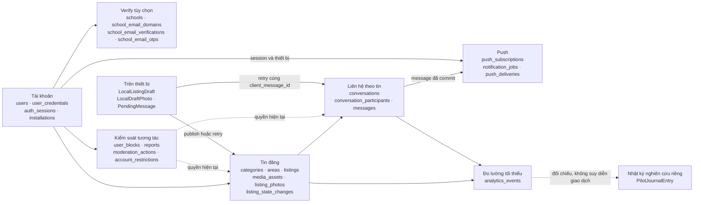

**Cách hiểu:** `listings` là trung tâm của tìm kiếm và liên hệ. `messages` là nguồn sự thật cho chat; push chỉ giúp người nhận biết có tin mới. Verify bổ sung một tín hiệu hồ sơ và không nằm trên đường bắt buộc để đăng tin/chat. Nhật ký pilot không biến việc tự hẹn gặp thành một quy trình đặt hàng trong app.

### 2.2. ERD tài khoản, trường và xác thực

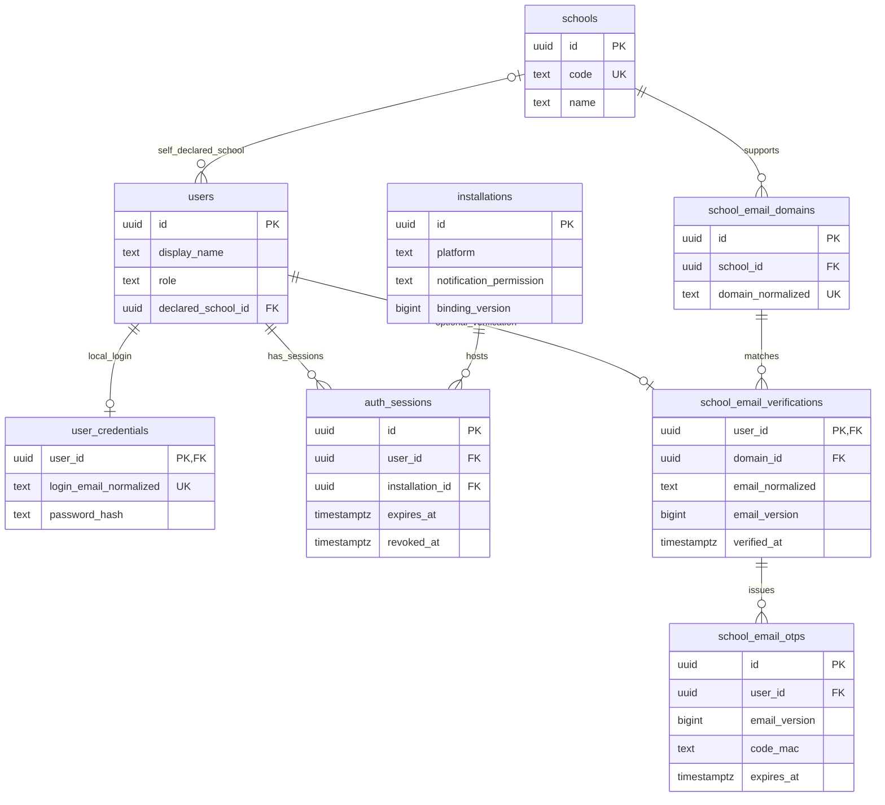

Trường tự khai nằm ở `users.declared_school_id`; trường của email đã xác thực suy ra từ `verification → domain → school`. Hai thông tin không tự ghi đè nhau.

### 2.3. ERD tin đăng, ảnh và hội thoại

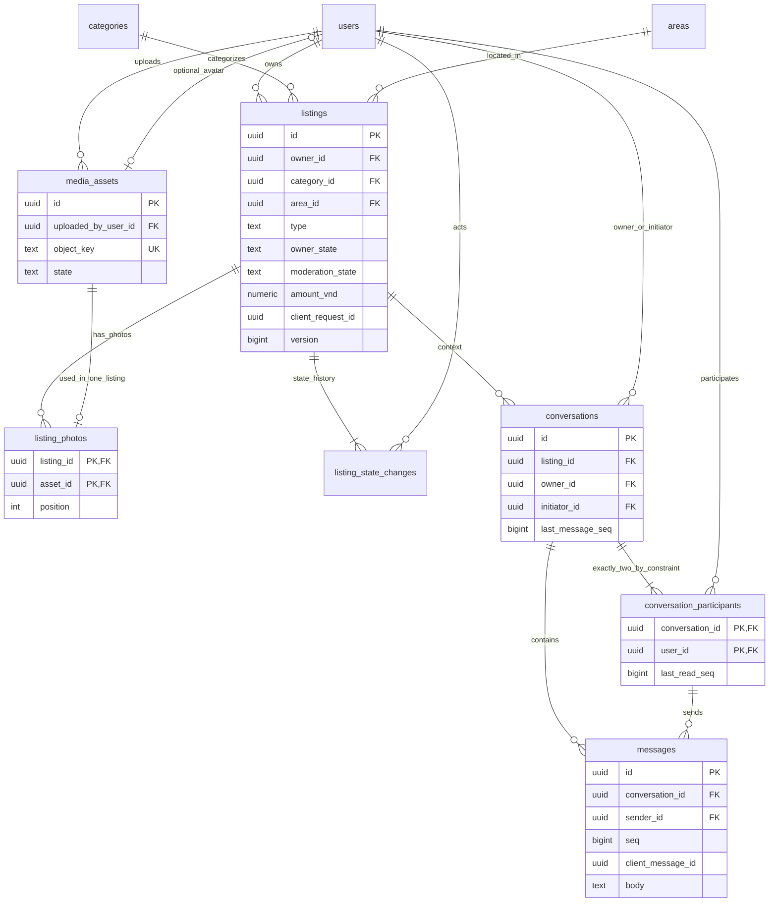

Mỗi tin chỉ có một chủ tin; mỗi hội thoại gồm chủ tin và một người liên hệ. Bảng `conversation_participants` là bảng mapping người dùng ↔ hội thoại, đồng thời giữ mốc chưa đọc riêng. Đường từ participant sang message dùng FK ghép `(conversation_id, sender_id)`, không chỉ FK người gửi.

### 2.4. ERD báo cáo, chặn và xử lý

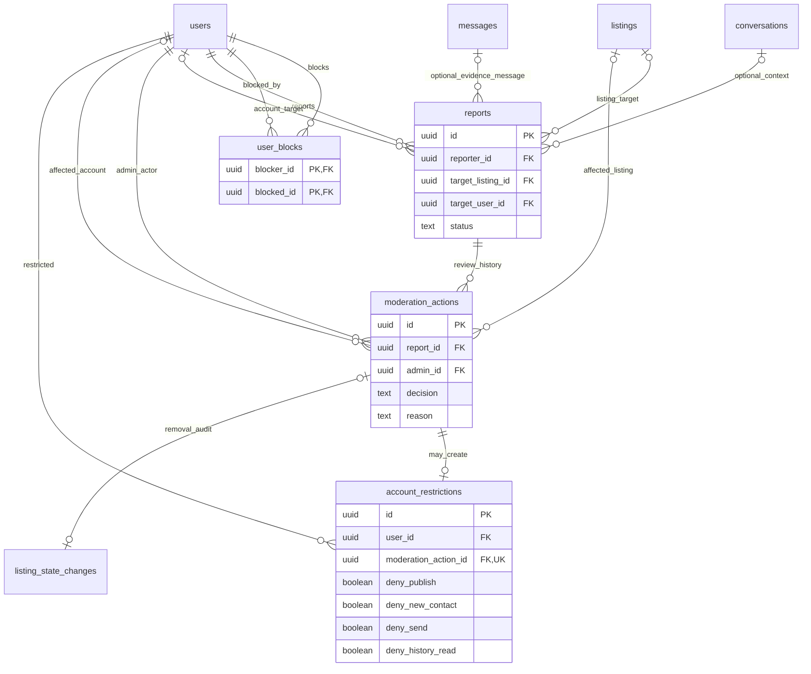

Hai cạnh target vào `reports` là **XOR**: mỗi báo cáo trỏ đúng một tin hoặc một tài khoản. Context hội thoại/tin nhắn chỉ là minh chứng được phép cung cấp, không tạo loại báo cáo thứ ba hoặc quyền đọc toàn bộ chat cho admin.

### 2.5. ERD push và sự kiện

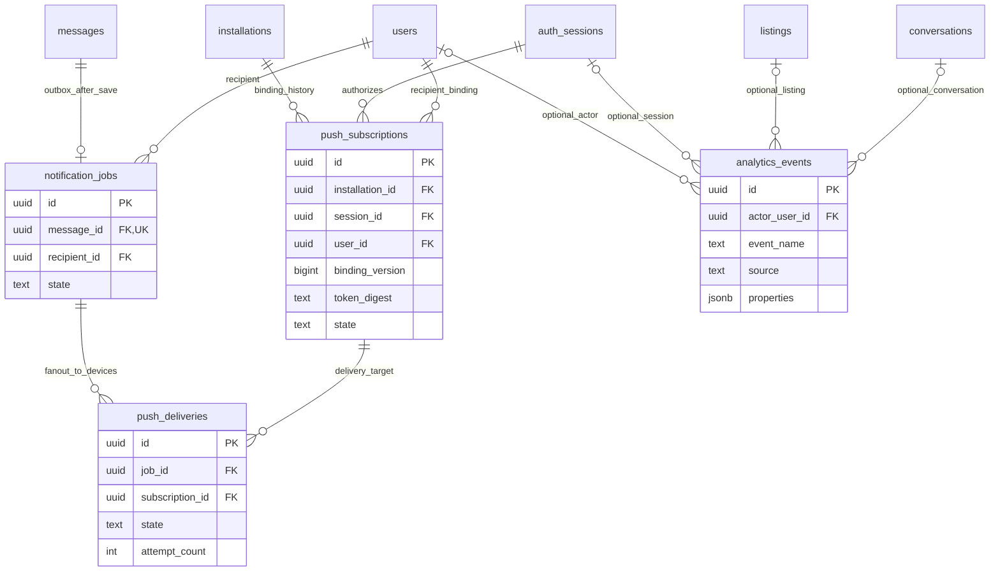

`notification_jobs` là outbox ngay trong PostgreSQL, chưa cần giả định một dịch vụ queue bên ngoài. Một message riêng tư có tối đa một người nhận khác người gửi; một job có thể phát tới nhiều thiết bị đang hợp lệ của người đó.


## 3. Mapping table: nghiệp vụ → entity → nơi lưu

| Nhóm | Entity / bảng | Ý nghĩa và cardinality chính |
|---|---|---|
| Tài khoản | `users` | Một người dùng có thể mua/bán/tìm mua/trao đổi; role MEMBER hoặc ADMIN |
| Tài khoản | `user_credentials` | 0..1 phương thức email/mật khẩu nội bộ trên một user, theo phương án đăng nhập đề xuất |
| Thiết bị | `installations` | Một lần cài app, không phải mã phần cứng hoặc vị trí thiết bị |
| Tài khoản | `auth_sessions` | Một user có nhiều phiên ở nhiều installation; giữ lịch sử phiên đã thu hồi |
| Danh mục | `schools`, `school_email_domains` | Một trường có nhiều miền email được hỗ trợ |
| Verify | `school_email_verifications` | 0..1 địa chỉ email trường hiện tại của mỗi user |
| Verify | `school_email_otps` | Nhiều lần phát OTP; mỗi lần gắn phiên bản email cụ thể |
| Danh mục | `areas`, `categories` | Danh sách khu vực phục vụ và danh mục hàng dùng chung ba loại tin |
| Media | `media_assets` | Metadata ảnh và kết quả upload; file ở object storage, không trong DB |
| Tin đăng | `listings` | Một bảng dùng chung Bán/Tìm mua/Trao đổi |
| Mapping | `listing_photos` | Tin ↔ ảnh; lưu thứ tự, ảnh đầu là ảnh bìa |
| Audit tin | `listing_state_changes` | Một tin có ít nhất một bản ghi trạng thái khi publish và các lần kết thúc/gỡ |
| Chat | `conversations` | Một tin có nhiều hội thoại; mỗi người liên hệ có tối đa một hội thoại trên tin đó |
| Mapping | `conversation_participants` | User ↔ conversation, chính xác hai người/hội thoại và mốc đọc của từng người |
| Chat | `messages` | Message đã được server lưu, có thứ tự trong hội thoại và khóa chống gửi trùng |
| Mapping | `user_blocks` | Quan hệ chặn có hướng user → user |
| Vận hành | `reports` | Báo cáo đúng một tin hoặc một tài khoản |
| Audit quản trị | `moderation_actions` | Nhiều lần xem xét, tối đa một kết luận cuối cho mỗi báo cáo |
| Phân quyền | `account_restrictions` | Hạn chế hiện hành/lịch sử, phát sinh từ quyết định quản trị |
| Mapping thiết bị | `push_subscriptions` | Gắn installation + phiên + tài khoản + token theo một phiên bản liên kết |
| Outbox | `notification_jobs` | Công việc thông báo sinh cùng transaction lưu message |
| Gửi push | `push_deliveries` | Một lần phân phối logic trên mỗi job × subscription, có thể thử lại nhiều lần |
| Đo lường | `analytics_events` | Sự kiện tối thiểu, tách client/server và dữ liệu thử |
| Local | `LocalListingDraft`, `LocalDraftPhoto`, `PendingMessage` | Nội dung chưa công khai/chưa nhận xác nhận, phân vùng theo tài khoản trên thiết bị |
| Nghiên cứu | `PilotJournalEntry` | Nhật ký ẩn danh; không đại diện đơn hàng hoặc giao dịch đã xác minh |

## 4. Từ điển dữ liệu server

### 4.1. Tài khoản và thiết bị

#### `users`

| Cột | Kiểu | Khóa / ý nghĩa |
|---|---|---|
| `id` | uuid | PK |
| `display_name` | text | Không rỗng sau trim |
| `role` | text(code) | MEMBER / ADMIN; mặc định MEMBER |
| `declared_school_id` | uuid? | FK → schools; thông tin tự khai |
| `avatar_asset_id` | uuid? | FK → media_assets; UQ khi có; chỉ ảnh READY của chính user, purpose AVATAR |
| `created_at` | timestamptz | Thời điểm tạo |
| `updated_at` | timestamptz | Thời điểm cập nhật hồ sơ |

Không có role BUYER/SELLER, không có `is_trusted` hoặc điểm uy tín. Nhãn email được suy ra từ bảng verification, không lưu một boolean verify độc lập dễ bị lệch.

Hạn chế tài khoản được tính từ `account_restrictions`, không sao chép thành một trạng thái “banned” thứ hai trong users. API hồ sơ công khai dùng danh sách trường cho phép, không serialize credential/session/verification.

#### `user_credentials`

| Cột | Kiểu | Khóa / ý nghĩa |
|---|---|---|
| `user_id` | uuid | PK, FK → users; tối đa một credential nội bộ |
| `login_email_normalized` | text | UQ; email đăng nhập, không phải điều kiện verify trường |
| `password_hash` | text | Hash có salt theo thư viện xác thực được chọn, không lưu mật khẩu |
| `password_changed_at` | timestamptz | Mốc đổi credential để hỗ trợ thu hồi phiên theo chính sách |
| `created_at` | timestamptz | Thời điểm tạo |
| `updated_at` | timestamptz | Thời điểm cập nhật |

**Giả định thiết kế:** dùng email/mật khẩu cho đăng ký ban đầu. Wiki chưa chốt phương thức login. Nếu chọn nhà cung cấp xác thực ngoài, thay phần credential bằng mapping subject của provider; không triển khai hai cơ chế song song chỉ vì tài liệu này. Email đăng nhập và email verify trường là hai mục đích riêng; chưa verify trường không ngăn đăng nhập.

#### `installations`

| Cột | Kiểu | Khóa / ý nghĩa |
|---|---|---|
| `id` | uuid | PK; app sinh cho một installation, không dùng IMEI |
| `platform` | text(code) | ANDROID / IOS; khả năng phát hành mỗi nền tảng còn cần nghiệm thu |
| `notification_permission` | text(code) | UNKNOWN / GRANTED / DENIED, phản ánh lần đồng bộ OS gần nhất |
| `binding_version` | bigint | Mặc định 0, không âm; tăng mỗi lần đổi/thu hồi liên kết tài khoản/push |
| `created_at` | timestamptz | Thời điểm ghi nhận |
| `last_seen_at` | timestamptz | Lần đồng bộ gần nhất |

Permission này không thay quyền OS thực tế và không cấp quyền đọc chat. Nếu app được cài lại, installation mới được tạo; token cũ có thể vô hiệu hóa khi phát hiện hết hiệu lực.

#### `auth_sessions`

| Cột | Kiểu | Khóa / ý nghĩa |
|---|---|---|
| `id` | uuid | PK |
| `user_id` | uuid | FK → users |
| `installation_id` | uuid | FK → installations |
| `refresh_token_digest` | text | UQ; chỉ digest, không lưu refresh token thô |
| `refresh_generation` | bigint | Không âm; tăng khi rotate token |
| `created_at` | timestamptz | Mốc bắt đầu phiên |
| `expires_at` | timestamptz | Phải sau created_at |
| `revoked_at` | timestamptz? | Có giá trị khi logout/thu hồi |
| `last_seen_at` | timestamptz | Lần hoạt động gần nhất |

UQ phụ `(id, user_id, installation_id)` để subscription dùng FK ghép. Đề xuất một phiên chưa thu hồi trên một installation; cùng user vẫn dùng được nhiều installation. Khi login mới trên cùng installation, thu hồi phiên cũ và subscription cũ trong một transaction.

Phiên hợp lệ khi `revoked_at IS NULL AND expires_at > server_now`. Backend phải kiểm tra thu hồi với thao tác private; một access token chưa hết hạn không được tự bỏ qua logout.

### 4.2. Trường, miền email và OTP

#### `schools`

| Cột | Kiểu | Khóa / ý nghĩa |
|---|---|---|
| `id` | uuid | PK |
| `code` | text | UQ, mã ổn định |
| `name` | text | Tên hiển thị, không rỗng |
| `is_active` | boolean | Có cho chọn mới hay không |
| `created_at`, `updated_at` | timestamptz | Audit cơ bản |

#### `school_email_domains`

| Cột | Kiểu | Khóa / ý nghĩa |
|---|---|---|
| `id` | uuid | PK |
| `school_id` | uuid | FK → schools |
| `domain_normalized` | text | UQ; hostname miền được chuẩn hóa, không gồm ký tự @ |
| `is_active` | boolean | Có tiếp nhận xác thực mới hay không |
| `created_at`, `updated_at` | timestamptz | Audit cơ bản |

Danh sách thật do TASK-15 chốt, không seed miền phỏng đoán. So khớp hostname đầy đủ; miền gần giống hoặc subdomain chưa được khai báo không tự được chấp nhận. Tắt miền không tự chứng minh nhãn cũ sai: chính sách thu hồi hàng loạt cần quyết định riêng.

#### `school_email_verifications`

| Cột | Kiểu | Khóa / ý nghĩa |
|---|---|---|
| `user_id` | uuid | PK, FK → users; không có hàng khi chưa bắt đầu verify |
| `domain_id` | uuid | FK → school_email_domains |
| `email_normalized` | text | Email hiện tại, dữ liệu riêng |
| `email_version` | bigint | > 0; tăng khi thay địa chỉ hoặc hủy chu kỳ verify cũ |
| `verified_at` | timestamptz? | NULL khi chưa verify hoặc vừa đổi email |
| `next_send_allowed_at` | timestamptz | Mốc được yêu cầu phát OTP tiếp theo |
| `created_at`, `updated_at` | timestamptz | Audit cơ bản |

Nhãn verify = tồn tại hàng này và `verified_at IS NOT NULL`. Đổi email cập nhật email/domain, tăng version, đặt verified_at = NULL và vô hiệu OTP cũ **trong cùng transaction**.

Đề xuất chưa áp UQ email trường giữa nhiều user vì wiki chưa chốt chính sách “một email/một tài khoản”. Đây là quyết định còn mở, không phải sự cho phép lạm dụng.

#### `school_email_otps`

| Cột | Kiểu | Khóa / ý nghĩa |
|---|---|---|
| `id` | uuid | PK |
| `user_id` | uuid | FK → school_email_verifications.user_id |
| `email_version` | bigint | Snapshot phiên bản email lúc yêu cầu, > 0 |
| `email_at_issue` | text | Snapshot địa chỉ đích, dữ liệu riêng |
| `client_request_id` | uuid | UQ cùng user_id; retry request không tự gửi thêm mã |
| `code_mac` | text | MAC có khóa bí mật phía server của mã, không lưu OTP thô |
| `attempt_count` | integer | Mặc định 0; 0..max_attempts |
| `max_attempts` | integer | > 0; snapshot cấu hình cho challenge |
| `delivery_state` | text(code) | QUEUED / PROVIDER_ACCEPTED / FAILED |
| `requested_at` | timestamptz | Mốc tiếp nhận |
| `provider_accepted_at` | timestamptz? | Không đồng nghĩa email đã đến inbox |
| `expires_at` | timestamptz | Sau requested_at; TTL lấy từ cấu hình được chốt |
| `consumed_at` | timestamptz? | OTP đã dùng thành công, không dùng lại |
| `invalidated_at` | timestamptz? | Mã bị thay thế/khóa/hủy |
| `failure_code` | text? | Mã lỗi kỹ thuật đã lọc, không chứa OTP |

Tối đa một challenge chưa consumed/chưa invalidated trên một user; consumed_at và invalidated_at không được đồng thời có giá trị. Challenge hết hạn phải được invalidate trước khi tạo mã thay thế. Không FK phiên bản OTP vào `verification.email_version` vì email_version hiện tại thay đổi còn challenge cũ phải giữ được lịch sử.

Verify chỉ thành công nếu MAC đúng, chưa consumed/invalidated, còn hạn, chưa hết lượt thử, version/email khớp bản hiện tại và miền cho phép xác thực tại thao tác đó. Cần giới hạn tổng yêu cầu/lượt thử theo user và cửa sổ thời gian, không chỉ từng challenge; resend không được reset toàn bộ chống dò mã.

### 4.3. Danh mục, ảnh và tin đăng

#### `areas`

| Cột | Kiểu | Khóa / ý nghĩa |
|---|---|---|
| `id` | uuid | PK |
| `code` | text | UQ |
| `name` | text | Tên khu vực giao dịch trong địa bàn phục vụ |
| `is_active` | boolean | Cho chọn mới hay không |
| `created_at`, `updated_at` | timestamptz | Audit cơ bản |

Danh sách chọn thủ công theo TASK-15. Không thêm latitude/longitude hoặc địa chỉ phòng trọ. Khu vực ngừng cho chọn vẫn giữ cho tin/lịch sử cũ tham chiếu.

#### `categories`

| Cột | Kiểu | Khóa / ý nghĩa |
|---|---|---|
| `id` | uuid | PK |
| `code` | text | UQ |
| `name` | text | Tên danh mục |
| `is_active` | boolean | Cho chọn mới hay không |
| `created_at`, `updated_at` | timestamptz | Audit cơ bản |

MVP dùng danh mục phẳng; chưa cần cây nhiều cấp. Ưu tiên nguồn tin công nghệ/phụ kiện và gia dụng, vẫn giữ sách/giáo trình; danh mục cuối cùng cần dữ liệu được chốt.

#### `media_assets`

| Cột | Kiểu | Khóa / ý nghĩa |
|---|---|---|
| `id` | uuid | PK |
| `uploaded_by_user_id` | uuid | FK → users |
| `purpose` | text(code) | LISTING_IMAGE / AVATAR |
| `object_key` | text | UQ; khóa object storage, không phải URL có chữ ký hết hạn |
| `mime_type` | text | MIME được server xác minh |
| `size_bytes` | bigint | > 0 |
| `width_px`, `height_px` | integer? | Cùng có hoặc cùng NULL; khi có phải > 0 |
| `checksum` | text? | Checksum kiểm tra file |
| `state` | text(code) | UPLOADING / READY / FAILED |
| `created_at` | timestamptz | Mốc cấp upload |
| `ready_at` | timestamptz? | Chỉ có khi state READY |
| `failure_code` | text? | Lỗi đã lọc |

Tạo metadata upload không có nghĩa có tin đã đăng. File chưa READY không được làm ảnh của tin công khai. Asset READY đang được tham chiếu không được đổi uploader/purpose/object hoặc hạ trạng thái để làm mất tính hợp lệ của ảnh; thay ảnh bằng asset mới đã xác minh. Cleanup upload mồ côi chỉ xóa sau khi xác nhận không còn tham chiếu từ tin/avatar; không xóa ảnh còn dùng để phục vụ lịch sử hoặc xử lý báo cáo khi chưa có chính sách lưu giữ.

#### `listings`

| Cột | Kiểu | Khóa / ý nghĩa |
|---|---|---|
| `id` | uuid | PK |
| `owner_id` | uuid | FK → users; không chuyển chủ trong MVP |
| `category_id` | uuid | FK → categories |
| `area_id` | uuid | FK → areas |
| `type` | text(code) | SALE / WANTED / EXCHANGE; không đổi loại sau publish trong phương án này |
| `title` | text | Tiêu đề/món cần tìm, không rỗng |
| `description` | text | Mô tả món đồ hoặc yêu cầu tìm mua, không rỗng |
| `condition_text` | text? | Tình trạng/khuyết điểm; bắt buộc với SALE/EXCHANGE |
| `amount_vnd` | numeric(14,0)? | Giá SALE hoặc ngân sách WANTED; NULL với EXCHANGE |
| `exchange_wants` | text? | Món/điều kiện muốn đổi; bắt buộc với EXCHANGE |
| `owner_state` | text(code) | OPEN / COMPLETED / CLOSED / WITHDRAWN |
| `moderation_state` | text(code) | VISIBLE / REMOVED; độc lập owner_state |
| `client_request_id` | uuid | UQ cùng owner_id; định danh một lần publish |
| `create_payload_hash` | text | Hash payload publish chuẩn hóa, bất biến để đối chiếu retry |
| `version` | bigint | > 0; tăng khi cập nhật, dùng chống ghi đè |
| `published_at` | timestamptz | Tin server đã chấp nhận công khai |
| `completed_at` | timestamptz? | Có khi owner_state COMPLETED, kết quả tự báo cáo |
| `owner_state_changed_at` | timestamptz | Mốc trạng thái của chủ tin gần nhất |
| `created_at`, `updated_at` | timestamptz | Audit cơ bản |

UQ phụ `(id, owner_id)` để conversation FK ghép xác nhận đúng chủ tin.

**Tách hai trạng thái:** admin có thể gỡ một tin đã hoàn tất; khi đó `owner_state=COMPLETED`, `moderation_state=REMOVED`. Vẫn giữ sự kiện chủ tin tự báo hoàn tất, đồng thời tin không còn được hiển thị công khai. Không ghi đè thành một trạng thái REMOVED làm mất nguồn kết quả.

**Không có hàng DRAFT trong listings.** Nháp ở thiết bị; upload ở media_assets. Publish tạo listing + ảnh + lịch sử trong một transaction, validate trước commit. Không để tin OPEN thiếu ảnh xuất hiện tạm thời trong tìm kiếm.

#### `listing_photos` — bảng mapping tin ↔ ảnh

| Cột | Kiểu | Khóa / ý nghĩa |
|---|---|---|
| `listing_id` | uuid | PK ghép, FK → listings |
| `asset_id` | uuid | PK ghép, FK → media_assets; thêm UQ(asset_id) |
| `position` | integer | >= 0; UQ(listing_id, position) |
| `created_at` | timestamptz | Mốc gắn ảnh |

Một asset gắn tối đa một tin trong phương án này. Ảnh có position nhỏ nhất làm ảnh bìa; không cần boolean cover dễ bị trùng. Kiểm tra asset thuộc chủ tin, purpose LISTING_IMAGE, state READY. SALE/EXCHANGE cần ít nhất một ảnh; WANTED có thể không có ảnh.

#### `listing_state_changes`

| Cột | Kiểu | Khóa / ý nghĩa |
|---|---|---|
| `id` | uuid | PK |
| `listing_id` | uuid | FK → listings |
| `actor_id` | uuid | FK → users, người thực hiện |
| `from_owner_state` | text(code)? | NULL chỉ ở lần publish đầu |
| `to_owner_state` | text(code) | Trạng thái chủ tin sau thao tác |
| `from_moderation_state` | text(code)? | NULL chỉ ở lần publish đầu |
| `to_moderation_state` | text(code) | Trạng thái quản trị sau thao tác |
| `moderation_action_id` | uuid? | FK → moderation_actions; UQ khi có |
| `reason` | text? | Lý do đóng/gỡ; bắt buộc cho hành động quản trị |
| `changed_at` | timestamptz | Server đặt |

Bản ghi đầu `NULL → OPEN/VISIBLE`; các bản ghi sau mô tả chuyển trạng thái thật, không sinh bản sao vì retry. Sửa tiêu đề/giá không cần giả lập một lần chuyển trạng thái. Audit này không phải sổ đơn hàng hoặc bằng chứng thanh toán.


### 4.4. Hội thoại, thành viên và tin nhắn

#### `conversations`

| Cột | Kiểu | Khóa / ý nghĩa |
|---|---|---|
| `id` | uuid | PK |
| `listing_id` | uuid | FK → listings |
| `owner_id` | uuid | FK → users; phải đúng listings.owner_id |
| `initiator_id` | uuid | FK → users; người liên hệ, khác owner_id |
| `last_message_seq` | bigint | Mặc định 0, không âm; counter thứ tự message của hội thoại |
| `last_message_at` | timestamptz? | NULL khi chưa có message |
| `created_at` | timestamptz | Mốc tạo |
| `updated_at` | timestamptz | Mốc thay đổi metadata/message gần nhất |

UQ `(listing_id, initiator_id)` vì chủ tin cố định. FK ghép `(listing_id, owner_id) → listings(id, owner_id)` bảo đảm owner không bị truyền giả. CHECK `owner_id <> initiator_id`.

Không có `is_closed` tự đồng bộ từ listing. Hội thoại cũ không tự ngừng gửi chỉ vì chủ tin hoàn tất hoặc đóng tin. Trạng thái/quyền gửi được tính từ các điều kiện hiện tại ở mục 8.

#### `conversation_participants` — bảng mapping user ↔ hội thoại

| Cột | Kiểu | Khóa / ý nghĩa |
|---|---|---|
| `conversation_id` | uuid | PK ghép, FK → conversations |
| `user_id` | uuid | PK ghép, FK → users |
| `last_read_seq` | bigint | Mặc định 0; mốc đã xem, chỉ tăng |
| `last_read_at` | timestamptz? | Mốc đồng bộ đã xem gần nhất |
| `joined_at` | timestamptz | Tạo cùng hội thoại |

Đúng hai hàng, lần lượt là owner và initiator của conversation; không cho thêm người thứ ba hoặc đổi thành viên sau tạo. Đây là ràng buộc liên bảng, cần transaction + constraint trigger phù hợp; PK ghép tự nó chỉ chống trùng thành viên.

Unread của user = số message của conversation có `seq > last_read_seq` và `sender_id <> user_id`. Không lưu thêm một số unread bắt buộc phải cập nhật ở nhiều nơi trong MVP.

#### `messages`

| Cột | Kiểu | Khóa / ý nghĩa |
|---|---|---|
| `id` | uuid | PK do server cấp |
| `conversation_id` | uuid | FK → conversations |
| `sender_id` | uuid | FK ghép cùng conversation_id → conversation_participants |
| `seq` | bigint | > 0; UQ(conversation_id, seq) |
| `client_message_id` | uuid | UQ(sender_id, client_message_id); giữ nguyên khi retry |
| `body` | text | Văn bản không rỗng; giới hạn độ dài cần chốt |
| `payload_hash` | text | Hash của conversation_id + body chuẩn hóa khi gửi |
| `accepted_at` | timestamptz | Server xác nhận lưu sau commit |

Thêm UQ `(conversation_id, id)` cho FK minh chứng báo cáo. Không có status SENT/FAILED trong bảng message: một hàng tồn tại ở đây là đã được lưu; trạng thái đang gửi/lỗi thuộc local PendingMessage. Không có attachment, call, group hoặc receipt “giao dịch thành công”.

Counter `last_message_seq` được tăng khi khóa hàng conversation; insert message và cập nhật counter trong cùng transaction. Cách này tránh dùng một số sequence toàn cục làm mốc đọc trong khi các transaction có thể commit khác thứ tự. `last_read_seq` không được vượt counter và chỉ được tiến đến message đã thực sự được phép hiển thị cho user.

### 4.5. Chặn, báo cáo và quản trị

#### `user_blocks` — quan hệ có hướng user → user

| Cột | Kiểu | Khóa / ý nghĩa |
|---|---|---|
| `blocker_id` | uuid | PK ghép, FK → users; người chủ động chặn |
| `blocked_id` | uuid | PK ghép, FK → users |
| `created_at` | timestamptz | Server xác nhận quan hệ chặn |

CHECK `blocker_id <> blocked_id`. A chặn B chỉ lưu A → B, nhưng kiểm tra tương tác xét **cả A → B và B → A**. Hai người có thể đồng thời chặn nhau thành hai hàng. Chặn không cần report và không xóa message/participant. Việc bỏ chặn không phải luồng đã chốt trong wiki; chưa thiết kế UI hoặc tự áp chính sách khôi phục khác.

#### `reports`

| Cột | Kiểu | Khóa / ý nghĩa |
|---|---|---|
| `id` | uuid | PK |
| `reporter_id` | uuid | FK → users |
| `target_listing_id` | uuid? | FK → listings |
| `target_user_id` | uuid? | FK → users; XOR với target_listing_id |
| `reason_code` | text | Mã lý do từ danh sách được duyệt, không rỗng |
| `description` | text? | Mô tả bổ sung, dữ liệu hạn chế truy cập |
| `context_conversation_id` | uuid? | FK → conversations; context được phép của người báo cáo |
| `context_message_id` | uuid? | FK ghép với context_conversation_id → messages(conversation_id, id) |
| `evidence_snapshot` | jsonb? | Snapshot tối thiểu nội dung liên quan, không sao toàn bộ chat |
| `status` | text(code) | PENDING / RESOLVED |
| `client_request_id` | uuid | UQ cùng reporter_id; retry cùng thao tác không nhân bản report |
| `payload_hash` | text | Đối chiếu key trùng nhưng payload khác |
| `created_at` | timestamptz | Mốc gửi đã lưu |
| `resolved_at` | timestamptz? | Có khi đã có kết luận cuối |

CHECK đúng một target. Nếu context_message_id có thì context_conversation_id phải có; message phải thuộc đúng conversation. Backend kiểm tra reporter có quyền context, target có liên quan và snapshot không lấy dữ liệu ngoài phạm vi.

Snapshot giữ căn cứ ở thời điểm báo cáo nếu tin sau đó bị sửa, nhưng không cấp quyền duyệt toàn bộ lịch sử người khác. RESOLVED phải đi cùng resolved_at và đúng một final action; PENDING có resolved_at=NULL và chưa có final action. Ràng buộc tồn tại action cần kiểm tra liên bảng ở cuối transaction. Chính sách retention minh chứng cần được chốt trước pilot.

#### `moderation_actions`

| Cột | Kiểu | Khóa / ý nghĩa |
|---|---|---|
| `id` | uuid | PK |
| `report_id` | uuid | FK → reports |
| `admin_id` | uuid | FK → users; role ADMIN kiểm tra tại thời điểm xử lý |
| `decision` | text(code) | INSUFFICIENT_EVIDENCE / NO_VIOLATION / REMOVE_LISTING / RESTRICT_ACCOUNT |
| `affected_listing_id` | uuid? | FK → listings; chỉ có với REMOVE_LISTING |
| `affected_user_id` | uuid? | FK → users; chỉ có với RESTRICT_ACCOUNT |
| `reason` | text | Lý do không rỗng |
| `client_action_id` | uuid | UQ cùng admin_id; retry không ghi quyết định/áp phạt hai lần |
| `payload_hash` | text | Đối chiếu nội dung thao tác |
| `created_at` | timestamptz | Mốc quyết định |

INSUFFICIENT_EVIDENCE lưu ghi nhận và để report PENDING. Ba loại còn lại là kết luận cuối; UQ có điều kiện trên report_id bảo đảm tối đa một kết luận cuối. Kết luận cuối và effects phải commit cùng transaction.

REMOVE_LISTING tác động đúng tin bị report. RESTRICT_ACCOUNT tác động đúng user bị report hoặc chủ tin của tin bị report, không nhận tùy ý một user khác từ request. Phương án MVP không có chức năng xét xử lại một report đã RESOLVED; nếu cần sẽ thiết kế thêm, không sửa/xóa audit cũ.

#### `account_restrictions`

| Cột | Kiểu | Khóa / ý nghĩa |
|---|---|---|
| `id` | uuid | PK |
| `user_id` | uuid | FK → users |
| `moderation_action_id` | uuid | UQ, FK → moderation_actions |
| `deny_publish` | boolean | Chặn tạo/sửa nội dung tin |
| `deny_new_contact` | boolean | Chặn bắt đầu liên hệ mới |
| `deny_send` | boolean | Chặn phát sinh message tương tác mới |
| `deny_history_read` | boolean | Chặn quyền xem lịch sử; mặc định false |
| `starts_at` | timestamptz | Bắt đầu hiệu lực |
| `ends_at` | timestamptz? | NULL = chưa đặt kết thúc; nếu có phải sau starts_at |
| `revoked_at` | timestamptz? | Mốc thu hồi thủ công nếu sau này có quy trình được phép |
| `revoked_by_admin_id` | uuid? | FK → users; cùng có/không với revoked_at |
| `revoke_reason` | text? | Bắt buộc khi revoked_at có giá trị |
| `created_at` | timestamptz | Audit tạo |

CHECK có ít nhất một deny=true. Restriction phải thuộc action RESTRICT_ACCOUNT và đúng affected_user_id. Một user có thể có nhiều restriction; quyền hiệu lực là phép OR các deny của các hàng đang hiệu lực. Active được tính bằng starts_at/ends_at/revoked_at tại server, không lưu thêm boolean active dễ lệch theo thời gian.

**Chính sách đề xuất để schema cụ thể:** chặn hoặc hạn chế gửi vẫn cho xem lịch sử trừ khi có deny_history_read rõ ràng; tin bị admin gỡ giữ lịch sử cho người có quyền nhưng ngăn gửi mới trong context đó. Wiki yêu cầu xét quyền hiện tại, chưa chốt toàn bộ phạm vi hình phạt; các deny và chính sách này cần được duyệt trước triển khai.

### 4.6. Push và outbox

#### `push_subscriptions`

| Cột | Kiểu | Khóa / ý nghĩa |
|---|---|---|
| `id` | uuid | PK; mỗi lần liên kết/đổi token tạo hàng mới |
| `installation_id` | uuid | FK → installations |
| `session_id` | uuid | FK ghép cùng user_id, installation_id → auth_sessions |
| `user_id` | uuid | FK → users; user nhận push |
| `binding_version` | bigint | > 0; snapshot installation.binding_version lúc liên kết |
| `provider` | text | Mã provider được lựa chọn, chưa mặc định Expo/FCM/APNs |
| `token_ciphertext` | text | Token được bảo vệ để worker sử dụng, không trả trong API công khai |
| `token_digest` | text | Fingerprint cho unique, không dùng làm token gửi |
| `state` | text(code) | ACTIVE / REVOKED / INVALID |
| `created_at` | timestamptz | Mốc gắn liên kết |
| `ended_at` | timestamptz? | Có khi REVOKED/INVALID |
| `end_reason` | text? | LOGOUT / ACCOUNT_SWITCH / TOKEN_ROTATED / PERMISSION_DENIED / INVALID_TOKEN hoặc mã đã duyệt |

UQ `(installation_id, binding_version)`; tối đa một ACTIVE/installation; UQ có điều kiện `(provider, token_digest)` khi ACTIVE. Thêm UQ `(id, installation_id)` cho delivery FK ghép.

Đổi tài khoản/logout/từ chối quyền: tăng binding_version và thu hồi liên kết cũ. ACTIVE có ended_at=NULL; REVOKED/INVALID phải có ended_at. Liên kết mới cần đúng user/session/installation, phiên chưa thu hồi/chưa hết hạn và quyền nhận phù hợp. Không ghi đè token/user của một hàng lịch sử đang được delivery tham chiếu.

#### `notification_jobs`

| Cột | Kiểu | Khóa / ý nghĩa |
|---|---|---|
| `id` | uuid | PK |
| `message_id` | uuid | UQ, FK → messages; tối đa một job cho một message |
| `recipient_id` | uuid | FK → users; phải là người còn lại của conversation |
| `state` | text(code) | PENDING / PROCESSING / DONE |
| `available_at` | timestamptz | Thời điểm worker được lấy job |
| `lease_until` | timestamptz? | Cho phép thu hồi job nếu worker chết |
| `suppression_reason` | text? | Ví dụ đang xem đúng chat, không còn quyền, không có thiết bị hợp lệ |
| `created_at` | timestamptz | Tạo cùng transaction message |
| `finished_at` | timestamptz? | Khi mọi delivery kết thúc hoặc job không có đối tượng đủ điều kiện |

Không lưu body message trong job. Worker lấy conversation qua message và tạo payload chung. Job là một đơn vị bền vững để không mất yêu cầu thông báo giữa commit message và gọi provider.

#### `push_deliveries`

| Cột | Kiểu | Khóa / ý nghĩa |
|---|---|---|
| `id` | uuid | PK |
| `job_id` | uuid | FK → notification_jobs |
| `installation_id` | uuid | FK → installations |
| `subscription_id` | uuid | FK ghép cùng installation_id → push_subscriptions(id, installation_id) |
| `state` | text(code) | PENDING / PROCESSING / RETRY / PROVIDER_ACCEPTED / FAILED / SUPPRESSED |
| `attempt_count` | integer | >= 0; số lần gọi đã thực hiện |
| `next_attempt_at` | timestamptz | Lịch thử lại có giới hạn |
| `lease_until` | timestamptz? | Khôi phục khi worker bị dừng |
| `provider_message_id` | text? | Ticket/provider ID, không phải read receipt |
| `last_error_code` | text? | Mã lỗi đã lọc |
| `created_at`, `updated_at` | timestamptz | Audit trạng thái |

UQ `(job_id, installation_id)`: một đích logic trên mỗi installation, retry cập nhật cùng hàng. Recipient của subscription phải khớp job.recipient_id. Khi fan-out lần đầu, chụp tập subscription trong một transaction; không tự chuyển job cũ sang tài khoản/liên kết mới sau account switch.

PROVIDER_ACCEPTED chỉ có nghĩa provider đã nhận yêu cầu. Không khẳng định OS đã hiển thị, người dùng đã đọc hoặc đã phản hồi. Retry external call có thể gặp kết quả không rõ; dùng dedup/collapse key nếu provider hỗ trợ, không hứa exactly-once push.

### 4.7. Sự kiện tối thiểu

#### `analytics_events`

| Cột | Kiểu | Khóa / ý nghĩa |
|---|---|---|
| `id` | uuid | PK; event_id ổn định khi retry |
| `actor_user_id` | uuid? | FK → users; NULL cho sự kiện không gắn tài khoản |
| `auth_session_id` | uuid? | FK → auth_sessions; nếu có phải cùng actor_user_id |
| `listing_id` | uuid? | FK → listings nếu liên quan |
| `conversation_id` | uuid? | FK → conversations nếu liên quan |
| `event_name` | text(code) | Danh sách sự kiện tối thiểu bên dưới |
| `source` | text(code) | SERVER / CLIENT |
| `properties` | jsonb | Chỉ các thuộc tính được whitelist, mặc định object rỗng |
| `is_test` | boolean | Mặc định false; đánh dấu thử/seed |
| `exclusion_reason` | text? | Lý do loại khỏi phân tích theo quy tắc được thống nhất |
| `occurred_at` | timestamptz | Thời điểm sự kiện được ghi nhận ở nguồn |
| `received_at` | timestamptz | Server tiếp nhận |

Đề xuất event: LISTING_PUBLISHED, SEARCH_PERFORMED, LISTING_VIEWED, CONTACT_STARTED, LISTING_COMPLETED, LISTING_CLOSED, LISTING_WITHDRAWN. Các event kết quả/phát sinh dữ liệu do server sinh sau commit hoặc cùng transaction; không tin client tự khai đã hoàn tất. SEARCH_PERFORMED/LISTING_VIEWED có thể từ client/API theo định nghĩa đo lường được chốt; phải phân biệt nguồn.

properties phải là JSON object và chỉ nhận trường được whitelist; actor/session/source do server xác định từ ngữ cảnh tin cậy, không nhận tùy ý các trường định danh hoặc SERVER từ client. Không ghi nội dung chat, OTP, token, email hoặc từ khóa tìm kiếm thô có thể chứa thông tin cá nhân trong properties. Không tính CONTACT_STARTED hay message đã lưu thành giao dịch thành công. Sự kiện client có thể đến muộn; dùng received_at để nhận biết sai lệch thời gian.


## 5. Dữ liệu cục bộ và nhật ký pilot

### 5.1. `LocalListingDraft` — chỉ trên thiết bị

| Trường | Kiểu logic | Ý nghĩa / ràng buộc |
|---|---|---|
| `id` | UUID | PK local |
| `account_user_id` | UUID | Phân vùng theo tài khoản; không cho tài khoản khác đọc |
| `client_request_id` | UUID | Khóa publish ổn định cho lần gửi; giữ nguyên sau timeout |
| `type` | SALE / WANTED / EXCHANGE | Có thể chưa hoàn thành nội dung bắt buộc |
| `title`, `description`, `condition_text`, `exchange_wants` | text tùy chọn | Nội dung đang soạn, được thiếu khác với listing đã publish |
| `category_id`, `area_id` | UUID tùy chọn | Tham chiếu logic lookup; khi publish phải validate lại |
| `amount_vnd` | số nguyên dạng chuỗi hoặc NULL | Tránh sai số tiền trong client; thiếu khác số 0 |
| `state` | EDITING / SUBMITTING / UNCONFIRMED / ERROR | Chỉ là trạng thái local, không phải listing công khai |
| `frozen_payload_hash` | text tùy chọn | Khóa nội dung lần gửi đang chờ đối chiếu |
| `published_listing_id` | UUID tùy chọn | Được gán khi server xác nhận |
| `created_at`, `updated_at` | thời điểm | Phục hồi theo lần chỉnh gần nhất |
| `last_error_code` | text tùy chọn | Giải thích lỗi để tiếp tục |

Nếu đã submit nhưng chưa rõ kết quả, không đổi payload rồi gửi lại dưới cùng key. Đối chiếu theo key cũ; nếu cần một lần đăng khác thì tạo key mới. Sau xác nhận publish, local draft có thể được dọn theo UX; việc dọn nháp không được gọi API gỡ tin đã đăng.

### 5.2. `LocalDraftPhoto` — chỉ trên thiết bị

| Trường | Kiểu logic | Ý nghĩa / ràng buộc |
|---|---|---|
| `id` | UUID | PK local |
| `draft_id` | UUID | FK local → LocalListingDraft |
| `local_uri` | text | Ảnh được lưu ở vùng app có thể tiếp tục dùng, không chỉ URI tạm dễ hết hạn |
| `position` | integer >= 0 | UQ(draft_id, position) |
| `state` | LOCAL / UPLOADING / READY / FAILED | READY khi đã có xác nhận asset từ server |
| `server_asset_id` | UUID tùy chọn | Tham chiếu logic → media_assets; không phải FK xuyên thiết bị/server |
| `last_error_code` | text tùy chọn | Lỗi và hướng chọn/tải lại |
| `updated_at` | thời điểm | Mốc thay đổi |

Một draft có 0..N ảnh. Xóa draft dọn ảnh local thuộc draft; upload server mồ côi được cleanup theo quy tắc server, không xóa tài nguyên đã gắn vào tin.

### 5.3. `PendingMessage` — chỉ trên thiết bị

| Trường | Kiểu logic | Ý nghĩa / ràng buộc |
|---|---|---|
| `account_user_id` | UUID | PK ghép, phân vùng theo người gửi |
| `client_message_id` | UUID | PK ghép; dùng cùng key khi retry |
| `conversation_id` | UUID | Context định gửi, phải được server kiểm tra quyền |
| `body` | text | Giữ nội dung khi lỗi/chưa xác nhận |
| `state` | SENDING / UNCONFIRMED / FAILED / ACKNOWLEDGED | Không tự đánh dấu ACK khi chỉ đã gửi HTTP |
| `server_message_id` | UUID tùy chọn | Gán theo response/reconcile từ server |
| `server_seq` | bigint tùy chọn | Gộp với message tải về, tránh hiển thị hai bubble |
| `created_at`, `updated_at` | thời điểm | Phục hồi/hiển thị trạng thái |
| `last_error_code` | text tùy chọn | Ví dụ hết phiên, bị chặn hoặc lỗi mạng |

Giữ body/key sau timeout. Sửa nội dung thành một message khác cần định danh mới; không tái dùng key của request chưa rõ kết quả. Đổi tài khoản phải xóa hoặc khóa vùng dữ liệu riêng của tài khoản trước, không để pending message tự gửi bằng phiên tài khoản mới.

### 5.4. `PilotJournalEntry` — cấu trúc nghiên cứu, không bắt buộc là bảng DB

| Trường | Kiểu logic | Ý nghĩa |
|---|---|---|
| `id` | UUID | Định danh ghi chép |
| `pilot_code` | text | Đợt pilot trong một cụm được chọn |
| `participant_code` | text | Mã ẩn danh; danh tính thật nếu có được giữ riêng với quyền phù hợp |
| `consent_reference` | text | Tham chiếu sự đồng ý phù hợp, không chép thông tin nhận dạng vào repository |
| `related_listing_id`, `related_conversation_id` | UUID tùy chọn | Tham chiếu logic để đối chiếu khi được phép |
| `evidence_kind` | OBSERVED / SELF_REPORTED | Phân biệt quan sát và lời kể |
| `outcome_code` | text(code) | FOUND_MATCH / USEFUL_CONTACT / MEETUP_REPORTED / COMPLETION_REPORTED / ABANDONED |
| `sanitized_note` | text | Ghi chú ẩn danh, đủ bối cảnh và giới hạn |
| `recorded_at` | thời điểm | Mốc ghi nhận |
| `recorder_code` | text | Người nghiên cứu chịu trách nhiệm theo mã nội bộ |

Một cuộc hẹn trong nhật ký không tạo entity Booking trong app. COMPLETION_REPORTED vẫn là tự báo cáo, không phải giao dịch được nền tảng xác minh. Nếu lưu file, các UUID chỉ là tham chiếu để đối chiếu, không có FK thật. Retention và quyền truy cập nhật ký phải được chốt riêng.

## 6. Mapping relationship và bảng liên kết

### 6.1. Danh sách quan hệ

| Bên cha → bên con | Cardinality | FK / cách bảo đảm |
|---|---|---|
| users → user_credentials | 1 → 0..1 | credentials.user_id vừa PK vừa FK; đăng ký local tạo hai hàng cùng transaction |
| users → auth_sessions; installations → auth_sessions | Mỗi bên 1 → 0..N | user_id / installation_id |
| schools → users | 0..1 trường/user; 1 trường → 0..N user | users.declared_school_id nullable |
| media_assets → users (avatar) | 0..1 ↔ 0..1 | users.avatar_asset_id nullable + UQ; validate ownership/purpose |
| schools → school_email_domains | 1 → 0..N | school_id |
| users → school_email_verifications | 1 → 0..1 | verification.user_id PK/FK |
| school_email_domains → school_email_verifications | 1 → 0..N | domain_id |
| school_email_verifications → school_email_otps | 1 → 0..N | otp.user_id FK; version snapshot không FK vào cột mutable |
| users / categories / areas → listings | Mỗi bên 1 → 0..N | owner_id / category_id / area_id |
| users → media_assets | 1 → 0..N | uploaded_by_user_id |
| listings → listing_photos → media_assets | Tin 0..N ảnh; asset 0..1 tin | PK(listing_id, asset_id), UQ(asset_id), UQ(listing_id, position); min ảnh phụ thuộc loại |
| listings → listing_state_changes; users → listing_state_changes | Tin 1..N history; actor 0..N history | listing_id / actor_id; bắt buộc bản ghi publish trong transaction |
| listings → conversations | 1 → 0..N | FK(listing_id, owner_id), UQ(listing_id, initiator_id) |
| users → conversations | Một user có thể là owner hoặc initiator ở nhiều chat | owner_id / initiator_id; CHECK khác nhau |
| users ↔ conversations qua conversation_participants | M:N nhưng đúng 2 user/conversation | PK(conversation_id, user_id), trigger kiểm tra tập {owner, initiator} |
| conversations → messages | 1 → 0..N | conversation_id, UQ(conversation_id, seq) |
| conversation_participants → messages | Một participant gửi 0..N message | FK(conversation_id, sender_id) → participant(conversation_id, user_id) |
| users ↔ users qua user_blocks | M:N có hướng | PK(blocker_id, blocked_id), CHECK không tự chặn |
| users → reports (reporter) | 1 → 0..N | reporter_id |
| listings hoặc users → reports (target) | Mỗi report có đúng 1 target | Hai FK nullable + CHECK XOR |
| conversations/messages → reports (context) | 0..1 context/report | context_conversation_id + FK ghép message đúng context |
| reports → moderation_actions; users → moderation_actions (admin) | Mỗi bên 1 → 0..N | report_id / admin_id, kiểm tra role khi thao tác |
| listings/users → moderation_actions (affected) | 0..1 target/action tùy decision | affected_listing_id / affected_user_id + CHECK và kiểm tra liên hệ với report |
| moderation_actions → listing_state_changes | 0..1 ↔ 0..1 | history.moderation_action_id nullable + UQ |
| users → account_restrictions; moderation_actions → account_restrictions | User 0..N; action 0..1 restriction | user_id, moderation_action_id UQ; validate decision và đúng user |
| users → account_restrictions (người thu hồi) | 0..1 admin/restriction | revoked_by_admin_id nullable; kiểm tra role/quyền ở thao tác thu hồi nếu được triển khai |
| auth_sessions → push_subscriptions | 1 → 0..N lịch sử | FK(session_id, user_id, installation_id) → session(id, user_id, installation_id) |
| installations/users → push_subscriptions | Mỗi bên 1 → 0..N lịch sử | installation_id / user_id; ACTIVE bị giới hạn theo installation/token |
| messages → notification_jobs; users → notification_jobs | Message 0..1 job; recipient 0..N job | message_id UQ; recipient_id; trigger/service xác nhận đúng người còn lại |
| notification_jobs → push_deliveries | 1 → 0..N | job_id, UQ(job_id, installation_id) |
| push_subscriptions/installations → push_deliveries | Mỗi bên 1 → 0..N | FK(subscription_id, installation_id); validate recipient khớp job |
| users/sessions/listings/conversations → analytics_events | Mỗi event tham chiếu 0..1 mỗi loại | Các FK nullable; session nếu có phải khớp actor; conversation nếu có phải khớp listing khi cùng cung cấp |

**Các bảng mapping thực sự cần:** `conversation_participants`, `listing_photos`, `user_blocks`, `push_subscriptions`. Không tạo `user_roles` hoặc `listing_buyers` vì MVP chỉ cần một role vận hành và các vai trò chủ tin/người liên hệ được xác định theo từng đối tượng.

### 6.2. Ví dụ mapping có dữ liệu

Giả sử A đăng tin L1 bán bàn học; B và C quan tâm. B cũng đăng tin L2 tìm mua sách và A liên hệ.

| conversations.id | listing_id | owner_id | initiator_id |
|---|---|---|---|
| C1 | L1 | A | B |
| C2 | L1 | A | C |
| C3 | L2 | B | A |

A/B được có C1 và C3 vì khác tin; B mở lại L1 thì lấy lại C1. Không có C4 = L1/A/B vì vi phạm UQ(listing_id, initiator_id).

| conversation_participants.conversation_id | user_id | last_read_seq |
|---|---|---:|
| C1 | A | 2 |
| C1 | B | 3 |
| C2 | A | 0 |
| C2 | C | 0 |
| C3 | B | 0 |
| C3 | A | 0 |

| messages.conversation_id | seq | sender_id | body minh họa |
|---|---:|---|---|
| C1 | 1 | B | Bàn còn không bạn? |
| C1 | 2 | A | Mình vẫn còn. |
| C1 | 3 | B | Mình xem ở khu vực nào được? |

Với C1, A có **1 tin chưa đọc**, B có **0**. C chưa thuộc C1 nên không được đọc ba message này, dù C có hội thoại riêng C2 trên cùng tin L1.

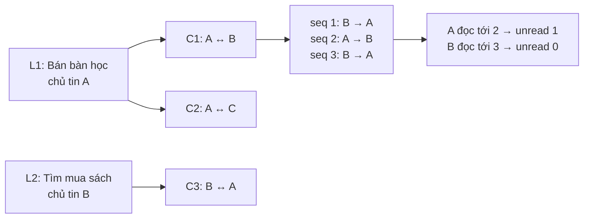


## 7. Ràng buộc toàn vẹn: đặt ở đâu?

**DB** bảo đảm hình dạng dữ liệu và các quan hệ ổn định. **Backend trong transaction** kiểm tra danh tính, trạng thái/quyền hiện tại và tuần tự hóa các request cạnh tranh. **Mobile** chỉ giúp UX; việc ẩn nút không thay phân quyền.

CHECK không dùng để truy vấn trạng thái hàng/bảng khác. Các quy tắc liên bảng dưới đây cần FK/UQ hoặc constraint trigger và transaction phù hợp; không viết một CHECK giả định có thể tự kiểm tra số ảnh/thành viên. Căn cứ kỹ thuật: [PostgreSQL — Constraints](https://www.postgresql.org/docs/current/ddl-constraints.html).

### 7.1. Ma trận ràng buộc

Các mã C01–C24 chỉ đánh số trong tài liệu này, không thay mã requirement R của wiki.

| Mã | Bất biến | Bảo đảm tại DB | Backend / transaction |
|---|---|---|---|
| C01 | Đúng tài khoản/chủ tin/admin | FK user; mã role hợp lệ | Danh tính từ phiên; không nhận owner/sender/admin do client tự khai, không cho tự nâng role |
| C02 | Verify tùy chọn | Không FK bắt buộc listing/chat vào verification | Không gate đăng/chat bằng verified_at |
| C03 | Email verify không bị trộn với tự khai | FK domain → school, user.declared_school_id riêng | Chỉ trả nhãn và phần trường phù hợp, không lộ email |
| C04 | OTP đúng chu kỳ, có hạn, giới hạn thử | CHECK count/time; UQ key và challenge chưa kết thúc | Khóa verification, kiểm tra version/email/MAC/time/quota; consume đúng một lần |
| C05 | Trường riêng theo loại tin | CHECK type/amount/condition/exchange_wants | Validate thông báo theo form; không yêu cầu ảnh/ngân sách với WANTED |
| C06 | SALE/EXCHANGE có ảnh hợp lệ | FK/unique ảnh; constraint trigger cuối transaction kiểm tra số ảnh/ownership/state | Publish và sửa bộ ảnh atomically; khóa listing và asset liên quan |
| C07 | Giá thiếu khác 0 | amount_vnd nullable; CHECK không âm khi có | Filter giá loại NULL; không gán default 0 |
| C08 | Retry publish không sinh tin thứ hai | UQ(owner_id, client_request_id), hash ban đầu bất biến | Cùng key/cùng payload trả id cũ; cùng key/khác payload báo conflict |
| C09 | Trạng thái chủ tin và admin độc lập | CHECK hai bộ mã, completed_at phù hợp | Chủ tin không đổi moderation_state; admin removal không xóa kết quả cũ |
| C10 | Không mất cập nhật | version > 0 | Update theo expected_version; nếu lệch thì reload/conflict, không ghi đè |
| C11 | Không tự chat, không giả chủ tin | CHECK khác user, FK ghép đúng owner | Kiểm tra hai tài khoản, listing OPEN/VISIBLE khi tạo mới |
| C12 | Một hội thoại/cặp người/tin | UQ(listing_id, initiator_id) | Lấy lại hội thoại, xử lý unique conflict khi concurrent |
| C13 | Đúng hai thành viên | PK participant + constraint trigger kiểm tra đúng tập owner/initiator | Tạo conversation + hai participant cùng transaction; không API thêm thành viên |
| C14 | Chỉ thành viên gửi, retry không trùng | FK(conversation_id, sender_id), UQ(sender_id, client_message_id) | Kiểm tra quyền gửi hiện tại; so payload hash, cấp seq dưới khóa conversation |
| C15 | Thứ tự và mốc đọc nhất quán | UQ(conversation_id, seq); CHECK seq/counter >= 0 | Counter/message cùng commit; last_read chỉ tăng và không vượt message được phép đọc |
| C16 | Chặn có hướng, tác động hai chiều | PK(blocker,blocked), CHECK không tự chặn | Kiểm tra cả hai hướng dưới cùng cơ chế khóa với gửi/chat mới/push |
| C17 | Một target/report | Hai FK nullable + CHECK XOR, FK context message | Reporter có quyền context; không tự mở quyền admin đọc chat |
| C18 | Report không tự phạt, một kết luận cuối | Partial UQ report_id trên action kết luận cuối | Khóa report; action + report status + effect cùng commit; đủ role/reason/target |
| C19 | Restriction có nguồn và phạm vi | FK action, UQ(action_id), CHECK ít nhất một deny/time | Đúng action/user; tính OR các restriction hiệu lực bằng giờ server |
| C20 | Session/subscription không trộn user | FK ghép(session,user,installation); partial UQ ACTIVE | Revoke/switch/tăng binding_version atomically; kiểm tra phiên hiện tại khi mở push |
| C21 | Lưu message trước yêu cầu push | FK job.message_id; UQ(message_id) | Insert message + outbox một transaction; chỉ worker đọc hàng đã commit |
| C22 | Không gửi mới trái quyền | UQ(job,installation); FK subscription đúng installation | Recheck block/restriction/session/binding/permission, tuần tự hóa dispatch với thay đổi quyền |
| C23 | Push không phải nguồn chat | Message tồn tại độc lập job/delivery | Provider lỗi vẫn inbox; payload chung; ticket không đồng nghĩa đã đọc/đã giao |
| C24 | Metrics không suy diễn giao dịch | Event source/name hợp lệ, event_id PK | Kết quả từ server; loại thử/spam; tách completed khỏi closed/withdrawn |

### 7.2. Ma trận dữ liệu theo loại tin

| Thuộc tính | SALE — Bán | WANTED — Tìm mua | EXCHANGE — Trao đổi |
|---|---|---|---|
| title / description / category / area | Bắt buộc | Bắt buộc | Bắt buộc |
| condition_text | Bắt buộc | NULL; nhu cầu nằm trong description | Bắt buộc |
| amount_vnd | Bắt buộc, >= 0 ở tầng schema | NULL hoặc >= 0 | NULL |
| exchange_wants | NULL | NULL | Bắt buộc |
| Ảnh READY của chủ tin | Ít nhất 1 | 0..N ảnh tham khảo | Ít nhất 1 |
| Nhãn khi COMPLETED | Đã bán | Đã tìm được | Đã trao đổi |

Precision và khả năng nhận giá **0 do người dùng khai báo** là lựa chọn kỹ thuật ở đây, chưa phải quyết định thêm chức năng tặng miễn phí. UI/validation giá tối thiểu và giới hạn ảnh/độ dài phải được chốt trước triển khai. Bất kể chọn giá tối thiểu nào, thiếu giá vẫn là NULL.

### 7.3. Fragment SQL minh họa các khóa quan trọng

Các đoạn sau minh họa ràng buộc khi triển khai các bảng đã mô tả; **không phải migration chạy độc lập**. Các cột liên quan cần đúng NOT NULL như từ điển dữ liệu, FK đích cần PK/UQ tương ứng.

```sql
-- Retry publish và định danh conversation.
ALTER TABLE listings
  ADD CONSTRAINT uq_listing_create UNIQUE (owner_id, client_request_id),
  ADD CONSTRAINT uq_listing_owner UNIQUE (id, owner_id);

ALTER TABLE conversations
  ADD CONSTRAINT ck_conversation_not_self CHECK (owner_id <> initiator_id),
  ADD CONSTRAINT uq_conversation_contact UNIQUE (listing_id, initiator_id),
  ADD CONSTRAINT fk_conversation_listing_owner
    FOREIGN KEY (listing_id, owner_id) REFERENCES listings (id, owner_id);

-- Sender phải là thành viên đúng conversation, không chỉ là user tồn tại.
ALTER TABLE messages
  ADD CONSTRAINT fk_message_sender
    FOREIGN KEY (conversation_id, sender_id)
    REFERENCES conversation_participants (conversation_id, user_id),
  ADD CONSTRAINT uq_message_retry UNIQUE (sender_id, client_message_id),
  ADD CONSTRAINT uq_message_seq UNIQUE (conversation_id, seq),
  ADD CONSTRAINT uq_message_context UNIQUE (conversation_id, id);

-- Mỗi report chỉ có một target; không có target_type + target_id mồ côi.
ALTER TABLE reports
  ADD CONSTRAINT ck_report_one_target CHECK (
    (target_listing_id IS NOT NULL) <> (target_user_id IS NOT NULL)
  ),
  ADD CONSTRAINT ck_report_message_has_context CHECK (
    context_message_id IS NULL OR context_conversation_id IS NOT NULL
  ),
  ADD CONSTRAINT fk_report_message_context
    FOREIGN KEY (context_conversation_id, context_message_id)
    REFERENCES messages (conversation_id, id);

-- Tối đa một kết luận cuối, nhiều ghi nhận chưa đủ căn cứ vẫn được lưu.
CREATE UNIQUE INDEX uq_report_final_action
  ON moderation_actions (report_id)
  WHERE decision IN ('NO_VIOLATION', 'REMOVE_LISTING', 'RESTRICT_ACCOUNT');

-- Tối đa một phiên chưa thu hồi/installation, một push binding ACTIVE.
CREATE UNIQUE INDEX uq_session_unrevoked_installation
  ON auth_sessions (installation_id) WHERE revoked_at IS NULL;

CREATE UNIQUE INDEX uq_push_active_installation
  ON push_subscriptions (installation_id) WHERE state = 'ACTIVE';

CREATE UNIQUE INDEX uq_push_active_token
  ON push_subscriptions (provider, token_digest) WHERE state = 'ACTIVE';

CREATE UNIQUE INDEX uq_otp_unfinished_user
  ON school_email_otps (user_id)
  WHERE consumed_at IS NULL AND invalidated_at IS NULL;
```

Các unique có điều kiện dùng predicate trạng thái rõ ràng, như [PostgreSQL — Partial Indexes](https://www.postgresql.org/docs/current/indexes-partial.html). Hết expires_at không tự đổi revoked_at/invalidated_at: login/resend phải xử lý hàng cũ trước khi tạo hàng mới, kể cả nó đã hết hạn.

**Các trigger/transaction còn phải viết khi làm migration:** tối thiểu ảnh hợp lệ theo loại tin; đúng hai participant; state history phù hợp; action/effect/target nhất quán; recipient push đúng người còn lại; mốc đọc không vượt counter. Không thể coi các fragment trên đã đủ cưỡng chế toàn bộ schema.

### 7.4. Khóa và xử lý cạnh tranh

Đề xuất MVP dùng chung thứ tự khóa cho các thao tác ghi liên quan: **users theo UUID tăng dần → installations → listings → conversations → các hàng con/report/job liên quan**. Cần thống nhất trong code và kiểm thử, không để một handler khóa theo thứ tự ngược.

- Tạo chat khóa listing trước khi kiểm tra OPEN/VISIBLE. Đóng/gỡ tin cũng khóa listing nên không có chat được tạo mới sau khi thao tác kết thúc đã có hiệu lực.
- Gửi message khóa các user liên quan và conversation; insert block/thêm restriction cũng đi qua gate các user này. Nhờ đó “không có block” không chỉ là một query đọc rồi bỏ mặc một insert block đồng thời.
- Publish khóa/xác minh asset và quyền chủ tin, chèn ảnh/lịch sử cùng transaction. Sửa/xóa mapping ảnh cũng phải đi qua cùng bảo vệ để không còn tin thiếu ảnh sau commit.
- Counter cấp seq dưới khóa conversation; transaction lỗi rollback cả counter, message và outbox.
- OTP khóa hàng verification; hai request xác thực cùng mã không được cùng consume/cấp nhãn.
- Xử lý report khóa report và các target cần tác động; hai admin cùng xử lý chỉ một kết luận cuối commit được.
- Worker claim job/delivery bằng cơ chế lease + khóa phù hợp, retry dùng cùng hàng; lease không thay UQ chống trùng.

Row lock và advisory lock là các lựa chọn cần triển khai nhất quán; xem [PostgreSQL — Explicit Locking](https://www.postgresql.org/docs/current/explicit-locking.html). Đây là thiết kế đồng bộ cần kiểm chứng với code thực tế, không phải bảo đảm đạt được chỉ nhờ có FK.

## 8. Visualization: trạng thái tin và quyền tương tác

### 8.1. Vòng đời do chủ tin quản lý

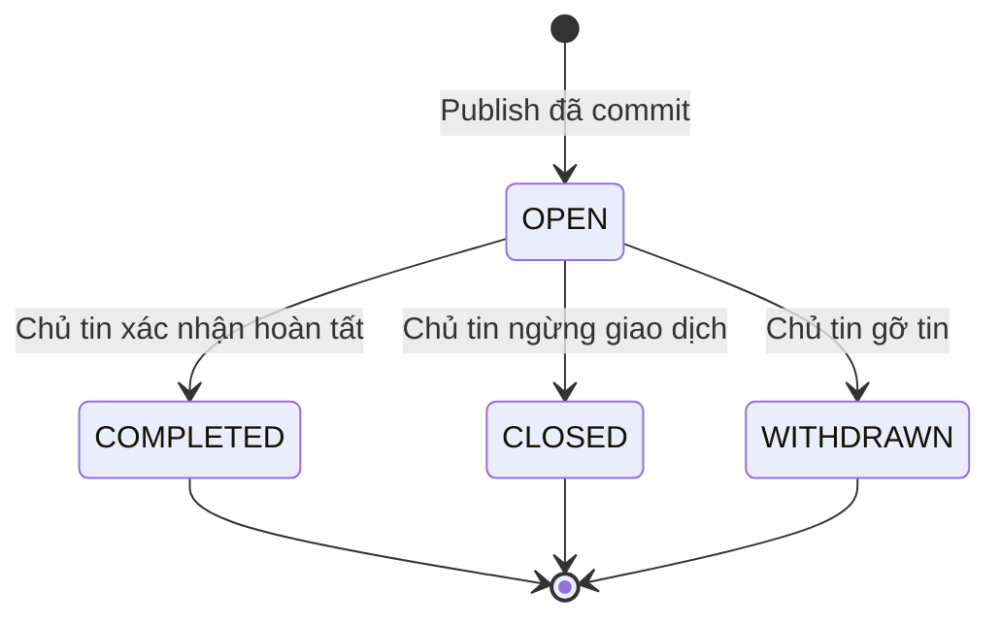

SALE + COMPLETED → Đã bán; WANTED + COMPLETED → Đã tìm được; EXCHANGE + COMPLETED → Đã trao đổi.

Đây là các chuyển trạng thái tối thiểu trong phương án này. Wiki chưa chốt mở lại tin; schema không tự cung cấp API reopen hoặc đổi type sau publish. Giao dịch ngoài app không phải một state được server xác minh.

### 8.2. Lớp quản trị độc lập

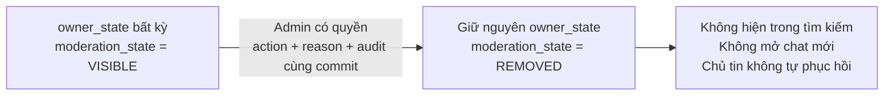

Admin gỡ tin không đổi COMPLETED thành CLOSED và không xóa hội thoại/lịch sử. Chính sách quyền đọc/gửi sau gỡ được kiểm tra riêng.

### 8.3. Ma trận quyền tại thời điểm thao tác

Mọi ô “Có” đều còn cần session hợp lệ và đúng owner/participant/role; chưa verify trường không làm thay đổi kết quả.

| Tình huống | Tạo chat mới | Xem lịch sử chat đã có | Gửi trong chat đã có | Phát push mới |
|---|---|---|---|---|
| Tin OPEN/VISIBLE; hai tài khoản đủ quyền | Có, nếu không tự chat | Có với participant | Có | Có khi recipient/device/permission đủ điều kiện |
| Chủ tin COMPLETED hoặc CLOSED, tin VISIBLE | Không | Có | Có nếu không bị chặn/hạn chế | Theo message mới hợp lệ |
| Chủ tin WITHDRAWN | Không | Theo quyền hiện tại; đề xuất giữ đọc | Đề xuất không; wiki chưa chốt chi tiết sau chủ tin gỡ | Không nếu không được gửi |
| Tin bị admin REMOVED | Không | Theo quyền hiện tại; đề xuất giữ đọc nếu không deny_history_read | Đề xuất không | Không |
| Có block ở một trong hai hướng | Không | Có theo quyền xem, không tự xóa lịch sử | Không | Không |
| Restriction có deny_new_contact | Không | Không tự ảnh hưởng quyền xem | Theo deny_send/quyền khác | Theo quyền gửi/đọc hiện tại |
| Restriction có deny_send | Không khởi tạo tương tác mới | Có nếu không deny_history_read | Không phát sinh tương tác mới với tài khoản bị hạn chế gửi | Không phát sinh push từ tương tác bị cấm |
| User có deny_history_read | Không mở context mới khi không được đọc context đó | Không | Không trong context không được đọc | Không gửi push tới người không còn quyền xem context |
| Từ chối quyền thông báo | Theo quyền nghiệp vụ | Có | Có | Không; inbox/unread vẫn hoạt động |
| Hết phiên / logout / đổi tài khoản | Phải xác thực đúng tài khoản lại | Không hiển thị dữ liệu của phiên trước | Không dùng danh tính phiên trước | Binding cũ bị thu hồi; tap thông báo kiểm tra lại |

Quyền **tạo mới** và **gửi tiếp trong hội thoại cũ** là hai phép kiểm tra khác nhau. Không viết `listing.owner_state = OPEN` thành điều kiện bắt buộc của mọi send, vì sẽ làm sai US07 sau chủ tin hoàn tất/đóng tin.


## 9. Visualization: dữ liệu thay đổi theo từng user flow

### 9.1. UF02a — Publish và retry không trùng

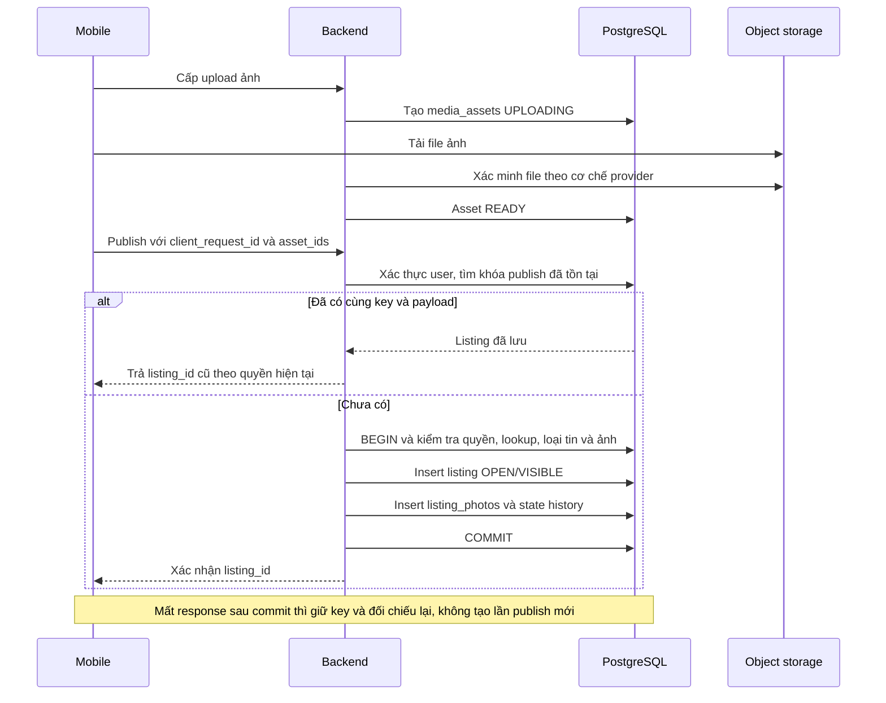

Nếu cùng key nhưng payload khác, trả conflict để client đối chiếu, không sửa listing theo payload mới. `create_payload_hash` giữ nguyên payload ban đầu kể cả listing sau đó đã được sửa.

### 9.2. UF01b + UF04 — Gửi message, commit và push

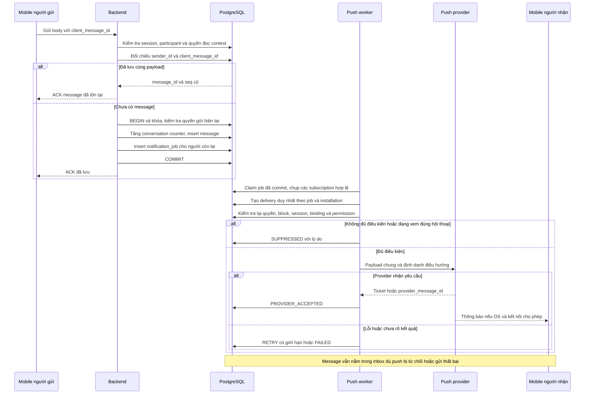

Đối chiếu message cũ vẫn phải có quyền đọc; “ACK lại message đã lưu” không tạo tin mới sau khi bị chặn. Nếu chưa có hàng cũ thì phải kiểm tra quyền gửi hiện tại đầy đủ. Một client không thể dùng key của user khác để lấy dữ liệu.

### 9.3. UF04 — Đổi tài khoản và mở thông báo cũ

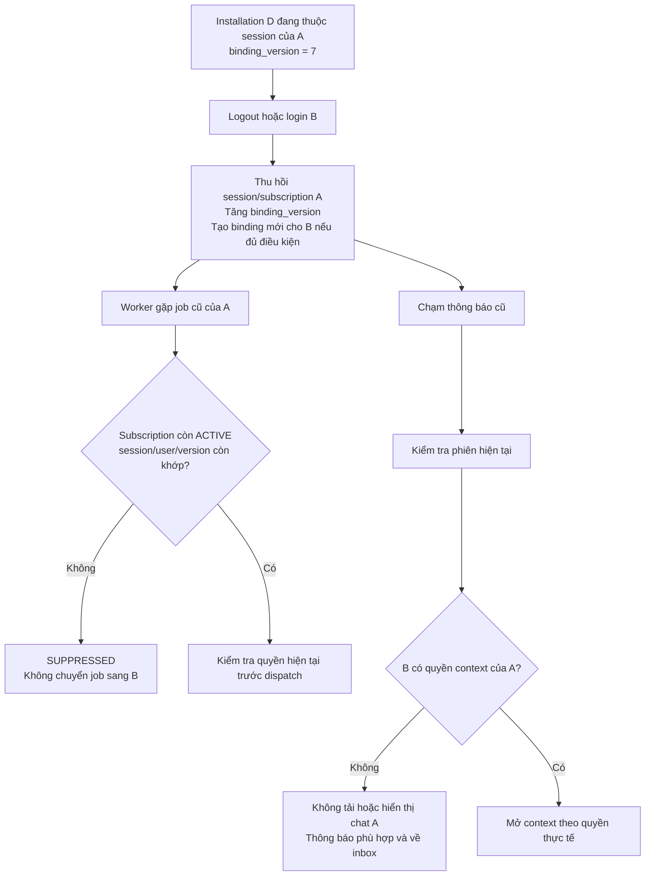

Dispatch push và logout/switch/block/restriction cần cùng cơ chế gate tuần tự hóa theo user/installation để không phát yêu cầu mới từ binding đã thu hồi. Nếu provider đã nhận một push trước lúc thu hồi, nền tảng không thể bảo đảm rút nó khỏi OS: payload phải chung và tap luôn xác thực lại. Không giữ một transaction DB không giới hạn trong khi chờ mạng; triển khai gate/timeout và kiểm tra race trong TASK-17/TASK-24.

### 9.4. UF03 và UF05 — Các transaction nguyên tử còn lại

| Flow | Những thay đổi phải cùng commit | Điều không được suy diễn |
|---|---|---|
| UF03 — yêu cầu OTP | Khóa verification; kiểm tra quota/cooldown; invalidate mã trước; insert challenge mới với email_version; cập nhật next_send_allowed_at | API tiếp nhận không có nghĩa email đã tới inbox |
| UF03 — xác thực OTP | Kiểm tra email/version/quyền/miền/MAC/expiry/attempt; consume challenge và đặt verified_at | Có nhãn không chứng minh người hiện là sinh viên hoặc đáng tin cậy |
| UF03 — đổi email | Tăng email_version, verified_at=NULL, đổi email/domain, invalidate mã cũ | OTP địa chỉ trước không cấp nhãn cho địa chỉ mới |
| UF05a — report | Insert report và snapshot được phép, theo client_request_id | Không tự tạo moderation_action/hình phạt |
| UF05a — block | Upsert quan hệ blocker/blocked dưới gate tương tác | Không tự xóa chat hoặc report thay người dùng |
| UF05b — chưa đủ căn cứ | Append action INSUFFICIENT_EVIDENCE; report còn PENDING | Không tự coi report là vi phạm |
| UF05b — gỡ tin | Final action, report RESOLVED, listing.moderation_state=REMOVED và state change nếu có thay đổi thật | Không xóa completed_at hoặc messages |
| UF05b — hạn chế tài khoản | Final action, report RESOLVED, tạo restriction đúng user và phạm vi | Không tự cấp quyền đọc mọi chat cho admin |

### 9.5. Trạng thái tạm `ConversationPresence`

Để tránh thông báo trùng khi người nhận đang xem đúng chat, có thể giữ một trạng thái tạm gồm `session_id`, `installation_id`, `user_id`, `conversation_id`, `last_heartbeat_at`, `expires_at`.

Không bắt buộc tạo bảng PostgreSQL hoặc chọn Redis. Presence chỉ là gợi ý cập nhật UI/suppression có thời hạn, không cấp quyền. Server chỉ chấp nhận heartbeat cho phiên và conversation hợp lệ; hết hạn coi như không còn đang xem. TTL cần cấu hình và nghiệm thu trên thiết bị; presence mất đồng bộ không được làm mất message trong inbox.

## 10. Index, truy vấn và chính sách lưu giữ

### 10.1. Index cần thiết theo đường đọc

Các PK/UQ đã nêu là ràng buộc bắt buộc của phương án. Index truy vấn sau là khởi điểm, cần đo bằng dữ liệu thực tế trước khi thêm mọi tổ hợp filter.

| Truy vấn | Index đề xuất |
|---|---|
| Danh sách tin mở, mới nhất | listings(published_at DESC, id DESC), partial owner_state=OPEN AND moderation_state=VISIBLE |
| Lọc khu vực/danh mục/loại | Partial listings(area_id, category_id, type, published_at DESC, id DESC) theo workload thực tế |
| Giá/ngân sách | Partial listings(amount_vnd, id) với tin OPEN/VISIBLE và amount_vnd IS NOT NULL |
| Tin của tôi | listings(owner_id, updated_at DESC, id DESC) |
| Tìm từ khóa | GIN trên biểu diễn tìm kiếm title/description nếu chọn PostgreSQL full-text; cấu hình tiếng Việt/không dấu cần thử và chốt riêng |
| Ảnh theo tin | UQ(listing_id, position) đã đáp ứng lấy ảnh theo thứ tự |
| Inbox user | conversation_participants(user_id, conversation_id), kết hợp conversation.last_message_at và id |
| Lịch sử chat / unread | UQ messages(conversation_id, seq) và PK participant |
| Chặn hai chiều | PK(blocker_id, blocked_id) đủ cho hai probe có đủ hai khóa; index đảo nếu cần liệt kê ai chặn user |
| OTP theo cửa sổ hạn mức | school_email_otps(user_id, requested_at DESC), thêm partial challenge chưa kết thúc |
| Report chờ | reports(status, created_at, id) |
| Action/restriction theo đối tượng | moderation_actions(report_id, created_at), account_restrictions(user_id, starts_at) |
| Subscription hiện hành | Partial UQ installation và token; thêm push_subscriptions(user_id, state) cho fan-out |
| Worker outbox | notification_jobs(state, available_at, id); push_deliveries(state, next_attempt_at, id); hỗ trợ reclaim lease theo workload |
| Event pilot | analytics_events(event_name, received_at), analytics_events(listing_id, received_at) khi có nhu cầu đối chiếu |

Không tạo partial index với điều kiện “còn hiệu lực theo giờ hiện tại” để thay việc kiểm tra hạn; trạng thái hết hạn cần xét tại query/worker.

### 10.2. Lọc giá phải giữ đúng ý nghĩa NULL

```sql
-- Nhánh có bật khoảng giá và đã chuẩn hóa hai cận trong API.
SELECT id, title, type, amount_vnd, area_id
FROM listings
WHERE owner_state = 'OPEN'
  AND moderation_state = 'VISIBLE'
  AND amount_vnd IS NOT NULL
  AND amount_vnd BETWEEN :min_vnd AND :max_vnd
ORDER BY published_at DESC, id DESC;
```

Khi chỉ có một cận, API tạo điều kiện >= hoặc <= tương ứng. Khi không lọc giá, bỏ toàn bộ điều kiện giá để WANTED chưa có ngân sách và EXCHANGE vẫn có thể xuất hiện. Không dùng `COALESCE(amount_vnd, 0)` để lọc hoặc hiển thị.

### 10.3. Xóa và dữ liệu lịch sử

| Nhóm dữ liệu | Chính sách đề xuất cho MVP |
|---|---|
| users, listings, conversations, messages, reports, actions | FK RESTRICT/NO ACTION cho quan hệ nghiệp vụ; không hard-delete xuyên chuỗi trong luồng gỡ tin/chặn |
| Lookup school/domain/area/category | Tắt is_active để ngừng chọn mới; không xóa giá trị đang được tham chiếu |
| Listing bị chủ gỡ/admin gỡ | Cập nhật owner_state/moderation_state và audit; giữ context chat và căn cứ xử lý theo quyền |
| Credential/session/subscription/OTP | Không công khai; revoke/consume/invalidate thay vì coi xóa hàng là logout; lịch dọn phải giữ toàn vẹn tham chiếu |
| Media | Chỉ dọn object không còn được sử dụng; gỡ tin không mặc định xóa ảnh ngay |
| Analytics | Có thể SET NULL FK tùy retention được duyệt, giữ số liệu phi định danh; không giữ nội dung riêng trong properties |
| Local draft/photo/message | Phân vùng hoặc xóa an toàn khi logout/switch theo thiết kế mobile; xóa draft có thể cascade các ảnh local của draft |
| Pilot journal/evidence snapshot | Quyền nghiên cứu/admin riêng, đồng ý phù hợp và lịch lưu giữ được chốt trước pilot |

Chưa có luồng xóa tài khoản hoặc thời hạn retention chính thức trong wiki. Không tự đặt số ngày hoặc tuyên bố schema đã đáp ứng một chính sách pháp lý chưa được xác định. Các FK nullable không mặc định có ON DELETE SET NULL; chỉ analytics nêu lựa chọn này.

## 11. Mapping User Story / User Flow → bảng → ràng buộc

| R / US | Nhu cầu hoặc use case | User Flow | Entity/bảng tham gia | Ràng buộc trọng tâm | TASK |
|---|---|---|---|---|---|
| R01 / US01 | Tạo/truy cập tài khoản và dữ liệu cá nhân | UF01b, UF02a, UF03, UF04, UF05 | users, user_credentials, installations, auth_sessions; owner/participant ở bảng nghiệp vụ | C01, C20; logout/đổi tài khoản không lộ dữ liệu | TASK-16 |
| R02 / US02 | Đăng món đồ cần bán | UF02a | listings, listing_photos, media_assets, categories, areas, listing_state_changes | C05–C08; SALE cần giá, tình trạng và ít nhất 1 ảnh | TASK-03, TASK-04 |
| R03 / US03 | Đăng tìm mua | UF01a → UF02a, UF02b | listings dùng type WANTED; ảnh tùy chọn, lookups và state history | C05, C07–C09; ngân sách/ảnh không bắt buộc | TASK-03, TASK-04, TASK-07 |
| R04 / US04 | Đăng trao đổi | UF02a, UF02b | listings dùng type EXCHANGE, listing_photos, media_assets | C05–C09; có món đang có/món muốn đổi, không có đơn/ghép tự động | TASK-03, TASK-04, TASK-07 |
| R05 / US05 | Duyệt/tìm/lọc | UF01a | listings, categories, areas, listing_photos/media_assets | C07, C09; chỉ OPEN/VISIBLE, NULL không phải 0, lỗi tải khác rỗng | TASK-05, TASK-15 |
| R06 / US06 | Xem tin và hồ sơ đúng trạng thái | UF01a, UF01b | listings, users, media_assets, school_email_verifications, school_email_domains, schools | C01, C03, C09; riêng tư email/địa chỉ, nhãn verify đúng giới hạn | TASK-06, TASK-07 |
| R07 / US07 | Liên hệ và trao đổi theo tin | UF01b, UF02b, UF04 | conversations, conversation_participants, messages, user_blocks, account_restrictions; PendingMessage local | C11–C16, C19; một cặp/tin, không tự chat, retry không trùng, quyền hiện tại | TASK-06, TASK-21; phối hợp TASK-23 |
| R08 / US08 | Sửa/gỡ/đóng/hoàn tất tin | UF02b | listings, listing_state_changes; moderation_actions khi admin tác động | C01, C09–C10; hoàn tất khác đóng/gỡ, không tự phục hồi admin removal | TASK-04, TASK-07 |
| R09 / US09 | Verify email trường tùy chọn | UF03 | schools, school_email_domains, school_email_verifications, school_email_otps | C02–C04; email_version, expiry/attempt/cooldown, đổi email thu hồi nhãn | TASK-15, TASK-17, TASK-18 |
| R10 / US10 | Báo cáo và chặn | UF05a | reports, user_blocks; optional context từ conversations/messages | C16–C17; report và block độc lập, không tự phạt/xóa lịch sử | TASK-22 |
| R11 / US11 | Admin xem xét/xử lý báo cáo | UF05b | reports, moderation_actions, account_restrictions, listings, listing_state_changes | C18–C19; audit, đúng target, effects nhất quán, giới hạn dữ liệu được xem | TASK-22 |
| R12 / US12 | Tiếp tục nội dung khi gián đoạn | UF02a | LocalListingDraft, LocalDraftPhoto; media_assets, listings và khóa publish khi gửi server | C06, C08, C20; local draft không phải tin đã đăng, không đồng bộ nháp đa thiết bị | TASK-23, TASK-04 |
| R13 / US13 | Nhận biết và tiếp tục hội thoại | UF04 | installations, auth_sessions, push_subscriptions, notification_jobs, push_deliveries, messages/participants; presence tạm | C20–C23; lưu trước push, payload chung, reauth tap cũ, denied push vẫn inbox | TASK-17, TASK-19, TASK-20, TASK-21 |

| Công việc hỗ trợ | Dữ liệu/đầu ra liên quan | Giới hạn |
|---|---|---|
| TASK-15 | schools, school_email_domains, areas và danh sách được chốt | Không bịa trường, miền hoặc khu vực thực tế |
| TASK-17 | OTP/push/session/device và kết quả spike trên thiết bị thật | Mock/simulator không thay bằng chứng push trên thiết bị thật |
| TASK-25 | analytics_events, PilotJournalEntry và định nghĩa chỉ số | Không suy giao dịch từ message/đóng/gỡ |
| TASK-24 | Kiểm tra tất cả R01–R13 và mọi nhánh UF | Phải có code/bản cài và kết quả thực tế mới gọi nghiệm thu |
| TASK-08 / TASK-09 | Nguồn người/tin thật, nhật ký và quyết định sau pilot | Nghiên cứu không phải tính năng mở rộng marketplace |

## 12. Các quyết định còn cần chốt khi triển khai

Schema này đã chọn một phương án để mô tả đủ quan hệ/ràng buộc, nhưng không tự thay quyền quyết định các nội dung chưa có trong wiki:

| Nội dung | Phương án hiện mô tả | Cần xác nhận |
|---|---|---|
| Đăng nhập | Credential email/mật khẩu tách khỏi verify trường | Local auth hay provider ngoài; thuật toán hash/token và chính sách phiên |
| Loại/tiền | Một listings, amount VND không có phần lẻ, NULL cho chưa khai báo | Giá 0 có hợp lệ không, giới hạn giá/nội dung/ảnh |
| Trạng thái tin | owner_state độc lập moderation_state; terminal sau OPEN | Có reopen hay đổi loại sau đăng không |
| Hạn chế quyền | Các deny cụ thể; giữ lịch sử nếu không có cấm rõ ràng | Phạm vi restriction, quyền sau chủ gỡ/admin gỡ, quy trình thu hồi/quyết định lại |
| Email trường | Một địa chỉ hiện tại/user, OTP có version | Danh sách miền, uniqueness email giữa user, TTL/cooldown/quota và retention |
| Ảnh và push | Metadata ảnh + PostgreSQL outbox + delivery theo installation | Nhà cung cấp, giới hạn upload, retry/timeout và gate dispatch |
| Nền tảng và tìm kiếm | Mobile RN/Expo; PostgreSQL tìm cơ bản | OS nghiệm thu, router/ORM, tìm tiếng Việt/không dấu |
| Nghiên cứu | Sự kiện tối thiểu + nhật ký riêng | Định nghĩa liên hệ hữu ích, quy tắc loại thử/spam, consent và retention |

Các thay đổi quyết định được đồng bộ sang wiki và schema; không “đánh dấu đã triển khai” chỉ vì bảng xuất hiện trong tài liệu.

## 13. Checklist nghiệm thu schema khi có mã

- [ ] Mọi entity server có PK/FK/NOT NULL/UQ/CHECK đúng từ điển; không có FK đa hình không được cưỡng chế.
- [ ] Tạo đủ ba loại tin, thiếu ảnh SALE/EXCHANGE bị từ chối ở commit; WANTED không có ảnh/ngân sách vẫn hợp lệ.
- [ ] Bộ lọc giá loại NULL, bỏ lọc thấy lại tin phù hợp; chỉ OPEN/VISIBLE có trong tìm kiếm đang mở.
- [ ] Retry sau commit/mất response không tạo thêm listing/message/action; key trùng payload khác bị conflict.
- [ ] Hai request cùng mở chat chỉ tạo một conversation và đúng hai participant; sender giả/outsider bị từ chối.
- [ ] Tin COMPLETED/CLOSED không tạo chat mới nhưng chat cũ còn quyền vẫn gửi; WITHDRAWN/REMOVED theo chính sách được chốt.
- [ ] Race giữa đóng/gỡ/chặn/hạn chế và create/send/push cho kết quả theo thứ tự hiệu lực, không dựa vào nút đã ẩn.
- [ ] OTP sai/hết hạn/vượt lượt/khác email_version không cấp nhãn; cùng mã không consume hai lần; chưa verify vẫn đăng/chat.
- [ ] Message + outbox cùng commit; provider lỗi không mất message; push đến đúng người/device và không chứa body.
- [ ] Logout/switch thu hồi binding; notification cũ không lộ chat của tài khoản trước; từ chối permission vẫn có inbox/unread.
- [ ] Report không tự tạo hình phạt; action có admin/reason/time, đúng target và hiệu lực nhất quán; audit không bị sửa/xóa qua API.
- [ ] Nháp/pending message được phân vùng theo account và giữ nội dung lỗi; không biến local state thành hàng listing đã publish.
- [ ] Metrics tách completed tự báo cáo với closed/withdrawn và loại dữ liệu thử/spam; không log nội dung riêng.
- [ ] Kiểm thử schema/transaction trên PostgreSQL thật và các ca OTP/push trên thiết bị thật theo TASK-17/TASK-24.

**Đọc visualization:** các sơ đồ dùng Mermaid, có thể xem trong Markdown preview hỗ trợ Mermaid. Ký hiệu ERD theo [Mermaid — Entity Relationship Diagrams](https://mermaid.js.org/syntax/entityRelationshipDiagram.html). Tài liệu này mô tả thiết kế; checklist chưa được đánh dấu đạt vì repository hiện chưa có mã ứng dụng hoặc migration.


