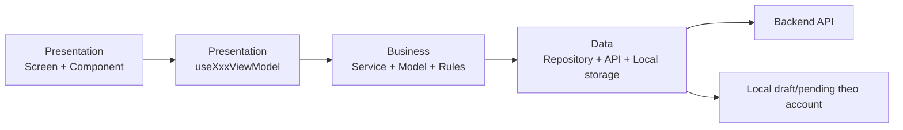
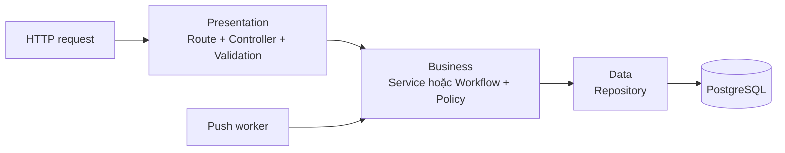

# StudentMart — Solution Tree cho đồ án môn học

**Ngày cập nhật:** 02/11/2026. **Đã chọn:** Three-Layer; mobile dùng MVVM nhẹ, backend dùng Controller → Service → Repository. **Đã tạo:** khung thư mục thật trong `mobile/` và `backend/`; chưa khởi tạo ứng dụng chạy được.

## 1. Kiến trúc nên dùng

StudentMart là đồ án phát triển ứng dụng di động, cần hoàn thành luồng nghiệp vụ, dễ phân công, kiểm thử và giải thích khi bảo vệ. Phương án cho dự án:

| Cấp độ | Lựa chọn | Cách áp dụng |
|---|---|---|
| Phân tầng | **Three-Layer Architecture** | Presentation → Business → Data trong từng feature/module |
| Mobile | **MVVM nhẹ theo cách viết React** | Screen/Component là View; custom hook là ViewModel; business model/service/rules và repository cung cấp dữ liệu |
| Backend | **Three-Layer, Controller → Service → Repository** | Controller xử lý HTTP, Service xử lý nghiệp vụ, Repository đọc/ghi PostgreSQL |
| Chia chức năng | Feature-first / module-first | Mỗi feature có ba tầng; các bạn có thể làm những feature khác nhau |
| Triển khai | Một backend chia module | API và công việc push dùng chung nghiệp vụ và DB; chưa cần microservices |

**Three-Layer và MVVM không loại trừ nhau:** Three-Layer chia trách nhiệm toàn ứng dụng; MVVM tổ chức phần UI và trạng thái màn hình. Không coi mobile/BE/PostgreSQL là ba thư mục tầng tương ứng duy nhất: mobile vẫn có business/data cho client, backend vẫn có presentation/business/data của server.

Các tầng là ranh giới logic, không bắt buộc là các process/máy chủ riêng. Tham khảo [Microsoft — N-tier architecture](https://learn.microsoft.com/en-us/azure/architecture/guide/architecture-styles/n-tier).

### 1.1. Đối chiếu các kiến trúc bạn gửi

| Mẫu | Đánh giá cho StudentMart | Quyết định |
|---|---|---|
| Three-Layer | Có ranh giới rõ, thể hiện được kiến thức môn học; chi phí tổ chức vừa phải | Chọn làm khung chung |
| MVC | Controller phù hợp biên HTTP của backend; nếu dồn state và xử lý vào screen mobile sẽ khó kiểm soát | Dùng controller ở BE, không chọn làm cách tổ chức UI mobile |
| MVP — Model/View/Presenter | Có thể kiểm thử Presenter nhưng phải quản lý contract/callback giữa View và Presenter | Không cần thêm tầng Presenter cho app React Native này |
| MVVM | Tách state/action khỏi JSX; có thể biểu diễn bằng custom hook và service | Chọn phiên bản nhẹ cho mobile |
| VIPER | Thêm nhiều vai trò/file cho từng màn hình; không phù hợp chi phí của đồ án hiện tại | Không dùng |
| MVI | Luồng action → state → render hữu ích cho chat/form | Dùng cách quản lý state rõ ràng, không dựng thêm framework Intent/Reducer/Effect bắt buộc cho mọi màn hình |
| Clean Architecture | Hữu ích khi cần domain độc lập nghiêm ngặt và nhiều adapter; sẽ tăng interface/use case/mapper | Chưa áp dụng đầy đủ; chỉ tách thêm abstraction khi có nhu cầu cụ thể |

Đây là đánh giá cho phạm vi, thời gian và công nghệ StudentMart, không phải bảng xếp hạng chung rằng mẫu nào luôn tốt hơn.

### 1.2. MVVM trong React Native nghĩa là gì?

- **View:** `ListingsScreen.tsx` chỉ render state và gửi thao tác cho ViewModel.
- **ViewModel:** `useListingsViewModel.ts` giữ loading/error/filter/data và các action; gọi business service, không giữ tham chiếu Screen hoặc trực tiếp viết JSX.
- **Model:** dữ liệu và hành vi do business model/service/rules cùng data repository cung cấp; không bắt tạo một class Model bao trùm tất cả.
- Hook là cách triển khai do dự án chọn, không phải React Native có sẵn một class ViewModel giống Android. Hook không tự giữ state qua app bị kill; bản nháp vẫn cần persistence.
- Tách logic UI bằng custom hook phù hợp khả năng React cung cấp. Xem [React — Custom Hooks](https://react.dev/learn/reusing-logic-with-custom-hooks).
- Một state gửi tin có thể là `sending | unconfirmed | failed | acknowledged`, tránh boolean mâu thuẫn; immutable state không tự giải quyết response cũ hay race. Vẫn phải đối chiếu request/seq và quyền hiện tại. Xem [React — State Structure](https://react.dev/learn/choosing-the-state-structure).

## 2. Phạm vi đã tạo và nguồn tài liệu

Đã tạo các thư mục được liệt kê trong cây mobile/backend dưới đây, cùng README của hai phần. File `.gitkeep` trong thư mục lá giữ khung khi đưa vào Git; bỏ file đó khi thư mục có mã thật.

**Các tên .ts/.tsx ở mục mẫu feature/module là vị trí viết code tiếp theo, chưa phải file đã triển khai.** Nền tảng Expo mobile và NestJS backend đã có manifest, entrypoint và cấu hình chạy. Hai app dùng pnpm workspace với một `pnpm-lock.yaml` ở root; chưa có ORM hoặc migration chạy được.

Nguồn: [schema](schema.md), [README sản phẩm](../README.md), [hướng dẫn agent](../stephen-skills/AGENTS.md), [User Stories](../StudentMart.wiki/User-Stories.md), [User Flows](../StudentMart.wiki/Critical-User-Flows.md), [Traceability](../StudentMart.wiki/Traceability.md) và [Project Plan](../StudentMart.wiki/Project-Plan.md). Lựa chọn mẫu kiến trúc đối chiếu nội dung so sánh MVC/MVP/MVVM/VIPER/MVI/Clean người dùng cung cấp trong phiên làm việc.

```text
StudentMart/
├── mobile/                         # Đã có khung: React Native + Expo
├── backend/                        # Đã có khung: Node.js + PostgreSQL
├── docs/
│   ├── schema.md                   # 25 bảng, ERD, relationship và constraint
│   └── solution_tree.md            # Quyết định kiến trúc và bản đồ thư mục này
├── StudentMart.wiki/               # Yêu cầu, nghiên cứu và quyết định sản phẩm
├── stephen-skills/                 # Skill/agent; không chứa source ứng dụng
└── README.md
```

Runtime, framework BE, ORM/migration, router, state/form library, provider ảnh/email/push và test runner còn cần chốt. Kiến trúc ba tầng không phụ thuộc vào việc chọn một thư viện cụ thể.

## 3. Mobile — Feature-first + Three-Layer + MVVM nhẹ

### 3.1. Cây thư mục thật

```text
mobile/
├── README.md
├── assets/
├── src/
│   ├── bootstrap/                  # Ghép dependency/provider; business không import ngược
│   ├── navigation/                 # Điều hướng và mở app theo route; kiểm quyền ở server
│   ├── features/
│   │   ├── auth/
│   │   │   ├── presentation/
│   │   │   ├── business/
│   │   │   └── data/
│   │   ├── listings/
│   │   │   ├── presentation/
│   │   │   ├── business/
│   │   │   └── data/
│   │   ├── chat/
│   │   │   ├── presentation/
│   │   │   ├── business/
│   │   │   └── data/
│   │   ├── notifications/
│   │   │   ├── presentation/
│   │   │   ├── business/
│   │   │   └── data/
│   │   ├── profile/
│   │   │   ├── presentation/
│   │   │   ├── business/
│   │   │   └── data/
│   │   └── moderation/
│   │       ├── presentation/
│   │       ├── business/
│   │       └── data/
│   ├── business/
│   │   └── workflows/              # Logout/switch, mở thông báo: phối hợp nhiều feature
│   └── shared/
│       ├── presentation/
│       │   ├── components/         # Loading, Empty, Error, Confirm; UI dùng lại
│       │   └── theme/              # Màu, typography, spacing
│       ├── data/
│       │   ├── http/               # API client, session transport, lỗi mạng
│       │   ├── storage/            # Adapter storage bảo mật và local account namespace
│       │   ├── media/              # Upload ảnh dùng cho tin/avatar
│       │   └── catalog/            # API lookup trường/khu vực/danh mục
│       └── config/
└── tests/
    ├── unit/
    └── integration/
```

### 3.2. Mẫu file sẽ viết cho feature listings

```text
mobile/src/features/listings/
├── presentation/
│   ├── ListingsScreen.tsx
│   ├── ListingDetailScreen.tsx
│   ├── ListingEditorScreen.tsx
│   ├── MyListingsScreen.tsx
│   ├── ListingDraftsScreen.tsx
│   ├── ListingCard.tsx
│   ├── ListingFilters.tsx
│   ├── useListingsViewModel.ts
│   └── useListingEditorViewModel.ts
├── business/
│   ├── listing.model.ts            # Listing client, type, state; không sao toàn bộ DB entity
│   ├── listing.rules.ts            # Form ba loại và ánh xạ trạng thái cho client
│   ├── listing.service.ts          # Tìm/lấy/đăng/sửa/kết thúc và điều phối nháp/retry
│   └── draft.model.ts              # LocalListingDraft, LocalDraftPhoto
└── data/
    ├── listings.api.ts             # HTTP và DTO request/response
    ├── listings.repository.ts      # Lấy/lưu dữ liệu, ánh xạ DTO khi cần
    └── drafts.repository.ts        # Persistence local theo account_user_id
```

Với feature nhỏ, đặt screen/component/hook trực tiếp dưới presentation như mẫu. Chỉ tách thêm screens/components/view-models khi số file thực tế làm việc tìm kiếm khó hơn; không thêm nhiều thư mục chỉ để áp một khuôn.

| Feature | Presentation dự kiến | Business | Data |
|---|---|---|---|
| auth | SignIn, SignUp, VerifySchoolEmail + hook | Session, OTP flow và giải thích verify tùy chọn | Auth API, credential/session storage theo chính sách |
| listings | Danh sách, chi tiết, form, tin của tôi, nháp | Ba loại tin, trạng thái, form, publish/retry | Listing API, lookup, upload adapter, local draft |
| chat | Inbox, Conversation, Composer + hook | Context tin, unread, ACK/retry/reconcile | Conversation/message API, sync, pending local |
| notifications | Permission và phản hồi mở thông báo | Registration, binding và xử lý đích notification | OS/provider SDK adapter và subscription API |
| profile | MyProfile, EditProfile, PublicProfile | Public projection, tự khai khác verified school | Profile API, avatar upload |
| moderation | Report, BlockConfirmation, admin report/detail | Report và block độc lập, form quyết định admin | Report/block/admin API |

Admin UI chỉ phục vụ xem report và xử lý tối thiểu trong feature moderation; không tạo một website quản trị riêng. Bộ lọc và biểu mẫu dùng chung cho ba loại tin; không chia app thành buyer/seller hoặc sale/wanted/exchange riêng.

### 3.3. Quy tắc phụ thuộc mobile



- Screen không gọi HTTP hoặc đọc storage trực tiếp. ViewModel không viết SQL, gọi SDK provider trực tiếp hoặc quyết định quyền server.
- Business không import React component, navigation hoặc ViewModel. Data không import screen/ViewModel.
- Có thể truyền repository/provider vào service qua tham số để test bằng fake; không bắt tạo cặp interface/implementation cho mọi file.
- FE validate để phản hồi sớm; BE kiểm tra lại trường, ownership, membership, block, role và trạng thái tại thao tác thật.
- Session workflow dừng sync và dọn/khóa dữ liệu của A trước khi dùng phiên B. Nháp/pending không tự gửi bằng danh tính tài khoản khác.
- Nếu chọn Expo Router sau này, route wrapper đặt theo cấu hình router được chọn, gọi các screen hiện có trong presentation; không duy trì hai cây route cùng xử lý một màn hình.

## 4. Backend — Module-first + Controller/Service/Repository

### 4.1. Cây thư mục thật

```text
backend/
├── README.md
├── src/
│   ├── bootstrap/                  # Ghép server, module, dependency và lifecycle
│   ├── modules/
│   │   ├── auth/
│   │   │   ├── presentation/
│   │   │   ├── business/
│   │   │   └── data/
│   │   ├── users/
│   │   │   ├── presentation/
│   │   │   ├── business/
│   │   │   └── data/
│   │   ├── catalog/
│   │   │   ├── presentation/
│   │   │   ├── business/
│   │   │   └── data/
│   │   ├── media/
│   │   │   ├── presentation/
│   │   │   ├── business/
│   │   │   └── data/
│   │   ├── listings/
│   │   │   ├── presentation/
│   │   │   ├── business/
│   │   │   └── data/
│   │   ├── chat/
│   │   │   ├── presentation/
│   │   │   ├── business/
│   │   │   └── data/
│   │   ├── notifications/
│   │   │   ├── presentation/
│   │   │   ├── business/
│   │   │   └── data/
│   │   ├── moderation/
│   │   │   ├── presentation/
│   │   │   ├── business/
│   │   │   └── data/
│   │   └── analytics/
│   │       ├── presentation/
│   │       ├── business/
│   │       └── data/
│   ├── business/
│   │   └── workflows/              # Transaction và use case ghi nhiều module
│   ├── workers/                    # Entry công việc nền gọi business service/workflow
│   └── shared/
│       ├── http/                   # Middleware session, request context, lỗi HTTP
│       ├── database/               # Connection, transaction context và thứ tự khóa
│       ├── providers/              # Adapter email/storage/push/crypto khi được chọn
│       ├── config/                 # Env, DB, TTL/quota OTP, retry/lease
│       └── logging/                # Log được lọc
├── database/
│   ├── migrations/
│   ├── seeds/
│   └── reference-data/             # Lookup TASK-15, chỉ ghi dữ liệu đã chốt
└── tests/
    ├── unit/
    ├── integration/
    └── support/
```

### 4.2. Mẫu file sẽ viết cho module listings

```text
backend/src/modules/listings/
├── presentation/
│   ├── listings.routes.ts
│   ├── listings.controller.ts       # HTTP input/output, actor và mã lỗi theo contract
│   └── listings.validation.ts       # Validate request, không thay business policy
├── business/
│   ├── listing.model.ts
│   ├── listings.service.ts          # Create/search/detail/update/complete/close/withdraw
│   └── listings.policy.ts           # Loại tin, trạng thái, quyền chủ tin
└── data/
    ├── listings.repository.ts       # Chỉ truy vấn/lưu các bảng module sở hữu
    └── listings.query.ts            # Chỉ tách khi truy vấn filter/search cần rõ riêng
```

Controller không trở thành “service lớn” chứa SQL và nghiệp vụ. Service không phụ thuộc request/response của framework. Repository không trả HTTP response hoặc tự quyết định user nào có quyền.



Ở backend, “Presentation” là giao diện HTTP của hệ thống, không nhất thiết là HTML/View render trên server. Không cần dựng View/template chỉ để gọi backend là MVC.

### 4.3. Mapping đầy đủ 25 bảng

| Module | Bảng sở hữu | Số bảng |
|---|---|---:|
| users | `users` | 1 |
| auth | `user_credentials`, `installations`, `auth_sessions`, `school_email_verifications`, `school_email_otps` | 5 |
| catalog | `schools`, `school_email_domains`, `areas`, `categories` | 4 |
| media | `media_assets` | 1 |
| listings | `listings`, `listing_photos`, `listing_state_changes` | 3 |
| chat | `conversations`, `conversation_participants`, `messages` | 3 |
| moderation | `user_blocks`, `reports`, `moderation_actions`, `account_restrictions` | 4 |
| notifications | `push_subscriptions`, `notification_jobs`, `push_deliveries` | 3 |
| analytics | `analytics_events` | 1 |
| **Tổng** | **Đúng schema.md, không trùng chủ sở hữu** | **25** |

Giữ chín module này để truy vết schema, không triển khai cả chín đồng thời. Catalog/media/analytics là chức năng hỗ trợ các yêu cầu MVP đã có, không phải mở rộng scope.

### 4.4. Transaction liên module

Các workflow đặt trong `backend/src/business/workflows/`, được bootstrap ghép dependency. Module khác có thể gọi service/API nội bộ được công bố, không import file private hoặc tự ghi bảng của nhau.

| File dự kiến | Phối hợp | Bất biến |
|---|---|---|
| session-lifecycle.workflow.ts | auth + notifications | Session/installation/binding đổi nhất quán, thu hồi subscription cũ |
| publish-listing.workflow.ts | listings + media + catalog + moderation | Đúng quyền/lookup/ảnh; listing + ảnh + state history cùng commit, retry không trùng |
| open-conversation.workflow.ts | chat + listings + moderation | Chỉ tạo mới từ tin mở; đúng owner, không tự chat, không block, đúng hai participant |
| send-message.workflow.ts | chat + moderation + listings + notifications | Message + seq + outbox cùng transaction; quyền hiện tại và idempotency |
| apply-moderation.workflow.ts | moderation + listings và các effect liên quan | Final action + report status + effect/audit đúng target cùng commit |

Truyền cùng transaction context qua các repository tham gia. Không commit message trong chat rồi mới mở transaction khác tạo notification_job. Worker kiểm tra quyền/binding hiện tại trước dispatch và dùng cùng service/policy với API.

### 4.5. Cross-cutting và ranh giới phụ thuộc

`shared/` chỉ giữ kỹ thuật dùng lại: HTTP/session, DB/transaction/locks, config, logging và adapter. Rule “chưa verify vẫn chat”, “không tự chat”, “tin đóng vẫn giữ hội thoại cũ” thuộc business, không giấu trong generic middleware hoặc logger.

Đây là Three-Layer thực dụng: business gọi data, data không biết business orchestration/UI. Có thể bổ sung port/interface tại chỗ cần thay provider hoặc fake để test; không khẳng định domain đã độc lập hoàn toàn với mọi framework như Clean Architecture đầy đủ.

## 5. Mapping luồng học phần vào cấu trúc

| R / US | User Flow | Mobile | Backend / điểm kiểm tra |
|---|---|---|---|
| R01 / US01 | UF01b, UF02a, UF03, UF04, UF05 | auth + business/workflows phiên | auth/users, session thật và dữ liệu private |
| R02 / US02 | UF02a | listings form SALE | listings/media/catalog: ảnh, giá, tình trạng, ACK sau commit |
| R03 / US03 | UF01a → UF02a, UF02b | listings form WANTED | listings: ảnh/ngân sách tùy chọn |
| R04 / US04 | UF02a, UF02b | listings form EXCHANGE | listings: món đang có/muốn đổi, không matching |
| R05 / US05 | UF01a | listings Screen/ViewModel/filter | listings search + catalog, NULL giá khác 0 |
| R06 / US06 | UF01a, UF01b | listings detail + profile | Public projection, nhãn verify và trạng thái hiện tại |
| R07 / US07 | UF01b, UF02b, UF04 | chat ViewModel, pending local | chat + workflow: unique, membership, retry, unread |
| R08 / US08 | UF02b | listings quản lý tin | owner_state tách moderation_state, quyền/version |
| R09 / US09 | UF03 | auth verify + profile badge | auth + catalog: email_version, OTP/quota, verify tùy chọn |
| R10 / US10 | UF05a | moderation report/block | moderation: hai hành động độc lập, lịch sử theo quyền |
| R11 / US11 | UF05b | moderation admin View/ViewModel | moderation + workflow: ADMIN, reason/time/actor và effect |
| R12 / US12 | UF02a | listings business + data local draft | media/listings khi publish, idempotency theo request |
| R13 / US13 | UF04 | notifications + chat + workflow mở thông báo | notifications + auth + chat, push sau lưu và reauth khi tap |

Giữ nguyên rule: chưa verify vẫn đăng/chat; denied push vẫn có inbox; hội thoại cũ tiếp tục sau chủ tin hoàn tất/đóng nếu còn quyền. Chọn kiến trúc đơn giản không được cắt bỏ phân quyền, transaction hoặc xử lý lỗi này.

## 6. Kiểm thử, API contract và triển khai cho quy mô đồ án

| Phần | Vị trí | Cần kiểm tra |
|---|---|---|
| Unit mobile | mobile/tests/unit/ hoặc test gần mã khi bắt đầu | Form/rule, state và action ViewModel; không gọi provider thật |
| Integration mobile | mobile/tests/integration/ | Draft/pending/retry, logout/switch, permission và mở notification |
| Unit backend | backend/tests/unit/ | Service/policy, loại tin, quyền và OTP |
| Integration backend | backend/tests/integration/ | API + PostgreSQL thật, migration, unique/FK/trigger, concurrent và outbox |
| Test helpers | backend/tests/support/ | DB riêng, fake clock/email/storage/push, fixture độc lập |
| Thiết bị thật | Thủ tục và evidence TASK-17/TASK-24 khi triển khai | OTP/push/lifecycle/permission theo OS và bản cài thực tế |

Chỉ tạo test cụ thể khi có hành vi để kiểm tra. Khung thư mục không có nghĩa test đã chạy hoặc feature đã được nghiệm thu.

Các thành phần sau vẫn là **bước triển khai sau**, chưa có file hoặc dependency tương ứng:
- Cấu hình router và ORM; manifest, entrypoint Expo/NestJS, pnpm workspace và test runner đã được tạo.
- Hợp đồng HTTP tại `contracts/openapi.yaml` nếu chọn quản lý contract riêng; không tạo generated types song song khi chưa cần.
- Docker/PostgreSQL local/test, workflow CI ở root `.github/workflows/`, bản cài thử khi chọn môi trường.
- Provider ảnh/email/push và worker lifecycle; một backend chia module, có thể chạy worker cùng process trước.
- Ghi chú metric/nhật ký pilot ẩn danh; không cần dashboard analytics nâng cao.

## 7. Agent, skill và cách làm việc

Tất cả agent đọc [AGENTS.md](../stephen-skills/AGENTS.md), dùng ba tầng trong cây này. Cấu hình agent vẫn ở `stephen-skills/`, chưa tự cài vào root.

| Agent | Nơi làm việc chính |
|---|---|
| pm | US/UF/AC, scope và evidence trong wiki; không tự thêm chức năng ngoài MVP |
| tech-lead | schema, ranh giới tầng, contract, workflow/transaction và quyết định kỹ thuật |
| frontend-dev | mobile feature presentation/business/data; MVVM hook và native UI |
| backend-dev | backend module presentation/business/data, workflow, DB và provider |
| qa-engineer | Test service/policy/ViewModel, API + PostgreSQL và thiết bị thật |

Skill [studentmart-requirements](../stephen-skills/.agents/skills/studentmart-requirements/SKILL.md) đối chiếu nghiệp vụ; [frontend-design](../stephen-skills/.agents/skills/frontend-design/SKILL.md) hỗ trợ UI; [database-migrations](../stephen-skills/.agents/skills/database-migrations/SKILL.md) dùng khi có thay đổi PostgreSQL; [context7-doc-capture](../stephen-skills/.agents/skills/context7-doc-capture/SKILL.md) kiểm chứng thư viện đúng phiên bản.

Không bắt một service có một use-case class cho mỗi thao tác CRUD, không tạo interface/mapper/base repository khi không có ích thực tế. Chia trách nhiệm rõ bằng tầng, giữ tên file dễ tìm, và bổ sung chi tiết khi viết code cho task cụ thể.

## 8. Thứ tự hiện thực

1. Nền tảng đã có Expo mobile, NestJS backend và Vitest, quản lý bằng pnpm workspace với một lockfile chung. Tiếp theo chọn ORM/router và dùng khung hiện có để đặt source.
2. Auth/users/catalog và DB test; thử OTP/push trên thiết bị thật sớm theo TASK-17.
3. Media/listings, form ba loại, tìm/chi tiết, bản nháp và publish retry.
4. Chat/unread/pending, message + outbox, subscription/push và mở notification theo đúng phiên.
5. Verify tùy chọn, report/block/admin và analytics tối thiểu trước nghiệm thu; không hoãn push hoặc verify ra khỏi MVP đầu.
6. TASK-24 nghiệm thu rồi pilot; tiến độ thật vẫn lấy từ GitHub Project, không suy từ số thư mục đã tạo.

Khi trình bày đồ án, có thể giải thích: **“StudentMart tổ chức theo chức năng; mỗi chức năng có Presentation–Business–Data. Mobile dùng Screen và ViewModel bằng hook; backend dùng Controller–Service–Repository. Phân quyền và transaction được bảo đảm tại backend, còn giao dịch mua bán diễn ra ngoài ứng dụng.”**


