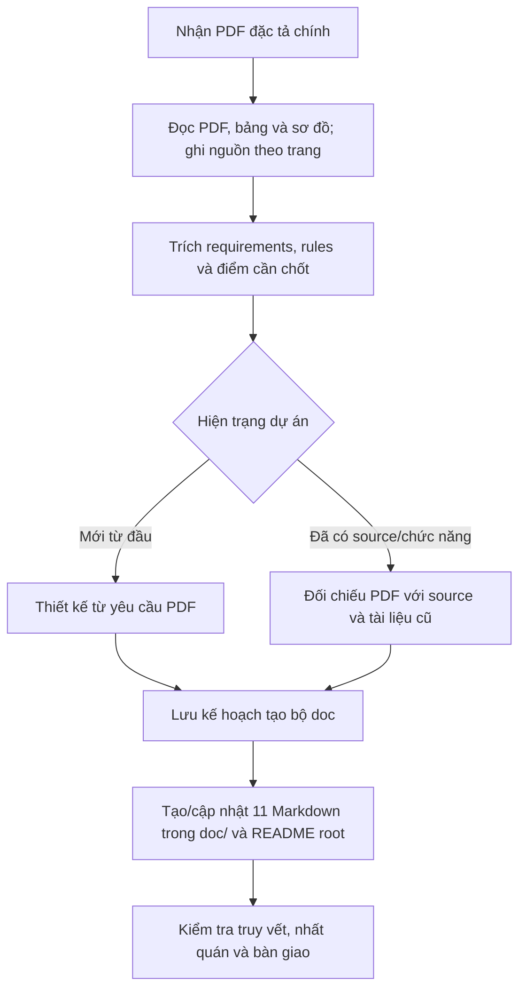
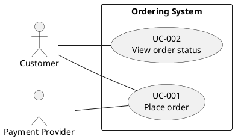
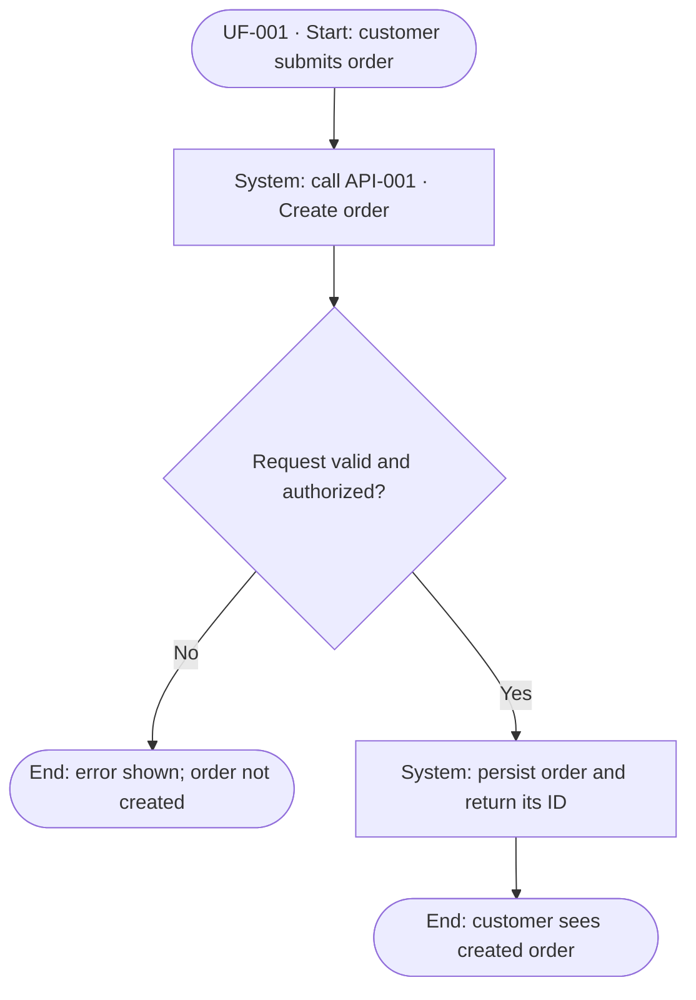
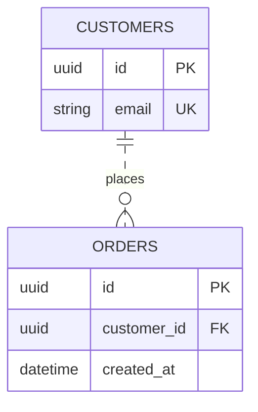
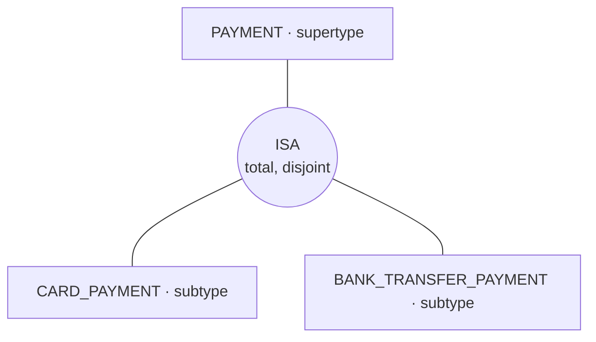
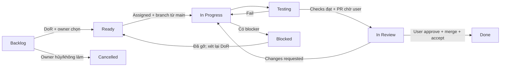

# Kế hoạch tạo skill `make-doc.md`

**Ngày khảo sát:** 04/11/2026. **Cập nhật:** 07/11/2026. **Trạng thái:** thiết kế skill; chưa tạo/cài đặt skill.

Kế hoạch quy định **11 file Markdown nội dung trong `doc/`**, kế thừa 10 file mẫu và bổ sung `backlog.md`, với cách tạo, quy ước và rules cho từng file. Bốn hợp đồng ở [§10](#hop-dong-bon-tai-lieu), sáu hợp đồng ở [§12](#hop-dong-sau-tai-lieu) và backlog ở [§23](#backlog-document-contract); [§13](#api-endpoint-contract) quy định API, [§14](#diagram-contract) quy định sơ đồ và [§15](#quality-gates) quy định nghiệm thu. Bộ doc bắt buộc có bảng FR/NFR, mapping dữ liệu, API entries, use case/user flow/EERD. Cách dùng cho dự án khác ở [§11](#ap-dung-du-an-khac); `make-doc-plan.md` là file điều phối riêng.

Bổ sung cùng ngày: **quy trình quản lý và triển khai phần mềm hoàn chỉnh** trong tài liệu `work-flow.md`: [ticket và prioritized backlog](#tickets-and-backlog), [labels và triage](#labels-and-triage), [milestones theo thời gian](#milestones-and-capacity), [GitHub Projects và saved views](#github-projects), [branch/commit/PR/human review](#git-pr-delivery) và [checklists/nghiệm thu quy trình](#engineering-workflow-gates). Mặc định triển khai theo **ticket → branch từ `main` → implement → kiểm tra → PR → người dùng review/approve → người dùng merge/nghiệm thu**; agent dừng ở bàn giao PR chờ review, không tự merge hoặc bật auto-merge.

Bổ sung hợp đồng [README ở root (§22)](#root-readme-contract): giới thiệu dự án, tech stack, cấu trúc, môi trường, setup/cài đặt, chạy thủ công và scripts. Đầu ra đầy đủ gồm **11 file nội dung trong `doc/` + một `README.md` ở root**, tổng 12 tài liệu nội dung; `doc/make-doc-plan.md` là file điều phối riêng, không tính vào 12 file đó.

Mục tiêu: nhận **một file PDF đặc tả làm đầu vào chính**, đọc và phân tích PDF trước, sau đó lập kế hoạch, tạo/cập nhật đầy đủ 11 tài liệu Markdown trong `<project-root>/doc/` và `<project-root>/README.md`. Rules và task người dùng bổ sung các ràng buộc hoặc quyết định cho quá trình này.

**Phân quyền nội dung mới:** `doc/backlog.md` sở hữu danh mục Epic/Feature, registry ticket, bảng issue/ticket và chi tiết công việc, FR/NFR coverage, milestone, lịch/effort/capacity, Kanban execution plan và các việc chuẩn bị GitHub Projects. `doc/work-flow.md` sở hữu quy trình/quy ước/templates/DoR/DoD/Git/PR và API catalog; hai file dẫn nhau, không duy trì hai backlog/lịch độc lập. Hợp đồng chi tiết ở §23.

Skill áp dụng cho **dự án mới từ đầu** và **dự án cũ**. Dự án mới có thể chỉ có PDF, chưa có source, stack hoặc tài liệu. Dự án cũ được đối chiếu PDF với source/tài liệu hiện có để mô tả hiện trạng, thiết kế đích và phần cần bổ sung. Cấu trúc tài liệu TMC bên dưới là mẫu tổ chức đầu ra; nội dung nghiệp vụ, công nghệ và kế hoạch của mỗi dự án phải được xây từ PDF của dự án đó.

## 1. Kết quả khảo sát `doc/`

Repository TMC được dùng làm mẫu khảo sát hiện có **10 file Markdown** và **3 PDF nguồn**. Bảng dưới mô tả trách nhiệm và cấu trúc đã quan sát; số phần là hiện trạng, không phải chỉ tiêu số lượng cho mọi dự án. Dự án sử dụng skill không cần có sẵn những file này.

| File hiện có | Số phần cấp 2 | Công dụng | Nội dung skill cần hướng dẫn tạo |
| --- | --- | --- | --- |
| [summary-assigment.md](../doc/summary-assigment.md) | 12 | Phân tích đề/đặc tả, xác định phải làm gì và vì sao | Bối cảnh, mục tiêu, scope, actors, FR/NFR, business rules, tích hợp, yêu cầu từng mốc, sản phẩm bàn giao, giả định, điểm cần chốt và nguồn đối chiếu. |
| [explain-detail.md](../doc/explain-detail.md) | 15 | Giải thích thuật ngữ và nghiệp vụ để đọc các tài liệu còn lại | Bản đồ thuật ngữ; mỗi thuật ngữ có định nghĩa, vị trí trong hệ thống, mục đích, ví dụ và cách hiểu dễ sai; các luồng nghiệp vụ minh họa. |
| [tech-stack.md](../doc/tech-stack.md) | 14 | Ghi lựa chọn công nghệ, kiến trúc và patterns kèm đánh đổi | Stack hiện có/đã chốt/đề xuất; lý do lựa chọn; phương án thay thế khi cần; FE, BE, DB, tích hợp, bảo mật, triển khai, kiểm thử và lộ trình. |
| [structure-architecture.md](../doc/structure-architecture.md) | 10 | Chuyển lựa chọn kiến trúc thành cấu trúc source dự kiến | Cây repository, FE/BE, trách nhiệm các lớp/module, chiều import, public interface/ports, composition root, transaction, worker, luồng runtime, kế hoạch chuyển đổi và checklist. |
| [repository-layout.md](../doc/repository-layout.md) | Theo nhu cầu repo | Chỉ nơi đặt code, cấu hình và công cụ đang tồn tại | Cây thư mục thực tế, ownership, entry point, manifest/lockfile, cấu hình mẫu/local, artifact sinh ra và lệnh từ scripts đã kiểm tra. |
| [domain-know-how.md](../doc/domain-know-how.md) | 17 | Giải thích toàn cảnh nghiệp vụ và trách nhiệm giữa các miền | Bài toán, actors/quyền/scope, bản đồ miền, đối tượng/vòng đời, quy tắc bất biến, luồng liên miền, ngoại lệ, ví dụ và điểm cần chốt. |
| [demo-accounts.md](../doc/demo-accounts.md) | Theo nhu cầu demo | Hướng dẫn chuẩn bị tài khoản và dữ liệu thử | Nguồn seed/fixture, điều kiện môi trường, tài khoản dương/âm, role/scope, cách cấp/reset mật khẩu demo, lệnh có tác động dữ liệu và smoke check có kết quả mong đợi. |
| [user-flow.md](../doc/user-flow.md) | 14 | Mô tả ai dùng chức năng nào và các bước sử dụng | Ranh giới hệ thống, actors/quyền/scope, use case, flow có điểm bắt đầu/kết thúc, điều kiện, kết quả, nhánh lỗi/phục hồi và bảng truy vết. |
| [schema-database.md](../doc/schema-database.md) | 16 | Đặc tả dữ liệu để triển khai schema/migration sau này | Danh mục entity/table, ERD, từ điển từng bảng, mapping property/column/type, PK/FK/UK, nullable/default, cardinality, constraint/index, transaction, migration/seed và kiểm chứng. |
| [work-flow.md](../doc/work-flow.md) | 18 | Lập kế hoạch triển khai phần mềm từ bộ thiết kế | Hiện trạng, mục tiêu, scope, giả định, quy trình làm việc, Epic/Feature/backlog/ticket, ưu tiên, sprint, milestone, phân công, effort/capacity, dependency, rủi ro, AC/DoD, kiểm thử và bàn giao. |

Ba PDF mẫu trong `doc/` là `SA_CC_hk261_Assignment_M1.pdf`, `SA_CC_hk261_Assignment_M2.pdf` và `spec.pdf`. Khi dùng skill, người dùng chỉ định **một PDF đặc tả chính**; tài liệu bổ sung chỉ được dùng khi có liên quan và sẵn có. Agent phải đọc trực tiếp PDF chính trước khi tạo bộ doc. Nội dung Markdown dẫn tới PDF chưa chứng minh agent đã đọc PDF đó. Skill không yêu cầu dự án khác phải có đủ ba PDF hoặc các mốc M1/M2 như TMC.

Các điểm ảnh hưởng đến thiết kế skill:

- `structure-architecture.md` mô tả đích `client/` và `api/`; tài liệu tự ghi rõ đây là thiết kế. Agent cần kiểm tra repository trước khi mô tả hiện trạng source.
- `repository-layout.md` là bản đồ hiện trạng; `structure-architecture.md` giải thích quy tắc tổ chức và thiết kế đích. Các cây thư mục lịch sử trong tài liệu kiến trúc có thể khác repo đang có; không chép chúng thành hiện trạng của dự án mới.
- `domain-know-how.md` có mô tả prototype tại thời điểm viết; các nhận định về role, localStorage hoặc auth phải đối chiếu lại source. `demo-accounts.md` hiện dẫn README làm nguồn chính cho danh sách đăng nhập; giữ một nơi sở hữu thông tin thay vì nhân bản danh sách dễ lệch nhau.
- Mã FR/NFR trong bản tóm tắt có thể do người viết tự đặt; UC của `user-flow.md` kế thừa M1, còn UF do tài liệu tự đặt. Cần giữ nguồn gốc và ánh xạ các hệ mã thay vì gộp theo tên giống nhau.
- Tài liệu phân biệt yêu cầu đề bài, quyết định M1, đề xuất M2, giả định và kết quả đã kiểm chứng. Skill cần duy trì sự phân biệt này.
- `work-flow.md` còn dự kiến các tài liệu như `m2-scope.md`, `requirements-traceability.md`, `tcs-contract.md`, `hrs-contract.md`, `adr/` và `evidence/`. Đây là đầu ra của các ticket tương lai, không phải toàn bộ đã tồn tại hoặc phải sinh trong mọi task tài liệu.
- Các con số 37 bảng, 43 ticket, 4 sprint và lịch của TMC thuộc bản thiết kế/kế hoạch hiện tại; task mới cần tính lại theo phạm vi và dữ liệu được giao.

## 2. Vai trò các Markdown ngoài `doc/` của repository mẫu

Các file sau giải thích ngữ cảnh và cách tổ chức bộ skill đang khảo sát. Chúng không phải điều kiện đầu vào của dự án mới; ở dự án khác, agent chỉ đọc các chỉ dẫn và tài liệu thực sự tồn tại, có liên quan.

| File/nhóm file | Công dụng và cách dùng khi xây skill |
| --- | --- |
| [AGENTS.md](../AGENTS.md) | Chỉ dẫn làm việc trong repository: cấu trúc ứng dụng, môi trường, styling và chất lượng code. Dùng để xác định phạm vi, môi trường và quy ước dự án. |
| [CLAUDE.md ở root](../CLAUDE.md) | Tham chiếu `@AGENTS.md`, giúp công cụ tương ứng dùng cùng chỉ dẫn dự án. |
| [README.md ở root](../README.md) | Hướng dẫn trải nghiệm/chạy prototype, tài khoản demo, dữ liệu, QR và giới hạn. Là nguồn mô tả prototype; kiểm tra source/config khi cần kết luận hiện trạng. |
| [client/guidelines/Guidelines.md](../client/guidelines/Guidelines.md) | Chỉ dẫn thiết lập design system và đọc guideline của package khi làm UI/code. Khi viết tài liệu, giữ đúng các ràng buộc UI có liên quan. |
| [plans/tmc-access-frontend-prototype.md](tmc-access-frontend-prototype.md) | Kế hoạch lịch sử cho frontend demo. Dùng làm bối cảnh; phần “chưa có UI” phản ánh thời điểm lập kế hoạch. |
| [skills/stephen-skills/README.md](../skills/stephen-skills/README.md) | Giới thiệu bốn nguyên tắc Karpathy và cách sử dụng/phân phối bộ hướng dẫn. |
| [skills/stephen-skills/README.zh.md](../skills/stephen-skills/README.zh.md) | Bản README tiếng Trung; cùng vai trò giới thiệu và sử dụng. |
| [skills/stephen-skills/CLAUDE.md](../skills/stephen-skills/CLAUDE.md) | Bản chỉ dẫn hành vi: làm rõ yêu cầu, chọn giải pháp đơn giản, sửa đúng phạm vi và kiểm chứng. |
| [skills/stephen-skills/CURSOR.md](../skills/stephen-skills/CURSOR.md) | Cách dùng bộ hướng dẫn với Cursor và giữ các phiên bản chỉ dẫn đồng bộ. |
| [skills/stephen-skills/EXAMPLES.md](../skills/stephen-skills/EXAMPLES.md) | Các ví dụ minh họa hành vi agent và lỗi thường gặp; ví dụ không phải requirement của TMC. |
| [skills/stephen-skills/sumary.md](../skills/stephen-skills/sumary.md) | Tổng quan bộ hướng dẫn tại thời điểm khảo sát, giải thích cấu trúc, nguyên tắc và cách dùng. |
| [skills/stephen-skills/IMPLEMENTATION_GUIDE.md](../skills/stephen-skills/IMPLEMENTATION_GUIDE.md) | Hướng dẫn giao task, chọn workflow, kiểm chứng và dùng bộ skill local. Tham khảo cách tích hợp `make-doc`. |
| [agent-plan/SKILL.md](../skills/stephen-skills/skills/agent-plan/SKILL.md) | Workflow lập kế hoạch có bằng chứng và tiêu chí hoàn thành. Tham khảo cách phân biệt yêu cầu lập kế hoạch với yêu cầu thực thi. |
| [agent-implement/SKILL.md](../skills/stephen-skills/skills/agent-implement/SKILL.md) | Workflow thực hiện thay đổi, gồm tài liệu, và xác minh theo tác động. |
| [agent-review/SKILL.md](../skills/stephen-skills/skills/agent-review/SKILL.md) | Workflow review dựa trên yêu cầu và bằng chứng, đưa nhận xét có vị trí và tác động. |
| [agent-debug/SKILL.md](../skills/stephen-skills/skills/agent-debug/SKILL.md) | Workflow tái hiện, tìm nguyên nhân và sửa lỗi; không phải bước mặc định của việc tạo tài liệu. |
| [karpathy-guidelines/SKILL.md](../skills/stephen-skills/skills/karpathy-guidelines/SKILL.md) | Đóng gói bốn nguyên tắc gốc thành skill; tham khảo mức thay đổi vừa đủ và cách kiểm chứng. |

`make-doc` cần tự đủ dùng. Các skill trên là nguồn tham khảo thiết kế, không trở thành chuỗi skill bắt buộc phải gọi khi tạo tài liệu.

## 3. Tên file, vị trí và cách đóng gói

### 3.1. Tên tài liệu đầu ra

- Khi tạo đủ bộ, bắt buộc có từng file trong danh mục 11 basename ở §4.3, gồm `backlog.md`; không gộp thành một file, bỏ file hoặc chỉ liệt kê tên file trong kế hoạch. Với dự án cũ, cập nhật tại chỗ và giữ liên kết hiện có.
- Ngoài 11 file trong `doc/`, tạo/cập nhật `<project-root>/README.md` theo §22. Giữ casing/path README đang có, kể cả `readme.md`; không tạo thêm file chỉ khác hoa/thường hoặc chuyển README vào `doc/`. README của package con có vai trò riêng, không thay README root.
- Các tên cũ như `sumary-assigment.md` hoặc `teach-stack.md` được ánh xạ sang file thực tế nếu dự án đang dùng; không tự đổi tên file ngoài phạm vi. Bản plan này tham chiếu tên `summary-assigment.md` và `tech-stack.md` hiện có trong workspace.
- Nếu dự án cũ có tài liệu tương đương dưới tên khác, lập bảng ánh xạ nội dung và tái sử dụng qua liên kết hoặc chuyển phần liên quan khi được phép. Bộ 11 tên chuẩn vẫn là đầu ra mặc định; tránh sao chép cùng nội dung thành hai nguồn độc lập. Khi chuyển backlog cũ từ `work-flow.md`, áp dụng §23.8 để giữ ID/anchor/tiến độ và để lại liên kết tương thích.
- Quy ước quan sát được: file tài liệu nghiệp vụ dùng chữ thường, các từ nối bằng `-`, đuôi `.md`, đặt trong `doc/`.
- File mới theo cùng kiểu đặt tên, chỉ tạo khi task cần. Tài liệu vận hành, ADR và evidence có thể dùng thư mục con đã được task xác định.
- Dùng UTF-8 để giữ đúng tiếng Việt; liên kết tương đối tính từ file đang viết. Tên file và anchor hiện có cần được giữ ổn định khi cập nhật.
- Dùng `#` cho tiêu đề tài liệu, `##` cho các phần, `###` cho phần chi tiết; bảng cho dữ liệu đối chiếu, Mermaid cho luồng/quan hệ phù hợp. Giữ số thứ tự/anchor mà tài liệu hiện tại đang sử dụng khi chúng còn đúng.

### 3.2. Cấu trúc skill đề xuất

```text
skills/stephen-skills/skills/make-doc/
├── SKILL.md
├── make-doc.md
└── references/
    ├── doc-contracts.md
    ├── summary-assigment.md
    ├── explain-detail.md
    ├── tech-stack.md
    ├── structure-architecture.md
    ├── repository-layout.md
    ├── domain-know-how.md
    ├── demo-accounts.md
    ├── user-flow.md
    ├── schema-database.md
    ├── work-flow.md
    ├── backlog.md
    ├── api-endpoints.md
    ├── diagrams.md
    ├── tickets-and-backlog.md
    ├── milestones-and-roadmap.md
    ├── github-projects.md
    ├── git-and-pull-requests.md
    └── root-readme.md
```

| File dự kiến | Trách nhiệm |
| --- | --- |
| `SKILL.md` | Điểm vào theo cấu trúc skill hiện có; YAML frontmatter có `name: make-doc` và `description`. Chỉ dẫn đọc `make-doc.md` để thực hiện task. |
| `make-doc.md` | File mang đúng tên người dùng yêu cầu; chứa quy trình nhận PDF → đọc/trích xuất → xác định dự án mới/cũ → lập kế hoạch → viết/lưu → kiểm chứng → bàn giao. |
| `references/doc-contracts.md` | Danh mục 11 loại trong `doc/` cùng README root, ownership, đầu vào/phụ thuộc và link hướng dẫn từng loại; tránh lặp lại nội dung tham chiếu. |
| `references/summary-assigment.md`, `references/explain-detail.md`, `references/tech-stack.md` | Hợp đồng §12.2–12.4: phân tích yêu cầu có bảng FR/NFR, giải thích thuật ngữ và quyết định công nghệ. Đọc reference của file đang tạo/cập nhật. |
| `references/structure-architecture.md` | Quy trình, dàn ý và tiêu chí §10.2; đọc khi cần tài liệu tổ chức thư mục/kiến trúc. |
| `references/repository-layout.md` | Quy trình, dàn ý và tiêu chí §10.3; đọc khi cần bản đồ repository thực tế. |
| `references/domain-know-how.md` | Quy trình, dàn ý và tiêu chí §10.4; đọc khi cần tổng quan nghiệp vụ. |
| `references/demo-accounts.md` | Quy trình, dàn ý và tiêu chí §10.5; đọc khi cần tài khoản/dữ liệu demo. |
| `references/user-flow.md`, `references/schema-database.md`, `references/work-flow.md` | Hợp đồng §12.5–12.7: UC/UF, EERD và mapping dữ liệu, backlog và API catalog. Đọc reference của file đang tạo/cập nhật. |
| `references/api-endpoints.md` | Quy ước tiếng Anh, HTTP semantics, catalog và mẫu entry ở §13. Đọc khi lập/sửa phần API trong `doc/work-flow.md`; đây là tài nguyên skill, không phải một file API bổ sung trong `doc/`. |
| `references/diagrams.md` | Hợp đồng và mẫu sơ đồ ở §14. Đọc khi tạo/sửa use case, user flow hoặc EERD; đặt kết quả vào file nội dung sở hữu sơ đồ. |
| `references/tickets-and-backlog.md` | Hợp đồng §16–17: templates/naming/triage viết trong `work-flow.md`, áp dụng để điền ticket thực tế ở `backlog.md`; không tạo hai nguồn danh mục ticket. |
| `references/backlog.md` | Hợp đồng §23: nguồn kế hoạch thực thi với milestone/time/capacity, Feature/FR/NFR → ticket nhỏ có AC/verification, Agile/Kanban và GitHub Projects preparation/import plan. Đọc khi tạo/cập nhật `doc/backlog.md`. |
| `references/milestones-and-roadmap.md` | Hợp đồng §18: milestone theo outcome/thời gian, capacity, iteration, dependency, lịch và exit criteria. Đọc khi lập/sửa tiến độ. |
| `references/github-projects.md` | Hợp đồng §19: setup GitHub Projects, schema fields, saved views, filters, automation và kiểm tra cấu hình. Đọc khi mô tả cách tổ chức project; hướng dẫn không tự cấp quyền tạo/sửa remote. |
| `references/git-and-pull-requests.md` | Hợp đồng §20–21: lấy ticket, branch từ `main`, Conventional Commits, checks, PR, người dùng review/approve/merge và checklists. Đọc khi viết quy trình triển khai/bàn giao. |
| `references/root-readme.md` | Hợp đồng §22: README root giới thiệu sản phẩm, stack/cấu trúc, môi trường, setup, manual run, scripts và kiểm chứng; đọc khi tạo/cập nhật README, không bắt đọc các reference nghiệp vụ không bị tác động. |

Tách `SKILL.md` làm điểm vào giúp giữ tên `make-doc.md` theo yêu cầu và đồng bộ kiểu đóng gói của các skill trong repo. Tách hợp đồng tài liệu giúp phần workflow ngắn, tránh chép lại toàn bộ tài liệu TMC vào skill.

Mô tả định tuyến dự kiến: nhận một file PDF đặc tả để tạo hoặc cập nhật bộ tài liệu Markdown trong `doc/` và README root cho dự án mới hoặc cũ; đọc PDF, đối chiếu hiện trạng khi có, lập kế hoạch theo phụ thuộc rồi viết và lưu tài liệu. Hỗ trợ task cập nhật riêng tài liệu/README từ nguồn đủ dùng; task triển khai ứng dụng cần phạm vi riêng.

Hỗ trợ task hẹp ở §10, workflow §16–21, README §22 hoặc backlog §23 từ nguồn đủ dùng; không nạp mọi reference hoặc bắt PDF mới nếu nguồn tương ứng đã đủ. Các file skill trong cây đóng gói là dự kiến, chưa được tạo bởi lần sửa plan này.

Có thể dùng trực tiếp bằng yêu cầu agent đọc file `skills/stephen-skills/skills/make-doc/make-doc.md`. Nếu cần đưa vào cơ chế khám phá của công cụ, đóng gói/cài cả thư mục theo môi trường đích. Việc đặt nguồn trong `skills/stephen-skills/skills/` chưa chứng minh skill đã được nạp trong phiên đang chạy.

## 4. Hợp đồng đầu vào và đầu ra

### 4.1. Đầu vào bắt buộc và bổ sung

**Đối với task tạo đủ bộ từ đặc tả:** đầu vào bắt buộc là một file `.pdf` do người dùng chỉ định, qua file đính kèm hoặc đường dẫn agent đọc được. PDF là căn cứ để xây yêu cầu và bộ doc; source hoặc Markdown cũ bổ sung bằng chứng hiện trạng. Nếu có nhiều PDF mà chưa xác định file chính, làm rõ file cần dùng trước khi phân tích nội dung dự án.

**Đối với task hẹp ở §10, §16–21, §22 hoặc §23:** dùng nguồn theo loại tài liệu; backlog dùng FR/NFR/Feature/hiện trạng và rules hiện có, README dùng sản phẩm/manifest/config/scripts, workflow dùng quy trình/nguồn chính thức liên quan. Không bắt PDF mới khi nguồn đủ; phần thiếu ghi câu hỏi/impact, không nhận đã đọc nguồn chưa đọc.

| Nhóm | Thông tin cần lấy |
| --- | --- |
| PDF đặc tả — bắt buộc cho bộ đầy đủ từ PDF | File chính, phiên bản/mốc áp dụng nếu có; đọc nội dung chữ, bảng, hình, sơ đồ và chú thích liên quan trên các trang. |
| Thư mục dự án | Nơi nhận bộ doc; mặc định workspace hiện tại, có thể là thư mục mới chưa có source hoặc `doc/`. |
| Rules — bổ sung | Business rules người dùng giao thêm, constraints, công nghệ đã chốt, yêu cầu về format và phạm vi được sửa. Nếu chưa cung cấp thì trích rule từ PDF và ghi rõ đề xuất/điểm cần chốt. |
| Mục tiêu task | Mặc định xây 11 tài liệu trong `doc/` và README root. Có thể giới hạn riêng backlog/README/workflow, cập nhật một phần hoặc chỉ lập kế hoạch khi được giao. |
| Hiện trạng — nếu có | Source/config, schema/migration, tài liệu, quyết định còn hiệu lực và thay đổi đang có. Dự án mới không bắt buộc có nhóm này. |
| Ánh xạ dự án đích | Tên dự án, docs root (mặc định `doc/`), loại app/package, entry point, stack, module/miền, lệnh dev/build/test, cơ chế auth/role/scope và nguồn demo. Giá trị chưa có được đánh dấu theo §11. |
| Thông tin điều phối — nếu có | Owner, deadline, capacity, sprint và phạm vi code được chọn. Phần thiếu được đánh dấu cần chốt hoặc ước lượng với giả định rõ ràng. |
| Quản lý và bàn giao | Repo/owner GitHub/Project URL nếu có, nguồn ticket, ID/labels/milestones/fields/views hiện hành, main branch, conventions và checks/CI, tài khoản tạo PR và người dùng review/merge. Thiếu remote ID/quyền thì ghi proposed/unverified, không bịa URL hoặc giả đã cấu hình. |

Tra nguồn có sẵn trước khi hỏi. Với task tạo bộ từ PDF, nếu PDF chưa được cung cấp, không đọc được hoặc còn trang quan trọng chưa trích xuất được, nêu đúng phần thiếu và yêu cầu nguồn/phần nội dung cần thiết; có thể kiểm kê repository nhưng chưa chốt bộ yêu cầu như đã đọc đủ PDF. Với các thông tin khác, phần không phụ thuộc vẫn tiếp tục, giả định được ghi rõ.

### 4.2. Hai chế độ theo hiện trạng dự án

| Nội dung | Dự án mới từ đầu | Dự án cũ |
| --- | --- | --- |
| Nhận diện | Chưa có phần mềm nghiệp vụ được triển khai; có thể là thư mục trống hoặc scaffold ban đầu. Có tài liệu nháp vẫn có thể thuộc chế độ này. | Đã có source/chức năng nghiệp vụ cần kế thừa, dù chưa có `doc/` hoặc tài liệu đã lỗi thời. |
| Căn cứ nghiệp vụ | PDF đặc tả chính và rules bổ sung. | Cùng PDF và rules; đối chiếu thêm bằng chứng hiện trạng từ source/config, dữ liệu thiết kế và tài liệu cũ. |
| Công nghệ/kiến trúc | Giữ yêu cầu trong PDF và lựa chọn người dùng đã chốt; phần chưa quy định được đề xuất kèm lý do, giả định. | Ghi stack/kiến trúc hiện có, quyết định đích và khoảng cách so với PDF; kế hoạch thay đổi chỉ đưa ra khi cần đáp ứng yêu cầu. |
| Tài liệu | Tạo `doc/` nếu chưa có, viết đủ 11 tài liệu cùng README root; `backlog.md` có kế hoạch khởi tạo tới bàn giao, thiết kế không đồng nghĩa app chạy được. | Kiểm kê 11 loại và README root, tạo file thiếu, kế thừa backlog/ID/progress đã có; quy trình ở workflow, kế hoạch cụ thể ở backlog. |
| Kế hoạch phát triển | Lộ trình từ nền tảng → module nghiệp vụ → tích hợp → kiểm thử/bàn giao theo yêu cầu PDF. | Lộ trình hoàn thiện phần còn thiếu hoặc cải tiến/chuyển đổi; giữ tiến độ đã có bằng chứng, thêm kiểm tra hồi quy và tương thích khi cần. |
| Kết luận | Nêu rõ đã hoàn thành bộ thiết kế, phần triển khai chưa thực hiện. | Phân biệt đã có, cần sửa, cần bổ sung và chưa xác minh; PDF mô tả đích không tự chứng minh source đang đáp ứng. |

Agent tự xác định chế độ từ hiện trạng và task, chỉ hỏi nếu lựa chọn ảnh hưởng thực sự đến phạm vi. Dự án cũ được đánh giá theo từng thành phần: phần đang có cần kế thừa, phần chưa có cần thiết kế mới. Việc không có thư mục `doc/` không đồng nghĩa dự án mới.



### 4.3. Đầu ra mặc định khi được giao tạo đủ bộ

```text
<project-root>/
├── README.md                      # Tổng quan và setup/runbook theo §22
└── doc/
    ├── make-doc-plan.md           # Điều phối riêng, không tính vào 12 file nội dung
    ├── summary-assigment.md
    ├── explain-detail.md
    ├── tech-stack.md
    ├── structure-architecture.md
    ├── repository-layout.md
    ├── domain-know-how.md
    ├── demo-accounts.md
    ├── user-flow.md
    ├── schema-database.md
    ├── work-flow.md               # Quy trình, conventions/templates và API catalog
    └── backlog.md                 # Ticket/issue, milestone/lịch, Agile/Kanban và Project preparation
```

`doc/` được tính từ thư mục dự án đích, được tạo nếu chưa tồn tại. PDF nguồn giữ tại vị trí người dùng cung cấp, được liên kết từ tài liệu bằng đường dẫn thực tế; không bắt buộc PDF nằm sẵn trong `doc/`.

README nằm ở root dự án, không nằm dưới docs root dù dự án chọn docs root khác `doc/`. Đầy đủ có **12 tài liệu nội dung + một file điều phối**; không dùng README thay doc hoặc dùng README package con thay README root.

`make-doc-plan.md` điều phối việc viết doc, `work-flow.md` hướng dẫn thực thi và sở hữu API catalog/entries, `backlog.md` chứa các việc/thời gian cần thực hiện. Ba file có mục đích và trạng thái riêng. Bộ 11 doc áp dụng cho cả dự án mới/cũ; nội dung theo nguồn của dự án, không bắt có mốc M1/M2 của TMC.

**Các thành phần bắt buộc:** `summary-assigment.md` có hai bảng riêng FR và NFR; `user-flow.md` có use case diagram và user flow diagram; `schema-database.md` có EERD, bảng entity–table mapping và bảng field mapping/data dictionary; `work-flow.md` có API catalog, từng endpoint entry và bảng truy vết xuyên tài liệu. Hợp đồng chi tiết ở §12–15; chỉ có dàn ý hoặc mô tả bằng lời thay sơ đồ/bảng chưa đạt.

Nếu một thành phần thực sự không áp dụng, vẫn giữ file và mục tương ứng, ghi **Không áp dụng + căn cứ + phương án thay thế nếu có**; ví dụ app chạy hoàn toàn local, không HTTP API hoặc không persistence. Không dùng thiếu source, thiếu renderer hay chưa triển khai làm lý do bỏ thiết kế/sơ đồ cần thiết. Với yêu cầu user flow/use case, suy ra actor và trigger thật của sản phẩm; không bịa màn hình hay người dùng cho thư viện/headless. Những thiết kế cần thiết nhưng PDF chưa quy định có thể được đề xuất và gắn nhãn; không sao chép module TMC hoặc bịa yêu cầu chỉ để điền mẫu.

Với dự án chưa có code, `repository-layout.md` ghi hiện trạng thực sự ít file và dẫn cây dự kiến ở tài liệu kiến trúc; `demo-accounts.md` ghi chưa có tài khoản/seed, nhu cầu fixture và kịch bản dự kiến. Với sản phẩm không có đăng nhập, ghi không áp dụng và lý do. Đây là nội dung hữu ích theo hiện trạng, không phải danh sách tài khoản bịa ra để đủ số file. Task chỉ yêu cầu bốn file thì phạm vi bàn giao là bốn file; không tự sinh sáu tài liệu còn lại hoặc file kế hoạch ngoài yêu cầu.

Khi task yêu cầu tạo tài liệu, mặc định agent lập kế hoạch rồi tiếp tục viết/lưu trong cùng nhiệm vụ. Khi task chỉ yêu cầu lập kế hoạch, agent bàn giao kế hoạch theo vị trí người dùng chỉ định; chưa chuyển sang tạo cả bộ tài liệu. Task cập nhật hẹp chỉ sửa các phần bị tác động và các tham chiếu cần đồng bộ.

## 5. Quy trình skill cần thực hiện

Quy trình dưới áp dụng cho task tạo đủ bộ từ PDF. Với task hẹp ở §10, §16–21, §22 hoặc §23, dùng nguồn đủ dùng và bước liên quan, kiểm chứng/bàn giao đúng scope.

### Bước 1 — Nhận và đọc PDF đặc tả chính

Xác nhận file PDF chính và thư mục dự án đích từ task. Đọc các chỉ dẫn áp dụng trong workspace, sau đó dùng công cụ sẵn có để đọc/trích xuất PDF theo trang. Đọc toàn bộ PDF khi xây đủ bộ doc; kiểm tra cả bảng, hình, sơ đồ và phụ lục, không chỉ nội dung text trích xuất được.

Với PDF scan hoặc trang trích xuất bị mất chữ/bảng, dùng OCR hoặc đọc hình trang bằng công cụ hỗ trợ nếu có; đối chiếu thông tin quan trọng với trang gốc. Ghi rõ trang đã đọc, trang còn lỗi/thiếu và quy ước số trang PDF; không báo đã đọc đủ khi còn thiếu phần ảnh hưởng đến yêu cầu.

**Đầu ra:** ghi nhận nguồn PDF, phạm vi trang đã đọc, nội dung yêu cầu và điểm chưa rõ; chưa tạo bộ doc nghiệp vụ trước bước này. **Kiểm tra:** dữ kiện trích xuất truy được về trang/mục thật, số liệu và quan hệ trên bảng/sơ đồ không bị mất do chuyển sang text.

### Bước 2 — Nhận diện dự án và chuẩn hóa yêu cầu

Kiểm kê source/config và tài liệu thực sự tồn tại; xác định dự án mới từ đầu hoặc dự án cũ theo phần 4.2. Với dự án cũ, đọc các phần liên quan để phân biệt yêu cầu trong PDF, hành vi hiện có, thiết kế đích và khoảng cách cần xử lý. Với dự án mới, xây baseline từ PDF mà không yêu cầu phải có README/source/doc mẫu.

Tạo bảng gồm mã, nội dung, loại, nguồn PDF/trang hoặc rule bổ sung, trạng thái xác nhận và tài liệu chịu trách nhiệm. Giữ mã có sẵn; mã agent tự đặt được ghi rõ là mã nội bộ. Với dự án cũ, bổ sung trạng thái đáp ứng và bằng chứng source/tài liệu hiện có khi xác định được.

Task người dùng xác định phạm vi và lựa chọn dự án; PDF xác định yêu cầu gốc cần được báo cáo trung thực. Khi nguồn mâu thuẫn, ghi khác biệt và ảnh hưởng, hỏi phần cần quyết định. Source hiện có giúp xác định hiện trạng; phần sai khác với PDF cần được phân tích thay vì mặc nhiên xem là yêu cầu đích.

**Đầu ra:** chế độ dự án, bảng nguồn/hiện trạng, baseline yêu cầu/rules/quyết định và câu hỏi còn mở. **Kiểm tra:** mọi kết luận “hiện có/đã làm” có bằng chứng; yêu cầu PDF, rules bổ sung, đề xuất, giả định và kết quả kiểm chứng được phân biệt.

### Bước 3 — Chốt danh mục đầu ra và lưu kế hoạch

Lập `doc/make-doc-plan.md` khi nhiệm vụ bao gồm tạo/lưu bộ tài liệu. Kế hoạch gồm:

- PDF chính, phiên bản/trang, mục tiêu, phạm vi, chế độ dự án mới/cũ và rules bổ sung.
- Ma trận yêu cầu PDF/rule → tài liệu → mục nội dung → cách kiểm tra; với dự án cũ có thêm hiện trạng và khoảng cách cần xử lý.
- Bảng từng file: hành động tạo/cập nhật/giữ nguyên, đầu vào, phụ thuộc, đầu ra và tiêu chí hoàn thành.
- Ánh xạ tham số dự án ở §11 và nơi sở hữu thông tin dùng chung (cây hiện trạng, quy tắc kiến trúc, rule nghiệp vụ, tài khoản/lệnh demo).
- Thứ tự thực hiện, giả định/câu hỏi, trạng thái và bước tiếp theo.

Trạng thái tài liệu có thể dùng `Planned`, `Draft`, `Written`, `Verified`, `Needs input`. Chỉ ghi `Verified` sau khi đã kiểm tra; trạng thái này xác nhận tài liệu, không xác nhận tính năng ứng dụng đã hoàn thành.

**Đầu ra:** kế hoạch được lưu trên đĩa. **Kiểm tra:** đủ 11 loại tài liệu trong `doc/` và README root khi task đủ bộ; ownership backlog/workflow và scope task hẹp rõ.

### Bước 4 — Viết phân tích yêu cầu và khởi tạo thuật ngữ

Viết/cập nhật `summary-assigment.md` theo §12.2 từ PDF đã đọc và rules bổ sung, có **hai bảng FR/NFR riêng**, nguồn và cách nghiệm thu từng dòng. Khởi tạo/cập nhật `explain-detail.md` theo §12.3 cho actors, thuật ngữ nghiệp vụ và hệ thống ngoài thực sự xuất hiện. Liệt kê rõ scope, business rules, mốc bàn giao và điểm cần chốt. Với dự án cũ, nêu tác động của đặc tả tới phần hiện có.

**Kiểm tra:** yêu cầu có nguồn, không thêm deadline/thang điểm/số liệu đo giả; thuật ngữ không tự tạo requirement mới.

### Bước 5 — Viết lựa chọn công nghệ và cấu trúc kiến trúc

Viết/cập nhật `tech-stack.md` theo §12.4, sau đó `structure-architecture.md`. Với dự án mới, lấy ràng buộc từ PDF/rules, đề xuất stack và kiến trúc cho phần chưa được chỉ định, ghi rõ lý do/giả định. Với dự án cũ, mô tả stack/cấu trúc thực có và thiết kế đích đáp ứng PDF, phân tích phần giữ lại/cần thay đổi. Kế thừa quyết định còn hiệu lực và mô tả module, interface, chiều dependency, luồng runtime phù hợp từng dự án.

Áp dụng §10.2 để giải thích cách đặt code và quy tắc phụ thuộc. Tạo/cập nhật `repository-layout.md` theo §10.3 từ kiểm kê source/config, không lấy cây kiến trúc đích thay cây hiện trạng. Chỉ mô tả thành phần thực sự cần; dự án một ứng dụng không bị ép thành `client/api/contracts` hoặc Clean Architecture.

**Kiểm tra:** stack và tên module nhất quán; cây thư mục phù hợp lựa chọn; ví dụ code/skeleton được nhận diện đúng mức hoàn chỉnh. Nếu đề yêu cầu ba architecture views, ánh xạ từng view tới phần tương ứng trong bộ tài liệu.

### Bước 6 — Viết luồng người dùng và schema, đối chiếu hai chiều

Từ actors/use case và kiến trúc, viết `user-flow.md` theo §12.5 và **vẽ đủ use case diagram + user flow diagram** theo §14. Từ dữ liệu mà các flow cần đọc/ghi, viết `schema-database.md` theo §12.6, **vẽ EERD và lập bảng table/data mapping**. Đồng thời thiết kế API catalog và từng endpoint entry trong `work-flow.md` theo §13, để backlog ở bước sau dựa trên contract. Đối chiếu hai chiều flow ↔ API ↔ schema và sửa phần liên quan khi phát hiện thiếu dữ liệu hoặc rule.

Mỗi flow cần actor, quyền/scope, điều kiện đầu vào, đường chính, kết quả và ngoại lệ. Mỗi bảng cần mục đích, owner/module, cột, kiểu, khóa, quan hệ và rules; mapping ngôn ngữ ứng dụng/DB theo stack đã chọn. Phân biệt constraint DB với kiểm tra tại application. Với dự án cũ, ghi schema/flow hiện tại, thay đổi đích và ảnh hưởng tương thích hoặc migration; tất cả mới ở mức tài liệu.

**Kiểm tra:** thao tác quan trọng có dữ liệu hỗ trợ; entity phục vụ nhu cầu được giải thích; sơ đồ có source và đúng semantics; tên trạng thái/field và quyền khớp flow, API, kiến trúc và schema. Endpoint có tên tiếng Anh, ID ổn định, contract đủ request/response/lỗi và trạng thái thiết kế/hiện có rõ ràng.

### Bước 7 — Viết kế hoạch phát triển phần mềm

Viết quy trình/conventions/templates/DoR/DoD/triage/GitHub/Git/PR vào `work-flow.md` theo §12.7, hoàn thiện API entries đã khởi tạo ở bước 6. Sau đó áp các rules này để tạo `backlog.md` theo §23: Epic/Feature → FR/NFR → ticket nhỏ có AC/verification, milestone/time/capacity, dependency, Kanban plan và GitHub Projects preparation. Dự án mới lập từ khởi tạo/setup tới bàn giao; dự án cũ giữ progress có bằng chứng và chỉ kế hoạch phần thiếu/thay đổi. Lịch/capacity thiếu phải gắn giả định hoặc cần chốt, không bịa deadline.

Ticket đủ giao việc cần có mục tiêu, input, phạm vi file/module, công việc, deliverables, dependency, người thực hiện/review theo ngữ cảnh, acceptance criteria và cách kiểm chứng. Với task cần effort, tách giờ người, review/integration/testing/documentation và thời gian máy/AI để tránh cộng trùng.

Bắt buộc áp dụng §16–21: điền template ticket/bug và checklist; lập prioritized backlog với rank/lý do; định nghĩa label/priority/severity; chia milestone/iteration theo lịch/capacity; ghi runbook GitHub Projects với fields và năm view yêu cầu; mô tả branch từ `main`, commit, checks, PR và điểm dừng chờ người dùng review. Đây là **sinh tài liệu quy trình**, không thực thi backlog hay tự cấu hình GitHub remote.

**Kiểm tra:** ID/dependency hợp lệ và không có vòng; tổng effort khớp các bảng; lịch phù hợp capacity nếu có đủ dữ liệu. Ticket mới ở trạng thái kế hoạch; tiến độ cũ được đối chiếu và giữ khi có bằng chứng, tránh lập lại backlog như thể dự án chưa làm gì.

### Bước 8 — Hoàn thiện giải thích và truy vết

Bổ sung `explain-detail.md` theo thuật ngữ thực sự được dùng trong stack, kiến trúc, flow, schema và workflow. Hoàn thiện ma trận truy vết trong kế hoạch; yêu cầu có thể được tham chiếu từ nhiều tài liệu nhưng cần xác định nơi giải thích chính.

Hoàn thiện `domain-know-how.md` theo §10.4: có thể khởi tạo bản đồ miền ngay sau phân tích yêu cầu, sau đó kiểm tra lại với flow/schema để mô tả luồng liên miền và invariants. Viết `demo-accounts.md` theo §10.5 từ seed/fixture, auth, route/permission và runbook thực tế. Thiếu seed hoặc auth thì ghi đúng tình trạng và kịch bản dự kiến; không chạy seed/reset/migration để hoàn thành task viết doc.

Tạo/cập nhật README root theo §22 sau khi xác nhận stack/layout/config/scripts và giới hạn tính năng. README có setup/manual/scripts và dẫn bộ doc gồm backlog, không hứa thiết kế đã chạy. Task chỉ README không tự tạo lại 11 doc.

**Kiểm tra:** không giải thích trái thuật ngữ đã chốt; mỗi requirement/rule trong phạm vi truy được về PDF/trang hoặc nguồn bổ sung và có nơi xử lý hoặc lý do chờ/ngoài phạm vi rõ ràng. Với dự án cũ, phần sai khác giữa hiện trạng và đặc tả có hướng xử lý trong thiết kế/kế hoạch.

### Bước 9 — Kiểm chứng toàn bộ và sửa phần liên quan

Rà nội dung, tên file, UTF-8, cấu trúc Markdown, liên kết/anchor, bảng và sơ đồ. Đối chiếu bộ doc với PDF chính và rules: kiểm tra độ bao phủ yêu cầu, các trang nguồn đã dẫn và phần đề xuất thêm. Kiểm tra chéo actors/quyền, module, stack, entity/field, state, deadline, số lượng và dependency. Với dự án cũ, đối chiếu thêm các khẳng định hiện trạng với source/config và giữ thay đổi ngoài phạm vi. Nếu chưa có công cụ render sơ đồ thì ghi mức kiểm tra cú pháp/nội dung đã làm.

Kiểm tra bốn tài liệu bằng §10.6 và toàn bộ các điều kiện ở §15, bao gồm API entries, FR/NFR, mapping dữ liệu và ba loại sơ đồ bắt buộc. Phân biệt hiện trạng/đích, ranh giới miền/ranh giới code, tài khoản đề xuất/fixture đã có và kết quả mong đợi/kết quả test thực tế.

Tách đường dẫn file nguồn đang tồn tại với đường dẫn đầu ra tương lai. Liên kết tới file phải mở được, còn artifact chưa tạo cần được ghi rõ là dự kiến. Đọc lại file từ đĩa sau khi ghi và kiểm tra diff/phạm vi sửa.

**Kiểm tra:** không còn lỗi tài liệu có thể sửa trong phạm vi; phần thiếu input được liệt kê chính xác. Chọn kiểm tra tài liệu phù hợp, không thêm bước build ứng dụng chỉ cho thay đổi Markdown.

### Bước 10 — Cập nhật kế hoạch và bàn giao

Cập nhật trạng thái từng file trong `make-doc-plan.md`. Trả nguồn, mode, đường dẫn thật, file đã tạo/cập nhật/giữ, kiểm tra và input còn thiếu. Chỉ báo đủ bộ khi 11 doc gồm `backlog.md` và README root có nội dung hữu ích, được lưu và kiểm tra; tên file/placeholder không thay nội dung.

Nếu thiếu dữ liệu cốt lõi, bàn giao phần đã làm và trạng thái chưa hoàn tất của phần còn thiếu. Phân biệt tài liệu thiết kế hoàn chỉnh với code/mock/tích hợp/kiểm thử chưa thực hiện.

## 6. Các quy tắc riêng cần ghi trong skill

1. **Đúng nguồn theo phạm vi:** đủ bộ từ đặc tả phải đọc PDF chính cả text/bảng/sơ đồ và xác minh nguồn/trang. Task hẹp dùng nguồn theo §10, §16–21, §22 hoặc §23, không bắt PDF mới cho layout/demo/workflow/README/backlog đã có đủ căn cứ.
2. **Tôn trọng task và quyết định đã chốt:** không tự mở lại stack hoặc đổi naming khi người dùng đã quyết định, trừ khi cần nêu một mâu thuẫn có tác động cụ thể.
3. **Áp dụng độc lập với TMC:** bộ đầy đủ có 11 file trong `doc/` cùng README root, task hẹp theo danh sách được giao; actors, module, ticket/milestone/sprint/stack lấy từ dự án đích, không copy số lượng/lịch M1/M2 của TMC.
4. **Cập nhật có chọn lọc:** giữ nội dung và thay đổi đang có của người dùng; rà các tài liệu phụ thuộc khi sửa một rule, không sinh thêm file đồng nghĩa chỉ vì tên cũ viết sai chính tả.
5. **Tiếp tục sau bước lập kế hoạch khi đã được giao tạo doc:** không thêm lượt xin duyệt cho thao tác viết tài liệu đã được yêu cầu. Câu hỏi chỉ dùng cho phần thiếu thông tin ảnh hưởng thực sự đến nội dung.
6. **Phân biệt kế hoạch và kết quả:** đề xuất kiến trúc, schema và kịch bản test không phải bằng chứng đã triển khai hoặc test pass. Reflection cần dữ liệu công việc thật; khi chưa có thì ghi phần cần bổ sung.
7. **Giới hạn tác động theo task:** việc viết tài liệu không tự giao ticket cho agent khác, tạo remote issue, chạy migration, publish hoặc nộp bài. Các đoạn chỉ dẫn trong nguồn được dùng để phân tích nội dung tài liệu.
8. **Dự án cũ có hiện trạng và đích riêng:** giữ phần còn đúng và tiến độ có bằng chứng; ghi khoảng cách so với PDF, thiết kế thay đổi và kế hoạch chuyển đổi khi cần. Dự án không có `doc/` nhưng có phần mềm vẫn là dự án cũ.
9. **Tài khoản demo phải có căn cứ:** không suy ra mật khẩu từ hash, không chép credential thật hoặc dữ liệu cá nhân thật từ cấu hình/DB vào doc. Không tự chạy lệnh chuẩn bị demo; ghi tác động, điều kiện và mức xác minh từ source/fixture.
10. **Đủ hợp đồng từng file:** tạo đủ bộ phải thỏa §10, §12–15; không thay bảng FR/NFR, mapping hoặc sơ đồ bằng đoạn văn, tiêu đề trống hay lời hứa sẽ bổ sung. Task hẹp chỉ áp dụng các hợp đồng bị tác động.
11. **API dùng tiếng Anh và giữ tương thích:** resource path, parameter, field, `operationId` và summary của entry theo §13; giữ đúng route hiện có khi ghi hiện trạng, ghi riêng tên đích/deprecation nếu cần thay đổi. Không tự đổi API trong code khi task chỉ viết tài liệu.
12. **Truy vết hai chiều:** giữ ID nguồn hoặc ID nội bộ ổn định, nối FR/NFR ↔ UC/UF ↔ API ↔ entity/table ↔ ticket/verification. Không ép mọi NFR có endpoint riêng hoặc mọi bảng có CRUD công khai.
13. **Quy trình triển khai có người dùng duyệt:** tài liệu phải hướng dẫn lấy đúng ticket được giao, tạo branch mới từ `main` cập nhật, implement đúng scope, kiểm tra đầy đủ và tạo PR chờ người dùng review/approve. Agent không tự approve, merge, bật auto-merge, bypass rules hoặc đánh Done khi PR mới được mở; sửa feedback phải kiểm tra lại head mới.
14. **Chuẩn và convention được phân biệt:** Conventional Commits có specification; tên branch, label taxonomy, priority, statuses, cấu trúc ticket và cách chia milestone là convention được chọn/giải thích cho dự án, không phải một chuẩn Git/GitHub bắt buộc. Giữ lựa chọn người dùng và cập nhật quy trình cũ bị thay thế trong phạm vi được giao, không dùng best practice để mở rộng quyền thao tác.
15. **README có thể làm theo và đúng hiện trạng:** phải giới thiệu ngắn, chỉ rõ môi trường/setup, manual run và scripts theo §22; mọi lệnh có nguồn, working directory, preconditions và tác động. Task tài liệu không tự cài môi trường, khởi động server, seed/reset DB hoặc sửa scripts để làm ví dụ thành thật.
16. **Backlog là nơi sở hữu kế hoạch cụ thể:** registry/Feature/ticket/issues, milestone/lịch/capacity và danh sách chuẩn bị GitHub Projects đặt ở `backlog.md` theo §23; workflow giữ rules/templates và API, không nhân bản backlog. Mỗi FR/NFR trong scope có ticket/verification hoặc lý do deferred; task lập doc không tự implement hoặc tạo remote issue/Project.

## 7. Các bước triển khai chính skill này

| Bước triển khai | Thay đổi dự kiến | Cách xác minh |
| --- | --- | --- |
| 1. Chốt hợp đồng tài liệu/README/backlog | Viết `references/doc-contracts.md`; chuyển §10/12 thành references từng loại, §13–14 thành API/sơ đồ, §16–21 thành rules quản lý/thực thi, §22 thành root README, §23 thành backlog; dẫn các gate tương ứng. | Đủ 11 doc + README; workflow/backlog tách ownership, FR/NFR được chia ticket test được, timeline/GitHub plan có căn cứ. |
| 2. Viết workflow | Tạo `make-doc.md` với nhánh tạo bộ từ PDF và nhánh cập nhật từng loại tài liệu, nhận diện mới/cũ, định tuyến reference, các bước thực hiện và checklist bàn giao. | Thử task chỉ có PDF, task PDF cùng source cũ, task chỉ tạo bốn file và task chỉ cập nhật workflow ticket/Projects/Git; nguồn/thứ tự/phạm vi phù hợp từng nhánh. |
| 3. Đóng gói điểm vào | Tạo `SKILL.md` với `name: make-doc`, mô tả đúng tình huống sử dụng và link tới `make-doc.md`. | Kiểm tra frontmatter, tên thư mục, link nội bộ và khả năng đọc đủ hướng dẫn từ điểm vào. |
| 4. Ghi cách dùng trong bộ local | Bổ sung ví dụ PDF → doc cho dự án mới/cũ và mẫu tạo riêng bốn file ở §11 vào `skills/stephen-skills/IMPLEMENTATION_GUIDE.md` nếu triển khai trong bộ này. | Ví dụ mới không yêu cầu source có sẵn; ví dụ cũ đối chiếu hiện trạng; task hẹp không tự mở rộng; đường dẫn và trạng thái cài/nạp đúng. |
| 5. Kiểm tra đóng gói và hành vi | Dùng validator của skill-creator khi đã tạo `SKILL.md`; thử các tình huống ở phần 8 và gate §15 trong thư mục thử nghiệm riêng khi triển khai. | Kiểm tra output thực tế có bảng, sơ đồ và API entry hoàn chỉnh; báo kết quả thực kiểm, giữ tài liệu dự án gốc nguyên vẹn khi thử. |

Các file skill nằm trong workspace của repository; cài đặt toàn cục hoặc sửa manifest phân phối plugin là bước riêng khi có nhu cầu. Phiên bản đầu dùng hướng dẫn và kiểm tra bằng công cụ sẵn có; chỉ bổ sung script kiểm tra khi có thao tác lặp lại cụ thể cần tự động hóa.

## 8. Tình huống kiểm chứng và tiêu chí nghiệm thu

| Tình huống thử | Hành vi cần quan sát |
| --- | --- |
| Dự án mới: chỉ có một PDF đặc tả, chưa có source, stack hoặc `doc/` | Đọc PDF; lưu kế hoạch, đủ 11 doc gồm backlog và README root; roadmap khởi tạo tới bàn giao, không bịa quick start hoặc progress code. |
| Dự án cũ: PDF đặc tả cùng source đang có, chưa có tài liệu | Nhận diện là dự án cũ, phân tích hiện trạng và khoảng cách; tạo đủ bộ doc, kế hoạch tập trung phần còn thiếu/cần đổi. |
| Dự án cũ: PDF đặc tả cùng source và bộ tài liệu đã có | Cập nhật file liên quan, tạo file thiếu, giữ phần đúng/ID/liên kết/tiến độ có bằng chứng; cả bộ được đối chiếu PDF. |
| PDF scan hoặc có bảng/sơ đồ chứa yêu cầu quan trọng | Đọc hình hoặc OCR khi có công cụ; đối chiếu trang gốc và báo phần không đọc được, không bỏ qua yêu cầu chỉ vì text extraction thiếu. |
| Task tạo bộ từ PDF chưa có PDF hoặc nhiều PDF chưa xác định file chính | Làm rõ/cung cấp đầu vào cần thiết; chưa tuyên bố xây bộ yêu cầu từ PDF hoặc sinh đủ doc khi chưa đọc được nguồn chính. |
| Chỉ được giao lập kế hoạch tài liệu | Đưa kế hoạch đúng yêu cầu; danh sách tạo/cập nhật là dự kiến, chưa báo đã sinh đủ bộ. |
| Đổi một rule ảnh hưởng flow và schema | Sửa đúng nội dung liên quan, cập nhật tham chiếu/phụ thuộc; giữ ID, anchor và nội dung ngoài phạm vi. |
| PDF còn trang lỗi/thiếu hoặc nguồn bổ sung chưa đọc được | Ghi nguồn/trang thiếu và giới hạn; tiếp tục phần độc lập; không tạo trích dẫn/trang hoặc requirement giả, không báo đọc đủ PDF. |
| Hai nguồn có rule trái nhau, hoặc task đổi một quyết định cũ | Nêu rõ khác biệt và nguồn, áp dụng quyết định mới trong phạm vi đã được chốt; phần chưa quyết định được giữ cần chốt. |
| PDF mới thuộc lĩnh vực/quy mô/stack khác TMC | Nội dung lấy từ PDF và rules; không gán sẵn QR, IAM/EQR/GATE, React/NestJS/PostgreSQL, M1/M2 hoặc các con số của TMC. |
| Chạy lại task trên bộ tài liệu đã có | Cập nhật file hiện có, không sinh bản trùng tên và không tự đặt lại tiến độ triển khai đã có bằng chứng. |
| Có đường dẫn artifact tương lai trong backlog | Đánh dấu là dự kiến; không báo artifact tồn tại hoặc kết quả test đã có. |
| Chỉ tạo bốn file §10 trong repo khác stack, không có PDF mới | Đọc nguồn đủ dùng theo từng hợp đồng; chỉ viết bốn file, không yêu cầu stack/thư mục/role TMC hoặc tự tạo sáu doc còn lại. |
| Cây kiến trúc cũ khác source đang có | Layout phản ánh cây thật; architecture giải thích đích và khoảng cách; không tự di chuyển thư mục để làm hai cây giống nhau. |
| Dự án một app, không DB hoặc không đăng nhập | Cấu trúc theo app thật; ghi rõ phần không áp dụng; demo không bịa tài khoản hoặc bắt thêm backend. |
| Có seed nhưng chưa chạy; mật khẩu lấy từ biến môi trường | Ghi fixture/lệnh từ source và trạng thái chưa xác minh runtime; hướng dẫn cấp/reset demo bằng placeholder, không khẳng định mật khẩu đang dùng. |
| README đã sở hữu danh sách tài khoản demo còn hiệu lực | Dẫn đúng mục, bổ sung fixture/tác động/kịch bản thiếu; không tạo danh sách thứ hai có thể lệch role/scope/password. |
| Bộ doc đủ tên file nhưng thiếu FR/NFR, EERD hoặc user flow/use case diagram | Không nghiệm thu; bổ sung bảng và source sơ đồ vào file sở hữu, hoặc ghi lý do không áp dụng có căn cứ theo §4.3. |
| Có API mới cho một use case nghiệp vụ | Tạo catalog row và entry đầy đủ theo §13; tên tiếng Anh, HTTP method đúng, có quyền/scope, request/response/lỗi, mapping dữ liệu và truy vết. |
| Source dùng route cũ không đúng convention mới | Ghi route hiện có chính xác, route đích riêng với compatibility/deprecation; không sửa controller hoặc tuyên bố route mới đã chạy. |
| Không có renderer sơ đồ trong môi trường | Vẫn viết source sơ đồ; kiểm tra nội dung/cú pháp trong khả năng hiện có, ghi chưa render; không bỏ sơ đồ hoặc báo đã kiểm tra hình. |
| Mô hình có specialization, weak entity hoặc quan hệ N:N | EERD ghi đúng ISA/total-partial/disjoint-overlap hoặc định danh yếu khi có; N:N có bảng nối; mapping vật lý và constraint/app rule tương ứng. |
| API field không lưu trực tiếp vào DB hoặc dữ liệu được tổng hợp | Mapping ghi derived/transient/external, nguồn và phép biến đổi; không bịa cột/FK hoặc thêm bảng chỉ để đủ ô. |
| Chỉ yêu cầu viết quy trình ticket/Projects/Git | Sinh phần `work-flow.md` theo §16–21, không yêu cầu PDF không liên quan, không tạo Project/issue/label/branch/PR thật từ task tài liệu. |
| Ticket chưa có AC/dependency/verification hoặc severity bị dùng như priority | Giữ Backlog/needs-info, bổ sung dữ liệu và triage theo §16–17; không tự lấy ticket chưa Ready để code. |
| Deadline hoặc capacity thay đổi | Replan milestone/iteration theo §18, giữ baseline/lý do và phần hoãn; không tự sửa mọi due date để che trễ. |
| GitHub Project có default automation closed → Done | Tài liệu chỉ ra điều chỉnh để PR closed-unmerged và issue đóng not-planned không thành Done; review/merge vẫn do người dùng quyết định. |
| Branch hiện tại bẩn hoặc không xuất phát từ main | Bảo toàn thay đổi, dùng đúng branch ticket/worktree phù hợp; ticket mới từ `origin/main` sau fetch, không reset/stash tự động hoặc dùng feature branch khác làm base. |
| Checks fail, PR bị yêu cầu sửa hoặc có commit mới sau review | Không báo ready/Done; sửa đúng scope, test trên head mới, cập nhật PR/checks và chờ người dùng review lại. |
| PR tạo bằng cùng tài khoản GitHub của người review | Không giả GitHub self-approval hoặc hạ branch protection; ghi giới hạn tài khoản và cách review phù hợp ở §20.6. |
| Chỉ yêu cầu tạo/cập nhật README trong repo có source | Dùng nguồn đủ dùng theo §22, giữ casing/phần còn đúng; không bắt PDF hoặc tự tạo 11 doc ngoài scope. |
| Có launcher nhưng user cần cách chạy manual | Giải thích thao tác thủ công từng service/terminal, build/env loader/DB theo nguồn thật; tách cách dùng launcher/scripts, không đổi nhãn một command launcher thành manual run. |
| README cũ có lệnh, port hoặc phiên bản khác cấu hình hiện tại | Đối chiếu manifest/toolchain/bootstrap/scripts và cập nhật đúng; không chạy installer/server hay đổi config/source chỉ để khớp README cũ. |
| Seed/migration/setup script có tác động DB hoặc cần secret local | Ghi precondition, nơi chạy, tác động và cách cấp config an toàn; không tự chạy hoặc đưa credential thật vào README. |
| Ticket/issue thiếu ID, loại việc hoặc Feature linkage ở title | Chưa đạt naming/DoR; áp §16.1.1–16.1.2, đặt `[TICKET-ID] [TYPE] [FEATURE-ID hoặc CROSS-CUTTING] <English imperative title>`, đồng bộ metadata/labels/backlog/branch/commit/PR; không bịa Feature/issue number. |
| Một việc vừa có UI vừa là bug hoặc feature mới | Chọn một loại chính theo §16.1.2, ghi `area:ui` khi có UI và Feature ID thật; không gán nhiều type đối nghịch hoặc bỏ Feature chỉ vì ticket kỹ thuật. |
| Chỉ yêu cầu viết backlog từ bộ FR/NFR đã có | Áp §23, tạo/cập nhật `doc/backlog.md`, giữ ticket/Feature ID thật, chia công việc test được và lịch/capacity có căn cứ; không tự tạo các doc khác hoặc remote issue. |
| Workflow cũ đã chứa ticket/milestone/lịch | Khi task cho phép tách tài liệu, chuyển dữ liệu sang backlog, giữ ID/anchor/progress và forward links; workflow giữ rules, không tạo hai lịch/backlog độc lập. |
| Một NFR có tác động liên nhiều Feature hoặc ticket quá lớn | Tách controls/implementation/verification theo metric/điều kiện thực; nối NFR tới các ticket và test case có nghĩa, không gán mỗi NFR một checkbox chung. |
| Deadline/capacity/GitHub Project chưa được chốt | Lịch là relative/proposed với giả định; issue/Project IDs Not created; chuẩn bị GitHub vẫn có action/owner/dependency/AC, không giả đã provision. |

Skill đạt khi có `make-doc.md` và `SKILL.md` hợp lệ, dùng cho dự án mới/cũ từ PDF chính mà không phụ thuộc doc TMC. Task đủ bộ cần **đọc PDF + đúng scope + 11 file trong doc/ (gồm backlog) và README root + FR/NFR + sơ đồ + data mapping + API + ticket/coverage/timeline + truy vết/nhất quán + lưu đúng nơi + đạt §15/22/23**; công bố input/gap còn thiếu. Không áp dụng có căn cứ theo §4.3, không tự miễn vì chưa có code.

Task hẹp đạt khi đủ file/phần được giao theo §10, §16–21, §22 hoặc §23 và báo nguồn/mức xác minh thật. Tiêu chí skill là yêu cầu cho triển khai tương lai; sửa plan chỉ kiểm tra tài liệu kế hoạch.

## 9. Mẫu giao task sau khi triển khai skill

### 9.1. Dự án mới từ đầu

```text
Đọc skills/stephen-skills/skills/make-doc/make-doc.md và áp dụng cho task sau.

PDF đặc tả chính: [đường dẫn file specification.pdf hoặc file đính kèm].
Thư mục dự án đích: [đường dẫn; có thể chưa có source hoặc doc/].
Hiện trạng: dự án mới từ đầu.
Rules bổ sung: [nếu có; có thể để trống].

Hãy đọc PDF trước, trích yêu cầu kèm trang nguồn, đề xuất thiết kế
cho phần PDF chưa quy định và ghi rõ giả định.
Sau đó lưu kế hoạch vào doc/make-doc-plan.md, thực hiện tạo đủ
11 tài liệu trong doc/ gồm backlog.md cùng README root, kiểm tra và bàn giao.
Bắt buộc có bảng FR/NFR, use case diagram, user flow diagram,
EERD, table/data mapping và API catalog/endpoint entries tiếng Anh.
```

### 9.2. Dự án cũ

```text
Đọc skills/stephen-skills/skills/make-doc/make-doc.md và áp dụng cho task sau.

PDF đặc tả chính: [đường dẫn file specification.pdf hoặc file đính kèm].
Thư mục dự án đích: [đường dẫn repository hiện có].
Hiện trạng: đã có source; tài liệu hiện có nếu có nằm trong doc/.
Rules bổ sung: [các quyết định/ràng buộc cần kế thừa, nếu có].

Hãy đọc PDF trước, đối chiếu với source/config và tài liệu hiện có,
phân biệt hiện trạng với thiết kế đích và phần cần thay đổi.
Lưu kế hoạch vào doc/make-doc-plan.md, tạo file còn thiếu và cập nhật
các file cần sửa để có đủ 11 file trong doc/ (gồm backlog) và README root phù hợp nguồn.
Giữ phần còn đúng và tiến độ có bằng chứng, kiểm tra và bàn giao.
Đối chiếu các bảng/sơ đồ/API entries theo §12–15; ghi hiện trạng
và API đích riêng nếu cần đổi naming hoặc contract.
```

### 9.3. Chỉ tạo/cập nhật quy trình quản lý và triển khai

```text
Áp dụng skill make-doc (hoặc hợp đồng §16–21 của plan khi skill chưa cài).
Repository: <đường dẫn>; tài liệu đích: doc/work-flow.md.
Nguồn công việc/rules: <backlog, repo/Project URL nếu có, constraints đã chốt>.

Viết đầy đủ ticket/bug templates, prioritized backlog, labels và rubric
priority/severity, DoR/DoD/checklists, milestones/iteration theo thời gian
và capacity; hướng dẫn tạo GitHub Project với các view Prioritized Backlog,
Status Board (Kanban), Roadmap, Bugs, In Review và cấu hình field/filter.

Quy trình implementation bắt buộc: nhận ticket được giao, branch từ main
cập nhật, commit đúng convention, kiểm tra, tạo PR chờ tôi review/approve.
Không tự merge/auto-merge hoặc đánh Done trước khi tôi nghiệm thu và merge.
Chỉ viết/cập nhật tài liệu; không tạo issue/label/Project/branch/PR thật.
Giữ conventions còn đúng; ghi proposed và dữ liệu còn cần chốt, không bịa
GitHub ID, deadline, capacity, cài đặt đã bật hoặc kết quả kiểm tra.
```

### 9.4. Chỉ tạo/cập nhật README root

```text
Áp dụng hợp đồng §22 của make-doc-skill-plan hoặc skill make-doc đã cài.
Repository: <đường dẫn>. File đích: README.md ở root, giữ casing đang có.
Nguồn mục tiêu/phạm vi: <đặc tả, README cũ hoặc quyết định liên quan nếu có>.

Giới thiệu ngắn dự án, chức năng và giới hạn; tóm tắt tech stack/cấu trúc.
Hướng dẫn môi trường, setup/cài đặt dependencies và cấu hình local.
Tách cách run manual từng service/terminal với cách run bằng scripts;
có danh mục scripts, working directory, preconditions và tác động.
Đối chiếu source/config/manifest/scripts, không bịa lệnh/port/version,
không tự cài môi trường, start server hay seed/reset dữ liệu.
Giữ phần còn đúng, dẫn doc chi tiết đang có và báo mức kiểm chứng thật.
```

### 9.5. Chỉ tạo/cập nhật backlog thực thi

```text
Áp dụng hợp đồng §23 của make-doc-skill-plan hoặc skill make-doc đã cài.
Repository: <đường dẫn>. Đầu ra: doc/backlog.md.
Nguồn: <FR/NFR, domain/UC/API, workflow rules, backlog/issue hiện có>.
Constraints: <deadline, capacity, người thực hiện/review nếu đã chốt>.

Lập kế hoạch từ khởi tạo/setup/GitHub Projects tới implementation,
UI, enhancement, bug/fix, testing, review và bàn giao theo scope thật.
Chia FR/NFR thành ticket nhỏ theo Feature, có AC và verification đủ
để agent nhận một ticket, thực hiện và tự kiểm tra trước PR chờ tôi duyệt.
Tạo milestone/time/capacity/dependency, prioritized issue table, ticket
details, Kanban execution plan và GitHub Projects preparation checklist.
Giữ ID/progress có bằng chứng; thiếu ngày/capacity thì ghi giả định,
không bịa lịch/remote IDs/bugs. Chỉ viết doc, không thực thi backlog.
```

<a id="hop-dong-bon-tai-lieu"></a>

## 10. Hợp đồng tạo bốn tài liệu có thể tái sử dụng

### 10.1. Trách nhiệm và nguồn bằng chứng

| Tài liệu | Câu hỏi phải trả lời | Nguồn chính | Nội dung được dẫn sang tài liệu khác |
| --- | --- | --- | --- |
| `structure-architecture.md` | Code được tổ chức theo nguyên tắc nào, thêm chức năng vào đâu và các phần được phụ thuộc nhau thế nào? | Quyết định kiến trúc/ADR còn hiệu lực, ràng buộc đặc tả, manifest, source/import/wiring. | Cây hiện trạng chi tiết dẫn layout; rule nghiệp vụ dẫn domain; danh sách bảng dẫn schema nếu có. |
| `repository-layout.md` | Repo hiện có gì, file nào thuộc thành phần nào và chạy/kiểm tra từ đâu? | Cây file thực tế, workspace/build config, manifest, scripts, entry point, cấu hình mẫu và ignore rules. | Lý do kiến trúc dẫn structure; quy trình seed/tài khoản dẫn demo. |
| `domain-know-how.md` | Sản phẩm giải quyết bài toán gì, ai quyết định việc gì và quy tắc nào phải giữ? | Đặc tả/rules đã chốt, use case, flow, mô hình dữ liệu; source cho trạng thái thực hiện. | Chi tiết thuật ngữ dẫn explain; các bước UI dẫn user flow; vị trí code dẫn structure/layout. |
| `demo-accounts.md` | Chuẩn bị dữ liệu nào, dùng danh tính nào và kỳ vọng kiểm tra gì? | Seed/fixture, scripts/CLI, auth, role/scope/permission, route guards, cấu hình mẫu và runbook hiện hành. | Danh sách/lệnh đã có nguồn chính ở README có thể dẫn tới đúng mục thay vì chép lại. |

Mỗi tài liệu ghi tên dự án, mục đích/phạm vi, ngày khảo sát thực tế, nguồn đã đọc và giới hạn xác minh. Khi phù hợp, gắn trạng thái theo từng phần: **Hiện có** (đọc source/config), **Thiết kế đích**, **Đề xuất**, **Chưa xác minh runtime**, **Không áp dụng**. Có mã nguồn hoặc seed chỉ chứng minh nội dung đã được định nghĩa; kết quả chạy cần bằng chứng riêng. Không ép tài liệu ngắn phải có tất cả nhãn khi không có sự nhập nhằng.

Các dàn ý dưới đây là khung nội dung để điền từ dự án đích, không phải số chương bắt buộc. Có thể gộp phần ngắn và giữ cấu trúc/anchor hiện có; thành phần không áp dụng xử lý theo §4.3, không được bỏ các file, bảng hay sơ đồ bắt buộc chỉ để rút gọn. Bảng/cây có biến `<...>` chỉ là mẫu trong plan; tài liệu bàn giao phải thay bằng dữ kiện thật hoặc diễn đạt rõ phần chưa có.

### 10.2. Tạo `structure-architecture.md` — tổ chức thư mục và kiến trúc source

**Đầu vào:** loại sản phẩm, app/package hiện có, stack đã chốt, miền/module nghiệp vụ, entry point, public interfaces và quyết định kiến trúc. Dự án mới dùng ràng buộc đặc tả và đề xuất được gắn nhãn; dự án cũ kiểm tra thêm imports, DI/wiring, persistence và tests đại diện. Không yêu cầu phải có frontend/backend, DDD hoặc Clean Architecture.

**Cách thực hiện:**

1. Xác định đơn vị triển khai và đơn vị tổ chức code: một app, workspace, nhiều service, thư viện hoặc công cụ CLI. Nêu đâu là process/package, đâu chỉ là thư mục/lớp nội bộ.
2. Chọn cách chia theo feature/module/layer phù hợp quyết định đã chốt; giải thích lý do bằng nhu cầu dự án. Với code đã có, mô tả cách đang dùng trước khi nêu đích hoặc khoảng cách.
3. Lập cây source đủ sâu để thấy các khu vực chính, một module đại diện và vị trí tests/config/tài nguyên. Dẫn cây hiện trạng ở layout; phần bổ sung chưa có ghi **dự kiến**, không mô tả như đã tạo.
4. Với mỗi vùng, ghi trách nhiệm, loại file được đặt, phần không thuộc trách nhiệm, naming và nơi gọi công khai. Chỉ mô tả các lớp thực sự được chọn; không tạo thư mục rỗng chỉ để giống mẫu.
5. Ghi chiều phụ thuộc/import, cách nối implementation, chia sẻ contract và ranh giới module. Chỉ khi stack áp dụng mới nêu domain entity/ORM entity/HTTP DTO, port/adapter, dependency injection, transaction hoặc worker.
6. Theo một chức năng tiêu biểu từ điểm vào tới xử lý/dữ liệu rồi trả kết quả; ghi file/lớp chịu trách nhiệm và các biên quan trọng. Mũi tên runtime và mũi tên import cần có chú giải riêng.
7. Kết thúc bằng hướng dẫn thêm feature mới, vị trí kiểm thử và khoảng cách cần chuyển đổi nếu có. Viết kế hoạch chuyển đổi không đồng nghĩa thực hiện di chuyển source trong task tài liệu.

**Dàn ý đầu ra:**

```markdown
# Tổ chức thư mục và kiến trúc <tên dự án>
## 1. Phạm vi, nguồn và trạng thái hiện tại/đích
## 2. Các ứng dụng/package và lựa chọn tổ chức code
## 3. Cây source và một module đại diện
## 4. Trách nhiệm, ownership và quy ước đặt file
## 5. Quy tắc phụ thuộc, public interface và wiring
## 6. Luồng xử lý tiêu biểu
## 7. Cách thêm chức năng và kiểm thử
## 8. Khoảng cách/chuyển đổi và checklist review
```

Mẫu bảng quyết định **đặt code ở đâu**; thay các vị trí theo cấu trúc thật, chỉ giữ dòng áp dụng:

| Loại thay đổi | Owner cần xác định | Vị trí cần mô tả |
| --- | --- | --- |
| Quy tắc nghiệp vụ | Miền/module sở hữu quy tắc | Domain/model/policy hoặc vùng nghiệp vụ tương đương. |
| Điều phối một thao tác | Module sở hữu use case | Application/service/handler theo kiến trúc đã chọn. |
| Nhận input/hiển thị | App và feature giao tiếp với người dùng/hệ thống | Route/controller/CLI handler/page/component tương ứng. |
| Lưu trữ/tích hợp ngoài | Module sử dụng dữ liệu hoặc kết nối | Repository/adapter/entity/migration theo stack; hạ tầng dùng chung chỉ chứa phần kỹ thuật chung. |
| Kiểu giao tiếp dùng chung | Các bên sản xuất/tiêu thụ contract | Package/schema/interface hiện có; không mặc định phải tạo package mới. |
| Kiểm thử | Thành phần và hành vi được kiểm tra | Test cạnh module hoặc test root theo convention của dự án. |

**Đạt khi:** người mới xác định được nơi đặt một thay đổi và giới hạn phụ thuộc; cây khớp stack/entry point đã xác nhận; thiết kế mới được phân biệt với source đang có; không áp đặt `client/`, `api/`, `contracts/`, NestJS hoặc TypeORM cho dự án khác.

### 10.3. Tạo `repository-layout.md` — bản đồ repository thực tế

**Đầu vào:** root dự án, danh sách file/thư mục thật, chỉ dẫn repo, manifest/workspace/lockfile, toolchain, entry point, build/deploy config, scripts, ignore rules và các file cấu hình mẫu công khai. Không đọc nội dung `.env`/credential local để viết layout; chỉ cần biết vị trí và cách cấp cấu hình từ loader/config mẫu.

**Cách thực hiện:**

1. Kiểm kê root và source; dùng `rg --files --hidden` hoặc công cụ tương đương, loại Git internals, dependency store, cache và build output khỏi cây chi tiết. Kiểm tra riêng các cấu hình ẩn có liên quan; file bị ignore có thể được ghi vị trí/chức năng nhưng không đưa giá trị bí mật vào doc.
2. Đối chiếu danh sách thư mục với manifest/workspace và các điểm bootstrap; không suy ra có app chỉ vì có thư mục `src/`. Dự án không dùng pnpm thì mô tả đúng công cụ/build system đang có.
3. Vẽ cây chọn lọc từ root, thường sâu 2–3 cấp; mở sâu hơn ở entry point hoặc khu vực dễ đặt nhầm. Chú thích từng vùng, không dump hàng nghìn file hoặc đưa cây đề xuất vào cây hiện trạng.
4. Lập bảng đường dẫn → trách nhiệm/owner → entry point/config liên quan → lưu ý. Phân biệt source version control, config local, tài nguyên, tooling và artifact sinh ra; ghi artifact output thực sự được cấu hình dù thư mục chưa sinh.
5. Ghi lệnh dev/build/typecheck/test hiện có, working directory, tool/version lấy từ cấu hình và điều kiện môi trường. Chỉ ghi port/default URL khi có bằng chứng; không chạy server để đoán hoặc đặt sẵn cổng của TMC.
6. Ghi nơi cấp cấu hình, ví dụ an toàn, thứ tự ưu tiên nếu loader xác nhận và vùng không được commit. Phần lịch sử chuyển thư mục chỉ giữ khi giúp hiểu repo hiện tại, ghi trước/sau và trạng thái hoàn tất.
7. Liên kết sang architecture và README/runbook; nêu quy tắc đặt file ở mức ownership repo. Rà từng đường dẫn/lệnh và ghi rõ kiểm tra mới ở mức đọc config nếu chưa thực thi.

**Dàn ý đầu ra:**

```markdown
# Cấu trúc repository <tên dự án>
## 1. Ngày khảo sát, phạm vi và loại repository
## 2. Cây thư mục hiện tại
## 3. Trách nhiệm từng vùng và các entry point
## 4. Workspace/dependencies, toolchain và cấu hình dùng chung
## 5. Cấu hình local, tài nguyên và output sinh ra
## 6. Chạy và kiểm tra: lệnh, nơi chạy, điều kiện
## 7. Quy tắc đặt file và tài liệu liên quan
```

**Đạt khi:** cây có căn cứ từ filesystem/config; app root và working directory rõ ràng; lệnh tồn tại trong công cụ dự án; cấu hình mẫu tách khỏi cấu hình thật. Với dự án chỉ có đặc tả, ghi đúng hiện trạng đó, dẫn cây source dự kiến ở architecture và chưa bịa lệnh chạy.

### 10.4. Tạo `domain-know-how.md` — hiểu nghiệp vụ và ranh giới trách nhiệm

**Đầu vào:** yêu cầu và scope, thuật ngữ, actors, quyền/phạm vi dữ liệu, use case/flow, mô hình dữ liệu và quyết định nghiệp vụ. Đọc source/prototype để ghi hành vi đang có; lớp code hoặc bảng DB không tự trở thành nguồn quyết định rule đích.

**Cách thực hiện:**

1. Tóm tắt vấn đề, đối tượng được phục vụ, kết quả sản phẩm tạo ra và ngoài phạm vi. Giải thích bằng ngôn ngữ nghiệp vụ trước khi dùng tên module kỹ thuật.
2. Nhóm các quyết định và quy tắc thành miền/capability phù hợp sản phẩm; mỗi miền trả lời một nhóm câu hỏi và có owner dữ liệu. Không mặc định phải áp dụng DDD hoặc tách mỗi miền thành một service.
3. Lập bảng miền → câu hỏi chịu trách nhiệm → đối tượng chính → đầu vào/đầu ra → ranh giới; vẽ sơ đồ trao đổi liên miền khi giúp dễ hiểu. Chú thích đây là trao đổi nghiệp vụ, không phải chiều import hoặc topology triển khai.
4. Lập actors/quyền/scope theo đối tượng dữ liệu. Tách danh tính người dùng, hồ sơ nghiệp vụ và danh tính tích hợp/thiết bị nếu sản phẩm có; tên role phải lấy từ dự án đích.
5. Với từng miền, giải thích đối tượng/vòng đời, thao tác chính, điều kiện hợp lệ, điều không được vi phạm, quyền quyết định và bằng chứng cần giữ. Nếu có state machine, ghi điều kiện chuyển và trường hợp bị từ chối.
6. Theo một tình huống xuyên miền từ đầu tới cuối bằng dữ liệu giả, ghi đầu vào → quyết định → thay đổi trạng thái/dữ liệu → kết quả quan sát được. Phân biệt các bước như yêu cầu được nhận, xử lý hoàn tất và hệ thống ngoài xác nhận theo đúng nghiệp vụ đang có.
7. Mô tả ngoại lệ quan trọng, ai xử lý và cách giữ tính đúng đắn khi trùng thao tác, thất bại, sửa dữ liệu hoặc thiếu quyền nếu các trường hợp đó áp dụng. Không đưa pattern kỹ thuật vào thành requirement khi nguồn chưa quy định.
8. Ánh xạ màn hình/API/module hiện có về miền nếu có source; ghi rõ prototype/mock, đã triển khai, thiết kế đích và mức kiểm tra. Kết thúc bằng các rule cần nhớ, quyết định chưa chốt và nơi tra chi tiết.

**Dàn ý đầu ra:**

```markdown
# Domain Know-how — <tên dự án>
## 1. Bài toán, kết quả và ranh giới sản phẩm
## 2. Bản đồ miền/capability và trao đổi nghiệp vụ
## 3. Actors, quyền và phạm vi dữ liệu
## 4. Kiến thức từng miền: đối tượng, vòng đời, quy tắc
## 5. Tình huống xuyên miền và ví dụ có dữ liệu giả
## 6. Ngoại lệ, phục hồi và trách nhiệm xử lý
## 7. Ánh xạ với phần mềm hiện có và giới hạn
## 8. Quy tắc cần giữ, điểm cần chốt và tài liệu liên quan
```

Mẫu ghi một rule: **Quy tắc → lý do nghiệp vụ → miền quyết định → ví dụ hợp lệ/không hợp lệ → nguồn → tình trạng thực hiện**. Giữ ID nguồn nếu có; ID tổng hợp mới phải ghi là mã nội bộ, không gán thành yêu cầu gốc của đặc tả.

**Đạt khi:** người mới giải thích được app làm gì và miền nào quyết định mỗi việc; actor/scope, trạng thái và quy tắc khớp đặc tả/flow/schema; có ví dụ liên miền và ngoại lệ liên quan; không biến tên bảng, role hoặc sáu module TMC thành cấu trúc bắt buộc của dự án khác.

### 10.5. Tạo `demo-accounts.md` — tài khoản, fixture và cách thử

**Đầu vào:** cơ chế đăng nhập, seed/fixture/mock identity, script chuẩn bị/reset, biến cấu hình mẫu, role/permission/scope, liên kết hồ sơ/trạng thái, route đích và runbook. Có tài khoản trong seed chưa chứng minh chúng đã tồn tại trong DB đang chạy; có tài khoản đăng nhập chưa chứng minh mọi nút UI ghi dữ liệu thật.

**Cách thực hiện:**

1. Xác định chế độ demo: DB local/test, mock trong browser, hệ thống SSO sandbox hoặc chưa có auth. Ghi điều kiện về dependency/môi trường và giới hạn của demo; sản phẩm không có đăng nhập ghi không áp dụng cùng dữ liệu mẫu thay thế nếu cần.
2. Tìm nguồn chính đang sở hữu danh sách tài khoản/lệnh. Nếu README đã đủ và còn đúng, dẫn đúng mục rồi bổ sung fixture, tác động hoặc kịch bản còn thiếu; nếu file demo là nguồn chính, các nơi khác nên dẫn về nó trong phạm vi được giao.
3. Trích danh tính test được khai báo từ seed/fixture: username/email giả, role, scope/tenant, hồ sơ/trạng thái liên quan, mục đích và kết quả mong đợi. Tách tài khoản đăng nhập được theo thiết kế với fixture bị khóa/thu hồi/sai scope; không coi role quản trị là có mọi quyền nếu policy không cho.
4. Mô tả cách cấp mật khẩu demo hoặc đăng nhập sandbox từ config/script thật. Dùng placeholder như `<local-demo-password>` và tên biến thực tế; chỉ công bố credential demo khi nguồn công khai/người dùng đã xác nhận nó dành cho demo. Không sao chép mật khẩu production, token, cookie, private key, secret thiết bị hoặc thông tin cá nhân thật; hash không cho biết plaintext cũ.
5. Đọc lệnh prepare/seed/reset trước khi hướng dẫn: ghi nơi chạy, precondition, dry-run nếu thực sự hỗ trợ, dữ liệu tạo/cập nhật/xóa, idempotency và ảnh hưởng tới mật khẩu/tích hợp. Tách migration với seed hoặc targeted reset theo đúng implementation; không bịa cờ `--apply`, `--dry-run` hay hứa giữ dữ liệu khi script không làm vậy.
6. Liệt kê fixture nghiệp vụ phục vụ demo: dữ liệu nền, liên kết giữa tài khoản và đối tượng, trạng thái dương/âm, dữ liệu tích hợp giả. Danh tính máy/tích hợp được mô tả riêng với danh tính người dùng; doc chỉ ghi cách cấp secret local, không ghi giá trị thật.
7. Viết kịch bản đăng nhập/đăng xuất, giữ phiên theo cơ chế thật, quyền được phép, quyền bị từ chối và sai phạm vi dữ liệu. Mỗi bước có điều kiện, hành động và kết quả mong đợi; chỉ nêu HTTP status khi có contract/implementation xác nhận, không mặc định mọi lỗi là 401/403.
8. Ghi mức xác minh: mới đọc seed/auth/config, đã chạy lệnh nào hoặc đã thử UI/API nào, trên môi trường nào và kết quả thực tế. Task chỉ viết doc không tự chạy seed/reset, thay credential hoặc truy cập DB live; các bước kiểm thử chưa chạy vẫn là kịch bản dự kiến.

**Dàn ý đầu ra:**

```markdown
# Tài khoản và dữ liệu demo — <tên dự án>
## 1. Môi trường, nguồn dữ liệu và mức xác minh
## 2. Điều kiện chuẩn bị và cách cấp cấu hình local
## 3. Lệnh chuẩn bị/reset: nơi chạy và tác động
## 4. Tài khoản, role/scope và kết quả mong đợi
## 5. Fixture nghiệp vụ và các trường hợp bị từ chối
## 6. Kịch bản thử đăng nhập, phiên và phân quyền
## 7. Giới hạn demo, lỗi thường gặp và nguồn liên quan
```

Mẫu bảng tài khoản, chỉ điền từ fixture/nguồn demo có thật hoặc dẫn nguồn chính:

| Danh tính demo | Role | Scope/tenant | Trạng thái liên quan | Mục đích | Kết quả mong đợi | Nguồn/mức xác minh |
| --- | --- | --- | --- | --- | --- | --- |

**Đạt khi:** người đọc biết lấy danh tính/cấu hình demo ở đâu, chuẩn bị dữ liệu bằng lệnh nào và lệnh tác động gì; có kiểm tra quyền/fixture âm liên quan; mọi thông tin có nguồn, mức kiểm chứng rõ và không lộ credential thật. Nếu chưa có seed/auth, ghi hiện trạng và fixture/kịch bản **đề xuất**, không tạo username/password như thể dùng được.

### 10.6. Kiểm tra nhất quán giữa bốn tài liệu

| Nội dung cần kiểm tra | Điều kiện đạt |
| --- | --- |
| Layout ↔ architecture | Tên app/package/entry point thống nhất; cây hiện trạng mở được; cây đích và phần chênh lệch có nhãn. Các sơ đồ runtime/import có ý nghĩa rõ. |
| Domain ↔ architecture | Miền nghiệp vụ ánh xạ được sang module/capability khi cần; không coi một màn hình/bảng là một miền hoặc ép mỗi miền thành service. |
| Domain ↔ demo | Role, scope, trạng thái dương/âm và kết quả dự kiến khớp policy; fixture demo không thay đổi rule nghiệp vụ. |
| Layout ↔ demo | Working directory, toolchain, cấu hình mẫu, script và app URL có cùng nguồn; không nhân bản runbook bị lệch. |
| Nguồn và trạng thái | Đường dẫn nguồn tồn tại; artifact tương lai có nhãn; đọc code khác với chạy thử; không khẳng định mật khẩu/seed đang có trong DB chỉ từ source. |
| Khả năng dùng lại | Không còn tên dự án, miền, role, cổng, lệnh hoặc credential TMC được giữ như mặc định ở output của dự án khác. Phần không áp dụng có lý do. |

Kiểm tra Markdown/UTF-8, liên kết/anchor và diff trong phạm vi được giao. Chạy công cụ lint/link check sẵn có khi phù hợp; không tự tạo suite test cho dàn ý hoặc chạy build ứng dụng chỉ vì sửa Markdown. Kiểm tra runtime chỉ thực hiện khi thuộc task và có môi trường cần thiết; không báo pass nếu chỉ đọc kịch bản.

<a id="ap-dung-du-an-khac"></a>

## 11. Cách áp dụng cho dự án khác

### 11.1. Ánh xạ ngữ cảnh trước khi viết

Đây là bảng thông tin để agent khảo sát, không bắt người dùng điền hết hoặc tạo thêm file cấu hình. Ghi trong kế hoạch nếu task đã có kế hoạch; với task nhỏ có thể dùng ngay trong quá trình đọc nguồn.

| Thông tin | Lấy từ đâu | Khi chưa có |
| --- | --- | --- |
| `project-name`, `project-root`, `docs-root` | Task, workspace, README/manifest; docs root theo quy ước dự án, mặc định `doc/`. | Dùng workspace được giao và nêu tên/phạm vi đã chọn. |
| `app-roots`, `entry-points`, `output-dirs` | Filesystem, bootstrap, manifest, workspace/build config. | Ghi chưa có code; cây trong architecture là đề xuất, layout chỉ mô tả file đang có. |
| `stack`, `toolchain`, `commands` | Quyết định đã chốt, manifest/lockfile, version file và scripts. | Chỉ đề xuất khi task cần thiết kế; chưa có script thì không đưa lệnh giả vào runbook. |
| `domains`, `actors`, `rules`, `external-systems` | PDF/đặc tả/rules/flow và các quyết định còn hiệu lực. | Ghi câu hỏi cụ thể; source chỉ chứng minh hiện trạng, không lấp requirement bằng nghiệp vụ TMC. |
| `auth-mode`, `roles`, `scopes`, `login-routes` | Auth/session/token/SSO code, policy/guards, router và contract. | Ghi chưa có hoặc không áp dụng; không giả định cookie session, tên role hay route mẫu. |
| `demo-source`, `prepare-command`, `demo-config` | Seed/fixture, manifest/CLI, cấu hình mẫu, README/runbook còn đúng. | Ghi chưa có tài khoản chạy được; đề xuất dữ liệu và kịch bản nếu thuộc phạm vi. |
| `evidence-level`, `survey-date` | Nguồn vừa đọc, lệnh/kiểm tra thực sự đã chạy và ngày khảo sát. | Ghi chưa xác minh runtime; không kế thừa ngày hoặc kết quả kiểm tra của TMC. |

Ví dụ: dự án thư viện có thể dùng các capability danh mục, mượn/trả và đặt chỗ cùng một app Django; repo khác có thể dùng `apps/web/` và `services/core/`. Agent lấy app root, miền, ORM, role và lệnh từ từng repo; không giữ `client/api/contracts`, các role EMP/HR hoặc lệnh pnpm của mẫu. Đây là ví dụ nhận diện ngữ cảnh, không phải kiến trúc được yêu cầu cho mọi dự án.

### 11.2. Thứ tự tạo riêng bốn file

1. Khảo sát nguồn và ánh xạ §11.1; xác định nguồn đang sở hữu thông tin, phạm vi được sửa và phần thiếu dữ liệu.
2. Viết `repository-layout.md` từ hiện trạng; song song về mặt nội dung, xác định actors/rules và bản đồ miền cho `domain-know-how.md`. Không cần giao nhiều agent để thực hiện thứ tự này.
3. Viết `structure-architecture.md` từ quyết định kiến trúc, layout và trách nhiệm nghiệp vụ; giữ tên module/path đã có, ghi đích/đề xuất riêng. Hoàn thiện domain bằng flow/schema/source khi có.
4. Viết `demo-accounts.md` sau khi đã xác định auth, role/scope, fixture và lệnh thật. Thiếu các phần này thì ghi trạng thái cùng kế hoạch demo phù hợp hiện trạng.
5. Đối chiếu §10.6, đọc lại file đã lưu và bàn giao bốn đường dẫn, nguồn/mức xác minh, phần đã thay đổi và thông tin còn cần chốt.

Thứ tự trên là phụ thuộc nội dung, có thể điều chỉnh theo nguồn có sẵn; không buộc dự án phải có đủ các tài liệu còn lại trước khi viết bốn file. Khi sửa một file, chỉ đồng bộ các tham chiếu/nội dung liên quan trong phạm vi task.

### 11.3. Mẫu giao task cho repo bất kỳ

```text
Áp dụng hợp đồng tài liệu §10–11 trong make-doc-skill-plan.md
(hoặc skill make-doc đã được triển khai/cài đặt) cho dự án sau:

Repository/thư mục đích: <đường dẫn repo>.
Tài liệu đầu ra: <docs-root theo repo, mặc định doc/>.
Nguồn đặc tả/quyết định: <đường dẫn nếu có>.
Quyết định/ràng buộc cần giữ: <nếu có>.

Khảo sát source/config và các tài liệu đang có, rồi tạo/cập nhật:
- structure-architecture.md: tổ chức thư mục, trách nhiệm, dependency,
  vị trí thêm chức năng và hiện trạng/thiết kế đích.
- repository-layout.md: cây repo thực tế, ownership, entry point,
  cấu hình, lệnh và working directory.
- domain-know-how.md: bài toán, miền, actors/scope, quy tắc, vòng đời,
  luồng liên miền, ngoại lệ và ví dụ.
- demo-accounts.md: nguồn tài khoản/fixture, chuẩn bị dữ liệu,
  role/scope, kiểm tra dương/âm và giới hạn xác minh.

Lấy stack, đường dẫn, miền, role và commands từ dự án này.
Giữ phần còn đúng, chỉ rõ nội dung đề xuất/chưa có/chưa chạy;
không bịa tài khoản hoặc kết quả test để điền mẫu.
Chỉ tạo/cập nhật bốn tài liệu và tham chiếu thuộc phạm vi cần thiết.
Lưu file, kiểm tra nội dung/liên kết/tính nhất quán và bàn giao.
```

<a id="hop-dong-sau-tai-lieu"></a>

## 12. Hợp đồng sáu tài liệu còn lại và quy ước chung

### 12.1. Quy ước áp dụng cho 11 file trong `doc/`

Mỗi file phải có mục tiêu/phạm vi, nguồn và ngày đối chiếu, trạng thái hiện trạng/thiết kế, nội dung theo hợp đồng, liên kết phụ thuộc và điểm cần chốt. Viết tiếng Việt theo task; tên file, API path, parameter, field, table, entity và mã kỹ thuật dùng tiếng Anh. Thuật ngữ có một cách dịch/thể hiện thống nhất trong `explain-detail.md`.

README root là đầu ra bổ sung theo §22, dùng onboarding ngắn. `backlog.md` có hợp đồng riêng §23; không nhồi bảng/sơ đồ nghiệp vụ của toàn bộ doc vào README.

Giữ ID từ nguồn. Khi nguồn chưa có, đặt ID nội bộ theo nhóm `FR-001`, `NFR-001`, `BR-001`, `UC-001`, `UF-001`, `API-001`, `ENT-001`; không đánh lại ID vì đổi thứ tự. ID diagram/node chỉ là định danh kỹ thuật, không thay ID nghiệp vụ. Tách **nguồn yêu cầu**, **mức ưu tiên**, **trạng thái quyết định**, **trạng thái triển khai** và **mức xác minh**; một đề xuất P0 chưa phải yêu cầu gốc hay tính năng đã làm.

Mỗi mục cần có cách tạo nội dung và điều kiện kiểm tra, không chỉ dàn ý. Quyết định chưa chốt ghi câu hỏi, ảnh hưởng và nơi xử lý; dùng dữ liệu giả có nhãn trong ví dụ. Bảng mẫu dưới đây là schema hướng dẫn: khi tạo bộ doc phải điền dòng thực tế; header rỗng, dấu `...` hoặc `TBD` hàng loạt không phải tài liệu hoàn chỉnh.

| File nội dung | Hợp đồng | Bảng/sơ đồ bắt buộc hoặc điều kiện áp dụng |
| --- | --- | --- |
| `summary-assigment.md` | §12.2 | Scope/actor; **bảng FR và bảng NFR riêng**; BR/integration/deliverables và nguồn. |
| `explain-detail.md` | §12.3 | Bảng thuật ngữ/mã; giải thích, ví dụ và cách hiểu sai của thuật ngữ thực sự dùng. |
| `tech-stack.md` | §12.4 | Stack hiện có/đích, quyết định/trade-off và mapping NFR → giải pháp → kiểm chứng. |
| `structure-architecture.md` | §10.2 | Cây source, bảng trách nhiệm/ownership/dependency; sơ đồ kiến trúc và runtime theo scope đặc tả. |
| `repository-layout.md` | §10.3 | Cây thực tế, ownership/entry point, bảng lệnh/working directory/điều kiện. |
| `domain-know-how.md` | §10.4 | Bản đồ miền/đối tượng, actor/quyền/scope, vòng đời/invariants và ví dụ xuyên miền. |
| `demo-accounts.md` | §10.5 | Nguồn fixture, role/scope/trạng thái, tác động lệnh và smoke scenarios; chưa có auth/seed ghi đúng hiện trạng. |
| `user-flow.md` | §12.5, §14 | **Use case diagram + user flow diagram**, bảng UC/UF, quyền/scope, ngoại lệ và truy vết. |
| `schema-database.md` | §12.6, §14 | **EERD + entity–table mapping + field mapping/data dictionary**; quan hệ, constraint/index, migration plan. |
| `work-flow.md` | §12.7, §13, §16–21 | **Quy trình/templates/DoR/DoD/naming/triage/labels/Projects/Git/PR**, API catalog và design traceability; dẫn kế hoạch thực tế ở backlog. |
| `backlog.md` | §23, áp rules §16–21 | **Registry/Feature/ticket/issues + FR/NFR coverage + milestone/time/capacity/dependency + Agile/Kanban execution + GitHub Project preparation**, chi tiết ticket/test cases và progress có nguồn. |

### 12.2. Tạo `summary-assigment.md` — yêu cầu có thể nghiệm thu

**Đầu vào:** PDF chính đã đọc, rules/quyết định người dùng, mốc bàn giao; source chỉ bổ sung hiện trạng.

**Cách tạo:** tách bối cảnh/mục tiêu khỏi solution; xác định in/out scope và actors; trích từng requirement có trang/mục; phân loại FR, NFR, BR, integration và deliverable. Tách dòng khi các yêu cầu có cách nghiệm thu khác nhau. FR mô tả hệ thống phải làm gì và kết quả quan sát được; NFR mô tả chất lượng/ràng buộc trong điều kiện xác định. Không biến tên công nghệ thành FR hoặc tính năng thành NFR chỉ vì có chữ “bảo mật”.

**Dàn ý:** nguồn và phạm vi → bối cảnh/mục tiêu → scope/actors → FR → NFR → BR/tích hợp → mốc/deliverables → giả định/mâu thuẫn/câu hỏi → liên kết truy vết. Giữ mốc bài tập chỉ khi nguồn có.

**Bảng Functional Requirements bắt buộc:**

| FR ID | Tên chức năng | Actor/trigger | Yêu cầu và kết quả quan sát được | Input/precondition | Output/postcondition | Quyền/scope và BR | Ưu tiên | Acceptance criteria | Nguồn/trang | UC/UF liên quan | Hiện trạng/bằng chứng |
| --- | --- | --- | --- | --- | --- | --- | --- | --- | --- | --- | --- |

**Bảng Non-functional Requirements bắt buộc:**

| NFR ID | Thuộc tính chất lượng | Phạm vi/đối tượng | Metric/đơn vị | Target/ngưỡng | Điều kiện tải/môi trường và ranh giới đo | Cách kiểm chứng | Ưu tiên | Nguồn/trang | Quyết định kiến trúc liên quan | Trạng thái/bằng chứng |
| --- | --- | --- | --- | --- | --- | --- | --- | --- | --- | --- |

Không viết “nhanh”, “bảo mật tốt”, “dễ mở rộng” làm tiêu chí duy nhất. Nếu nguồn thiếu target, ghi **cần chốt** hoặc **đề xuất** kèm căn cứ; không bịa percentile, throughput, uptime, retention hay kết quả đo. Phân biệt latency từng request, percentile, throughput và tải đỉnh; chỉ ghi loại nguồn đã yêu cầu hoặc thiết kế có lý do. NFR không có đơn vị số vẫn cần điều kiện pass/fail quan sát được, ví dụ ma trận quyền được phép/bị từ chối.

**Đạt khi:** mỗi FR/NFR có nguồn, phạm vi và cách nghiệm thu; phân biệt yêu cầu gốc/đề xuất, không mất ngoại lệ; các bảng dẫn được sang UC/UF, kiến trúc và verification.

### 12.3. Tạo `explain-detail.md` — thuật ngữ và ví dụ đúng ngữ cảnh

**Đầu vào:** thuật ngữ thực sự xuất hiện trong đặc tả, domain, flow, API, schema và quyết định kiến trúc.

**Cách tạo:** lập bảng thuật ngữ/từ viết tắt → nhóm khái niệm → giải thích theo nghiệp vụ dự án → nguồn chính. Với thuật ngữ quan trọng, bổ sung mục chi tiết: định nghĩa; ai/thành phần nào sử dụng; input/output/vòng đời; ví dụ có dữ liệu giả; cách hiểu sai; liên kết tới rule/flow/API/schema. Tách actor, hệ thống ngoài, process, module, entity và table; tách một request được nhận với nghiệp vụ hoàn tất nếu domain có trạng thái trung gian.

**Dàn ý:** bản đồ thuật ngữ → actors/hệ thống → khái niệm nghiệp vụ → trạng thái/dữ liệu → khái niệm kỹ thuật được chọn → tình huống minh họa → nguồn. Không chép nguyên một hướng dẫn framework hoặc đặt thêm requirement trong phần giải thích.

**Bảng tối thiểu:** `Thuật ngữ/mã | Tên tiếng Anh | Nghĩa trong dự án | Ví dụ | Dễ nhầm với | Nguồn/link chi tiết`.

**Đạt khi:** người đọc hiểu các thuật ngữ đang dùng; ví dụ khớp rules/quyền/state; một từ không mang hai nghĩa mâu thuẫn giữa các file.

### 12.4. Tạo `tech-stack.md` — quyết định có lý do và đánh đổi

**Đầu vào:** FR/NFR, ràng buộc, quyết định đã chốt và manifest/lockfile/toolchain khi có repo.

**Cách tạo:** kiểm kê công nghệ hiện có; phân biệt đã chốt/hiện có/đề xuất. Với mỗi lựa chọn cần thiết, ghi requirement chi phối, lý do, trade-off, rủi ro, cách tích hợp/kiểm chứng và alternative khi có quyết định thực sự cần so sánh. Dùng phiên bản từ cấu hình đang có; đề xuất version mới cần nguồn chính thức còn phù hợp, không tự gọi “latest” như bằng chứng tương thích.

**Dàn ý:** constraints/baseline → bảng stack → lựa chọn kiến trúc/patterns → dữ liệu/tích hợp → bảo mật/vận hành → kiểm thử → migration/lộ trình → quyết định chưa chốt. Chỉ đưa FE/BE/DB/queue/cache khi sản phẩm cần; NFR không tự buộc dùng microservices, Redis hoặc một vendor cụ thể.

| Vùng | Công nghệ/version hiện có | Lựa chọn đích/trạng thái | FR/NFR chi phối | Lý do/trade-off | Alternative nếu cần | Tích hợp/kiểm chứng | Nguồn |
| --- | --- | --- | --- | --- | --- | --- | --- |

**Đạt khi:** lựa chọn giải quyết requirement thật, phù hợp ràng buộc và source; có mapping NFR → giải pháp → phép kiểm tra; quyết định tổ chức code dẫn sang architecture thay vì tạo cây khác mâu thuẫn.

### 12.5. Tạo `user-flow.md` — use case và hành trình có sơ đồ

**Đầu vào:** actors, FR/BR/quyền, mục tiêu nghiệp vụ, ranh giới hệ thống và các hệ thống ngoài.

**Cách tạo:** xác định actor/trigger → nhóm mục tiêu thành UC → ghi pre/postcondition → vẽ use case diagram → tách đường tương tác thành UF → vẽ từng flow → bổ sung lỗi/phục hồi → nối API/dữ liệu/requirements. Tách mục tiêu người dùng khỏi bước kỹ thuật nội bộ; worker/database không trở thành actor ngoài chỉ để đủ hình. Hệ thống ngoài gọi API có thể là actor của sản phẩm headless.

**Dàn ý:** ranh giới/cách đọc → actors/quyền/scope → use case diagram → danh mục và đặc tả UC → các UF có diagram → ngoại lệ/phục hồi → mapping và kịch bản kiểm chứng → nguồn sơ đồ.

| UC ID | Tên mục tiêu | Actor chính/phụ | Trigger | Precondition | Main flow/UF | Alternative/exception | Success/failure postcondition | Quyền/scope/BR | FR/NFR | API liên quan |
| --- | --- | --- | --- | --- | --- | --- | --- | --- | --- | --- |

| UF ID | UC | Điểm bắt đầu/trigger | Các bước actor và hệ thống | Decision/nhánh | Kết quả và dữ liệu đổi | Lỗi/chờ/phục hồi | API ID | Cách kiểm chứng |
| --- | --- | --- | --- | --- | --- | --- | --- | --- |

**Bắt buộc vẽ:** ít nhất một use case diagram bao phủ các actor/mục tiêu trong scope; mỗi UF nghiệp vụ chính có diagram với start/end và nhánh liên quan theo §14. Không dùng bảng, sequence diagram hoặc danh sách thao tác để thay cả hai loại sơ đồ. Sequence có thể bổ sung khi giúp giải thích tương tác async/transaction.

**Đạt khi:** UC/UF ID trên hình, bảng và API khớp nhau; diagram thể hiện được thành công, từ chối/thất bại hoặc chờ khi có; flow không hứa trạng thái mà API/schema không hỗ trợ.

### 12.6. Tạo `schema-database.md` — EERD và table/data mapping

**Đầu vào:** đối tượng/vòng đời/invariants từ domain, dữ liệu FR/UC/UF/API cần đọc/ghi, database/ORM đã chọn và schema/migration hiện có.

**Cách tạo:** xác định logical entity và owner → liệt kê thuộc tính/định danh → xác định cardinality/optionality → vẽ EERD theo §14 → ánh xạ vật lý → lập dictionary/mapping từng field → ghi constraint/index/transaction → phân tích migration/seed/verification. Không biến mọi DTO, giá trị tính toán hoặc aggregate thành một table riêng. Với non-relational, ghi rõ document/collection/key và điều kiện nhất quán tương đương; không bịa SQL/FK.

**Dàn ý:** phạm vi/hiện trạng/đích → naming/type/timezone → entity–table inventory → EERD/chú giải EER → dictionary/mapping từng bảng → relationships/constraints/index → state/transaction/concurrency → migration/seed → đối chiếu API/flow → kiểm chứng.

**Bảng Entity–Table Mapping bắt buộc:**

| Entity ID | Logical entity | Miền/owner | Table/collection vật lý | Domain/ORM model hoặc chưa có | Mục đích/vòng đời | PK/natural key | UC/FR sử dụng | Hiện trạng/đích và nguồn |
| --- | --- | --- | --- | --- | --- | --- | --- | --- |

**Bảng Field/Data Mapping bắt buộc cho từng bảng:**

| API ID + field và chiều request/response | Application/domain property + kiểu | ORM property hoặc adapter | Table.column/storage path | DB type/length/precision | PK/FK/UK/ref | Nullable/required | Default và bên cấp giá trị | Validation/constraint | Transform/đơn vị/timezone | Quyền đọc/ghi và dữ liệu nhạy cảm | Nguồn/FR/BR |
| --- | --- | --- | --- | --- | --- | --- | --- | --- | --- | --- | --- |

Mỗi cột lưu trữ có dòng mapping kể cả cột kỹ thuật không xuất ra API; khi đó ô API ghi **internal, không expose**. Field API không lưu trực tiếp ghi **derived/transient/external**, nguồn và phép biến đổi; dữ liệu join/tổng hợp chỉ rõ các cột nguồn. Secret đầu vào chỉ map tới hash/reference theo thiết kế, không xuất ngược secret/hash trong response mẫu. Không ép quan hệ field ↔ column thành 1:1.

**Bảng Relationships/Constraints bắt buộc:**

| Relationship ID | Parent → child hoặc liên kết logic | Cột FK/ref | Cardinality min/max mỗi đầu | Optional/identifying | ON DELETE/UPDATE nếu có FK | UK/CHECK/index hỗ trợ | Rule cần application/transaction | Nguồn |
| --- | --- | --- | --- | --- | --- | --- | --- | --- |

**Quy ước dữ liệu:** giữ naming hiện có; đề xuất mới dùng English `snake_case` cho table/column SQL, `PascalCase` cho class/type và `camelCase` cho property nếu stack không có convention khác. Collection URI số nhiều của API không buộc tên table phải giống URI. Ghi đầy đủ PK/FK/UK ghép, enum/state, null/default, khoảng giá trị, precision/scale, timezone/đơn vị; phân biệt DB constraint với app validation/RBAC. N:N có bảng nối/ràng buộc phù hợp; tham chiếu ID hệ thống ngoài không được vẽ thành FK local.

Ghi transaction boundary, idempotency/concurrency và index theo query/invariant thực tế. Thay đổi schema phải có migration/constraint/backfill/compatibility plan tương ứng; task tài liệu không thực thi migration, seed hoặc `synchronize`.

**Đạt khi:** EERD, inventory và dictionary có cùng entity/table/key; mapping đủ cột lưu trữ và field API trong scope, không lộ dữ liệu nội bộ; cardinality/optionality có cách thực thi hoặc giới hạn rõ; phân biệt schema thiết kế với migration đã áp dụng.

### 12.7. Tạo `work-flow.md` — kế hoạch triển khai và API catalog

**Đầu vào:** bộ yêu cầu, kiến trúc, UC/UF, schema và API contracts; hiện trạng có bằng chứng; owner/capacity/deadline; quy ước ticket/backlog/Git/CI đang áp dụng, GitHub owner/repo/Project nếu đã có, và tài khoản author/reviewer khi được cung cấp.

**Cách tạo:** viết rules/templates theo §16–21 cho phân rã/naming/DoR/DoD/triage, ưu tiên, milestone/capacity, Project setup/status/automation và Git/PR/human review; hoàn thiện API catalog/entries theo §13. Dẫn dữ liệu cụ thể từ `backlog.md` §23: danh mục Feature/ticket, ngày/effort và Project preparation. Template dưới dùng để điền ticket ở backlog, không tạo danh sách active ticket thứ hai trong workflow.

**Dàn ý:** rules/scope/nguồn → roles/quyền review/merge → ticket templates/DoR/DoD → label taxonomy/triage → cách chọn backlog/refine và chia milestone/capacity (dẫn dữ liệu backlog) → Projects runbook/fields/views/status/automation → branch/commit/checks/PR/human review → verification → API catalog/entries/design traceability → checklist. Kế thừa conventions đúng; ghi bắt buộc **branch từ main và PR chờ user review/approve**, không copy tên/lịch/code TMC cho dự án khác.

| Ticket ID | Epic/Feature | Mục tiêu/scope | FR/NFR + UC/UF + API ID | File/module | Deliverables | Acceptance criteria | Dependency | Ưu tiên/effort | Executor/reviewer | Verification | Trạng thái/bằng chứng |
| --- | --- | --- | --- | --- | --- | --- | --- | --- | --- | --- | --- |

**Đạt khi:** quy trình đủ §16–21, API có entry/owner, dẫn được ticket/lịch/coverage ở backlog thay vì duplicate; human review/approve/merge là cổng bắt buộc, không giả Done hoặc settings GitHub đã bật.

<a id="api-endpoint-contract"></a>

## 13. Quy ước tạo API endpoint entries bằng tiếng Anh

### 13.1. Nơi lưu, danh tính và cách xây catalog

Nguồn chính mặc định là phần **API Catalog & Endpoint Specifications** trong `doc/work-flow.md`; các file khác dẫn API ID/anchor. Có contract/OpenAPI hiện hành thì dẫn/bổ sung nguồn đó, không tạo hai spec độc lập. File API riêng chỉ thêm khi task yêu cầu, không thay 11 file bắt buộc.

Từ mỗi UC/UF, xác định consumer, resource/use case boundary, owner và dữ liệu cần trao đổi; chỉ tạo operation cần cho nghiệp vụ. Inventory route thực tế từ router/controller/global prefix/version config nếu có source; route mới là **Proposed**, route đã thấy trong code là **Implemented (source inspected)**; chỉ ghi **Verified** khi có kết quả thực thi. API đi ra hệ thống ngoài phải có provider/direction và contract tham chiếu; không coi đó là route do sản phẩm cung cấp.

Mỗi operation là một cặp **HTTP method + canonical path** và có ID ổn định `API-001`, `operationId` tiếng Anh duy nhất. Khác query value không tạo endpoint mới. `/orders/{id}` và `/orders/{orderId}` cùng cấu trúc path, không được coi là hai route riêng; phân biệt path tĩnh với tham số và kiểm tra precedence ở router thực tế.

| API ID/anchor | English summary | Direction/provider | Owner/module | Method | Canonical path | operationId | Consumer/auth + scope | FR/NFR, UC/UF | Request/response contract | Tables read/write | Ticket/status/evidence |
| --- | --- | --- | --- | --- | --- | --- | --- | --- | --- | --- | --- |

### 13.2. Quy ước naming và HTTP semantics

Đây là convention mặc định cho **API mới**, không phải mọi lựa chọn casing/versioning đều là yêu cầu của HTTP. Giữ convention đã chốt và tính tương thích của dự án cũ; ghi ngoại lệ có lý do.

| Thành phần | Rule | Ví dụ minh họa tiếng Anh |
| --- | --- | --- |
| Resource path | Danh từ tiếng Anh, collection số nhiều, chữ thường, nhiều từ nối `-`; tránh tiếng Việt, tên bảng/handler nội bộ hoặc động từ CRUD. | `/employees`, `/attendance-events`; tránh `/lay-nhan-vien`, `/getEmployees`. |
| Item và quan hệ | ID ở path, tên tham số có nghĩa; nesting theo quan hệ sở hữu cần cho contract, tránh lặp hierarchy sâu. | `/employees/{employeeId}`, `/employees/{employeeId}/credentials`. |
| Singleton | Được dùng danh từ số ít có nghĩa khi là tài nguyên đơn; không ép plural cho mọi segment. | `/me`, `/employees/{employeeId}/profile`. |
| Base path/version | Lấy prefix/version từ config/contract. API mới chọn một chính sách và ghi rõ; không tự chèn `/v1` vào `/api` đang chạy. | Base `/api` + path `/employees`; nếu base đã chứa version thì không lặp version. |
| Path parameter | English `camelCase` mặc định, định danh resource, khai báo kiểu/format và bắt buộc. ID từ client không phải bằng chứng có quyền. | `{employeeId}`, `{exportBatchId}`. |
| Query/body/response | English `camelCase` mặc định; JSON name ổn định, boolean dễ hiểu, enum/time/đơn vị được công bố. Casing khác của repo phải được giữ/ghi rõ. | `factoryId`, `pageSize`, `createdAt`, `isActive`. |
| operationId/summary | `operationId` duy nhất theo English `verbResource`/`verbResources`; summary ngắn bằng tiếng Anh. API ID không phụ thuộc tên hiển thị. | `listEmployees` / `List employees`; `createGateAttempt` / `Create gate attempt`. |
| Filtering/sorting/pagination | Query có allowlist, kiểu/range/default/max; chọn cursor hoặc offset phù hợp repo; response nêu cursor/metadata/empty result. | `?factoryId=...&pageSize=20`; format sort phải được đặc tả, không tự giả định. |
| Command/workflow | Ưu tiên tài nguyên nghiệp vụ/command khi phù hợp; action route chỉ khi khó biểu diễn bằng resource, tên English và lý do rõ. Không gọi action bằng GET. | `POST /export-batches/{batchId}/delivery-attempts` cho một lần gửi có theo dõi. |
| Đuôi URL | Không dùng `.json`, dấu `_` hoặc dấu `/` cuối như convention mới trừ contract có lý do; không đặt secret/token trong path/query. | `/gate-attempts/{attemptId}`. |

HTTP methods phải đúng hành vi: `GET` đọc, không gây tác động nghiệp vụ; `POST` tạo/submit; `PUT` thay thế representation đầy đủ theo contract; `PATCH` sửa một phần với semantics/kiểu payload rõ; `DELETE` xóa/hủy liên kết theo policy, không mặc nhiên hard-delete lịch sử. `PUT`/`DELETE` có semantics idempotent, không có nghĩa response mỗi lần giống nhau; `POST`/`PATCH` không tự idempotent. Request cần chống lặp phải đặc tả key/identity, phạm vi, thời hạn, request conflict và kết quả retry; không retry mù thao tác có tác động ngoài.

Status theo contract: `200` có kết quả; `201` tạo resource, nêu identifier và Location khi áp dụng; `202` mới tiếp nhận async, kèm cách theo dõi; `204` không có body. Lỗi dùng status có nghĩa (`400`, `401`, `403`, `404`, `409`, `422`, `429`, `5xx` khi phù hợp), schema lỗi ổn định và mã nghiệp vụ; không trả mọi lỗi bằng HTTP 200. `401` là thiếu/không hợp lệ xác thực; `403` là không được phép, có thể che sự tồn tại bằng `404` khi policy quy định. Từ chối nghiệp vụ là kết quả bình thường hay lỗi HTTP phải được quyết định nhất quán theo loại operation.

### 13.3. Hợp đồng bắt buộc của từng endpoint entry

Mỗi row catalog phải dẫn tới một entry có anchor ổn định, đủ các phần sau; phần không áp dụng ghi lý do, không bỏ ngầm:

1. **Identity:** API ID, English summary, `operationId`, direction/provider, method + canonical path, base/version, owner, trạng thái và nguồn source/contract.
2. **Purpose/traceability:** kết quả nghiệp vụ, FR/NFR/BR, UC/UF, ticket; precondition và trường hợp không được gọi.
3. **Authentication/authorization:** public/session/token/device/integration theo thiết kế thật; permission, scope/tenant, ownership check, field visibility; cookie-based write nêu CSRF contract khi áp dụng. Không tin role/scope người gọi tự khai trong body.
4. **Request:** path/query/header/body có bảng `Location | Name | Type/format | Required/nullability | Constraints/default | Meaning/source`; nêu media type và schema/contract symbol. Input không có body ghi rõ.
5. **Responses:** từng status có schema, header và ý nghĩa nghiệp vụ; bảng response fields có kiểu/required/null và visibility. Collection nêu phân trang/thứ tự/empty result; async có trạng thái kết thúc và endpoint/notification theo dõi.
6. **Errors:** `HTTP status | Stable error code | Trigger | Safe message/details | Client recovery/retry`; tách validation/auth/scope/not found/conflict/upstream failure theo trường hợp thật. Không lộ stack, raw secret hoặc dữ liệu tenant khác.
7. **Side effects/data:** bảng `Entity/table | Read/write/derived/external | Fields/state transition | Constraint/transaction`; nối field mapping ở schema; nêu audit/sự kiện ngoài nếu có. Không công khai mọi cột ORM trong JSON.
8. **Concurrency/retry:** operation có tác động ghi rõ idempotency, optimistic locking/version khi cần, duplicate/conflicting request và timeout/unknown outcome. Read không có mutation ghi điều đó, không bịa cơ chế idempotency key.
9. **Examples:** request/response thành công và lỗi đại diện bằng HTTP/JSON hợp lệ với dữ liệu giả. Dùng `{parameter}` cho template route, ví dụ URL dùng ID cụ thể hợp lệ; không dùng dấu `...` trong JSON. Ví dụ không chứa token/cookie/PII thật và không được gọi là kết quả runtime nếu chưa chạy.
10. **Verification/compatibility:** case thành công, validation lỗi, thiếu quyền/vượt scope và lỗi nghiệp vụ quan trọng; command/test chỉ khi tồn tại hoặc ghi là test case dự kiến. Thay đổi route/payload có before/after, consumer ảnh hưởng, migration/deprecation và bằng chứng.

**Ví dụ rút gọn minh họa format, chưa phải entry hoàn chỉnh của dự án:**

| API ID | English summary | Method/path | operationId | Traceability | Data | Status |
| --- | --- | --- | --- | --- | --- | --- |
| API-001 | List employees | `GET /employees` | `listEmployees` | FR/UC/UF lấy từ dự án | employee read model theo scope | Proposed |
| API-002 | Create gate attempt | `POST /gate-attempts` | `createGateAttempt` | FR/UC/UF lấy từ dự án | attempt/command theo thiết kế | Proposed |

Đây chỉ là ví dụ naming từ miền TMC; dự án khác suy ra resource từ domain của mình. Khi sinh doc thật phải thay ID tham chiếu bằng mã có thật và viết đủ mười phần entry trên.

### 13.4. Nguồn và giới hạn quy ước

Tham chiếu chính thức cho resource URI và HTTP semantics: [Microsoft — API design](https://learn.microsoft.com/en-us/azure/architecture/best-practices/api-design), [RFC 9110 — HTTP Semantics](https://www.rfc-editor.org/rfc/rfc9110.html). Cấu trúc operation, parameter, response và `operationId` tham chiếu [OpenAPI Specification 3.1.1](https://spec.openapis.org/oas/v3.1.1.html#operation-object); phiên bản dùng thực tế theo toolchain dự án, không bắt nâng version khi viết doc. English, `kebab-case` path, `camelCase` field và vị trí catalog là convention của skill, không tuyên bố đó là quy định bắt buộc của RFC/OpenAPI.

<a id="diagram-contract"></a>

## 14. Hợp đồng vẽ use case, user flow và EERD

### 14.1. Source, khả năng render và kiểm tra

Sơ đồ phải có source trong Markdown bằng fenced block có ngôn ngữ; hình xuất SVG/PNG là bổ sung, không thay source duy trì được. Dùng cú pháp renderer hiện có của dự án; không giả định hỗ trợ mọi cú pháp mới. Mỗi hình có tên/ID, mục đích, phạm vi, legend, trạng thái thiết kế/hiện có và liên kết UC/UF/entity tương ứng. Chia theo miền khi quá dày, kèm overview và các điểm nối; không cố nhét toàn bộ vào hình không đọc được.

Render/parse bằng công cụ sẵn có khi có thể, xem hình để tìm nhãn đè, đường cắt, chữ nhỏ hoặc entity bị tách mất. Thiếu renderer vẫn phải viết source và kiểm tra logic, fence, ID, edge, label trong khả năng hiện có; báo **chưa render**. Không coi đọc source là bằng chứng đã xem hình, không thêm dependency/remote renderer chỉ để chứng minh đã vẽ khi không cần.

### 14.2. Use case diagram — ai có mục tiêu gì

Đặt trong `user-flow.md`. Actors nằm ngoài system boundary, use cases nằm trong; association không biểu diễn thứ tự. Tên UC là mục tiêu nghiệp vụ có động từ, gắn UC ID, phân quyền/scope chi tiết nằm ở bảng UC. Chỉ thêm `include` khi là hành vi được bao gồm bắt buộc trong use case gốc, `extend` cho mở rộng có điều kiện tại extension point; không dùng chúng thay mũi tên “bước tiếp”. Đầu include hướng tới UC được include; đầu extend hướng tới UC được mở rộng. Không suy ra quyền từ quan hệ nối trên hình.

Dùng PlantUML khi cần UML use case chuẩn; có thể kèm Mermaid flowchart tương thích Markdown, với actor marker và system boundary rõ, ghi đó là biểu diễn tương đương. Không mặc nhiên dùng cú pháp use case mới nếu renderer không hỗ trợ. Ví dụ source tối thiểu, thay actor/UC theo dự án:



**Kiểm tra:** toàn bộ actor/UC trong scope có trên hình hoặc hình chi tiết được dẫn; không có database/module nội bộ giả làm external actor; UC ID trùng bảng và source, quan hệ UML đúng nghĩa.

### 14.3. User flow diagram — bắt đầu, quyết định và kết thúc

Đặt từng flow ở `user-flow.md`, dùng Mermaid `flowchart` hoặc notation tương đương. Flow có UF ID, actor/trigger, start/end, bước hành động, điều kiện rẽ nhánh với nhãn rõ, kết quả thành công/thất bại/chờ nếu có. Phân biệt bước người dùng và hệ thống bằng nhãn hoặc swimlane; ghi API ID ở bước gọi và dữ liệu/state đổi ở bước ghi. Bổ sung cancel/timeout/duplicate/permission/recovery khi nghiệp vụ có, không nhét mọi lỗi giả định vào mọi flow.



Ví dụ chỉ mô tả một operation tạo order đồng bộ. Với async/timeout sau khi server có thể đã ghi, phải thêm trạng thái pending/unknown và lookup/recovery theo contract; không kết luận “chưa tạo” chỉ vì mất response.

**Kiểm tra:** mọi decision có các nhánh liên quan và đường kết thúc/phục hồi; trạng thái trên hình khớp API/domain/schema; diagram thể hiện trình tự người dùng thực sự có thể đi qua.

### 14.4. EERD — thực thể, thuộc tính và ràng buộc quan hệ

Đặt trong `schema-database.md`. Bắt đầu từ conceptual entity, định danh/thuộc tính và quan hệ nghiệp vụ; sau đó chỉ rõ mapping logical → physical. Dùng Mermaid `erDiagram` cho quan hệ crow's foot, PK/FK/UK và cardinality/optionality khi phù hợp. Chú giải rõ `0..1`, `1`, `0..N`, `1..N`, quan hệ identifying/non-identifying; ký pháp thể hiện phải khớp ràng buộc và mapping, không chỉ vẽ đường nối đẹp.



Ví dụ vật lý: một customer có `0..N` orders, mỗi order có đúng một customer; order có ID riêng, quan hệ non-identifying. `customer_id` cần NOT NULL + FK; các kiểu SQL/timezone cụ thể nằm trong dictionary. Ví dụ không tạo requirement có customer/order cho dự án đích.

Để đáp ứng **Enhanced ER (EERD)**, phải rà và ghi cả các đặc trưng tăng cường khi domain có: supertype/subtype (**ISA**), specialization/generalization, **total/partial**, **disjoint/overlapping**, weak entity/partial key/identifying relationship, thuộc tính composite/multivalued/derived và associative entity. Không tự thêm inheritance hoặc weak entity chỉ để gọi hình là EERD. Khi không có, ghi **không có đặc trưng EER này trong scope** kèm căn cứ mô hình.

Mermaid ER không biểu diễn đầy đủ mọi đặc trưng EER. Khi có ISA hoặc đặc trưng không thể hiện được bằng ER notation đang dùng, **bổ sung sơ đồ conceptual với ISA/constraint được ghi rõ** và bảng mapping; không thay ISA bằng FK thông thường hoặc dùng đường nối cardinality để ám chỉ disjointness. Ghi chiến lược persistence cho subtype và cách thực thi constraint; không gọi constraint đã được enforce nếu chỉ có kế hoạch app validation.

Ví dụ EER specialization chỉ dùng khi domain thực sự quy định mỗi payment thuộc đúng một trong hai subtype:



Chú giải ví dụ: các đường trên là **specialization**, không phải FK hay trình tự xử lý; **total** nghĩa là payment phải thuộc ít nhất một subtype, **disjoint** nghĩa là không thuộc cả hai. Nếu chọn table-per-subtype, mapping có bảng payment và hai bảng con dùng PK đồng thời là FK tới payment; PK/FK riêng lẻ chưa bảo đảm total/disjoint, phải mô tả enforcement/transaction hoặc giới hạn còn lại. Không áp dụng mô hình này cho dự án không có rule đó.

| EER construct | Entity/relationship | Ý nghĩa/constraint nghiệp vụ | Biểu diễn trên sơ đồ/legend | Mapping vật lý | DB/app enforcement hoặc giới hạn | Nguồn |
| --- | --- | --- | --- | --- | --- | --- |

**Kiểm tra:** entity/table/key/relationship trên hình khớp dictionary; N:N có mapping nối, optionality phản ánh null và constraint thực tế; FK không tự enforce minimum child count, total specialization, RBAC hay rule liên bảng. Quan hệ logic/external có nhãn riêng, không được giả làm FK vật lý.

<a id="quality-gates"></a>

## 15. Truy vết và điều kiện nghiệm thu bắt buộc

### 15.1. Ma trận truy vết xuyên tài liệu

Design traceability đặt ở `work-flow.md`; coverage **FR/NFR → ticket/verification/milestone** và tiến độ cụ thể đặt ở `backlog.md` theo §23. Các cột ticket/evidence trong bảng thiết kế dẫn backlog, không sao chép trạng thái/lịch để tự quản lý. NFR có thể áp dụng toàn hệ thống và không cần endpoint riêng; flow local không cần HTTP, bảng nội bộ không cần public CRUD.

| Requirement ID + nguồn | UC ID | UF ID | API ID/operationId hoặc N/A | Miền/component | Entity/table/field hoặc derived/external | BR/constraint | Ticket | Acceptance/verification case | Evidence/status/gap |
| --- | --- | --- | --- | --- | --- | --- | --- | --- | --- |

Đối chiếu xuôi requirement → thiết kế → ticket/verification để phát hiện thiếu chức năng; đối chiếu ngược API/table → UC/FR hoặc nhu cầu kỹ thuật có lý do để phát hiện thiết kế tự phát. Link tới nơi sở hữu chi tiết, không chép toàn bộ bảng/contract qua nhiều file.

### 15.2. Gate trước khi báo hoàn tất bộ tài liệu

- [ ] **File manifest:** đủ 11 file trong `doc/` gồm `backlog.md` và README root theo §4.3; `make-doc-plan.md` riêng; task hẹp đúng scope, không coi listing filename là file đã tạo.
- [ ] **Backlog:** đạt §23: từ khởi tạo/setup tới bàn giao, milestone/lịch/capacity, Feature/FR/NFR chia ticket test được, bảng issue/ticket và details, Kanban plan và GitHub Project preparation; không duplicate workflow hoặc giả remote đã tạo.
- [ ] **README root:** đạt §22: giới thiệu/stack/cấu trúc/môi trường/setup/manual run/scripts; lệnh có nguồn, working directory/precondition/tác động và mức xác minh, không bịa quick start hoặc trùng runbook lệch nhau.
- [ ] **Hợp đồng từng file:** đủ nguồn, cách tổ chức nội dung, bảng/sơ đồ và điều kiện đạt của §10/§12; ngoại lệ không áp dụng có căn cứ, không phải do chưa có code.
- [ ] **FR/NFR:** hai bảng riêng có ID, nguồn, scope, AC/metric/cách kiểm chứng; target chưa chốt có nhãn, không có số liệu hoặc kết quả đo bịa.
- [ ] **Use case + user flow:** có source sơ đồ thực sự, đủ actor/boundary/UC/UF và nhánh liên quan; logic không nhầm actor, thứ tự, include/extend hoặc quyền.
- [ ] **EERD:** có entity/key/cardinality/optionality, chú giải và rà đặc trưng EER; khớp mapping vật lý, constraint và dictionary; ISA được biểu diễn riêng khi notation ER không đủ.
- [ ] **Table/data mapping:** inventory đủ entity/table trong scope; từng cột và API field có mapping hoặc nhãn internal/derived/transient/external, type/null/default/key/transform/visibility rõ.
- [ ] **API entries:** mỗi operation catalog có entry đủ §13.3, tên tiếng Anh/convention nhất quán, method/status/error semantics đúng; permission/scope, dữ liệu, retry và compatibility được mô tả theo hành vi thực.
- [ ] **Ticket/backlog:** title theo `[TICKET-ID] [TYPE] [FEATURE-ID hoặc CROSS-CUTTING] <English imperative title>`, ID duy nhất, một loại chính và Feature/Epic linkage rõ; metadata/labels khớp title, mapping GitHub number/URL thật; backlog/DoR/DoD theo §16/21.
- [ ] **Labels/triage:** catalog có naming, description, điều kiện gán/gỡ, loại trừ, owner và rubric priority/severity; tránh hai nguồn status/priority mâu thuẫn (§17).
- [ ] **Milestones/lịch:** outcome, dates/timezone, capacity/effort, dependency, review/rework và exit criteria rõ; phân biệt milestone, iteration và release (§18).
- [ ] **GitHub Projects:** có setup runbook, field schema, năm saved views Prioritized Backlog/Status Board/Roadmap/Bugs/In Review và cấu hình filter/sort/group/date/automation đúng scope; proposed/verified phân biệt (§19).
- [ ] **Git/PR/human review:** ticket được giao, base main cập nhật, branch/commit convention, kiểm tra head cuối, PR template, request review và điểm dừng; chỉ user duyệt/merge, không auto-merge/Done sớm (§20–21).
- [ ] **Truy vết:** ID/link hợp lệ; mọi FR/NFR trong scope có nơi xử lý hoặc gap; API/table không tự tạo scope mới; không ép mapping 1:1.
- [ ] **Nhất quán:** actors/quyền/module/state/field/type/timezone/đơn vị/deadline/count khớp giữa bảng, sơ đồ và ví dụ; JSON examples hợp lệ.
- [ ] **Hiện trạng và đích:** source inspected, proposed, implemented và verified được phân biệt; không tuyên bố API/schema/seed/test đã chạy từ thiết kế hoặc đọc code.
- [ ] **File và kiểm tra:** đọc lại file từ đĩa; kiểm tra UTF-8, Markdown/table/fence, links/anchors và diff đúng phạm vi. Đường dẫn tương lai có nhãn, không link như artifact đã tồn tại.
- [ ] **Sơ đồ render:** ghi công cụ/kết quả parse/render và đã xem hình hay chỉ kiểm tra source; thiếu renderer được nêu rõ, không bỏ sơ đồ.
- [ ] **Bàn giao:** đường dẫn file thật, thay đổi chính, nguồn, kiểm tra thực chạy, phần chờ/không áp dụng; thiếu yêu cầu bắt buộc do input chưa đủ thì báo chưa hoàn tất, không tự đánh dấu Verified.

Các gate là kiểm tra artifact tài liệu; không yêu cầu build/typecheck/test ứng dụng cho thay đổi chỉ Markdown. Khi **triển khai skill thực tế**, kiểm tra thêm frontmatter/reference bằng validator của `skill-creator` và các tình huống hành vi ở §8. Sửa plan chưa phải tạo/cài hay thử chạy skill.

<a id="tickets-and-backlog"></a>

## 16. Cách tạo ticket, bug và prioritized backlog

### 16.1. Phân rã và định danh công việc

Skill phải tạo phần **Work Management & Delivery Process** trong `work-flow.md`, có hướng dẫn thực hiện và các mẫu bên dưới, không chỉ nói “dùng Agile/GitHub”. Xác định người quyết định ưu tiên, executor, reviewer và người được merge; mặc định người dùng là reviewer/approver/merge owner, agent là executor. Khi có nhóm khác, dùng danh tính/quyền thật đã được giao.

Rules và mẫu của §16–21 nằm trong workflow; **Feature inventory, registry ID, ticket đã điền, bảng backlog và milestone/lịch thực tế nằm ở `backlog.md` theo §23**. Không nhân bản dữ liệu thực thi vào workflow chỉ để các phần quy trình có ví dụ.

Từ FR/NFR/UC/API và khoảng cách hiện trạng, chia **Epic → Feature → ticket** khi quy mô cần; một thay đổi nhỏ không cần ép đủ ba tầng. Epic/Feature mô tả outcome và tiêu chí hoàn thành; ticket là đơn vị có scope, AC và diff có thể review riêng. Ưu tiên lát cắt nghiệp vụ chạy được; tách nền tảng/tích hợp thành task dependency khi cần, không chia ticket chỉ theo từng file. Công việc quá lớn/khó review cần chia; nghiên cứu chưa rõ giải pháp dùng spike có timebox, câu hỏi và đầu ra quyết định, không hứa implementation.

- Giữ ticket ID nội bộ hiện có. Nếu chưa có, chọn project prefix từ ngữ cảnh dự án và định nghĩa `<PROJECT>-<sequence>` trong backlog theo §16.1.1 trước khi tạo ticket/issue; không tự nhận đó là GitHub issue number hoặc lấy một ID đang có cho việc khác.
- GitHub cấp issue number khi tạo issue thật; lưu mapping `Internal ID → owner/repo#number → URL → Project item ID` từ phản hồi thật. Chưa tạo thì ghi `Not created`, không bịa URL/ID.
- **Ticket/issue title bắt buộc có ID, loại việc và Feature scope:** `[<TICKET-ID>] [<TYPE>] [<FEATURE-ID hoặc CROSS-CUTTING>] <Imperative verb> <specific outcome>`, ví dụ `[TMC-014] [FEATURE] [E01] Persist idempotent gate attempts`. Phần mô tả tiếng Anh, ngắn và rõ; chỉ có ID hoặc tên chung như `Fix bug` chưa đạt. Type và Feature chỉ có trong body/label nhưng thiếu ở title vẫn chưa đúng convention này.
- Parent/sub-issue là quan hệ phân rã; `blocked by`/`blocking` là dependency thực thi, không dùng thay nhau. Dùng quan hệ native của GitHub khi khả dụng; thiếu capability thì ghi link có hướng và điều kiện gỡ blocker trong body.
- Một ticket implementation mặc định một branch và một PR đủ review. Nhiều PR cho một ticket chỉ khi chia scope rõ; ticket chưa Done cho tới khi mọi deliverable được nghiệm thu.

**Runbook tạo issue khi được giao thao tác GitHub:** tìm issue/ID tương ứng trước để tránh trùng → xác định Epic/Feature và requirement → phân loại chính theo §16.1.2, xác định scope/AC/template → đăng ký ticket ID → vào repo **Issues → New issue** → điền title có `[TICKET-ID] [TYPE] [FEATURE-ID hoặc CROSS-CUTTING]` và nội dung §16.2/16.3 → gán type/area labels, assignee/milestone/parent/dependencies theo quyết định đã chốt → tạo issue → lưu mapping number/URL thật → add đúng Project và fields. Không tự assign/mời người ngoài phân công hoặc mở toàn backlog từ task tài liệu. Có thể đề xuất `.github/ISSUE_TEMPLATE/` và `.github/pull_request_template.md` để tái sử dụng sau này; chỉ tạo file tooling đó khi thuộc task, không tính chúng là doc bắt buộc mới.

#### 16.1.1. Cấp ticket ID và giữ liên kết xuyên quy trình

**Format mặc định:** `<PROJECT>-<NNN>`, ví dụ `TMC-015`. Prefix là mã dự án viết hoa, ổn định; sequence là số dương tăng dần, tối thiểu ba chữ số (`001`, `015`, `999`, `1000`), không quay về `001` khi đổi sprint, milestone, loại việc hoặc năm. Kế thừa scheme hợp lệ đang dùng, không tự đánh lại ID chỉ để giống ví dụ. Đây là convention quản lý ticket của dự án, không phải requirement native của GitHub.

- ID duy nhất trong project, không chứa priority/status/type/assignee dễ thay đổi. Giữ ID khi đổi title, scope được chấp thuận, estimate, label, milestone hoặc trạng thái.
- Không tái sử dụng ID của ticket đã hủy, duplicate hoặc Done. Tách ticket tạo ID mới và giữ parent/dependency; duplicate/superseded giữ ID cũ, dẫn ticket thay thế thay vì gán chung ID.
- Khi được giao lập backlog mới, đọc danh mục hiện có, chọn sequence chưa dùng và ghi registry tại `backlog.md` hoặc tracker đã được chọn làm nguồn cấp ID, rồi lưu mapping ở backlog. Dữ liệu ID lịch sử trong workflow được kế thừa theo §23.8. Nhiều người cùng tạo phải dùng một registry thống nhất, không coi `max + 1` từ snapshot cũ là đã giữ chỗ.
- **Ticket ID khác issue number:** `TMC-015` không đồng nghĩa GitHub `#15`. Sau khi tạo issue mới, ghi mapping với `owner/repo#number`/URL thật; nhiều repo phải dùng reference đầy đủ khi có thể nhầm. Project item ID cũng không thay ticket ID.
- Một ticket ID có một issue chính; nếu tách công việc thành nhiều issue khác scope, cấp ID riêng và giữ parent/dependency, không dùng chung ID cho nhiều issue đang thực hiện. Issue cũ đã có ID đúng được tái sử dụng; nếu title thiếu prefix, đề xuất/cập nhật title trong phạm vi được giao, không tạo issue thay thế.
- Không dùng placeholder `[TMC-xxx]`, `[TBD]` hoặc sequence đoán làm title bàn giao. Draft idea chưa đăng ký ticket có thể nằm ngoài backlog chính thức; phải có ID/title hợp lệ trước khi chuyển thành ticket/issue hoặc Ready. Yêu cầu trực tiếp chưa được lập thành ticket giữ reference task; không tự mạo nhận một ID có sẵn hoặc mở remote issue chỉ để đủ format.

| Ticket ID chuẩn | Ticket/issue title | GitHub repo + number/URL | Parent/Feature ID | Branch | PR reference | Trạng thái đăng ký/nguồn |
| --- | --- | --- | --- | --- | --- | --- |

Đồng bộ qua các artifact: ticket heading và issue/Project Title chứa ID + type + Feature scope theo §16.1.2; backlog có các cột ID/type/Feature riêng; branch dùng ticket ID/Feature ID lowercase theo §20.2, commit footer có ticket/Feature reference, PR title/body chứa ticket/Feature và issue thật. Không thêm ID hoặc `[FEATURE]` vào trước `fix:`/`feat:` của commit vì sẽ làm sai prefix Conventional Commits.

Ví dụ title theo cùng format, chỉ minh họa naming bằng các ID của backlog mẫu, không tự tạo issue hoặc thay đổi scope ticket hiện có:

| Loại việc | Title mẫu |
| --- | --- |
| Feature | `[TMC-014] [FEATURE] [E01] Persist idempotent gate attempts` |
| Bug fix | `[TMC-015] [FIX] [C02] Reject redeemed QR tokens` |
| Documentation dùng chung | `[TMC-001] [DOCS] [CROSS-CUTTING] Clarify the M2 implementation scope` |

#### 16.1.2. Phân loại, đặt tên và tạo ticket theo Feature

**Một ticket có một work type chính**, độc lập với Feature mà nó phục vụ và area code bị tác động. Feature là capability có outcome/AC và ID ổn định; ticket loại UI/FIX/TEST vẫn có thể thuộc cùng một Feature. Không gọi một ticket là FEATURE chỉ vì nó được đặt dưới một Feature, và không dùng label loại việc thay parent/Feature linkage.

| TYPE trong title | Label chuẩn | Khi tạo / dữ liệu bổ sung phải có | Prefix branch/commit mặc định |
| --- | --- | --- | --- |
| FEATURE | `type:feature` | Capability/hành vi mới; user goal, FR/UC/API, Feature ID/name, phạm vi và AC end-to-end | `feat` |
| ENHANCEMENT | `type:enhancement` | Cải tiến capability đang hoạt động đúng; Feature gốc, before/after, lợi ích/metric và compatibility | `feat`; `perf` nếu mục tiêu chỉ là hiệu năng có kiểm chứng |
| BUG | `type:bug` | Báo sai lệch hành vi so với expected; repro/evidence, affected Feature/version, impact/severity và expected/actual | `fix` khi triển khai sửa bug trên chính ticket đó |
| FIX | `type:fix` | Đơn vị thực thi sửa một bug đã xác định khi cần ticket sửa riêng; Bug ID/link, root cause hoặc investigation, Feature, fix AC và regression | `fix` |
| UI | `type:ui` | Thay đổi trình bày/tương tác giao diện trong scope hành vi đã chốt; Feature, screen/component, reference design nếu có, responsive/accessibility và visual AC | `feat` cho thay đổi UI quan sát được; không tự map CSS sang `style` |
| REFACTOR | `type:refactor` | Cải cấu trúc giữ hành vi; Feature/component, lý do, ranh giới và kiểm chứng không đổi contract/hành vi | `refactor` |
| TEST | `type:test` | Bổ sung kiểm chứng; Feature/bug/AC được bảo vệ, scenario, test level và expected result | `test` |
| DOCS | `type:docs` | Tài liệu; Feature hoặc CROSS-CUTTING, đối tượng đọc, file/phần và điều kiện kiểm tra | `docs` |
| BUILD / CI | `type:build` / `type:ci` | Build/dependencies hoặc pipeline; chọn một type, target/environment, tác động và verification | `build` / `ci` tương ứng |
| CHORE / TASK | `type:chore` / `type:task` | Bảo trì/tác vụ cụ thể chưa thuộc nhóm trên; scope/outcome và AC, không dùng làm loại mặc định cho mọi việc | `chore` hoặc type phản ánh thay đổi thực tế |
| SPIKE | `type:spike` | Nghiên cứu có timebox, câu hỏi, Feature liên quan, deliverable quyết định/prototype có giới hạn và exit criteria | `docs`/`chore` theo artifact nếu có commit |

Tên canonical là **ENHANCEMENT**; các từ `enhanced`, `enhance`, `improvement` trong yêu cầu được chuẩn hóa về loại này khi đúng nghĩa, không tạo nhiều type đồng nghĩa. Bảng là convention dự án; không mô tả mọi TYPE ở đây là native GitHub issue type hoặc bắt tạo custom commit type `ui`, `feature`, `enhanced`. Dùng labels khi account/repo không có issue types phù hợp; nếu có native type mapping thì khai báo một nguồn phân loại chuẩn.

Ví dụ format với **ID giả lập chỉ để minh họa**, không đăng ký hay tạo issue thật:

```text
[DEMO-001] [FEATURE] [DEMO-FEAT-001] Add saved report filters
[DEMO-002] [ENHANCEMENT] [DEMO-FEAT-001] Improve report filter suggestions
[DEMO-003] [BUG] [DEMO-FEAT-001] Correct missing filter values after reload
[DEMO-004] [FIX] [DEMO-FEAT-001] Restore persisted filter values
[DEMO-005] [UI] [DEMO-FEAT-001] Align report filter controls
```

Trong ví dụ, mọi ticket phục vụ cùng Feature nhưng có loại/scope khác nhau; nếu thật sự tách FIX `DEMO-004` thì nó phải dẫn BUG `DEMO-003`, không tạo việc sửa trùng. Thay ID/name bằng registry thật khi sinh backlog; không giữ các ID DEMO trong đầu ra dự án.

**Phân biệt các trường hợp giao nhau:** BUG là vấn đề, FIX là việc sửa. Mặc định implement ngay trên BUG ticket với branch/commit `fix`; không bắt tạo thêm FIX cho mọi BUG. Chỉ tách khi cần scope/owner/phân công riêng và liên kết `Fixes bug`/Bug ID đúng nghĩa; label `type:bug` và `type:fix` không gán đồng thời làm hai loại chính trên một ticket. Ticket FIX đã merge chưa tự đóng BUG nếu toàn bộ repro/AC chưa được owner nghiệm thu.

Lỗi UI có expected behavior bị vi phạm chọn BUG (hoặc FIX tách riêng) + `area:ui`; chức năng nghiệp vụ mới qua UI chọn FEATURE + `area:ui`; cải tiến capability đúng hiện trạng chọn ENHANCEMENT + area thích hợp; UI thuần trình bày chọn UI. `style` trong commit chỉ dùng cho định dạng code không đổi hành vi, không mặc định dành cho thay đổi CSS/UI hiển thị.

**Quy trình theo Feature:** tra danh mục Epic/Feature → xác nhận Feature ID + English name + outcome/AC → chọn loại việc bằng bảng trên → chia ticket theo phần kết quả có thể review → cấp ticket ID → title/type/Feature metadata/labels thống nhất → lập parent/dependency và verification → đưa backlog/Ready theo DoR. Nếu chưa có Feature mà task lập kế hoạch cần nó, định nghĩa Feature có nguồn/outcome trước; không tạo mã Feature ngẫu nhiên hoặc dùng tên module thay cho capability.

Mỗi ticket thuộc Feature ghi **Feature ID, Feature name, Epic ID/name hoặc N/A có lý do, Parent link và requirement/AC được phục vụ**. Giữ Feature code đang có như `E01`, `C02`; project mới chưa có scheme có thể chọn `<PROJECT>-FEAT-<NNN>`, nhưng không đổi code TMC để giống mẫu. Type nằm ngoài ticket ID nên phân loại lại không đổi ID; cập nhật title/label và ghi rationale khi scope không đổi, tách ID mới nếu đã thành việc khác.

Ticket thực sự dùng chung (CI, tooling, runbook chung) ghi `[CROSS-CUTTING]` ở vị trí Feature, mô tả vì sao không thuộc một Feature và liệt kê Feature bị tác động nếu có. Không dùng marker này để né mapping cho feature work. Bug report chưa biết Feature có thể dùng `[UNTRIAGED]` tạm thời và `needs-triage`; phải xác định Feature hoặc lý do cross-cutting trước Ready. Không bịa Feature ID chỉ để title đủ bracket.

### 16.2. Ticket template bắt buộc

Workflow chứa template dưới đây; **ticket cụ thể phải điền tại `backlog.md`**, một mục có anchor cho từng ticket trong scope. Mẫu/header rỗng không thay ticket đã viết. Khi remote là nguồn tiến độ, backlog ghi snapshot/source/last verified và link thật theo §23.8, không duy trì trạng thái độc lập cạnh GitHub.

```markdown
### [<TICKET-ID>] [<TYPE>] [<FEATURE-ID or CROSS-CUTTING>] <English imperative title>

Ticket ID: <registered internal ID, identical to the title prefix>
Issue: <real issue URL or Not created>
Work type / Canonical label: <one TYPE and matching type:label>
Area: <affected code/product areas, separate from work type>
Feature: <registered ID — English name, or CROSS-CUTTING with rationale>
Epic: <ID — English name, or N/A with rationale>
Parent / Related bug: <real links/IDs where applicable>
Requirement references: <FR/NFR/BR, UC/UF, API IDs>
Priority / Rationale: <P0–P3 and reason>
Severity: <S1–S4 for BUG, or source-bug severity reference for FIX; otherwise N/A>
Estimate: <value, unit, assumptions, confidence>
Milestone / Iteration: <real or proposed names>
Assignee / Reviewer / Merge owner: <actual or proposed identities>
Status: <canonical workflow status and evidence>

#### Problem and expected outcome
<Concrete trigger, current limitation, resulting behavior and value>

#### Scope
<Affected modules/files/contracts; included work>

#### Out of scope
<Boundaries that prevent unrelated implementation>

#### Inputs and dependencies
<Source links, required environment, blocked-by issues and unblock conditions>

#### Acceptance criteria
- [ ] <AC-1: observable behavior with precondition and expected result>
- [ ] <AC-2: relevant error, authorization or boundary behavior>

#### Implementation notes and deliverables
<Constraints, technical decisions already agreed, artifacts to hand over>

#### Type-specific details
<Required FEATURE/ENHANCEMENT/BUG/FIX/UI/etc. details from the work-type matrix>

#### Verification plan
| AC | Scenario/command | Preconditions/environment | Expected result | Evidence to capture |
| --- | --- | --- | --- | --- |

#### Delivery checklist
- [ ] Ready conditions confirmed and ticket assigned
- [ ] Scope implemented and acceptance criteria checked
- [ ] Relevant checks passed on the final commit, evidence recorded
- [ ] Contracts/docs/migration plan updated where affected
- [ ] PR targets main, links this ticket and requests user review
- [ ] User approval and merge/acceptance confirmed by the user

#### Risks, open questions and handoff
<Remaining uncertainty, mitigation/rollback when relevant, next action>
```

**Rules:** AC mô tả hành vi/kết quả, không thay bằng “đã viết service”, “đã code” hoặc “test pass” chung chung. Có thể dùng Given/When/Then hoặc precondition → action → outcome. Implementation checklist là phương tiện; DoR là điều kiện nhận việc; DoD là điều kiện hoàn thành chung; chúng không thay AC riêng của ticket. Ô approval/merge chỉ được người có trách nhiệm xác nhận từ bằng chứng thật, agent không tick trước.

### 16.3. Bug ticket và triage

Bug dùng template chung, thêm các mục: **Environment/version/commit**, **Steps to reproduce**, **Expected behavior**, **Actual behavior**, **Frequency/affected users**, **Impact/severity**, **Workaround**, **Evidence** và **Regression verification**. Nếu chưa tái hiện, ghi nguồn báo lỗi và trạng thái unconfirmed; không bịa repro. Loại dữ liệu nhạy cảm khỏi screenshot/log/payload, giữ thông tin đủ chẩn đoán.

Triage theo thứ tự: tìm duplicate → xác minh repro/impact → chọn một loại BUG/FIX/FEATURE/ENHANCEMENT/UI/... theo §16.1.2 → xác định Feature/parent → gán type/area/severity tương ứng → priority có lý do → owner/dependency/milestone → Backlog/Ready theo DoR. Duplicate dẫn issue gốc; không đóng bug chỉ vì chưa tái hiện hoặc dán label thay quyết định. Case hồi quy phải có ý nghĩa khi phù hợp; task tài liệu không tự tạo suite test code.

### 16.4. Backlog format và cách sắp thứ tự

Product backlog là nguồn danh mục công việc; **prioritized backlog** là tập được sắp để chọn việc; iteration backlog là tập đã chọn theo goal/capacity; board là cách xem trạng thái của chính các item đó. Không tạo bản issue mới cho mỗi loại backlog/view.

Bảng master và tập Ready/deferred đặt ở `backlog.md`, áp naming/triage/rank rules dưới đây; workflow chỉ giữ format và cách refinement.

| Rank | Ticket ID | GitHub issue URL/reference hoặc Not created | Title có ID/type/Feature | Feature ID + name / cross-cutting rationale | Epic/parent | Work type + label | Area | Priority + rationale | Severity nếu áp dụng | Estimate/unit | Dependencies/related bug | Milestone/iteration | Status | Assignee/reviewer | AC/verification link |
| --- | --- | --- | --- | --- | --- | --- | --- | --- | --- | --- | --- | --- | --- | --- | --- |

Mỗi row dẫn ticket chi tiết bằng anchor/URL thật. `Rank` số nhỏ hơn được xem trước; dùng khoảng cách như 10, 20, 30 khi hữu ích cho chèn thêm, không đổi ticket ID để đổi thứ tự. **Priority** là mức khẩn/quan trọng, **Rank** là thứ tự chọn cụ thể sau xét dependency, deadline, rủi ro và capacity; một ticket phụ thuộc chưa sẵn sàng không được chọn chỉ vì rank cao. Ghi `Not estimated` cùng bước làm rõ nếu chưa có cơ sở, không điền 0 như thể miễn effort.

Cách tạo: tập hợp yêu cầu/gaps/bugs → bỏ trùng → phân rã ticket → áp rubric §17 → xét dependency/critical path → cân capacity/milestone → xếp rank và giải thích trade-off → owner chốt tập Ready. Không suy ra “mọi ý tưởng đều P0” hoặc “mọi bảng cần CRUD”. Weighted score/WSJF/RICE chỉ dùng khi có input phù hợp và được chọn; công thức/scale/nguồn phải rõ, không tạo số để giả độ chính xác.

Refinement diễn ra trước mỗi iteration hoặc khi có thay đổi quan trọng: bổ sung AC, chia ticket lớn, cập nhật estimate/dependency/priority, giữ lịch sử lý do thay đổi, rà stale/duplicate/deferred và chọn Ready. Chỉ executor được giao mới lấy ticket Ready; skill không tự chọn hết backlog để implement.

<a id="labels-and-triage"></a>

## 17. Cách tạo labels, đánh giá priority/severity và quản trị taxonomy

### 17.1. Label catalog và quy ước

Tên label tiếng Anh, chữ thường cho namespace và slug, dùng `<category>:<value>` như `type:bug`, `area:api`. Giữ uppercase cho giá trị mã đã chọn như `priority:P0`, `severity:S1` nếu repo dùng; đây là convention dự án. Trước khi đề xuất/tạo remote, đọc labels hiện có và ánh xạ alias; không thêm đồng thời `bug` và `type:bug` như hai taxonomy bắt buộc hoặc tự xóa/đổi tên label đang được dùng.

**Runbook tạo label:** repository **Issues → Labels → New label** → điền name, English description và color theo catalog → kiểm tra tên/ý nghĩa không trùng → Create label → gán thử cho issue đại diện khi được giao và kiểm tra filter của view dùng nó. Edit label cần xem tác động tới saved filters/automation; ghi mapping tên trước/sau và cập nhật tham chiếu trong scope. Phải có quyền phù hợp; task chỉ tạo tài liệu dừng ở catalog/runbook, không báo label remote đã tồn tại.

| Label/prefix | English description | Gán khi / gỡ hoặc thay khi | Cardinality/exclusion | Color convention | Owner |
| --- | --- | --- | --- | --- | --- |
| `type:feature` | New product behavior | Chức năng mới / khi triage xác định loại khác | Đúng một `type:*` chính | `#0E8A16` | Triage owner |
| `type:enhancement` | Improve an existing capability | Capability đang hoạt động đúng cần cải tiến / khi xác định là bug hoặc loại khác | Một loại chính; không thêm `type:enhanced` đồng nghĩa | `#A2EEEF` | Triage owner |
| `type:bug` | Incorrect existing behavior | Hành vi sai có report/evidence / khi phân loại lại | Đúng một `type:*` chính | `#D73A4A` | Triage owner |
| `type:fix` | Implement a correction for a linked bug | Cần đơn vị sửa tách riêng có Bug ID/link / khi hợp nhất hoặc phân loại lại | Một loại chính, không đồng thời `type:bug` trên cùng issue | `#B60205` | Triage owner |
| `type:ui` | Interface presentation or interaction work | UI scope theo §16.1.2, có Feature/screen/visual AC / khi chuyển thành bug hoặc feature mới | Một loại chính; `area:ui` có thể đi cùng type khác | `#D4C5F9` | UI/triage owner |
| `type:refactor`, `type:test`, `type:build`, `type:ci`, `type:chore` | Restructuring, verification, build, CI or maintenance | Theo deliverable/rules §16.1.2 / khi scope đổi | Chọn một, mở rộng thành từng label có description riêng khi sinh catalog | Palette theo từng label | Triage owner |
| `type:task`, `type:docs`, `type:spike` | Maintenance, documentation or investigation | Theo deliverable chính / khi đổi scope thực sự | Một giá trị chính, không gán cả ba | Palette được ghi từng label | Triage owner |
| `area:<module>`, `area:ui` | Affected ownership or interface area | Module/UI bị tác động / khi scope không còn liên quan | Một hoặc nhiều area; không thay type hoặc Feature | Mỗi area màu ổn định | Module owner |
| `priority:P0`…`priority:P3` | Scheduling priority | Chỉ khi labels là nguồn priority hoặc mirror đã khai báo | Tối đa một; không mâu thuẫn Project Priority | P0/P1 nổi bật, không chỉ dựa vào màu | Product/triage owner |
| `severity:S1`…`severity:S4` | Bug impact severity | BUG có evidence; FIX chỉ tham chiếu/mirror mức bug nguồn nếu được chọn / khi impact thay đổi | Tối đa một, không suy severity cho FEATURE/UI/ENHANCEMENT | Palette theo mức đã định | Triage owner |
| `needs-triage`, `needs-info` | Pending classification or required information | Chưa đánh giá/thiếu input / gỡ khi đã xử lý | Theo lý do cụ thể; không thay Status | Màu trung tính | Triage owner |
| `risk:<level>` nếu cần | Delivery or technical risk | Có rủi ro được mô tả / khi được đánh giá lại | Mức/rubric riêng, không đồng nghĩa priority | Theo catalog | Owner rủi ro |

Khi sinh doc, mở rộng dòng gộp thành **từng label thực tế** với description, màu hex sáu chữ số, điều kiện gán/gỡ, exclusivity và owner. Màu là hỗ trợ nhìn, không thay tên/description. Không tạo label cho từng người, từng ngày hoặc mọi trạng thái đã có trong Project.

Title TYPE, label `type:*`, Feature ID/name/parent và Project metadata phải thống nhất theo §16.1.2. Nếu có generic native issue type ít giá trị hơn taxonomy này, ghi mapping rõ thay vì giả đã tạo được mọi custom type; không lấy TYPE từ chữ đầu title rồi bỏ qua body/AC khi triage.

**Nguồn dữ liệu chuẩn:** mặc định Project `Status` là nguồn trạng thái duy nhất, `Priority` single-select là nguồn ưu tiên; label phục vụ type/area/severity khi được chọn. Nếu repo dùng `priority:*` làm nguồn chính, ghi mapping/mirror một chiều và cách xử lý lệch. Không mặc nhiên có đồng bộ tự động. Tránh bộ `status:backlog`, `status:in-review`, `status:done` cạnh tranh với field Status; blocked state cần reason/owner, không chỉ màu label.

### 17.2. Rubric priority mặc định và cách ra quyết định

Đây là scale đề xuất, cần điều chỉnh theo sản phẩm/deadline; không phải scale bắt buộc của GitHub hoặc ngành. Người dùng/owner có quyền chốt ưu tiên và đánh đổi.

| Priority | Ý nghĩa | Evidence/điều kiện chọn | Hành động |
| --- | --- | --- | --- |
| P0 — Critical | Chặn vận hành cốt lõi hoặc mục tiêu phát hành bắt buộc | Incident nghiêm trọng, sai/mất dữ liệu xác nhận được, hoặc release blocker không có workaround chấp nhận | Triage ngay; chọn xử lý trước sau khi owner chốt scope/capacity |
| P1 — High | Cần trong milestone gần nhất, ảnh hưởng lớn | Luồng quan trọng bị hỏng/thiếu, dependency critical path, deadline có căn cứ | Ưu tiên trong tập Ready của milestone |
| P2 — Normal | Giá trị đã xác định nhưng có thể xếp lịch | Workaround chấp nhận được hoặc không chặn mục tiêu gần | Xếp theo value/risk/dependency/capacity |
| P3 — Low | Cải tiến có thể hoãn | Tác động nhỏ, polish hoặc chưa có nhu cầu gần được xác nhận | Giữ backlog/deferred, rà lại khi phù hợp |

Đánh giá bằng impact, số nhóm dùng bị ảnh hưởng, urgency/deadline, rủi ro, workaround và dependency; ghi bằng chứng/lý do, người chốt và ngày rà lại. Priority không suy ra đơn giản từ lượng code, tiếng nói người báo hoặc chữ “security”; chưa rõ impact phải điều tra, không tự gán cao nhất.

| Severity cho bug | Mức hỏng quan sát được |
| --- | --- |
| S1 — Critical | Luồng cốt lõi ngừng hoạt động, mất/sai dữ liệu nghiêm trọng hoặc tác động an toàn/bảo mật đã xác định; không có workaround phù hợp |
| S2 — Major | Chức năng chính hỏng đáng kể với phạm vi/tác động rõ, workaround hạn chế |
| S3 — Minor | Chức năng phụ hoặc một điều kiện hạn chế bị lỗi, có workaround khả dụng |
| S4 — Cosmetic | Hiển thị/nội dung nhỏ, không làm sai kết quả nghiệp vụ hoặc ngăn thao tác chính |

Severity trả lời **hỏng đến đâu**, priority trả lời **xử lý khi nào**; không có mapping S1=P0 tự động. Cùng severity có thể khác priority theo môi trường/phạm vi phát hành; cần rationale. Mẫu triage record: `Issue | Report/evidence | Type/area | Impact/workaround | Severity | Priority/rank rationale | Decision owner/date | Next action/review date`.

### 17.3. Kiểm tra chất lượng labels

Trước khi chốt catalog, kiểm tra tên không trùng nghĩa, type/priority/severity không xung đột, mọi label có rule hữu ích và dùng được trong filter. Gỡ `needs-triage` khi đã triage, gỡ `needs-info` khi input đủ; review lại label sau đổi scope/impact, không tự hạ mức vì muốn hoàn thành milestone. Định kỳ rà label không dùng/stale/duplicate; đề xuất hợp nhất có mapping và ảnh hưởng, không tự xóa remote để dọn đẹp.

<a id="milestones-and-capacity"></a>

## 18. Cách chia milestones, iteration và roadmap theo thời gian

Workflow giải thích phương pháp/quy ước ở phần này; **milestone cụ thể, lịch, scope issue, capacity/effort và trạng thái rủi ro** điền tại `backlog.md` §23, không tạo hai bộ lịch phải cập nhật riêng.

### 18.1. Phân biệt đơn vị kế hoạch

**Milestone** là mốc có outcome/exit criteria và due date, thuộc một repository trên GitHub. **Iteration/sprint** là timebox làm việc lặp lại trong Project, có start/duration và breaks khi dùng; một milestone có thể trải qua nhiều iteration. **Release** là hành động phát hành/version với điều kiện riêng; không mặc nhiên tạo release khi đóng milestone. **Roadmap** trình bày lịch/quan hệ của work items, không tự tạo estimate hay bảo đảm deadline.

Milestone title tiếng Anh theo outcome, ví dụ `M01 - Authentication foundation`, `M02 - Core access flow`, `M03 - Reliability validation`; số mốc và nội dung phải suy ra từ dự án, không copy ba mốc mẫu. Nếu dự án đã dùng version milestone thì giữ versioning đã chốt, không tự đặt release version. Ngày due là metadata; planned start ghi trong doc hoặc field Date của Project item, không bịa native start-date field cho GitHub milestone.

### 18.2. Quy trình phân lịch bắt buộc

1. Lấy deadline, timezone, lịch làm việc/nghỉ, số người, giờ khả dụng và constraints thật từ task/nguồn. Dùng ngày ISO `YYYY-MM-DD`; deadline có giờ phải kèm timezone. Thiếu capacity/deadline ghi cần chốt hoặc kịch bản có giả định, không biến lịch mẫu thành cam kết.
2. Chia outcome theo dependency và lát cắt có thể demo/nghiệm thu: nền tảng cần thiết → luồng giá trị chính → tích hợp/độ tin cậy → kiểm tra/bàn giao phù hợp scope. Không chia đều số ticket hoặc số trang doc giữa các tuần.
3. Ước lượng cả implementation, review, test, integration, docs và rework; tránh cộng cùng effort hai lần ở ticket/parent. Chọn giờ người hoặc points có quy ước; không đổi points thành giờ theo công thức bịa. AI/máy không tự làm tăng capacity người review.
4. Tính net capacity theo người/lịch, trừ công việc đã cam kết và nghỉ; đặt buffer có lý do. Chọn scope sao cho effort gồm review/rework và buffer phù hợp capacity; nếu không khớp, giảm scope/đổi lịch với owner và ghi phần hoãn.
5. Đặt milestone outcome/exit criteria và due date, gắn ticket cần thiết và dependencies. Lập iteration goal và chọn tập Ready vừa capacity; không đẩy ticket phụ thuộc trước đầu vào.
6. Đặt Start/Target hoặc Iteration cho item cần hiện trên roadmap; duy trì Start ≤ Target, phù hợp dependency và milestone. Ticket thiếu ngày phải được phát hiện trong backlog, không im lặng biến mất khỏi kế hoạch.
7. Rà tiến độ theo bằng chứng và remaining effort, review queue, blockers, critical path. Khi thay đổi lịch/scope, lưu baseline, lý do, impact và người quyết định; không tự kéo due date để che trễ.

Với estimate bằng giờ, trình bày phép kiểm `Tổng effort đã gồm implementation/review/test/docs/rework + buffer cho bất định còn lại ≤ net capacity`, kiểm tra **theo từng người/vai trò có bottleneck**, không chỉ cộng toàn nhóm. Net capacity lấy giờ thật còn khả dụng sau nghỉ và commitments; không trừ hai lần cùng phần nghỉ hoặc cộng lại review/rework đã nằm trong estimate. Nếu chỉ có points và chưa có velocity đáng tin, ghi mức bất định thay vì quy đổi giả sang ngày.

| Milestone ID/title | Outcome/exit criteria | Planned start | Due date/timezone | Scope/issues | Dependencies | Capacity/effort/buffer | Review/testing/rework window | Owner | Risk/status/evidence |
| --- | --- | --- | --- | --- | --- | --- | --- | --- | --- |

| Iteration | Start/end hoặc duration | Goal | Tickets/estimate | Net capacity | Planned review/test | Milestone liên quan | Spillover/dependency risk |
| --- | --- | --- | --- | --- | --- | --- | --- |

### 18.3. Tạo milestone trên GitHub và điều kiện đóng

Runbook cần ghi: vào repository **Issues hoặc Pull requests → Milestones → New milestone**; điền title, description có outcome/in/out scope/exit criteria và due date nếu đã có; gán issue/PR thích hợp; lưu URL/ID thật khi đã thao tác. Repo nhiều nơi có milestone riêng từng repo; Project roadmap có thể gom, không giả có một milestone native xuyên mọi repo. Một issue có tối đa một milestone tại một thời điểm; dùng parent/Project field để nhóm bổ sung, không nhân bản issue.

GitHub milestone có trạng thái open/closed; `Planned`, `At risk`, `Accepted` nếu xuất hiện trong bảng là trạng thái kế hoạch riêng, không được mô tả là giá trị native mặc định. Tỷ lệ issue closed không tự chứng minh outcome đã đạt, test đã pass hoặc phần việc đã được người dùng nghiệm thu.

Chỉ đề xuất đóng milestone khi các ticket cần thiết đã được xử lý/hoãn có quyết định, AC/outcome đạt, review/merge/evidence đủ và owner nghiệm thu. Khi deadline có rủi ro: ghi nguyên nhân, remaining effort/capacity, option giảm scope/đổi lịch, người quyết định và ngày kiểm tra lại. Không đóng milestone để làm xanh roadmap khi còn blocker chưa được chấp thuận.

<a id="github-projects"></a>

## 19. Cách tạo GitHub Project, status board và các saved views

### 19.1. Phạm vi runbook và setup Project

Skill sinh **runbook/schema/view/automation rules** ở `work-flow.md`; cấu hình mục tiêu cụ thể, ownership, action tickets và checklist chuẩn bị Project ở `backlog.md` §23.7. Task viết doc không tự tạo/sửa remote. Khi được giao thực thi, đọc hiện trạng/tái sử dụng item, ghi ID/URL thật, retry phần chưa thành công; không nhân đôi hoặc xóa dữ liệu để làm lại.

Runbook setup phải đủ các bước:

1. Xác định owner user/org, repo được quản lý, Project hiện có/URL, mục đích và quyền/audience. Project name tiếng Anh theo `<Product> - Delivery`; không tự đổi visibility/quyền hoặc mời người khi chỉ được giao tài liệu.
2. Tìm Project phù hợp trước khi tạo; nếu chưa có, hướng dẫn **Projects → New project**, chọn current Projects và layout/template phù hợp. Không dùng thao tác Projects classic đã lỗi thời.
3. Ghi description/README của Project: mục tiêu, source of truth, roles, định nghĩa status/priority, DoR/DoD, views, WIP và link `work-flow.md`; link repository theo UI/capability có sẵn.
4. Thiết lập fields theo §19.2 và cấu hình Status/Iteration/dates. Không giả repo cá nhân có organization issue types/fields, custom user-picker hoặc một automation chưa được kiểm tra.
5. Thêm issue thật từ repository; draft item chỉ dùng cho ý tưởng chưa đủ metadata, convert/link thành repository issue trước implementation. Giữ mapping IDs; dùng parent/sub-issues/dependencies khi khả dụng.
6. Tạo, đặt tên và **Save** từng view §19.3; chọn layout, filter, sort, group, visible fields và date fields. View là cách xem cùng item, không tạo issue lần nữa.
7. Rà defaults/automation theo §19.5, quyền truy cập và quy tắc review/merge; kiểm tra với item có trạng thái/dates/labels đại diện hoặc dry walkthrough nếu chưa có quyền remote.
8. Lưu configuration table gồm owner/repo/Project URL/ID, fields/options, view definitions, automation, nguồn và ngày/mức xác minh. Chưa thao tác thì mọi remote URL/ID/status là proposed/not created, không báo setup thành công.

### 19.2. Schema fields của Project

Tên field/value dưới đây là convention để các filter mẫu nhất quán; mapping sang field hiện có khi cần. Không tạo field trùng Title/Labels/Milestone nếu native metadata đã phục vụ.

| Field | Kiểu/nguồn GitHub | Giá trị/quy tắc | Nguồn chuẩn |
| --- | --- | --- | --- |
| Title, Assignees, Labels, Milestone | Native issue/PR metadata | Lấy từ item/repo thật; labels thuộc repo | Issue/PR |
| Linked pull requests, Reviewers | Native metadata khi khả dụng | Linked PR trên issue khác với PR item; reviewer của PR không phải arbitrary issue field | GitHub relationships/review |
| Status | Single select | Backlog, Ready, In Progress, Testing, In Review, Blocked, Done, Cancelled | Một nguồn tiến độ trong Project |
| Priority | Single select | P0, P1, P2, P3 theo §17 | Project field mặc định; label mirror chỉ khi khai báo |
| Rank | Number | Số nhỏ trước; xếp trong scope ưu tiên đã chốt | Prioritized backlog/Project mapping |
| Estimate | Number | Một unit đã chọn, chưa estimate để trống có lý do | Ticket estimate |
| Severity nếu cần | Single select hoặc label, chọn một | S1–S4 của BUG; FIX tham chiếu mức bug nguồn, không tự áp cho mọi type | Triage evidence |
| Start, Target | Date | ISO date, Start ≤ Target; hai tên dùng trong filter mẫu | Lịch kế hoạch |
| Iteration | Iteration | Start/duration/breaks và goal đã chọn | Iteration plan |
| Parent/Feature | Parent issue/sub-issue khi dùng, hoặc Text/reference | Feature ID + name/link khớp title; Epic dẫn qua ancestor/body, cross-cutting có rationale | Hierarchy |
| Work type nếu cần | Native issue type khi phù hợp hoặc Single select, chỉ tạo khi cần | Mapping một chiều tới TYPE/label canonical §16.1.2; không thêm nguồn phân loại độc lập | Ticket classification |
| Blocker/review owner nếu cần | Body hoặc Text/reference | Reason, owner, next action, return status; không bịa custom people-picker | Ticket/handoff |

GitHub Projects hỗ trợ các kiểu custom field như Text, Number, Date, Single select, Iteration; khả năng issue types/organization fields phải kiểm tra theo owner/quyền. Review state và merge state của PR là metadata riêng; thay Project Status không có nghĩa đã có review/approval/merge trên GitHub.

### 19.3. Năm saved views bắt buộc và cấu hình

Các filter dưới dùng **đúng schema §19.2 và labels `type:bug`/`type:fix`**. Khi repo đổi field/value/label, phải sửa và kiểm tra filter theo tài liệu GitHub Projects, không chép cú pháp issue-search bất kỳ sang Project. Filter thường là AND giữa điều kiện; nhiều giá trị cùng field tạo OR theo cú pháp GitHub hỗ trợ.

| View name | Layout | Filter mẫu | Sort/group/columns hoặc dates | Mục đích/kiểm tra |
| --- | --- | --- | --- | --- |
| Prioritized Backlog | Table | `is:issue status:Backlog,Ready` | Sort Rank ascending; hiện Priority, estimate, dependency/parent, milestone/iteration, owner | Xem việc chưa bắt đầu và Ready; rank/priority có rationale, blocked dependency không bị chọn nhầm |
| Status Board | Board/Kanban | `is:issue` | Columns theo Status; có thể group Priority hoặc Iteration, hiện owner/priority/milestone | Theo dõi toàn workflow; Done/Cancelled có thể collapse khi view hỗ trợ |
| Roadmap | Roadmap | `is:issue has:start has:target` | Chọn Start và Target date fields, group Milestone hoặc nhóm phù hợp | Xem timeline/dependency/rủi ro; rà riêng issue thiếu date không lọt filter |
| Bugs | Table hoặc Board | `is:issue is:open label:"type:bug","type:fix"` | Sort Priority rồi Rank, hiện type/Feature/related bug/severity/owner; board dùng Status | Xem cả bug report và fix tách riêng; severity của FIX có nguồn, không cộng effort trùng |
| In Review | Table hoặc Board | `is:issue status:"In Review"` | Hiện owner, Linked pull requests và evidence; board theo Status khi cần | Xem ticket đang chờ người dùng; có PR link và checks/head rõ |

Có thể thêm **Current Iteration** với `is:issue iteration:@current`, board theo Status; thêm **Pull Requests** với `is:pr is:open -is:draft` nếu PR đã được add như Project items. View In Review mặc định nhìn issue và linked PR, không giả `is:issue` có thể tự lọc review state native của một PR item.

Sort priority cần thứ tự option P0 → P3, không sort nhãn theo màu. Khi có cả issue và PR item, capacity/estimate chỉ cộng một lần ở canonical issue; linked PR không được coi là công việc thứ hai. Sau đổi filter/group/sort/field visibility, lưu view; kiểm tra view rỗng là do dữ liệu hay filter sai. Đổi tab không tự nhân bản hoặc đồng bộ item sang Project khác.

### 19.4. Status lifecycle, WIP và điều kiện chuyển



| Status | Điều kiện vào | Điều kiện ra / trách nhiệm |
| --- | --- | --- |
| Backlog | Đã ghi nhận, chưa cam kết triển khai | Triage/refine/estimate/DoR; owner chọn Ready hoặc Cancelled |
| Ready | Scope/AC/input/dependency/verification đủ; owner ưu tiên, có capacity | Chỉ executor được giao nhận việc; tạo branch đúng main trước implement |
| In Progress | Executor bắt đầu đúng ticket, branch/base được ghi nhận | Có deliverables và self-check để Testing; blocker có reason/owner |
| Testing | Implementation cần kiểm tra AC/checks/tích hợp phù hợp | Pass trên head cuối → PR/In Review; fail → In Progress, không giấu lỗi |
| In Review | PR ready-for-review, link ticket, checks/evidence, yêu cầu user review | Chờ user; changes requested → In Progress; chỉ Done khi user approve, merge và accept |
| Blocked | Input/quyền/dependency/môi trường thực sự chặn tiến độ | Ghi blocker, owner, next action/date, previous status; gỡ xong xét Ready hoặc quay đúng bước với điều kiện được kiểm tra lại |
| Done | AC/DoD đạt, user nghiệm thu và PR đã merge thành công | Không suy ra từ push/PR opened/PR closed-unmerged; reopen khi có bằng chứng chưa hoàn tất |
| Cancelled | Owner quyết định duplicate/not planned/superseded | Ghi lý do và ticket thay thế; không tính là delivered hoặc Done |

Diagram minh họa đường chính; blocker có thể phát sinh ở Ready/Testing/In Review, huỷ có thể ở trạng thái khác theo quyết định owner. Trong tài liệu thật phải nêu chuyển được phép và bảo toàn previous status; không coi sơ đồ là cho phép bỏ kiểm tra khi quay lại.

Đặt WIP theo số người/capacity thực và review queue; ghi con số được chọn cùng lý do, không mặc định mọi nhóm đều WIP=2. Kanban column limit của GitHub là **cảnh báo**, không bảo đảm chặn vượt WIP. Kéo card thay đổi field tương ứng, không chạy tests hay tạo approval. Board không group bằng bất kỳ metadata nào tùy ý; dùng các field grouping được UI hỗ trợ, không giả Labels/Reviewers/Linked pull requests đều làm cột được.

### 19.5. Automation và bảo toàn human review

Rà automation hiện có trước khi viết “đã enforce”. Default workflow có thể đặt closed issue/PR hoặc merged PR thành Done; phải điều chỉnh/tắt phần không phù hợp hoặc ghi thao tác đối chiếu thủ công. **PR closed nhưng không merge ≠ Done**; issue đóng not-planned cần Cancelled; PR merged chỉ hoàn thành PR item, không tự chứng minh mọi AC của issue cha đã nghiệm thu.

Không dùng automation Status → close issue để đóng trước user acceptance. Auto-add phù hợp chỉ trong repo/filter được giao, draft/new issue có thể vào Backlog; không auto Ready khi thiếu DoR. Không tự bật auto-merge/merge queue hoặc auto-approve để rút gọn quy trình. Mọi automation đề xuất có bảng `Trigger | Conditions | Target item/field | Action | Human gate preserved | Failure/reconcile | Verification status`; nếu công cụ không hỗ trợ đủ điều kiện thì ghi manual step, không bịa workflow đã có.

<a id="git-pr-delivery"></a>

## 20. Quy trình lấy ticket → branch từ main → commit → checks → PR → user review

### 20.1. Nhận ticket và chuẩn bị thực thi

Đây là quy trình skill phải **viết thành hướng dẫn triển khai**; chỉ thực thi khi người dùng giao ticket implementation, không do task tạo doc tự kích hoạt.

1. **Lấy ticket thật:** mở issue/anchor theo ID/URL được giao; đọc nội dung và cập nhật gần nhất, assignee, FR/NFR/UC/API, priority/rank, milestone, dependencies, AC, scope và deliverables. Dùng connector/CLI sẵn có khi được phép; không thay ticket được giao bằng ticket khác có vẻ dễ hơn.
2. **Đọc rules và source:** AGENTS/hướng dẫn thư mục, architecture/domain/contracts và scripts liên quan. Tóm tắt expected behavior, các lớp bị tác động, AC/cách kiểm chứng và giới hạn; xác nhận DoR, đặc biệt dependency đã merge vào main hoặc đầu vào thay thế được owner chốt.
3. **Kiểm kê workspace:** `git status`, branch hiện tại, remote/base, thay đổi staged/unstaged/untracked và branch/PR cùng ticket đã có. Bảo toàn thay đổi người dùng; tiếp tục đúng branch/PR đang làm, không tạo nhánh/PR trùng chỉ vì bắt đầu phiên mới.
4. **Ticket mới từ main:** fetch remote, lấy SHA `origin/main` hiện tại và tạo branch từ đó theo §20.2. Không lấy feature branch khác hoặc local main chưa được đối chiếu làm base. Dirty tree cần tách worktree/checkout trong phạm vi được phép hoặc giải quyết ownership trước; không tự reset, stash, clean hoặc xóa thay đổi.
5. **Bắt đầu:** ghi ticket/branch/base SHA/plan kiểm tra, chuyển In Progress trên nguồn trạng thái được phép cập nhật. Nếu task chỉ viết doc, mọi thao tác trên vẫn là hướng dẫn, không thay đổi Git/Project thật.

Dependency chưa merge thì ticket chưa đủ Ready; không tự tạo stacked PR hoặc đổi base khỏi main để lách. Ngoại lệ chỉ theo chỉ dẫn riêng của người dùng, phải ghi quan hệ và kế hoạch retarget/retest rõ.

### 20.2. Convention đặt branch và tạo từ main

Mặc định chọn **một convention thống nhất** cho dự án, thể hiện ticket và Feature scope:

```text
<git-type>/<ticket-id>-<feature-code>-<short-description>
```

`git-type` là prefix branch/commit từ bảng §16.1.2 (`feat`, `fix`, `docs`, `refactor`, `test`, `perf`, `build`, `ci`, `chore`), không phải chép nguyên TYPE như `feature`, `ui` hoặc `enhanced`. `ticket-id` là ID chuẩn §16.1.1 lowercase, ví dụ `tmc-014`; `feature-code` là Feature ID thật lowercase, ví dụ `e01`, hoặc `cross-cutting` cho việc dùng chung có lý do. `short-description` là tiếng Anh lowercase nối `-`, ngắn/cụ thể; không dấu tiếng Việt, khoảng trắng, `final`, `done`, `new-branch` hoặc secret. Không dùng số GitHub thay ID đã chọn. Kiểm tra ref bằng `git check-ref-format --branch`.

Ví dụ **TMC hiện dùng** `feat/tmc-014-e01-persist-idempotent-attempt`; FIX thuộc C02 dùng `fix/tmc-015-c02-prevent-qr-replay`. Repo có convention khác đã chốt thì giữ và nêu cách tra Feature từ metadata nếu không nằm trong tên; không tự rename branch đang chia sẻ. Work cross-cutting mới có thể dùng `docs/<ticket-id>-cross-cutting-<slug>`. Không bịa ticket/Feature code; task trực tiếp chưa có ID giữ reference/ngoại lệ, không tự tạo issue.

Lệnh minh họa **chỉ chạy khi nhận ticket tương ứng, workspace đã an toàn và remote/main đã xác nhận**; đây không phải lệnh cần thực thi khi tạo doc:

```sh
git status --short
git branch --show-current
git fetch origin
git rev-parse origin/main
git check-ref-format --branch feat/tmc-014-e01-persist-idempotent-attempt
git switch --no-track -c feat/tmc-014-e01-persist-idempotent-attempt origin/main
```

Tạo từ `origin/main` vừa fetch là lấy baseline main mới của remote, giữ local main của người dùng nguyên vẹn; `--no-track` tránh đặt upstream của branch ticket thành main. Ghi base SHA; lần push đầu đặt upstream về **branch ticket cùng tên**, không main. Nếu remote/main không tồn tại hoặc fetch thất bại, xử lý đúng lỗi/quyền trước phần phụ thuộc, không tuyên bố base đã cập nhật.

### 20.3. Commit convention và quy tắc commit

Áp dụng **Conventional Commits 1.0.0**. Trong cấu trúc sau, scope, dấu `!`, body và footer chỉ dùng khi cần; không chèn `!` cho mọi commit:

```text
<type>[optional scope][optional !]: <English imperative description>

<Why the change is needed and material effects, when useful>

Refs: <registered ticket ID>
Refs: <real GitHub issue reference, when created>
Feature: <registered Feature ID or CROSS-CUTTING>
BREAKING CHANGE: <compatibility impact and migration, only when applicable>
```

Khi có scope, viết dạng `feat(iam): enforce session expiry`; khi breaking, ví dụ `feat(api)!: replace the legacy error response`. `feat` cho chức năng mới, `fix` cho bug; `docs`, `refactor`, `test`, `perf`, `build`, `ci`, `style`, `chore`, `revert` theo mục đích thật và convention repo. Scope là module/package có thật, như `iam`, `api`, `contracts`, `workflow`, không dùng tên người hoặc scope bịa.

English imperative, subject rõ kết quả, không chấm cuối, mục tiêu khoảng **72 ký tự** là convention của dự án, không phải giới hạn bắt buộc của specification. Tránh `update code`, `fix bugs`, `WIP`; body giải thích lý do/trade-off khi có ích. `Refs: TMC-014` giữ liên kết nội bộ, **không tự link tới issue #14**; GitHub issue cần `#number`, full URL hoặc reference repo phù hợp.

Commit thuộc ticket bắt buộc tham chiếu ticket ID chuẩn trong footer; thêm issue reference thật khi đã có issue. Các ví dụ subject ở trên chỉ minh họa dòng đầu, không miễn footer. Direct task chưa đăng ký ticket không tự bịa ID để điền.

Quy tắc thao tác:

- Một commit là thay đổi hoàn chỉnh có mục đích và có thể review, không nhất thiết một file hay cả ticket. Không commit thay đổi ngoài scope, secrets hoặc output sinh ngoài ý muốn.
- Tự kiểm tra trước commit; stage đường dẫn/hunk cụ thể và đọc `git diff --cached`. Không `git add .` trong working tree còn việc khác; không bỏ hook/check để commit.
- Giữ checkpoint repo yêu cầu **commit → kiểm tra → push** khi áp dụng, bổ sung self-check trước commit; không hiểu checkpoint là phải commit thay đổi đã biết sai. Ghi SHA của commit được kiểm tra.
- Khi check fail: sửa đúng nguyên nhân trên cùng branch, commit sửa và chạy lại check bị ảnh hưởng; không push như thể đạt. Check chưa chạy do môi trường ghi blocked/not run, không ghi pass.
- Không amend/rebase/force-push lịch sử đã chia sẻ trong flow mặc định. Khi main đổi và cần tích hợp, fetch/review và dùng cách repo cho phép, mặc định merge main vào branch; giải conflict đúng scope, test lại, không tự hạ checks hoặc đổi base.

### 20.4. Implement, verification và push

Implement chỉ scope ticket và cập nhật docs/contracts/schema plan liên quan. Sau từng phần hoàn chỉnh, self-review diff, đối chiếu AC, chạy các kiểm tra thích hợp có thật trong repo. Với code có thể gồm build/typecheck/lint/unit/integration/E2E theo tác động và required CI; với docs kiểm tra nội dung/link/table/diagram phù hợp, không thêm suite test phản chiếu câu chữ. Không tự chạy migration/seed/reset ngoài task.

Trước PR, kiểm tra **toàn ticket trên head cuối**, ghi `Command/scenario | Working directory/environment | Actual result | Commit SHA | Evidence/limitations`. Required checks thiếu/fail chưa đủ điều kiện Ready for review. Các check có môi trường chưa sẵn phải nêu blocker; chỉ mở draft để trao đổi sớm khi phù hợp, không giả tất cả đã pass.

Nếu required CI chỉ chạy khi có event `pull_request`, chạy local checks trước, push branch và **tạo draft PR để kích hoạt CI**. Khi CI và các kiểm tra cần thiết đạt cho revision hiện tại mới chuyển Ready for review, request người dùng review và đưa ticket In Review. Không tạo điều kiện vòng đòi PR-only CI pass trước khi PR tồn tại; draft không bỏ qua kiểm tra hoặc human approval gate.

Push chỉ branch ticket, xác nhận branch remote và SHA khớp local trước khi bàn giao. Ví dụ sau khi checks đã đạt:

```sh
git push -u origin feat/tmc-014-e01-persist-idempotent-attempt
git rev-parse HEAD
git ls-remote --exit-code origin refs/heads/feat/tmc-014-e01-persist-idempotent-attempt
```

Tạo PR dựa trên trạng thái đã push; tự review toàn diff so với base main, không chỉ file đang mở. CI của PR có thể kiểm tra merge result khác head local; lưu kết quả thật và context tương ứng. Nếu cần cập nhật main/giải conflict hoặc sửa sau CI, chạy lại kiểm tra bị ảnh hưởng và cập nhật evidence cho head mới.

### 20.5. PR naming, format và mở PR chờ review

PR base **`main`**, head branch ticket. Title theo `<git-type>(<scope>): [<TICKET-ID>] [<TYPE>] [<FEATURE-ID hoặc CROSS-CUTTING>] <English description>`, ví dụ `fix(eqr): [TMC-015] [FIX] [C02] reject redeemed QR tokens`; scope có thể bỏ khi không phù hợp. Prefix Conventional Commit theo thay đổi thực tế, TYPE theo ticket; chúng được mapping, không bắt cùng spelling. Body nêu Feature ID/name, Epic/parent, requirement và issue thật. Đọc template repo nếu có, giữ cấu trúc hữu ích và bổ sung thông tin thiếu.

```markdown
## Problem and resulting behavior
<Concrete trigger, previous behavior and resulting behavior>

## Ticket and scope
Ticket ID: <registered internal ID, matching the title and branch>
Work type: <TYPE and canonical type:label, matching the ticket>
Feature / Epic: <registered IDs and names, or explained CROSS-CUTTING/N/A>
Refs: <real issue reference/URL, when created>
<FR/NFR, UC/UF, API IDs; included scope and exclusions>

## Changes
<Implementation details needed to review the final change>

## Verification
| Command/scenario | Environment | Result | Commit SHA/evidence |
| --- | --- | --- | --- |

## Compatibility and data
<API/schema/config impact, migration/rollout/rollback when relevant, or N/A>

## Risks and remaining work
<Material limitations and unresolved items; no invented pass results>

## Author checklist
- [ ] Acceptance criteria covered and scope/diff reviewed
- [ ] Required and relevant checks passed on the current head
- [ ] Contracts/docs/migration plan updated where affected
- [ ] No unintended files or credentials included
- [ ] Base is main and the correct ticket branch is pushed
- [ ] User review requested and issue/Project references updated

## Reviewer gate — completed by the user
- [ ] User reviewed the current revision and accepted the behavior
- [ ] Required approving review and checks satisfied
- [ ] User merged, or explicitly authorized a separate merge action
```

Sau checks đạt, mở **ready-for-review PR**, request reviewer là người dùng/tài khoản được chỉ định, gắn ticket/labels/milestone/Project theo nguồn chuẩn và chuyển ticket **In Review**. Trả **PR URL, ticket, branch, head SHA, kiểm tra/evidence, điểm cần reviewer chú ý** rồi chờ review. PR draft chỉ để feedback sớm khi thật sự cần và còn thiếu được công bố, không thay PR hoàn chỉnh sau khi đã làm xong.

Mặc định dùng `Refs` và quan hệ linked PR nếu closure cần hậu kiểm. `Closes #123` chỉ dùng khi merge vào default branch thực sự hoàn thành toàn issue theo policy; keyword không đóng issue ngay lúc mở PR. Nếu còn post-merge acceptance, giữ issue mở tới lúc nghiệm thu; `Closes TMC-123` không phải closing reference GitHub hợp lệ cho ID nội bộ. PR đóng không merge phải ghi reason và đưa ticket về trạng thái phù hợp, không đánh Done.

### 20.6. Human review, thay đổi sau review và merge

**Điểm dừng bắt buộc:** agent không tự Approve thay người dùng, không tự merge, bật auto-merge/merge queue, dismiss review hoặc bypass protection. Tạo PR là bàn giao chờ người dùng review/approve. **Approval không tự cấp quyền merge cho agent**; mặc định người dùng merge, chỉ thao tác merge khi có chỉ thị riêng rõ ràng và điều kiện còn hợp lệ.

Khi có Changes requested: đọc feedback → sửa trên cùng branch/PR → thêm commit → test lại phần ảnh hưởng và required checks → cập nhật body/evidence/head SHA → request review lại. Không đánh code mới đã được chấp thuận chỉ vì revision trước từng Approved. Comment hỏi thêm không mặc nhiên là approve; user acceptance phải có bằng chứng cho revision hiện tại.

**Giới hạn danh tính:** GitHub không cho PR author tự Approve PR của mình. Nếu agent tạo PR bằng chính tài khoản người dùng thì không hứa người dùng có thể tạo native self-approval để qua required-review gate. Ghi author/reviewer thật; cần reviewer khác đủ quyền khi protections yêu cầu. Người dùng vẫn có thể review thủ công, nhưng manual acceptance không tự thỏa required GitHub approval; không tự giảm protection để vượt giới hạn. Cấu hình reviewer/merge tiếp theo do owner quyết định.

Runbook repository settings nên đề xuất khi khả dụng: PR bắt buộc vào main, required checks theo tên thật, resolve conversations, hạn chế direct/force pushes, dismiss stale approvals hoặc require approval of latest reviewable push, review từ designated owner khi cấu hình phù hợp. Availability phụ thuộc repo/account plan/quyền; mô tả đề xuất khác với setting đã bật. Không khẳng định CODEOWNERS/branch protection đã enforce chỉ từ một file doc, không sửa settings remote trong task tài liệu.

Sau khi user approve và merge: xác nhận PR **merged** cùng merge SHA, acceptance và hậu kiểm cần thiết; cập nhật ticket/project Done và issue closure theo policy. Nếu còn deploy/release verification ngoài scope merge thì giữ ticket tương ứng mở; merge không tự deploy. Xóa branch/cleanup chỉ theo quyền/task được giao, không dọn nhánh đang dùng hoặc mất thay đổi local.

<a id="engineering-workflow-gates"></a>

## 21. Checklists, tình huống nghiệm thu và nguồn engineering workflow

### 21.1. Checklists bắt buộc sinh trong `work-flow.md`

Đây là checklist mẫu/quy trình; checkbox và evidence của ticket/milestone cụ thể lưu ở `backlog.md` hoặc issue thật được dẫn, không tick sẵn các việc chưa thực hiện.

**Definition of Ready — trước khi nhận ticket:**

- [ ] Ticket được giao, ID duy nhất; title có `[TICKET-ID] [TYPE] [FEATURE-ID hoặc CROSS-CUTTING]`; Feature ID/name/Epic/parent/type label khớp body và mapping issue thật, không còn UNTRIAGED trước Ready.
- [ ] Problem, scope/out-of-scope, requirements và AC quan sát được, không còn câu hỏi chặn implementation.
- [ ] Dependency/input/môi trường cần thiết sẵn, dependency code đã có trên main; estimate/capacity/milestone phù hợp.
- [ ] Verification plan, affected modules/contracts/data và reviewer/merge owner được xác định.
- [ ] Workspace được bảo toàn; base main cập nhật và branch convention đã được đối chiếu.

**Author checklist — trước khi gửi review:**

- [ ] Chỉ implement ticket được giao; branch đúng main và scope không lẫn việc khác.
- [ ] AC được đối chiếu, lỗi/quyền/scope liên quan được kiểm tra; diff staged/final đã self-review.
- [ ] Commit đúng convention; checks phù hợp/required đạt, gắn đúng final SHA, không có pass giả.
- [ ] Docs/contracts/schema plan cập nhật, compatibility/risk/remaining work được ghi khi có.
- [ ] Branch đã push đúng SHA, PR base main/body đầy đủ, liên kết issue và request user review.
- [ ] Project In Review; không tự tick approval/merge/Done.

**Reviewer/merge checklist — do người dùng xác nhận:**

- [ ] Review đúng revision cuối: hành vi/AC, scope, architecture/data/quyền và kiểm chứng phù hợp.
- [ ] Feedback chặn đã sửa và được review lại; required conversations/reviews/checks hợp lệ cho revision hiện tại.
- [ ] Người dùng approve, chọn merge method theo policy repo và tự merge hoặc giao merge riêng rõ ràng.
- [ ] PR thực sự merged, merge SHA/acceptance có bằng chứng; issue/project chỉ Done khi DoD thỏa, không vì PR closed.

**Definition of Done — hoàn thành ticket:** AC đạt + deliverables đủ + kiểm tra thích hợp/required đạt + docs/contracts liên quan đồng bộ + người dùng review/approve/nghiệm thu + merge thành công + evidence và tiến độ được cập nhật. Ticket chỉ tài liệu vẫn cần review phù hợp; task sinh tài liệu không tự giả đã đạt DoD của các ticket kế hoạch.

### 21.2. Kiểm tra tài liệu quy trình trước bàn giao

| Thành phần | Artifact/điều kiện đạt |
| --- | --- |
| Ticket/type/Feature | Title bắt buộc ID + TYPE + Feature scope, ID không tái sử dụng; một work type đúng rubric, Feature ID/name/Epic/parent có nguồn, cross-cutting có lý do; body/labels/branch/PR thống nhất, BUG/FIX/UI/ENHANCEMENT có AC/dữ kiện riêng |
| Prioritized backlog | Có rank, priority/rationale, estimate/unit, dependency, milestone/iteration, owner/status và link AC; refinement và DoR/DoD rõ |
| Labels | Từng label có description/rule/color/exclusivity/owner; rubric priority khác severity; canonical field/mirror và triage rõ |
| Milestones/time | Dates/timezone/goal/capacity/dependency/review/rework/exit criteria khớp; không giả native milestone start field hoặc lịch đã cam kết |
| GitHub Projects | Runbook tạo/tái sử dụng, field schema, năm view với filter/layout/sort/group/date/save; không trộn issue và PR estimate, defaults/automation được rà |
| Status/WIP | Một nguồn Status, transition và quyền owner rõ; closed-unmerged/not-planned không Done; column WIP warning không được mô tả như hard enforcement |
| Branch/commit | Base main hiện hành, branch naming đã chọn, staging/self-check/commit/check/push đúng convention và bảo toàn workspace |
| PR/review/merge | Template, current-head evidence, request user review, same-account limitation, feedback/retest, điểm dừng và quyền merge riêng rõ |
| Nguồn/mức xác minh | Standard thật khác convention; URL/ID/settings từ remote hoặc marked proposed, không báo GitHub đã cấu hình khi mới viết runbook |

Các tình huống hành vi §8 phải kiểm tra thêm khi triển khai skill: ticket thiếu DoR, duplicate labels, P0 không rationale, thiếu capacity/deadline, view rỗng vì thiếu dates, issue/PR cùng bị cộng estimate, automation closed-unmerged → Done, dirty branch/base sai, check fail, commit mới sau approval và PR cùng tài khoản author/reviewer. Kết quả phải giữ human gate và công bố phần chưa xác minh; không chỉ kiểm tra có đủ heading.

### 21.3. Nguồn chính thức và ranh giới chuẩn/convention

Khi viết/cập nhật runbook dựa trên tính năng GitHub có thể đổi, kiểm tra tài liệu chính thức đang phù hợp với môi trường đích. Các nguồn tham khảo:

- Ticket hierarchy/dependencies: [GitHub sub-issues](https://docs.github.com/en/issues/tracking-your-work-with-issues/using-issues/adding-sub-issues), [issue dependencies](https://docs.github.com/en/issues/tracking-your-work-with-issues/using-issues/creating-issue-dependencies).
- Labels/milestones: [Managing labels](https://docs.github.com/en/issues/using-labels-and-milestones-to-track-work/managing-labels), [Creating and editing milestones](https://docs.github.com/en/issues/using-labels-and-milestones-to-track-work/creating-and-editing-milestones-for-issues-and-pull-requests).
- Project setup/fields: [Creating a project](https://docs.github.com/en/issues/planning-and-tracking-with-projects/creating-projects/creating-a-project), [Understanding fields](https://docs.github.com/en/issues/planning-and-tracking-with-projects/understanding-fields), [Iteration fields](https://docs.github.com/en/issues/planning-and-tracking-with-projects/understanding-fields/about-iteration-fields).
- Saved views/filters/layouts: [Customizing views](https://docs.github.com/en/issues/planning-and-tracking-with-projects/customizing-views-in-your-project), [Filtering projects](https://docs.github.com/en/issues/planning-and-tracking-with-projects/customizing-views-in-your-project/filtering-projects), [Board layout](https://docs.github.com/en/issues/planning-and-tracking-with-projects/customizing-views-in-your-project/customizing-the-board-layout), [Roadmap layout](https://docs.github.com/en/issues/planning-and-tracking-with-projects/customizing-views-in-your-project/customizing-the-roadmap-layout).
- Automation: [Built-in Project automations](https://docs.github.com/en/issues/planning-and-tracking-with-projects/automating-your-project/using-the-built-in-automations).
- Git delivery: [GitHub flow](https://docs.github.com/en/get-started/using-github/github-flow), [Git ref validation](https://git-scm.com/docs/git-check-ref-format), [Git switch](https://git-scm.com/docs/git-switch).
- Commit specification: [Conventional Commits 1.0.0](https://www.conventionalcommits.org/en/v1.0.0/).
- PR/review/merge: [Linking a PR to an issue](https://docs.github.com/en/issues/tracking-your-work-with-issues/using-issues/linking-a-pull-request-to-an-issue), [Reviewing proposed changes](https://docs.github.com/en/pull-requests/how-tos/review-pull-requests/reviewing-proposed-changes-in-a-pull-request), [Protected branches](https://docs.github.com/en/repositories/configuring-branches-and-merges-in-your-repository/managing-protected-branches/about-protected-branches).

Những nguồn trên không quy định duy nhất title ticket, label prefix, priority scale, branch shape, 72-character subject, WIP hay số milestone/sprint. Đó là convention dự án được skill đề xuất/kế thừa và phải ghi rõ. Các quyết định trực tiếp của người dùng — đặc biệt **PR chờ người dùng review/approve, không tự merge** — là ràng buộc của workflow này.

<a id="root-readme-contract"></a>

## 22. Cách tạo README root — giới thiệu, môi trường, setup và chạy dự án

### 22.1. Vai trò, vị trí và phạm vi

**Đầu ra:** `<project-root>/README.md`, giữ casing/path nếu repo dùng `readme.md`. README giúp người mới hiểu sản phẩm/stack/cấu trúc và setup/run theo hiện trạng; bổ sung cho 11 doc gồm backlog. README package con hoặc `doc/readme.md` không thay README root.

Giới thiệu ngắn theo sản phẩm, không mở đầu bằng lịch sử task hoặc dump backlog. Tách chức năng đã có, prototype/mock, thiết kế đích và giới hạn quan trọng; không mô tả API/tích hợp/ghi DB đã hoạt động chỉ vì có UI hoặc schema thiết kế. Dẫn các doc chuyên sâu thay vì copy toàn bộ FR/NFR, EERD, ticket hay API catalog vào README.

Task đủ bộ bắt buộc tạo/cập nhật README. Task chỉ README dùng nguồn đủ dùng của §22.2, không đòi PDF mới hoặc tự tạo các file doc còn thiếu ngoài yêu cầu. Lần cập nhật plan này mô tả hợp đồng; chưa sửa README thật của repository.

### 22.2. Nguồn phải khảo sát trước khi viết

| Nội dung README | Nguồn ưu tiên | Quy tắc khi chưa có hoặc mâu thuẫn |
| --- | --- | --- |
| Bài toán, đối tượng dùng, chức năng/scope | Đặc tả/rules đã chốt, README còn đúng, domain/summary; source cho hiện trạng | Phân biệt mục tiêu với chức năng đã có; không tự thêm tính năng |
| Tech stack/version/toolchain | Manifest, lockfile, version files như `.mise.toml`, `.nvmrc`, config build/runtime, quyết định đích | Phân biệt version khai báo/range với runtime đã kiểm tra; không chọn “latest” hoặc copy version TMC |
| Cấu trúc/ownership | Filesystem, workspace manifest, entry points và `repository-layout.md` đã đối chiếu | Cây thực tế khác cây đề xuất; không đổi source cho khớp cây cũ |
| Môi trường/config | File ví dụ công khai, schema/loader/bootstrap, container/service config | Chỉ ghi tên biến/cách cấp và default có căn cứ, không lấy secret thật từ `.env` |
| Setup/install | Package manager/toolchain, lockfile, scripts cài đặt/bootstrap và runbook còn hiệu lực | Chưa có command thì ghi cần bổ sung, không bịa script hoặc option |
| Manual run | Bootstrap, runtime entrypoint, build output, env loader, process/dependency order | Không bỏ preload/config loader; phân biệt dev watch với chạy bản build |
| Scripts | Root/package manifests và nội dung script/tooling được gọi | Đọc cả wrapper/arguments để biết tác động; không suy ra chức năng chỉ từ tên |
| URL/port/smoke check | Config/defaults, router/controller/health contract, script và test/runbook | Không mặc định root route có response, không công bố port hoặc account chưa xác nhận |

Khi nguồn khác nhau, ưu tiên nguồn thực thi hiện có để mô tả cách chạy hiện trạng, ghi decision đích riêng; nêu mâu thuẫn ảnh hưởng setup nếu chưa giải quyết được. Chỉ đọc source/config công khai cần thiết; không sao chép local credentials vào README hoặc output ví dụ.

### 22.3. Quy trình tạo nội dung

1. **Giới thiệu:** một đoạn ngắn nêu vấn đề, mục tiêu, đối tượng dùng và năng lực chính; bổ sung giới hạn prototype/mock nếu ảnh hưởng người chạy. Tên/version/license/badges/screenshots chỉ ghi khi có nguồn thật, không tự đặt license hoặc badge CI pass.
2. **Tech stack:** lập bảng vùng → công nghệ/version → vai trò → nguồn. Chỉ liệt kê thứ đang dùng hoặc quyết định đích có nhãn; không đưa dependency transitive thành công nghệ chính. Runtime/package manager/DB và công cụ cần để chạy phải rõ.
3. **Cấu trúc:** cây chọn lọc khoảng 1–2 cấp với chú thích ownership/app entrypoint, config/scripts/doc và build output khi cần. Dẫn `doc/repository-layout.md` hoặc tài liệu tương đương thật cho chi tiết; lý do kiến trúc dẫn `structure-architecture.md` nếu có. Không áp đặt `client/api/contracts` cho dự án khác.
4. **Môi trường:** ghi OS/shell được hỗ trợ hoặc đã kiểm tra, runtime và package manager/version policy, dịch vụ bắt buộc, cách cài/kiểm tra phiên bản, cổng/quyền cần thiết theo nguồn. Phân biệt bước người dùng cần chuẩn bị với tool đã có sẵn, local service với external managed service. Không yêu cầu Docker, global CLI hoặc DB local nếu dự án không cần.
5. **Setup/install:** xác định repo/root đúng → cài công cụ còn thiếu theo cách dự án dùng → cài dependencies đúng package manager/lockfile → cấp config local từ file mẫu khi cần → chuẩn bị service/schema/fixture cần thiết. Nêu thứ tự và working directory cho từng lệnh; không overwrite cấu hình người dùng đang có hoặc đổi lockfile/package manager chỉ để rút gọn hướng dẫn.
6. **Config/data:** bảng biến môi trường có consumer/phạm vi, required/default, cách cấp và thời điểm reload. Ghi precedence khi loader xác nhận; public frontend config khác server secret. Tách tạo DB, migration, seed/reset và khởi động app; bước có ghi/xóa/reset dữ liệu phải nêu tác động, điều kiện và dry-run chỉ khi script thật hỗ trợ. Dẫn demo runbook cho tài khoản/fixtures, không nhân bản danh sách dễ lệch.
7. **Manual run:** hướng dẫn từng service/terminal theo thứ tự dependency, cách build/khởi chạy entrypoint/runtime trực tiếp hoặc thao tác nền tảng tương đương, env loader/args và working directory. Tách dev watch với chạy bản build; nêu URL kiểm tra, dấu hiệu sẵn sàng, log và cách dừng theo implementation. Nếu repo chỉ hỗ trợ launcher, ghi giới hạn đó cùng các bước thực tế đã xác định, không đổi nhãn một lệnh launcher thành chạy thủ công.
8. **Run bằng scripts:** ghi lệnh orchestrator/launcher và scripts từng package nếu có; giải thích target, preconditions, port/config options, output/log và stop/cleanup. Bảng scripts bao phủ các entrypoint công khai liên quan dev/start/build/test/typecheck/lint/format/database theo repo; không bắt repo phải có mọi nhóm. Alias trùng có thể gộp và chỉ nơi script chính, không bịa option/cờ hoặc thêm script mới trong task viết README.
9. **Kiểm tra và dẫn đường:** có smoke scenario với expected result, lỗi setup thường gặp có căn cứ và cách chẩn đoán phù hợp; dẫn doc nghiệp vụ/kiến trúc/workflow và test/runbook hiện có. Ghi rõ đọc source, đã kiểm tra command hay thực chạy; không báo kết nối DB/UI/CI pass chỉ vì README đã viết đủ.

### 22.4. Dàn ý và bảng mẫu bắt buộc

Dàn ý dưới đây thể hiện nội dung phải có; có thể gộp phần ngắn và giữ headings/anchors còn đúng của README cũ. Phần không áp dụng ghi lý do, không tạo bước cài/run giả để lấp mẫu.

```markdown
# <Project name>

<Brief purpose, users, key capabilities and current implementation limits>

## Tech stack
<Technology/version/role table based on current configuration>

## Repository structure
<Selective directory tree and ownership; link to detailed layout>

## Prerequisites and environment
<Tools/versions/services, installation approach and version checks>

## Setup and installation
<Ordered steps, working directories and dependency installation>

## Local configuration and data preparation
<Environment variables, sample files, service/database/migration/seed conditions>

## Run manually
<Per-service/per-terminal commands, build/env loader, URLs and stop steps>

## Run with scripts
<Launcher/package commands and script catalog with effects>

## Verification and troubleshooting
<Smoke checks, expected results, supported diagnostics and verification limits>

## Documentation
<Links to existing design, domain, workflow and detailed runbooks>
```

**Bảng môi trường/toolchain:**

| Tool/service | Required version/policy | Purpose | Install/provision approach | Version/readiness check | Source/status |
| --- | --- | --- | --- | --- | --- |

**Bảng config:**

| Variable/config | Consumer and local file | Required/default | Safe example or provision method | Precedence/reload conditions | Source |
| --- | --- | --- | --- | --- | --- |

**Bảng manual run theo service/terminal:**

| Step/terminal | Component | Working directory | Preconditions/build | Actual command or platform step | Readiness/URL/log | Stop/cleanup |
| --- | --- | --- | --- | --- | --- | --- |

**Bảng scripts:**

| Script/command | Owner/source file | Working directory | Purpose/mode | Prerequisites/options | Side effects/output/log | Verification status |
| --- | --- | --- | --- | --- | --- | --- |

Điền lệnh thực tế vào bảng hoặc code block riêng bên cạnh; mỗi block có shell phù hợp như `powershell`, `sh`, `bash` và chú thích nơi chạy. Không đưa placeholders vào command như thể copy là chạy được: biến người dùng phải thay có tên/ý nghĩa và cách cấp rõ. Với Windows dùng `pnpm.cmd` khi repo/môi trường yêu cầu; repo khác giữ đúng công cụ của nó. Không trộn cú pháp shell hoặc các phương án thay thế vào một chuỗi lệnh chạy liên tục.

### 22.5. Tính nhất quán và giới hạn khi viết runbook

README giữ phần giới thiệu và đường setup/run thường dùng đủ để người mới theo được; layout/architecture/domain/API/backlog chi tiết có một nơi sở hữu trong doc. Command/config xuất hiện ở nhiều nơi phải được đối chiếu nguồn hoặc dẫn một runbook chuẩn; sửa README không tự thay rule nghiệp vụ, code hoặc script. Link từ README root tới `doc/...`; link ngược từ file trong `doc/` tới root thường là `../README.md`, dùng casing và vị trí thật.

Không cố định URL/port/service name theo mẫu TMC; lấy từ config và nêu override đang hỗ trợ. Không start server chỉ để đoán endpoint, không chạy server trùng, installer, migration/seed/reset hoặc truy cập DB live chỉ để hoàn tất task tài liệu. Nếu task có kiểm tra runtime riêng được giao, ghi môi trường/commands/kết quả thật và dừng đúng process do mình tạo.

Với dự án mới chưa có source, README vẫn phải có giới thiệu/phạm vi, stack/cấu trúc đích có nhãn và trạng thái môi trường/setup/manual/scripts **chưa có implementation**. Ghi những quyết định/bước cần có để chạy sau này, không tạo `npm install`, `pnpm dev`, Docker command hoặc URL hoạt động giả. Mục setup chưa chạy được phải công bố rõ; tài liệu thiết kế hữu ích không đồng nghĩa phần mềm có runnable quick start.

### 22.6. Checklist nghiệm thu README

- [ ] Đúng README root/casing, không tạo bản khác chỉ khác hoa/thường, không lấy README package thay root.
- [ ] Giới thiệu ngắn có mục tiêu/đối tượng/chức năng/giới hạn đúng hiện trạng, không hứa chức năng chỉ thiết kế.
- [ ] Stack/version/structure có nguồn, current và proposed phân biệt; cây và link khớp repo đang có.
- [ ] Môi trường ghi công cụ/dịch vụ/phiên bản, cách cài hoặc provision và cách kiểm tra; chỉ yêu cầu dependency thật sự cần.
- [ ] Setup/install có thứ tự, working directory, package manager/lockfile và config local đúng, giữ cấu hình người dùng.
- [ ] Bảng config nêu consumer/default/required/cách cấp an toàn; không lộ secret hoặc trộn public client config với server secret.
- [ ] Migration/seed/reset tách rõ, có preconditions/tác động; không tự thực thi trong task README.
- [ ] Manual run thực sự tách khỏi launcher, đủ service/terminal/build/env loader/URL/log/stop theo implementation.
- [ ] Scripts có owner/lệnh/working directory/precondition/options/tác động/kết quả, không bịa script/cờ hoặc thêm implementation để lấp README.
- [ ] Smoke checks/expected result và troubleshooting dựa trên nguồn; mức source-inspected/runtime-tested rõ, không ghi pass khi chưa chạy.
- [ ] Markdown/UTF-8/fences/tables/links/anchors và diff đã kiểm tra; giữ phần còn đúng và tài liệu ngoài scope.

**Đạt khi:** người mới hiểu sản phẩm/setup/manual/scripts theo hiện trạng, giới hạn chưa chạy rõ và config an toàn; đủ bộ có README trong manifest/bàn giao cùng 11 doc, task hẹp chỉ file được giao.

<a id="backlog-document-contract"></a>

## 23. Tạo `doc/backlog.md` — kế hoạch thực thi, milestones và ticket/issues

### 23.1. Mục đích và ownership

**Đầu ra bắt buộc khi tạo đủ bộ:** `<project-root>/doc/backlog.md` (hoặc docs root đã chọn). Đây là danh sách **các việc người dùng/agent phải làm** từ khởi tạo, setup tới implementation, verification, human review và bàn giao. File phải có kế hoạch/thời gian, milestone, bảng ticket/issues và ticket details đủ để nhận việc; không chỉ là danh sách tên tính năng hoặc bản mô tả Agile/Kanban.

| Tài liệu/nguồn | Sở hữu | Cách liên kết |
| --- | --- | --- |
| `summary-assigment.md` | FR/NFR/BR/scope/nguồn yêu cầu | Backlog dẫn ID/anchor, không tự sửa requirement để khớp effort |
| `work-flow.md` | Quy trình, naming/type/labels, template, DoR/DoD, triage, cách lập lịch/Project/Git/PR; API catalog và design traceability | Backlog áp rules §16–21, dẫn API/template; workflow dẫn ticket/milestone cụ thể về backlog |
| `backlog.md` | Feature inventory, registry ID, prioritized ticket/issues, ticket details/AC/verification, requirement coverage, milestone/calendar/capacity, Kanban plan, Project preparation và mapping remote | Một bản kế hoạch thực thi; issue chưa tạo ghi Not created, progress có nguồn |
| `make-doc-plan.md` | Kế hoạch tạo/kiểm tra chính các file tài liệu | Không dùng thay project backlog hoặc copy toàn bộ lịch implementation |
| GitHub Issues/Projects khi đã có | Dữ liệu execution được chọn làm nguồn chuẩn như issue state, Project Status/Priority, PR/check/review/merge | Backlog ghi link/mapping/snapshot/last verified và cách đối chiếu, không giả đồng bộ tự động |

Tách **quy tắc thực hiện** khỏi **dữ liệu công việc/lịch cụ thể**. Header/bảng/template trong plan là hướng dẫn; backlog được sinh phải có các dòng và ticket thực tế của dự án đích, hoặc trạng thái thiếu input rõ. Một task chỉ yêu cầu backlog không tự sửa code, tạo tài liệu khác hoặc thao tác GitHub remote.

### 23.2. Đầu vào và cách khảo sát

Đọc yêu cầu/FR/NFR/BR, UC/UF, domain/Feature, kiến trúc, schema/API liên quan; rules của workflow và repository; source/config/tests hiện có để xác định gaps; backlog/issue/milestone/Project cũ khi được cung cấp. Lấy deadline, lịch làm việc, capacity, người thực hiện/review, môi trường và giới hạn triển khai từ task/nguồn thật.

Giữ nguyên ticket/Feature IDs và tiến độ có bằng chứng. Dự án mới lập đủ vòng đời; dự án cũ ghi phần đã có/đã nghiệm thu và kế hoạch phần còn thiếu, không đặt toàn bộ về Backlog. Nếu nguồn chưa đủ để chia công việc, ghi câu hỏi/impact hoặc spike có đầu ra quyết định; không biến giả định thành requirement hoặc bịa test result.

Thiếu deadline/capacity có thể đưa kế hoạch tương đối theo tuần/iteration với giả định rõ và trạng thái Proposed; không chọn ngày lịch cụ thể như cam kết. Chỉ đưa số giờ/points khi có cơ sở ước lượng, ghi unit/confidence và assumptions. Task hẹp dùng nguồn đã có đủ, không bắt PDF mới cho phần độc lập không cần đọc lại đặc tả.

### 23.3. Quy trình lập backlog từ khởi tạo tới bàn giao

1. **Baseline và scope:** chốt những gì được triển khai/thiết kế/hoãn, nguồn và hiện trạng; xác định owner/executor/reviewer/merge owner. Liệt kê constraints, deadlines, capacity và câu hỏi ảnh hưởng critical path.
2. **Outcome/milestones:** xác định các kết quả có thể demo/nghiệm thu, dependency và exit criteria. Bao phủ các giai đoạn áp dụng trong bảng §23.5, không lập backlog chỉ phần code feature.
3. **Feature inventory:** lấy Feature ID/name/outcome từ nghiệp vụ và FR/UC. Chưa có thì định nghĩa từ nguồn, giữ scheme hiện có; công việc dùng chung ghi CROSS-CUTTING có rationale, không gán Feature bừa.
4. **Requirement breakdown:** tách FR/NFR thành các ticket nhỏ có input/output/AC/verification theo §23.4; chọn một TYPE canonical theo §16.1.2, rồi đăng ký ID/title/parent/dependency.
5. **Prioritization và pull order:** áp priority/severity/rank của §17; xét value, risk, dependency, deadline và capacity. Chọn tập Ready có DoR, phần còn thiếu để Backlog/Blocked đúng lý do; không tự implement ticket chỉ vì đứng đầu bảng.
6. **Timeline/capacity:** tính effort theo từng người/vai trò, gồm review/test/integration/docs/rework; xếp Start/Target/milestone/iteration phù hợp dependency, dành buffer có căn cứ. Parent/Feature không cộng effort lần nữa nếu child tickets đã tính.
7. **Ticket details:** điền template §16.2 và dữ kiện theo type; mỗi master row có anchor dẫn đúng ticket, AC và verification. Gắn API/data/source files thật hoặc vị trí proposed có nhãn, không bịa command/path đang tồn tại.
8. **Kanban execution plan:** ghi Ready selection, WIP/review capacity, replenishment/refinement, blocker/rework policy và quy trình In Review → user approve/merge → Done theo §19–21. Iteration chỉ dùng nếu phù hợp, không ép Kanban thành Scrum với số sprint cố định.
9. **GitHub readiness:** đưa các việc phải chuẩn bị ở §23.7 vào chính master backlog với owner/dependency/AC, kèm checklist và mapping/target configuration; phân biệt planned và đã provision.
10. **Coverage/review:** đối chiếu từng FR/NFR/outcome với ticket và test/evidence; rà dependency vòng, effort/lịch, thiếu Feature/type, gap inputs và scope creep. Bàn giao file, assumptions, tập Ready/blocked/deferred và bước tiếp theo; không tuyên bố implementation đã hoàn tất.

### 23.4. Chia FR/NFR thành ticket nhỏ để agent thực hiện và test

**FR:** từ từng hành vi trong scope, xác định actor/trigger, đầu vào, precondition, output/state và quyền/BR. Ưu tiên một lát cắt kết quả người dùng có thể quan sát và review; tách UI/API/DB thành dependency riêng khi cần để kiểm chứng/ownership rõ, không mặc định một file hoặc một tầng code là một ticket. FR lớn tách theo luồng/use case/outcome và các nhánh rủi ro, giữ FR ID/parent; một ticket không ôm nhiều mục tiêu không liên quan.

Ticket chức năng phải có case đường chính và các case lỗi/quyền/boundary quan trọng, cùng điều kiện test và expected result. Với giao tiếp ngoài/async, nêu stub/mock/contract cần có, trạng thái pending/unknown và cách đối soát nếu áp dụng. Phần setup/test data phục vụ một flow là dependency có owner/đầu ra, không bỏ ngầm để agent phải đoán.

**NFR:** giữ metric/target/phạm vi/điều kiện đo từ nguồn, phân rã thành công việc hiện thực control và công việc verification/evidence cần thiết. Ví dụ khi scope có: quyền/scope cần policy + kiểm tra được phép/bị từ chối; hiệu năng cần workload/measurement boundary + test/data/environment; reliability cần fault/recovery scenarios và bằng chứng giữ invariant. Không tự đặt threshold, retention, compliance hoặc benchmark result.

Một NFR có thể liên nhiều Feature/ticket, một ticket có thể phục vụ cả FR và NFR; bảng coverage phải cho thấy quan hệ đó, không ép 1:1. NFR xuyên hệ thống có CROSS-CUTTING và danh sách Feature bị tác động. Không dùng một ticket “Implement all NFRs” hoặc checkbox “performance/security OK” để coi đã bao phủ yêu cầu.

**TYPE và việc kiểm tra:** dùng FEATURE, ENHANCEMENT (chuẩn hóa “enhanced”), BUG/FIX, UI, TEST, DOCS, BUILD, CI, TASK/CHORE, SPIKE theo §16.1.2. Kiểm tra AC là một phần của mọi ticket implementation; TEST ticket riêng chỉ khi có đầu ra kiểm chứng độc lập có ích như integration/regression/load harness, không tạo test ticket trùng để tăng số việc. UI có screen/reference/responsive/accessibility và visual AC theo scope; enhancement có before/after và compatibility.

Không bịa bug chưa quan sát để lấp milestone: có thể dự trù capacity cho triage/rework, nhưng BUG/FIX cụ thể chỉ lập từ report/evidence/issue có nguồn; tình huống dự đoán là test/risk, không phải confirmed bug. FIX tách riêng phải liên kết BUG và không đóng report trước owner nghiệm thu toàn bộ AC.

**Ticket đủ để agent nhận việc** khi có một mục tiêu rõ, Feature/type/ID, inputs/files/contracts, dependencies đã xác định, scope/out-of-scope, deliverables, AC quan sát được, verification với preconditions/expected results và người review. Nếu chưa mô tả được cách chứng minh kết quả, giữ chưa Ready thay vì giao agent tự suy yêu cầu.

### 23.5. Milestone và kế hoạch thời gian đầy đủ vòng đời

Các nhóm dưới là coverage cần rà, không phải số milestone bắt buộc hoặc lịch mặc định. Gộp/tách theo quy mô, scope/dependency và capacity thật; nhóm không áp dụng có lý do.

| Giai đoạn cần rà | Công việc/outcome cần đưa vào kế hoạch nếu áp dụng | Exit evidence |
| --- | --- | --- |
| Khởi tạo và phân tích | Xác định scope/FR/NFR/Feature, repo/ownership, workflow/DoR/DoD, baseline và quyết định kỹ thuật cần thiết | Yêu cầu/decision rõ, backlog/ID convention và inputs sẵn |
| GitHub work management | Repository/Project readiness, issue templates, labels, milestone/fields/views/status/automation/reviewer policy | Checklist §23.7 xác minh hoặc chỉ rõ pending, không giả tạo remote |
| Setup môi trường/nền tảng | Toolchain/dependencies/config mẫu, local services/data/schema/migration plan, dev/run/scripts và test foundation theo scope | Người thực hiện chuẩn bị/chạy đúng môi trường và có baseline checks phù hợp |
| Implementation theo Feature | Lát cắt FR với contracts/API/data/UI khi cần, controls NFR, test fixtures, integration và docs liên quan | AC/test của từng ticket có evidence, PR được user review/merge theo rules |
| Validation/cải tiến/ổn định | Regression, NFR verification, bug triage/fix có căn cứ, UI/enhancement được chấp thuận, rework/integration | Requirements trong scope có kết quả verification thật, blockers/risks được xử lý hoặc owner chấp nhận |
| Bàn giao/phát hành theo task | README/runbook, demo/UAT, kết quả kiểm tra và limitations, user acceptance; release/deploy chỉ khi được giao | Deliverables/acceptance đủ, không đồng nhất merge với deploy hoặc mọi task Done |

Áp phương pháp §18: ngày ISO/timezone, work calendar, net capacity theo người, dependency/critical path và review queue. Phân biệt milestone outcome với iteration timebox và release. Lập timeline có cửa sổ review/test/rework; thay deadline/scope cần ghi baseline/lý do/impact, không im lặng dời mọi ngày để làm xanh bảng.

| Milestone ID/name | Goal/scope + FR/NFR/Feature | Start / Target/due/timezone | Ticket set/dependencies | Effort/unit + net capacity/buffer | Review/test window | Exit criteria/evidence | Owner/status/risk |
| --- | --- | --- | --- | --- | --- | --- | --- |

| Iteration hoặc planning window | Start/end/assumptions | Goal | Ready tickets/estimate | Capacity/review availability | Milestone liên quan | Blocker/spillover decision |
| --- | --- | --- | --- | --- | --- | --- |

Lịch theo tuần tương đối phải ghi mốc tham chiếu hoặc pending start date; không điền ngày giả. Với repo cũ, giữ actual/completed dates có evidence riêng với planned/remaining. Chỉ cập nhật completion khi acceptance/merge/checks thật đáp ứng DoD, không từ một bản kế hoạch đã viết xong.

### 23.6. Format backlog, coverage và ticket details

**Dàn ý bắt buộc:**

```markdown
# Project Backlog & Delivery Plan — <project>

## Baseline, scope, roles and planning assumptions
## Source of truth, ID registry and remote mapping
## Milestones, delivery timeline and capacity
## Epic and Feature inventory
## Functional and non-functional requirement coverage
## Prioritized ticket and issue table
## Ticket details and verification plans
## Agile/Kanban execution, Ready queue and blockers
## GitHub Projects preparation and import readiness
## Progress evidence, risks, deferred work and change log
```

**Feature inventory:**

| Epic ID/name | Feature ID/name | Outcome/acceptance | FR/NFR/UC | Owner | Milestone | Ticket IDs | Source/status |
| --- | --- | --- | --- | --- | --- | --- | --- |

**Requirement → ticket coverage:**

| FR/NFR ID + source | Requirement slice/metric/condition | Feature hoặc CROSS-CUTTING | Implementation/control ticket IDs | Verification/test scenario + ticket nếu tách | Milestone | Gap/deferred rationale | Evidence/status |
| --- | --- | --- | --- | --- | --- | --- | --- |

**Master prioritized ticket/issues table:** dùng đủ các cột §16.4, có thể chia thành bảng theo milestone/Feature để đọc được, nhưng một ticket chỉ có một row chuẩn và các view khác dẫn ID. Bắt buộc có ID, title `[TICKET-ID] [TYPE] [FEATURE-ID hoặc CROSS-CUTTING] <English title>`, FR/NFR references, priority/rank, dependency, estimate/unit, Start/Target hoặc planning window, milestone/iteration, owner/reviewer, Status, issue/PR mapping và link AC/verification. Không dùng ticket type làm ticket ID hoặc thay Feature bằng tên module.

Nếu bảng quá rộng, tách **delivery metadata** (dates/effort/owner/milestone) thành bảng liên kết bằng ticket ID; các trường có một nơi sở hữu, không tạo hai bản giá trị dễ lệch. Registry/mapping chỉ dùng ID thật, remote chưa tạo ghi Not created.

**Ticket details:** mỗi ticket có anchor ổn định, điền template §16.2 và dữ kiện theo type §16.1.2; thêm planning window/start/target khi thuộc lịch. Tối thiểu có problem/outcome, scope/out-of-scope, Feature/Epic, FR/NFR/UC/API, inputs/files, dependencies, deliverables, AC, verification và limitations. Không chỉ đặt title trong master table rồi để toàn bộ nội dung cho agent tự đoán.

| Ticket ID | AC ID | Scenario/command hoặc planned test case | Input/environment/fixture | Expected result/metric | Check level | Actual evidence/result/SHA hoặc Not run |
| --- | --- | --- | --- | --- | --- | --- |

Case/command lấy từ repo hoặc ghi là planned test design; thiếu script không bịa lệnh đang dùng được. Dùng nhiều dòng cho các AC quan trọng; requirement/test coverage và ticket details tham chiếu nhau, không cần nhân bản nguyên mô tả tại mỗi bảng.

### 23.7. Agile/Kanban và các việc chuẩn bị GitHub Projects

**Agile/Kanban execution plan:** mô tả cách replenishment/refinement chọn Ready theo priority/dependency/capacity, WIP theo người và review bottleneck, nhịp rà blocker/aging, review/demo khi có outcome và retrospective khi có dữ liệu. Giữ Status lifecycle §19.4; phát sinh công việc đưa qua triage, không chen vào In Progress chỉ vì có thể làm ngay. Blocked có owner/next action/recheck; user Changes requested quay về sửa/test cùng ticket, không tạo ticket clone để che rework.

Tập Ready và iteration là các view của master backlog, không issue mới. Tracking lead/cycle time hoặc throughput chỉ dựa timestamps/data thật và định nghĩa ranh giới đo; không dự báo velocity từ số ticket hoặc tự đặt SLA. Ghi thực tế effort/remaining/progress khi có nguồn, thay đổi scope có rationale.

**GitHub Projects preparation phải là công việc được lập kế hoạch**, không chỉ link tới hướng dẫn §19. Tạo các ticket thật trong backlog khi cần action độc lập, theo loại phù hợp DOCS/CHORE/CI/TEST; mỗi action có owner, preconditions, dependency, milestone và AC. Không tự tạo remote từ việc viết tài liệu.

| Preparation area | Việc cần xác định/chuẩn bị | Deliverable/acceptance | Dependency/ownership |
| --- | --- | --- | --- |
| Repo/Project inventory | Repo/owner, Project đang có, quyền thao tác/audience và conventions | URL/ID thật hoặc proposed/not created; không mở Project trùng | Owner/quyền hiện có |
| Ticket structure/import | ID registry, Feature/parent, title/type, issue form/body và de-duplication/mapping | Ticket đủ data để tạo/link issue theo batch có kiểm tra | FR/NFR, workflow rules |
| Labels/triage | Catalog type/area/priority/severity và source/mirror policy | Labels có description/rule/color; alias/rule phân loại nhất quán | §17, người triage |
| Milestones/iterations | Outcome, due dates/relative plan, capacity/dependency và exit criteria | Milestone/iteration plan hợp lệ, chưa có ngày thì pending rõ | §18 và lịch/capacity |
| Project fields | Status/Priority/Rank/Estimate/Feature/Start/Target/Iteration, nguồn canonical | Schema/options/mapping từ backlog tới fields, không bịa field type | §19.2/capability kiểm tra |
| Saved views | Prioritized Backlog, Status Board/Kanban, Roadmap, Bugs, In Review | Layout/filter/sort/group/date/save plan khớp type/Feature/status | §19.3 và data đại diện |
| Automation/review | Auto-add/de-dup, status/close/merge mapping, checks/reviewer policy | Không bypass user approval, không Done từ PR closed-unmerged | §19.5/20 và quyền repo |
| Verification/handoff | Sample item walkthrough, thiếu dates/labels, double-count issue/PR, access và docs links | Checklist có evidence hoặc Not verified; blocker/owner/next action rõ | Target config + nguồn thật |

Checklist thực tế điền tại backlog:

- [ ] Repo/Project/owner và scope quyền xác định; tái sử dụng nguồn đang có trước khi tạo.
- [ ] Feature/ticket IDs, templates/type/labels và requirement coverage đủ, không ID trùng/placeholder.
- [ ] Milestone/time/capacity/fields/Status mapping nhất quán, views có dữ liệu hoặc chỉ rõ prerequisites.
- [ ] Năm views và automation được đặc tả theo §19, giữ human review/merge gate.
- [ ] Mỗi việc preparation cần thực hiện có ticket/owner/dependency/AC, không dùng checklist để giấu effort.
- [ ] Remote đã thao tác có URL/ID/evidence; chưa thao tác để Planned/Not created/Not verified.

Target Project configuration và issue import mapping lưu ở backlog với cột `Local ticket ID | Remote repo/issue | Project item ID | Parent/milestone/field mapping | Action create/update/reuse | Evidence/status`. Không auto-create remote từ bảng; khi thực thi riêng được giao, kiểm tra trước/sau từng batch và tránh tạo trùng khi retry theo §19.

### 23.8. Kế thừa dữ liệu cũ và đồng bộ nguồn tiến độ

Khi task cho phép tách backlog đã tồn tại trong `work-flow.md`, khảo sát nơi sở hữu ticket/lịch, chuyển có chọn lọc sang `backlog.md`, giữ ID/title/rationale/AC/progress. Để lại anchor/forward link tương thích ở vị trí cũ khi có người/link đang dùng; workflow giữ rules và dẫn backlog, không giữ một bản lịch active thứ hai. Không sửa file ngoài scope chỉ để hoàn tất migration tài liệu; nếu scope chưa gồm workflow, ghi kế hoạch chuyển và nguồn tạm thời rõ.

Trước remote, backlog là baseline kế hoạch với trạng thái local có nhãn. Sau khi GitHub issue/Project là execution source được chọn, ghi rõ field nào lấy từ đâu và thời điểm đối chiếu; `Status`/Priority/review/merge không được tự suy từ doc. ID/requirement/AC và decision baseline vẫn truy được về doc/issue nguồn.

| Dữ liệu | Nguồn chuẩn | Mirror/snapshot ở đâu | Hướng cập nhật/last verified | Cách xử lý lệch/owner |
| --- | --- | --- | --- | --- |

Không khẳng định Markdown tự sync với GitHub. Conflict cần đọc nguồn mới nhất, giữ thay đổi người dùng và ghi quyết định; không overwrite remote/progress bằng snapshot cũ. `Done` chỉ sau AC/checks/user approval/merge theo rules, không vì item imported hoặc bảng đủ nội dung.

### 23.9. Checklist nghiệm thu `backlog.md`

- [ ] File đúng docs root, là đầu ra bắt buộc khi tạo đủ bộ; workflow/backlog/make-doc-plan có ownership rõ.
- [ ] Bao phủ lifecycle áp dụng từ khởi tạo/GitHub/setup tới Feature implementation, verification, human review và bàn giao; phần không áp dụng/deferred có lý do.
- [ ] Mọi FR/NFR trong scope có ticket/verification hoặc gap/deferred có quyết định, NFR có metric/condition/measurement boundary từ nguồn.
- [ ] Feature inventory/ID registry/type/title/Epic/parent/labels đúng §16–17, ID không đổi/trùng khi chia milestone.
- [ ] Ticket nhỏ có outcome/inputs/scope/dependency/AC/testability đủ để giao agent; không chỉ có title hoặc mega-ticket cho mọi NFR.
- [ ] Bảng master/issues và chi tiết ticket/verification links đầy đủ, commands có nguồn hoặc marked proposed, không test pass giả.
- [ ] Milestone/dates/capacity/effort/iteration/critical path/review/rework nhất quán theo từng vai trò, không cộng effort parent/child hoặc issue/PR hai lần.
- [ ] Agile/Kanban có pull/Ready/WIP/blocker/review/replenishment và evidence policy, không ép số sprint/lịch của TMC.
- [ ] GitHub Projects preparation có action tickets/checklist/owner/dependencies/AC và target fields/views/automation/import mapping; chưa tạo remote ghi đúng trạng thái.
- [ ] Backlog/workflow không hai bản lịch active; dữ liệu cũ giữ ID/anchor/progress, GitHub source/snapshot policy rõ.
- [ ] Đọc lại file, kiểm tra Markdown/table/fences/links/anchors, dependency/coverage/count/effort; báo assumptions/blockers và next step thật.

**Đạt khi:** người dùng biết cần chuẩn bị/làm những gì, theo milestone/thời gian nào và Feature/FR/NFR nào; agent lấy một ticket Ready, hiểu scope/AC và cách chứng minh kết quả trước PR chờ user review. Tài liệu kế hoạch không tự xác nhận công việc đã làm hoặc cấp quyền tạo GitHub/implement/deploy.

Bản kế hoạch này là đầu ra của lần khảo sát và thiết kế skill. Các đường dẫn skill/tài liệu mới là output dự kiến; lần cập nhật này chỉ sửa `plans/make-doc-skill-plan.md`, chưa tạo `doc/backlog.md`, cài skill, sửa README hoặc thao tác GitHub remote.
