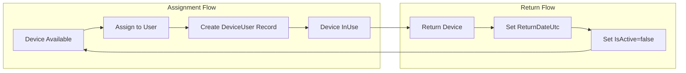

# Asset Management Design

## Overview

Asset management covers two types of company assets:
1. **Devices** - Individually tracked items assigned to employees (laptops, monitors, phones)
2. **Furniture** - Location-based items tracked by quantity (tables, chairs, shelves)

## Device Management

### Current State (Existing)

#### Entity: Device

**File**: `api/Cms.Core/Db/Entities/Device.cs`

| Field | Type | Description |
|-------|------|-------------|
| Id | int | Primary key |
| DeviceTypeId | int? | FK to DeviceType |
| Name | string(500) | Device name/description |
| Serial | string(100) | Serial number |
| PurchasingDate | DateOnly? | Date of purchase |
| SupplierId | int? | FK to Supplier |
| Price | decimal? | Purchase price |
| WarrantyDate | DateOnly? | Warranty expiration |
| Notes | string(1000) | Additional notes |
| ImageUrl | string(500) | Device image |
| Status | DeviceStatus | Available, InUse, Maintenance, Liquidated |

#### Entity: DeviceUser (Assignment History)

**File**: `api/Cms.Core/Db/Entities/DeviceUser.cs`

| Field | Type | Description |
|-------|------|-------------|
| Id | int | Primary key |
| DeviceId | int | FK to Device |
| UserId | int | FK to User |
| HandoverDateUtc | DateTime | Assignment date |
| ReturnDateUtc | DateTime? | Return date (null if active) |
| IsActive | bool | Current assignment flag |
| HandoverAgreement | bool | Agreement signed |
| WorkingType | string(50) | Hybrid, Remote, Office |
| Notes | string(1000) | Assignment notes |

#### Supporting Entities

- **DeviceType** - Categories (Laptop Mac, Laptop Win, Monitor, Phone, etc.)
- **Supplier** - Vendor information (name, contact)

### Data Flow

### Enhancements Needed

1. **Assignment History UI**
   - View all past assignments for a device
   - Timeline view showing who had the device and when

2. **Filtering**
   - By device status (Available, InUse, Maintenance, Liquidated)
   - By device type
   - By assigned/unassigned
   - By supplier

3. **Bulk Operations**
   - Assign multiple devices to same user
   - Bulk status update

---

## Furniture Management

### Current State (Existing)

#### Entity: Furniture

**File**: `api/Cms.Core/Db/Entities/Furniture.cs`

| Field | Type | Description |
|-------|------|-------------|
| Id | int | Primary key |
| AssetTypeId | int | FK to AssetType |
| Name | string(250) | Furniture name/description |
| Quantity | int | Number of items |
| Place | string(100) | Location (Living room, Meeting room, etc.) |
| PurchasingDate | DateOnly? | Date of purchase |
| SupplierId | int? | FK to Supplier |
| Price | decimal? | Purchase price |
| WarrantyDate | DateOnly? | Warranty expiration |
| Notes | string(500) | Additional notes |
| ImageUrl | string(250) | Furniture image |

### Design Decision

**Location-based tracking only** - Furniture is not assigned to individual users.

Rationale:
- Furniture items are shared resources (tables, chairs in meeting rooms)
- Tracked by location and quantity
- Sample data shows furniture items associated with places, not users

### Standard Locations

Based on sample data:
- Door (entrance area)
- Living room
- Meeting room - large
- Meeting room - small
- Liquidation (items being disposed)

---

## API Endpoints

### Devices (Existing)

| Method | Endpoint | Description |
|--------|----------|-------------|
| GET | /api/devices | List devices with filters |
| GET | /api/devices/{id} | Device details with assignment history |
| POST | /api/devices | Create device |
| PUT | /api/devices/{id} | Update device |

### Device Assignments (Existing)

| Method | Endpoint | Description |
|--------|----------|-------------|
| GET | /api/device-assignments | List all assignments |
| POST | /api/device-assignments | Assign device to user |
| PUT | /api/device-assignments/{id}/return | Return device |

### Furniture (Existing)

| Method | Endpoint | Description |
|--------|----------|-------------|
| GET | /api/furniture | List furniture with filters |
| GET | /api/furniture/{id} | Furniture details |
| POST | /api/furniture | Create furniture |
| PUT | /api/furniture/{id} | Update furniture |

---

## UI Pages

### Devices

| Page | Path | Description |
|------|------|-------------|
| Device List | /devices | DataGrid with filters |
| Device Details | /devices/:id | Details + assignment history |
| Device Edit | /devices/:id/edit | Edit form |

### Furniture

| Page | Path | Description |
|------|------|-------------|
| Furniture List | /furniture | DataGrid with filters |
| Furniture Details | /furniture/:id | Details view |
| Furniture Edit | /furniture/:id/edit | Edit form |

---

## Usecases

Two personas only: **admin** (HR = operations manager = admin, one role) manages furniture and sees everything; **employee** sees/requests only their own devices.

### Furniture (admin only)

1. As **admin**, I want to view/filter furniture by `Place` (Door, Living room, Meeting room - large/small), so that I can see what's in each room.
2. As **admin**, I want to filter furniture by `AssetType` (Shelf, Fan, Chair, Table, TV, etc.) and by `Supplier`, so that I can audit inventory by category or vendor.
3. As **admin**, I want to record a liquidation (date, sale price, buyer) on a furniture item instead of free-text `Notes`, so that history isn't buried in unstructured text (CSV rows 3-6).
4. As **admin**, I want to adjust `Quantity` on a furniture row (e.g. partial liquidation) without deleting the record, so that item history is preserved (CSV row 20).
5. As **admin**, I want a list of furniture with `WarrantyDate` expiring soon, so that I can plan repairs/replacements ahead of time.
6. As **admin**, I want a total furniture value report by `Place`/`AssetType`, so that I know spend per room/category.

### Devices — admin

7. As **admin**, I want to see all devices with current owner, `Status` (Available/InUse/Maintenance/Liquidated), and warranty state in one list, so that I have full visibility without checking each device individually.
8. As **admin**, I want to filter devices by `DeviceType`, status, and assigned/unassigned, so that I can quickly find available devices or audit a category.
9. As **admin**, I want to view a device's full assignment history, so that I can trace who had it and when.
10. As **admin**, I want to approve/reject employee device requests and assign the device on approval, so that requests turn directly into an assignment record.
11. As **admin**, I want to mark a device `Maintenance` or `Liquidated` while keeping its assignment history intact, so that past-owner data isn't lost when a device is retired/repaired.
12. As **admin**, I want a report of devices with `WarrantyDate` expiring soon, so that I can budget for repairs/replacements.

### Devices — employee

13. As an **employee**, I want to see the devices currently assigned to me (name, type, status), so that I know what I'm responsible for.
14. As an **employee**, I want to submit a device request (e.g. new monitor, replacement laptop) from my dashboard, so that I don't need to go through a separate channel.
15. As an **employee**, I want to see the status of my device request (pending/approved/rejected), so that I know whether to follow up.
16. As an **employee**, I want to report a device issue (e.g. needs maintenance) against my assigned device, so that admin is notified without me emailing IT directly.

---

## Design Notes

Applies to `/devices`, `/furniture` (admin list/detail/edit) and the new employee device widget. Desktop-first internal tool — Nuxt UI (@nuxt/ui) web app; mobile-only rules (safe areas, haptics, bottom nav) don't apply.

### Status & state (Device.Status, Furniture liquidation, request status)
- Pair every status badge with text/icon, not color alone (`color-not-only`, High severity) — e.g. `UBadge` with label text, not a bare colored dot. Applies to `DeviceStatus` (Available/InUse/Maintenance/Liquidated), and the new request status (pending/approved/rejected).
- If a status/count badge updates live (e.g. pending-request count on employee dashboard), announce it as one contextual phrase (`role="status" aria-atomic="true"`, e.g. "2 requests pending"), not a bare live-updating number (`contextual-live-badge-updates`, High).

### Filters (DeviceType/AssetType/Supplier/Location multi-select, assigned/unassigned, status tabs)
- Reuse the existing `UTabs` single-select pattern for status and assigned/unassigned (binary/small enum) — already established in `devices.vue`/`furniture.vue`.
- For multi-select filters (DeviceType, AssetType, Supplier, Location), when selected-value chips are shown, let the chip row wrap rather than clip, or provide an operable `+n` disclosure — never hide selected values in a fixed-height overflow:hidden row (`chip-collection-reflow`, High severity).
- Reset `pagination.pageIndex` to 0 on every filter change (already the convention — keep it for new filters).

### Data tables (device/furniture index grids)
- Wrap wide tables in a horizontal-scroll container (`overflow-x-auto`) rather than letting them break the page layout on narrow viewports (`table-handling`, Medium) — relevant since this is a data-dense admin grid with many optional columns (warranty, supplier, price).
- Icon-only action buttons (assign, return, edit, request) need `aria-label` (High severity, `aria-labels`) — check existing icon buttons in `devices.vue`/`furniture.vue` action columns too.

### Device request flow (new — employee submit, admin approve/reject)
- Submit gives loading → success/error feedback, not a silent click (`submit-feedback`, High).
- Validate on blur, not keystroke-by-keystroke (`inline-validation`, Medium) for the request form (device type, reason).
- Status visible to the employee (pending/approved/rejected) should use the same status+icon/text pairing as device status badges above, for visual consistency across the module.

### Employee dashboard widget (assigned devices + request status)
- Empty state ("No devices assigned yet" / "No requests yet") instead of blank space when the employee has nothing (`empty-states`, Medium) — relevant since new hires will see this widget before any device is assigned.

No verified nuxt-ui-specific pattern was found in the dataset for multi-select chip rendering — the chip-collection-reflow rule above is general `ux` guidance, not nuxt-ui-specific; verify against `USelectMenu`'s own chip/overflow behavior when implementing.