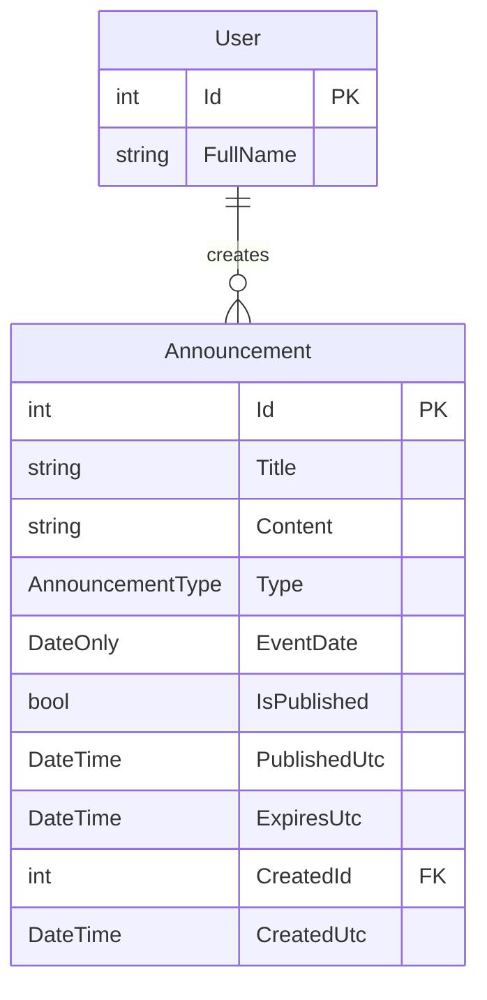

# Dashboard Design

## Overview

A central dashboard displaying company news, notices, and upcoming events. Only administrators can manage content.

## Content Types

| Type | Description | Display |
|------|-------------|---------|
| News | Company news and updates | Latest news section |
| Notice | Important announcements | Active notices panel |
| Event | Upcoming company events | Calendar/timeline view |

## Data Model

### Entity: Announcement

**File**: `api/Cms.Core/Db/Entities/Announcement.cs`

| Field | Type | Description |
|-------|------|-------------|
| Id | int | Primary key |
| Title | string(250) | Announcement title |
| Content | string(4000) | Full content (supports markdown) |
| Type | AnnouncementType | News, Notice, Event |
| EventDate | DateOnly? | For events: the event date |
| IsPublished | bool | Draft or published |
| PublishedUtc | DateTime? | When published |
| ExpiresUtc | DateTime? | Auto-hide after this date |
| CreatedId | int | Creator user ID |
| CreatedUtc | DateTime | Creation timestamp |
| UpdatedId | int? | Last editor user ID |
| UpdatedUtc | DateTime | Last update timestamp |

### Enum: AnnouncementType

**File**: `api/Cms.Core/Enums/AnnouncementType.cs`

```csharp
public enum AnnouncementType
{
    News = 1,
    Notice = 2,
    Event = 3
}
```

## Entity Relationship



## Display Logic

### News Section

- Show latest 5 published news items
- Ordered by PublishedUtc descending
- Filter: `Type = News AND IsPublished = true AND (ExpiresUtc IS NULL OR ExpiresUtc > NOW)`

### Notices Panel

- Show all active notices
- Ordered by PublishedUtc descending
- Filter: `Type = Notice AND IsPublished = true AND (ExpiresUtc IS NULL OR ExpiresUtc > NOW)`

### Upcoming Events

- Show events in next 30 days
- Ordered by EventDate ascending
- Filter: `Type = Event AND IsPublished = true AND EventDate >= TODAY AND EventDate <= TODAY + 30`

## API Endpoints

### Public (All Users)

| Method | Endpoint | Description |
|--------|----------|-------------|
| GET | /api/announcements/dashboard | Get dashboard content |
| GET | /api/announcements/{id} | Get single announcement |

### Admin Only

| Method | Endpoint | Description |
|--------|----------|-------------|
| GET | /api/announcements | List all (including drafts) |
| POST | /api/announcements | Create announcement |
| PUT | /api/announcements/{id} | Update announcement |
| DELETE | /api/announcements/{id} | Delete announcement |
| PUT | /api/announcements/{id}/publish | Publish draft |
| PUT | /api/announcements/{id}/unpublish | Unpublish |

### Request/Response Models

#### Dashboard Response

```json
// GET /api/announcements/dashboard
{
  "news": [
    {
      "id": 1,
      "title": "Q1 2026 Results",
      "content": "We are pleased to announce...",
      "publishedUtc": "2026-01-08T09:00:00Z",
      "author": "Admin User"
    }
  ],
  "notices": [
    {
      "id": 2,
      "title": "Office Closed Jan 20",
      "content": "The office will be closed...",
      "publishedUtc": "2026-01-05T10:00:00Z",
      "author": "HR Team"
    }
  ],
  "events": [
    {
      "id": 3,
      "title": "Team Building Day",
      "content": "Join us for...",
      "eventDate": "2026-01-25",
      "author": "HR Team"
    }
  ]
}
```

#### Create Announcement

```json
// POST /api/announcements
{
  "title": "New Policy Update",
  "content": "We are updating our remote work policy...",
  "type": "Notice",
  "eventDate": null,
  "isPublished": true,
  "expiresUtc": "2026-02-01T00:00:00Z"
}
```

## New Files

### Backend

| File | Description |
|------|-------------|
| `Cms.Core/Db/Entities/Announcement.cs` | Entity class |
| `Cms.Core/Db/Configurations/AnnouncementConfiguration.cs` | EF configuration |
| `Cms.Core/Enums/AnnouncementType.cs` | Type enum |
| `Cms.Core/Models/AnnouncementModel.cs` | DTOs |
| `Cms.Core/Services/AnnouncementService.cs` | Business logic |
| `Cms.Api/Controllers/AnnouncementsController.cs` | API controller |

### Frontend

| File | Description |
|------|-------------|
| `client/src/pages/index.vue` | Dashboard home page |
| `client/src/pages/announcements.vue` | Admin: Manage announcements |
| `client/src/pages/announcement-edit.vue` | Admin: Create/edit form |
| `client/src/modules/announcement/announcement.model.ts` | TypeScript interfaces |
| `client/src/modules/announcement/announcement.api.ts` | API functions |

## UI Pages

### Dashboard (`/`)

Layout:
```
+----------------------------------+
|           DASHBOARD              |
+----------------------------------+
|                    |             |
|  Latest News       | Notices     |
|  - News item 1     | - Notice 1  |
|  - News item 2     | - Notice 2  |
|  - News item 3     |             |
|                    |             |
+--------------------+-------------+
|     Upcoming Events              |
|  [Jan 25] Team Building Day      |
|  [Feb 10] All Hands Meeting      |
+----------------------------------+
```

Components:
- **News Widget**: Card list with title, excerpt, date
- **Notices Widget**: Alert-style list with title, content
- **Events Widget**: Timeline or calendar view with dates

### Announcements Admin (`/announcements`)

- DataGrid with all announcements
- Filter by type, status (draft/published)
- Quick actions: Publish, Unpublish, Edit, Delete

### Announcement Edit (`/announcements/new`, `/announcements/:id/edit`)

- Title input
- Type selector (News, Notice, Event)
- Event date picker (shown only for Event type)
- Rich text editor for content
- Expiration date picker
- Publish checkbox
