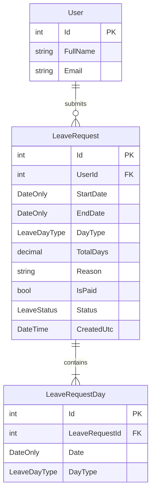
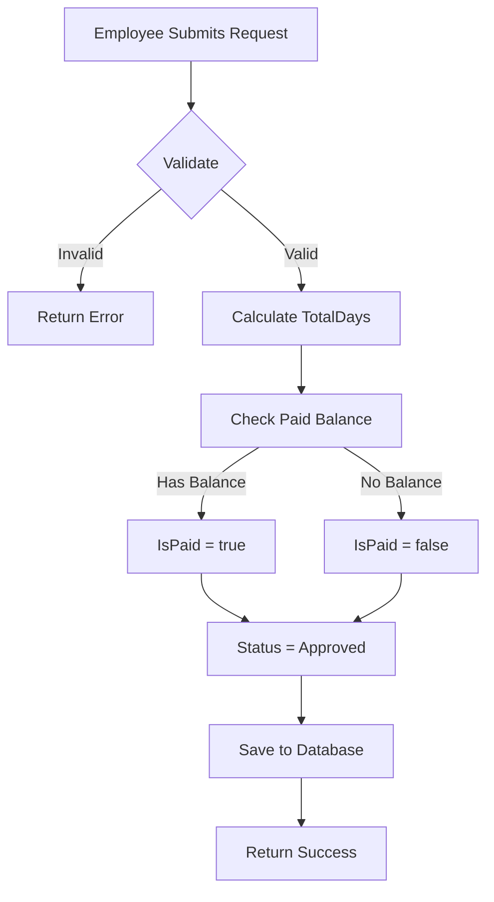

# Leave Management Design

## Overview

Enable employees to request time off with automatic balance tracking. Requests are auto-approved upon submission.

## Business Rules

| Rule | Description |
|------|-------------|
| Leave Duration | Each **calendar date** in a request is **full day (1.0)** or **half day (0.5)** — morning or afternoon |
| Max Request | **Up to 5 dates** per request; **one line per date** (no AM+PM on the same date in one request) |
| Annual Quota | 15 paid days per calendar year |
| Financial Year | January 1 - December 31 |
| Unpaid Leave | Auto-marked unpaid when paid quota exhausted |
| Auto-Approve | Requests auto-approve upon submission |

## Data Model

A **leave request** has a **header** (`LeaveRequest`) and **one row per calendar date** (`LeaveRequestDay`). Each row chooses **Full day**, **Half day (morning)**, or **Half day (afternoon)**.

### Entity: LeaveRequest (header)

**File**: `api/Cms.Core/Db/Entities/LeaveRequest.cs`

| Field | Type | Description |
|-------|------|-------------|
| Id | int | Primary key |
| UserId | int | FK to User |
| StartDate | DateOnly | **Denormalized:** minimum date among lines (for listing/filters) |
| EndDate | DateOnly | **Denormalized:** maximum date among lines |
| DayType | LeaveDayType | **Legacy / display:** first line by date order (column retained for compatibility) |
| TotalDays | decimal | **Denormalized:** sum of line weights (1.0 or 0.5 per line) |
| Reason | string(500) | Leave reason |
| IsPaid | bool | Paid or unpaid (whole request) |
| Status | LeaveStatus | Pending, Approved, Cancelled |
| CreatedUtc | DateTime | Request submission time |
| UpdatedUtc | DateTime | Last update time |

### Entity: LeaveRequestDay (line)

**File**: `api/Cms.Core/Db/Entities/LeaveRequestDay.cs`

| Field | Type | Description |
|-------|------|-------------|
| Id | int | Primary key |
| LeaveRequestId | int | FK to `LeaveRequest` |
| Date | DateOnly | Calendar date of this segment |
| DayType | LeaveDayType | `FullDay`, `HalfDay_Morning`, or `HalfDay_Afternoon` |

Unique constraint: **`(LeaveRequestId, Date)`** — at most one line per date per request.

### Enum: LeaveDayType

**File**: `api/Cms.Core/Enums/LeaveDayType.cs`

```csharp
public enum LeaveDayType
{
    FullDay = 1,
    HalfDay_Morning = 2,
    HalfDay_Afternoon = 3
}
```

### Enum: LeaveStatus

**File**: `api/Cms.Core/Enums/LeaveStatus.cs`

```csharp
public enum LeaveStatus
{
    Pending = 1,    // Not used with auto-approve, but kept for future
    Approved = 2,
    Cancelled = 3
}
```

## Entity Relationship



## Balance Calculation

### Formula

```
Remaining Paid Days = 15 - SUM(line weight)
WHERE each line comes from LeaveRequestDays joined to LeaveRequest:
  - LeaveRequest.IsPaid = true (after evaluation — see below)
  - LeaveRequest.Status = Approved
  - Line Date's calendar year = requested year

Line weight = 1.0 if DayType = FullDay, else 0.5
```

Used **paid** consumption for a year is the sum of **line weights** for approved **paid** requests whose **`Date`** falls in that year.

### TotalDays (header)

`LeaveRequest.TotalDays` = sum over its **`LeaveRequestDay`** rows: **1.0** per full day, **0.5** per half day.

### Paid vs Unpaid Logic

When creating a leave request:
1. Let **quota year** = **`YEAR(minimum line date)`** (earliest date in the payload).
2. Compute remaining paid balance for that year (same as `GET /api/leaves/balance?year=` for that year).
3. If **`TotalDays` <= remaining**: `IsPaid = true` on the header; else `IsPaid = false`.

## Request Flow



## Validation Rules

| Rule | Description |
|------|-------------|
| Lines | At least **1** date; at most **5** dates per request |
| Unique dates | No duplicate **Date** within the same request |
| Date window | Each line **Date >= UTC today - 7 days** (backdating up to 7 days allowed; no upper bound) |
| Weekdays only | Each line **Date must not be Saturday or Sunday** |
| No session overlap | Cannot conflict with another **approved** line for the same user on the same date: **Full** blocks the whole day; **half** blocks that half; **morning + afternoon** on the same date from **different** requests still conflict with a **Full** on that date (see implementation) |

## API Endpoints

| Method | Endpoint | Description |
|--------|----------|-------------|
| GET | /api/leaves | List user's leave requests |
| GET | /api/leaves/{id} | Get leave request details |
| POST | /api/leaves | Create new leave request |
| PUT | /api/leaves/{id}/cancel | Cancel leave request |
| GET | /api/leaves/balance | Get remaining paid days |
| GET | /api/leaves/all | Admin: List all employees' leaves |

### Request/Response Models

#### Create Leave Request

```json
// POST /api/leaves
{
  "days": [
    { "date": "2026-02-01", "dayType": "FullDay" },
    { "date": "2026-02-02", "dayType": "HalfDay_Morning" },
    { "date": "2026-02-03", "dayType": "FullDay" }
  ],
  "reason": "Family vacation"
}

// Response (camelCase; dayType enum numeric in JSON per serializer settings)
{
  "id": 1,
  "userId": 5,
  "userName": "John Doe",
  "startDate": "2026-02-01",
  "endDate": "2026-02-03",
  "dayType": "FullDay",
  "totalDays": 2.5,
  "reason": "Family vacation",
  "isPaid": true,
  "status": "Approved",
  "createdUtc": "2026-01-09T10:30:00Z",
  "days": [
    { "date": "2026-02-01", "dayType": "FullDay" },
    { "date": "2026-02-02", "dayType": "HalfDay_Morning" },
    { "date": "2026-02-03", "dayType": "FullDay" }
  ]
}
```

#### Get Balance

```json
// GET /api/leaves/balance
{
  "year": 2026,
  "totalQuota": 15.0,
  "usedPaid": 3.0,
  "remaining": 12.0
}
```

## New Files

### Backend

| File | Description |
|------|-------------|
| `api/Cms.Core/Db/Entities/LeaveRequest.cs` | Header entity |
| `api/Cms.Core/Db/Entities/LeaveRequestDay.cs` | Per-date line entity |
| `api/Cms.Core/Db/Configurations/LeaveRequestConfiguration.cs` | EF configuration |
| `api/Cms.Core/Db/Configurations/LeaveRequestDayConfiguration.cs` | EF configuration for lines |
| `api/Cms.Core/Enums/LeaveDayType.cs` | Day type enum |
| `api/Cms.Core/Enums/LeaveStatus.cs` | Status enum |
| `api/Cms.Core/Modules/LeaveIndex/LeaveIndexModel.cs` | DTOs (`LeaveRequestDto`, `CreateLeaveRequest`, etc.) |
| `api/Cms.Core/Modules/LeaveIndex/LeaveIndexService.cs` | Business logic |
| `api/Cms.Api/Controllers/LeavesController.cs` | API controller |

### Frontend

| File | Description |
|------|-------------|
| `client/src/pages/user-details.vue` | Per-user leave list + balance/cancel for current user (`GET /api/leaves/all?userId=`) |
| `client/src/pages/leaves.vue` | Admin: all employees (`GET /api/leaves/all`) |
| `client/src/pages/leave-new.vue` | New leave request form |
| `client/src/modules/leave_index/leave_index.model.ts` | TypeScript interfaces |

## UI Pages

### User profile — leave requests (`/users/:id`)

- Lists that user’s requests via `GET /api/leaves/all?userId=:id` (year/status filters, pagination)
- When viewing **your own** profile (same id as authenticated user; placeholder **user 1** until auth): show **balance** (`GET /api/leaves/balance`), **New request**, **Cancel** on approved rows
- Other users: list only (no cancel; balance API remains per current user)

### All leaves — admin (`/leaves`)

- Lists **all employees** via `GET /api/leaves/all` (employee column)
- No per-row cancel (cancel API is owner-scoped until admin-cancel exists)

### New Leave Request (`/leaves/new`)

- **Add/remove** up to **5** day rows; each row: **date** + **day type** (full / morning half / afternoon half)
- Optional reason
- Summary: **total days** (sum of weights) and paid vs unpaid preview vs balance
