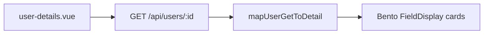

# User Details API Wire Implementation Plan

> **For agentic workers:** REQUIRED SUB-SKILL: Use superpowers:subagent-driven-development (recommended) or superpowers:executing-plans to implement this plan task-by-task. Steps use checkbox (`- [ ]`) syntax for tracking.

**Goal:** Replace `getMockUserDetail` on the user details page with live data from `GET /api/users/{id}` so the bento UI shows real employee fields.

**Architecture:** Keep the nested `UserDetail` view model the page already binds to. Expand the incomplete frontend `UserGet` type to match backend `UserGetModel`, add a pure mapper `mapUserGetToDetail`, and load via `useFetch` + `watch` + `execute` (same pattern as [`user-edit.vue`](client/src/pages/user-edit.vue) / [`device-detail.vue`](client/src/pages/device-detail.vue)). Fields with no API yet (`department`, `contractDetails`, `assets`) map to empty defaults; hide empty hero chips / manager row.

**Tech Stack:** Vue 3 Composition API, `@vueuse/core` `useFetch`, date-fns, Nuxt UI, existing `UserIndex` module. Backend already complete for this scope — no new endpoints.

**Canonical plan file (write on execution start):** [`docs/superpowers/plans/2026-07-19-user-details-api-wire.md`](docs/superpowers/plans/2026-07-19-user-details-api-wire.md)

## Global Constraints

- Do not run `dotnet build` unless user asks.
- Do not implement `PUT /api/users/{id}`, contacts CRUD, CSV import, or per-user device list APIs in this plan.
- Preserve existing comments; minimal diffs; follow [`client/AGENTS.md`](client/AGENTS.md) fetch pattern.
- Status source of truth: `UserStatus` enum (`Active=1`, `Inactive=2`, `OnLeave=3`) — drop mock `PROBATION` string status.



---

## File structure

| Path | Action | Responsibility |
|------|--------|----------------|
| [`client/src/modules/user_index/userIndex.model.ts`](client/src/modules/user_index/userIndex.model.ts) | Modify | Complete `UserGet` to match `UserGetModel` |
| [`client/src/models/user-detail.model.ts`](client/src/models/user-detail.model.ts) | Modify | Adjust `UserDetail` status type; add mapper; remove `getMockUserDetail` |
| [`client/src/pages/user-details.vue`](client/src/pages/user-details.vue) | Modify | Fetch, loading/404/error, bind mapped detail |
| [`api/Cms.Tests/UserIndexServiceTest.cs`](api/Cms.Tests/UserIndexServiceTest.cs) | Modify | Assert new scalar fields round-trip on `GetByIdAsync` |
| [`docs/plans/todo.md`](docs/plans/todo.md) / [`docs/plans/progress.md`](docs/plans/progress.md) | Modify | Check off / append session note |

**Read-only references:** [`UserGetModel`](api/Cms.Core/Modules/UserIndex/UserIndexModel.cs), [`UserIndexService.GetByIdAsync`](api/Cms.Core/Modules/UserIndex/UserIndexService.cs), [`user-edit.vue`](client/src/pages/user-edit.vue) load pattern.

---

## Docs to read before coding

1. [`client/AGENTS.md`](client/AGENTS.md) — `useFetch` + `watch` + `execute`
2. [`UserGetModel`](api/Cms.Core/Modules/UserIndex/UserIndexModel.cs) — full field list
3. [`user-edit.vue`](client/src/pages/user-edit.vue) — 404/error handling

---

### Task 1: Align `UserGet` TypeScript with backend

**Files:**
- Modify: [`client/src/modules/user_index/userIndex.model.ts`](client/src/modules/user_index/userIndex.model.ts)
- Test: [`api/Cms.Tests/UserIndexServiceTest.cs`](api/Cms.Tests/UserIndexServiceTest.cs)

**Interfaces:**
- Consumes: backend `UserGetModel` property names (camelCase JSON)
- Produces: complete `UserGet` type for mapper + edit page

- [ ] **Step 1: Write failing backend test for extended GetById fields**

Add to `UserIndexServiceTest.cs`:

```csharp
[Fact]
public async Task GetById_Should_ReturnExtendedHrFields_WhenUserExists()
{
    var db = fix.Get<Cms.Core.Db.ApplicationDbContext>();
    var user = new Cms.Core.Db.Entities.User
    {
        FullName = "HR Field User",
        Username = "hr.fields",
        Email = "hr.fields@example.com",
        Title = "Engineer",
        Gender = "Male",
        PersonalEmail = "personal@example.com",
        NationalId = "079092001234",
        BankAccount = "0123456789",
        CreatedBy = "SYSTEM",
        CreatedId = 0,
        Status = Cms.Core.Enums.UserStatus.Active,
    };
    db.Users.Add(user);
    await db.SaveChangesAsync();

    var svc = fix.Get<Cms.Core.Modules.UserIndex.IUserIndexService>();
    var result = await svc.GetByIdAsync(user.Id);

    Assert.NotNull(result);
    Assert.Equal("Engineer", result.Title);
    Assert.Equal("Male", result.Gender);
    Assert.Equal("personal@example.com", result.PersonalEmail);
    Assert.Equal("079092001234", result.NationalId);
    Assert.Equal("0123456789", result.BankAccount);
}
```

- [ ] **Step 2: Run test (expect PASS — API already maps these)**

Run (quiet): `rtk dotnet test api/Cms.Tests/Cms.Tests.csproj --filter "FullyQualifiedName~GetById_Should_ReturnExtendedHrFields" -v q`  
Expected: PASS (Docker/Testcontainers required). If fail, fix `GetByIdAsync` projection before frontend work.

- [ ] **Step 3: Expand `UserGet` type**

Replace the incomplete `UserGet` in `userIndex.model.ts` with fields matching `UserGetModel` (all optional strings/numbers as on API):

```ts
export type UserGet = {
  id: number
  fullName: string
  username: string
  email: string
  phone: string | null
  title: string | null
  gender: string | null
  personalEmail: string | null
  dateOfBirth: string | null
  placeOfBirth: string | null
  nation: string | null
  religion: string | null
  nationalId: string | null
  nationalIdIssueDate: string | null
  nationalIdIssuePlace: string | null
  hometown: string | null
  permanentResidence: string | null
  currentAddress: string | null
  academicLevel: string | null
  schoolOrUniversity: string | null
  major: string | null
  certificates: string | null
  idNotarizedDocument: string | null
  ndaDocument: string | null
  emergencyContactFullName: string | null
  emergencyContactRelationship: string | null
  emergencyContactPhone: string | null
  emergencyContactAddress: string | null
  marriageStatus: string | null
  contacts: Contact[]
  numberOfDependents: number | null
  bankAccount: string | null
  personalIncomeTaxCode: string | null
  socialInsuranceCode: string | null
  status: UserStatus
  teamMemberships: UserTeamMembership[]
  createdUtc: string
  createdBy: string
  updatedUtc: string
  updatedBy: string | null
}
```

- [ ] **Step 4: Commit**

```bash
git add client/src/modules/user_index/userIndex.model.ts api/Cms.Tests/UserIndexServiceTest.cs
git commit -m "$(cat <<'EOF'
feat(client): align UserGet type with API UserGetModel

EOF
)"
```

---

### Task 2: Mapper + trim mock / status types

**Files:**
- Modify: [`client/src/models/user-detail.model.ts`](client/src/models/user-detail.model.ts)

**Interfaces:**
- Consumes: `UserGet`, `UserStatus`
- Produces: `mapUserGetToDetail(user: UserGet): UserDetail`; `UserDetail.status` as display label string from enum

- [ ] **Step 1: Change `UserDetail.status` and empty contract/assets defaults**

```ts
import { UserStatus } from './user.enum'
import type { UserGet } from '../modules/user_index/userIndex.model'

// UserDetail.status becomes:
status: UserStatus

// ContractDetails.manager.name may be ''
// ContractDetails fields may be ''
```

Update `ContractDetails.status` to stay as UI-only placeholder union, or simplify contract card to not invent ACTIVE when empty — use empty strings and hide badge when no contract data (see Task 3).

- [ ] **Step 2: Add date helper + mapper**

```ts
import { format, parseISO, isValid } from 'date-fns'

function formatDateOnly(iso: string | null | undefined): string {
  if (!iso) return ''
  try {
    const d = parseISO(iso)
    return isValid(d) ? format(d, 'dd MMM yyyy') : iso
  } catch {
    return iso
  }
}

export function mapUserGetToDetail(user: UserGet): UserDetail {
  return {
    id: user.id,
    fullName: user.fullName,
    username: user.username,
    email: user.email,
    title: user.title ?? undefined,
    department: undefined,
    status: user.status,
    contactInfo: {
      workEmail: user.email,
      personalEmail: user.personalEmail ?? undefined,
      phone: user.phone ?? undefined,
    },
    personalInfo: {
      gender: user.gender ?? undefined,
      dateOfBirth: formatDateOnly(user.dateOfBirth),
      placeOfBirth: user.placeOfBirth ?? undefined,
      nation: user.nation ?? undefined,
      religion: user.religion ?? undefined,
      marriageStatus: user.marriageStatus ?? undefined,
      numberOfDependents: user.numberOfDependents ?? undefined,
    },
    identityDoc: {
      nationalId: user.nationalId ?? undefined,
      nationalIdIssueDate: formatDateOnly(user.nationalIdIssueDate),
      nationalIdIssuePlace: user.nationalIdIssuePlace ?? undefined,
    },
    address: {
      hometown: user.hometown ?? undefined,
      permanentResidence: user.permanentResidence ?? undefined,
      currentAddress: user.currentAddress ?? undefined,
    },
    education: {
      academicLevel: user.academicLevel ?? undefined,
      schoolOrUniversity: user.schoolOrUniversity ?? undefined,
      major: user.major ?? undefined,
      certificates: user.certificates ?? undefined,
    },
    financial: {
      bankAccount: user.bankAccount ?? undefined,
      personalIncomeTaxCode: user.personalIncomeTaxCode ?? undefined,
      socialInsuranceCode: user.socialInsuranceCode ?? undefined,
    },
    emergencyContact: {
      fullName: user.emergencyContactFullName ?? undefined,
      relationship: user.emergencyContactRelationship ?? undefined,
      phone: user.emergencyContactPhone ?? undefined,
      address: user.emergencyContactAddress ?? undefined,
    },
    documents: {
      idNotarizedDocument: user.idNotarizedDocument ?? undefined,
      ndaDocument: user.ndaDocument ?? undefined,
    },
    contractDetails: {
      contractType: '',
      startDate: '',
      probationEnd: '',
      status: 'PENDING',
      manager: { id: 0, name: '' },
    },
    assets: [],
  }
}
```

- [ ] **Step 3: Delete `getMockUserDetail` and its mock data block** (no remaining imports after Task 3).

- [ ] **Step 4: Commit**

```bash
git add client/src/models/user-detail.model.ts
git commit -m "$(cat <<'EOF'
feat(client): map UserGet to UserDetail view model

EOF
)"
```

---

### Task 3: Wire `user-details.vue` to API

**Files:**
- Modify: [`client/src/pages/user-details.vue`](client/src/pages/user-details.vue)

**Interfaces:**
- Consumes: `UserGet`, `mapUserGetToDetail`, `UserStatus` / `UserStatusOptions`
- Produces: live profile hero + bento; empty assets/contract until later APIs

- [ ] **Step 1: Replace mock import/computed with fetch**

Remove `getMockUserDetail`. Add (mirror leave-list pattern already on page):

```ts
import { mapUserGetToDetail, type UserDetail } from '../models/user-detail.model'
import type { UserGet } from '../modules/user_index/userIndex.model'
import { UserStatus, UserStatusOptions } from '../models/user.enum'

const userUrl = computed(() => `/api/users/${profileUserId.value}`)

const {
  data: userGet,
  isFetching: userLoading,
  error: userError,
  statusCode: userStatusCode,
  execute: executeUser,
} = useFetch(userUrl, { immediate: false, initialData: null }).json<UserGet | null>()

const userLoaded = ref(false)
const loadFailed = ref(false)

watch(
  profileUserId,
  async () => {
    loadFailed.value = false
    userLoaded.value = false
    const id = Number(profileUserId.value)
    if (!profileUserId.value || Number.isNaN(id)) {
      toast.add({ title: 'Invalid user', color: 'error' })
      router.push('/users')
      return
    }
    await executeUser()
    if (userStatusCode.value === 404) {
      toast.add({ title: 'User not found', color: 'error' })
      router.push('/users')
      return
    }
    if (userError.value) {
      loadFailed.value = true
      toast.add({ title: 'Failed to load user', color: 'error' })
      return
    }
    userLoaded.value = !!userGet.value
  },
  { immediate: true }
)

const userDetail = computed<UserDetail | null>(() =>
  userGet.value ? mapUserGetToDetail(userGet.value) : null
)
```

Move `profileUserId` **above** `userUrl` (today `userId` / mock sit before it — reorder).

- [ ] **Step 2: Fix status badge mapping**

```ts
const statusColor = computed((): 'success' | 'warning' | 'error' | 'neutral' => {
  if (!userDetail.value) return 'neutral'
  switch (userDetail.value.status) {
    case UserStatus.Active: return 'success'
    case UserStatus.OnLeave: return 'warning'
    case UserStatus.Inactive: return 'error'
    default: return 'neutral'
  }
})

function statusLabel(status: UserStatus): string {
  return UserStatusOptions.find((o) => o.value === status)?.label ?? String(status)
}
```

Template badge: `{{ statusLabel(userDetail.status) }}` (not raw enum number).

- [ ] **Step 3: Template guards**

- Wrap `#body` main content in `v-if="userDetail"`.
- Show skeleton / spinner while `userLoading`.
- Show error state when `loadFailed`.
- Hero department chip: `v-if="userDetail.department"`.
- Title line: show only if `userDetail.title`.
- Contract manager block: `v-if="userDetail.contractDetails.manager.name"`.
- Contract status badge: hide when `contractDetails.contractType` is empty (no fake ACTIVE).
- Assets sections: keep UI; empty lists when `assets` empty (already filtered computeds).

- [ ] **Step 4: Null-safe field computeds**

Every `userDetail.value.…` access must short-circuit when `userDetail` is null (return `[]` for field groups).

- [ ] **Step 5: Manual verify**

1. Run API + client; open `/users/1` (or known id).
2. Hero shows real `fullName` / `username` / `email` / status from DB.
3. Contact / personal / identity / education / financial / address / emergency match DB (empty OK if null).
4. Unknown id → toast + redirect `/users`.
5. Leave section still loads (unchanged API).
6. Devices/furniture lists empty (expected).

- [ ] **Step 6: Commit**

```bash
git add client/src/pages/user-details.vue client/src/models/user-detail.model.ts
git commit -m "$(cat <<'EOF'
feat(client): load user details from GET /api/users/:id

EOF
)"
```

---

### Task 4: Progress docs

**Files:**
- Modify: [`docs/plans/todo.md`](docs/plans/todo.md) — under Employee Management, add checked item: "User details page loads from `GET /api/users/{id}` (mock removed)"
- Modify: [`docs/plans/progress.md`](docs/plans/progress.md) — append session block (date, files, pending: PUT edit / assets-by-user / contract fields)

- [ ] **Step 1: Update todo + progress**
- [ ] **Step 2: Commit**

```bash
git add docs/plans/todo.md docs/plans/progress.md docs/superpowers/plans/2026-07-19-user-details-api-wire.md
git commit -m "$(cat <<'EOF'
docs: record user-details API wire progress

EOF
)"
```

---

## Self-review

1. **Spec coverage:** Wire details to API — Tasks 1–3. Out of scope (PUT, contacts UI, CSV, assets API) explicitly excluded.
2. **Placeholders:** None; mapper and fetch code are concrete.
3. **Type consistency:** `UserGet` matches `UserGetModel`; mapper uses those names; page uses `UserDetail` + `UserStatus`.

## Out of scope (next plans)

- `PUT /api/users/{id}` + `user-edit` save
- Expand edit form to all HR fields
- Contacts / team memberships cards on details
- Per-user devices/furniture API
- Department / contract / manager schema
