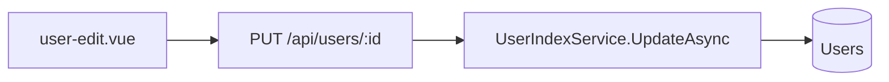

# User Edit HR Fields Implementation Plan

> **For agentic workers:** REQUIRED SUB-SKILL: Use **superpowers:subagent-driven-development** (recommended) or **superpowers:executing-plans** to implement this plan task-by-task. Steps use checkbox (`- [ ]`) syntax for tracking.

**Goal:** Expand `/users/:id/edit` so every HR section shown on user details (except leave, assets, and contract) loads and saves via `PUT /api/users/{id}`.

**Architecture:** Add `UserUpdateModel` + `UpdateAsync` on `UserIndex` (return `Result<int>` like devices). Expand Valibot schema and `UCard` sections on `user-edit.vue` to match details cards. Wire `handleSave` with `fetch` PUT + toast + navigate to details. Avatar file stays UI-only (no upload). Documents are plain text path/URL fields.

**Tech Stack:** .NET 10 / EF Core, Vue 3, Valibot + Nuxt UI `UForm`, `FormDatePicker`, `@vueuse/core` `useFetch` for load.

**Spec:** [`docs/prompts/prompt-user-edit-hr-fields-20260719.md`](../../prompts/prompt-user-edit-hr-fields-20260719.md)

## Global Constraints

- Do not run `dotnet build` unless user asks (tests via `rtk dotnet test … -v q` OK).
- No leave / assets / contract / department / `contacts[]` CRUD on edit.
- Preserve existing comments; minimal diffs; follow module patterns in `AGENTS.md` / `client/AGENTS.md`.
- Audit: set `UpdatedUtc = DateTime.UtcNow`, `UpdatedBy = "SYSTEM"` with `// UNDONE: use current user`.
- Username and audit fields remain read-only; do not accept username in PUT body.
- Gender / marriageStatus / document fields: free-text inputs (entity is `string`).
- Date fields over the wire: ISO `yyyy-MM-dd` or `null`.

### Locked field list (editable)

| Section | Fields |
|---------|--------|
| Basic | `fullName`, `title`, `status` |
| Contact | `email`, `personalEmail`, `phone` |
| Personal | `gender`, `dateOfBirth`, `placeOfBirth`, `nation`, `religion`, `marriageStatus`, `numberOfDependents` |
| Identity | `nationalId`, `nationalIdIssueDate`, `nationalIdIssuePlace` |
| Education | `academicLevel`, `schoolOrUniversity`, `major`, `certificates` |
| Financial | `bankAccount`, `personalIncomeTaxCode`, `socialInsuranceCode` |
| Documents | `idNotarizedDocument`, `ndaDocument` (text) |
| Addresses | `currentAddress`, `permanentResidence`, `hometown` |
| Emergency | `emergencyContactFullName`, `emergencyContactRelationship`, `emergencyContactPhone`, `emergencyContactAddress` |

Read-only on page (unchanged): username, id, team memberships, created/updated audit, avatar UI stub.



---

## File structure

| Path | Action | Responsibility |
|------|--------|----------------|
| [`api/Cms.Core/Modules/UserIndex/UserIndexModel.cs`](../../api/Cms.Core/Modules/UserIndex/UserIndexModel.cs) | Modify | Add `UserUpdateModel` record |
| [`api/Cms.Core/Modules/UserIndex/UserIndexService.cs`](../../api/Cms.Core/Modules/UserIndex/UserIndexService.cs) | Modify | `UpdateAsync` |
| [`api/Cms.Api/Controllers/UsersController.cs`](../../api/Cms.Api/Controllers/UsersController.cs) | Modify | `PUT {id}` |
| [`api/Cms.Tests/UserIndexServiceTest.cs`](../../api/Cms.Tests/UserIndexServiceTest.cs) | Modify | Update tests |
| [`client/src/modules/user_index/userIndex.model.ts`](../../client/src/modules/user_index/userIndex.model.ts) | Modify | `UserUpdate` type |
| [`client/src/pages/user-edit.vue`](../../client/src/pages/user-edit.vue) | Modify | Schema, load, sections, save |
| [`docs/plans/todo.md`](../plans/todo.md) / [`docs/plans/progress.md`](../plans/progress.md) | Modify | Progress |

**Read-only refs:** [`User.cs`](../../api/Cms.Core/Db/Entities/User.cs) max lengths; [`device-edit.vue`](../../client/src/pages/device-edit.vue) PUT pattern; [`user-details.vue`](../../client/src/pages/user-details.vue) section labels.

---

## Docs to read before coding

1. [`docs/prompts/prompt-user-edit-hr-fields-20260719.md`](../../prompts/prompt-user-edit-hr-fields-20260719.md)
2. [`client/AGENTS.md`](../../client/AGENTS.md) — Valibot + `FormDatePicker`
3. [`UserGetModel`](../../api/Cms.Core/Modules/UserIndex/UserIndexModel.cs) — field names

---

### Task 1: Backend `UserUpdateModel` + `UpdateAsync` (TDD)

**Files:**
- Modify: `api/Cms.Core/Modules/UserIndex/UserIndexModel.cs`
- Modify: `api/Cms.Core/Modules/UserIndex/UserIndexService.cs`
- Test: `api/Cms.Tests/UserIndexServiceTest.cs`

**Interfaces:**
- Consumes: existing `User` entity columns
- Produces: `UserUpdateModel`; `Task<Result<int>> UpdateAsync(int id, UserUpdateModel model, CancellationToken ct = default)`

- [ ] **Step 1: Write failing tests**

Append to `UserIndexServiceTest.cs`:

```csharp
[Fact]
public async Task UpdateAsync_Should_ReturnEntityNotFound_WhenUserMissing()
{
    var svc = fix.Get<Cms.Core.Modules.UserIndex.IUserIndexService>();
    var result = await svc.UpdateAsync(int.MaxValue, new Cms.Core.Modules.UserIndex.UserUpdateModel
    {
        FullName = "X",
        Email = "x@example.com",
        Status = Cms.Core.Enums.UserStatus.Active,
    });
    Assert.False(result.IsSuccess);
    Assert.Equal(Cms.Core.ResultCode.EntityNotFound, result.Code);
}

[Fact]
public async Task UpdateAsync_Should_PersistHrFields_WhenUserExists()
{
    var db = fix.Get<Cms.Core.Db.ApplicationDbContext>();
    var user = new Cms.Core.Db.Entities.User
    {
        FullName = "Before",
        Username = "hr.update",
        Email = "before@example.com",
        CreatedBy = "SYSTEM",
        CreatedId = 0,
        Status = Cms.Core.Enums.UserStatus.Active,
    };
    db.Users.Add(user);
    await db.SaveChangesAsync();

    var svc = fix.Get<Cms.Core.Modules.UserIndex.IUserIndexService>();
    var result = await svc.UpdateAsync(user.Id, new Cms.Core.Modules.UserIndex.UserUpdateModel
    {
        FullName = "After Name",
        Email = "after@example.com",
        Phone = "0900000000",
        Title = "Engineer",
        Gender = "Male",
        PersonalEmail = "p@example.com",
        DateOfBirth = new DateOnly(1990, 1, 15),
        PlaceOfBirth = "HCMC",
        Nation = "VN",
        Religion = "None",
        NationalId = "079090001111",
        NationalIdIssueDate = new DateOnly(2020, 5, 1),
        NationalIdIssuePlace = "CA HCMC",
        Hometown = "Hometown",
        PermanentResidence = "Permanent",
        CurrentAddress = "Current",
        AcademicLevel = "Bachelor",
        SchoolOrUniversity = "Uni",
        Major = "CS",
        Certificates = "AWS",
        IdNotarizedDocument = "id.pdf",
        NdaDocument = "nda.pdf",
        EmergencyContactFullName = "Spouse",
        EmergencyContactRelationship = "Wife",
        EmergencyContactPhone = "0911111111",
        EmergencyContactAddress = "Addr",
        MarriageStatus = "Married",
        NumberOfDependents = 1,
        BankAccount = "123",
        PersonalIncomeTaxCode = "TAX",
        SocialInsuranceCode = "SI",
        Status = Cms.Core.Enums.UserStatus.OnLeave,
    });

    Assert.True(result.IsSuccess);
    Assert.Equal(user.Id, result.Data);

    await db.Entry(user).ReloadAsync();
    Assert.Equal("After Name", user.FullName);
    Assert.Equal("after@example.com", user.Email);
    Assert.Equal("Engineer", user.Title);
    Assert.Equal("079090001111", user.NationalId);
    Assert.Equal("Bachelor", user.AcademicLevel);
    Assert.Equal("TAX", user.PersonalIncomeTaxCode);
    Assert.Equal("Spouse", user.EmergencyContactFullName);
    Assert.Equal(Cms.Core.Enums.UserStatus.OnLeave, user.Status);
    Assert.Equal("hr.update", user.Username); // username unchanged
}
```

- [ ] **Step 2: Run tests — expect FAIL** (missing type/method)

Run: `rtk dotnet test api/Cms.Tests/Cms.Tests.csproj -v q --filter "FullyQualifiedName~UpdateAsync_Should"`  
Expected: compile error or FAIL (method missing).

- [ ] **Step 3: Add `UserUpdateModel`**

In `UserIndexModel.cs` after `UserGetModel` / team membership records:

```csharp
/// <summary>Body for PUT /api/users/{id}. Does not include username or audit.</summary>
public record UserUpdateModel
{
    public string FullName { get; set; } = null!;
    public string Email { get; set; } = null!;
    public string? Phone { get; set; }
    public string? Title { get; set; }
    public string? Gender { get; set; }
    public string? PersonalEmail { get; set; }
    public DateOnly? DateOfBirth { get; set; }
    public string? PlaceOfBirth { get; set; }
    public string? Nation { get; set; }
    public string? Religion { get; set; }
    public string? NationalId { get; set; }
    public DateOnly? NationalIdIssueDate { get; set; }
    public string? NationalIdIssuePlace { get; set; }
    public string? Hometown { get; set; }
    public string? PermanentResidence { get; set; }
    public string? CurrentAddress { get; set; }
    public string? AcademicLevel { get; set; }
    public string? SchoolOrUniversity { get; set; }
    public string? Major { get; set; }
    public string? Certificates { get; set; }
    public string? IdNotarizedDocument { get; set; }
    public string? NdaDocument { get; set; }
    public string? EmergencyContactFullName { get; set; }
    public string? EmergencyContactRelationship { get; set; }
    public string? EmergencyContactPhone { get; set; }
    public string? EmergencyContactAddress { get; set; }
    public string? MarriageStatus { get; set; }
    public int? NumberOfDependents { get; set; }
    public string? BankAccount { get; set; }
    public string? PersonalIncomeTaxCode { get; set; }
    public string? SocialInsuranceCode { get; set; }
    public UserStatus Status { get; set; }
}
```

- [ ] **Step 4: Implement `UpdateAsync`**

On `IUserIndexService` add:

```csharp
Task<Result<int>> UpdateAsync(int id, UserUpdateModel model, CancellationToken cancellationToken = default);
```

Implementation (same class as `GetByIdAsync`):

```csharp
public async Task<Result<int>> UpdateAsync(int id, UserUpdateModel model, CancellationToken cancellationToken = default)
{
    using var db = await dbFactory.CreateDbContextAsync(cancellationToken);
    var user = await db.Users.FirstOrDefaultAsync(x => x.Id == id, cancellationToken);
    if (user is null)
        return Result<int>.Failure(ResultCode.EntityNotFound);

    user.FullName = model.FullName;
    user.Email = model.Email;
    user.Phone = model.Phone;
    user.Title = model.Title;
    user.Gender = model.Gender;
    user.PersonalEmail = model.PersonalEmail;
    user.DateOfBirth = model.DateOfBirth;
    user.PlaceOfBirth = model.PlaceOfBirth;
    user.Nation = model.Nation;
    user.Religion = model.Religion;
    user.NationalId = model.NationalId;
    user.NationalIdIssueDate = model.NationalIdIssueDate;
    user.NationalIdIssuePlace = model.NationalIdIssuePlace;
    user.Hometown = model.Hometown;
    user.PermanentResidence = model.PermanentResidence;
    user.CurrentAddress = model.CurrentAddress;
    user.AcademicLevel = model.AcademicLevel;
    user.SchoolOrUniversity = model.SchoolOrUniversity;
    user.Major = model.Major;
    user.Certificates = model.Certificates;
    user.IdNotarizedDocument = model.IdNotarizedDocument;
    user.NdaDocument = model.NdaDocument;
    user.EmergencyContactFullName = model.EmergencyContactFullName;
    user.EmergencyContactRelationship = model.EmergencyContactRelationship;
    user.EmergencyContactPhone = model.EmergencyContactPhone;
    user.EmergencyContactAddress = model.EmergencyContactAddress;
    user.MarriageStatus = model.MarriageStatus;
    user.NumberOfDependents = model.NumberOfDependents;
    user.BankAccount = model.BankAccount;
    user.PersonalIncomeTaxCode = model.PersonalIncomeTaxCode;
    user.SocialInsuranceCode = model.SocialInsuranceCode;
    user.Status = model.Status;
    user.UpdatedUtc = DateTime.UtcNow;
    user.UpdatedBy = "SYSTEM"; // UNDONE: use current user

    await db.SaveChangesAsync(cancellationToken);
    return Result<int>.Success(user.Id);
}
```

Add `using Cms.Core;` if needed for `Result` / `ResultCode`.

- [ ] **Step 5: Run tests — expect PASS**

Run: `rtk dotnet test api/Cms.Tests/Cms.Tests.csproj -v q --filter "FullyQualifiedName~UpdateAsync_Should"`  
Expected: PASS (Docker/Testcontainers).

- [ ] **Step 6: Commit**

```bash
git add api/Cms.Core/Modules/UserIndex/UserIndexModel.cs api/Cms.Core/Modules/UserIndex/UserIndexService.cs api/Cms.Tests/UserIndexServiceTest.cs
git commit -m "feat(api): add UserIndex UpdateAsync for HR fields"
```

---

### Task 2: `PUT /api/users/{id}` controller

**Files:**
- Modify: `api/Cms.Api/Controllers/UsersController.cs`

**Interfaces:**
- Consumes: `IUserIndexService.UpdateAsync`
- Produces: HTTP 200 `Result<int>` or 404 when `EntityNotFound`

- [ ] **Step 1: Add action**

After `Get`:

```csharp
/// <summary>
/// Update user HR profile fields.
/// </summary>
[HttpPut("{id:int}")]
public async Task<IActionResult> Update(int id, [FromBody] UserUpdateModel model, CancellationToken cancellationToken = default)
{
    var result = await userIndexService.UpdateAsync(id, model, cancellationToken);
    if (result.Code == ResultCode.EntityNotFound)
        return NotFound();

    return Ok(result);
}
```

Ensure usings: `Cms.Core` for `ResultCode`.

- [ ] **Step 2: Commit**

```bash
git add api/Cms.Api/Controllers/UsersController.cs
git commit -m "feat(api): expose PUT /api/users/{id}"
```

---

### Task 3: Frontend `UserUpdate` type + form schema / load mapping

**Files:**
- Modify: `client/src/modules/user_index/userIndex.model.ts`
- Modify: `client/src/pages/user-edit.vue` (script only this task)

**Interfaces:**
- Consumes: `UserGet` from GET
- Produces: `UserUpdate` payload type; expanded Valibot schema + `formData` + `applyLoadedUser`

- [ ] **Step 1: Add `UserUpdate` type**

In `userIndex.model.ts`:

```ts
/** JSON body for PUT /api/users/:id (camelCase). */
export type UserUpdate = {
  fullName: string
  email: string
  phone: string | null
  title: string | null
  gender: string | null
  personalEmail: string | null
  dateOfBirth: string | null
  placeOfBirth: string | null
  nation: string | null
  religion: string | null
  nationalId: string | null
  nationalIdIssueDate: string | null
  nationalIdIssuePlace: string | null
  hometown: string | null
  permanentResidence: string | null
  currentAddress: string | null
  academicLevel: string | null
  schoolOrUniversity: string | null
  major: string | null
  certificates: string | null
  idNotarizedDocument: string | null
  ndaDocument: string | null
  emergencyContactFullName: string | null
  emergencyContactRelationship: string | null
  emergencyContactPhone: string | null
  emergencyContactAddress: string | null
  marriageStatus: string | null
  numberOfDependents: number | null
  bankAccount: string | null
  personalIncomeTaxCode: string | null
  socialInsuranceCode: string | null
  status: UserStatus
}
```

- [ ] **Step 2: Helper for optional string maxLength**

In `user-edit.vue` script, replace `userEditSchema` with (keep avatar optional File validation as today):

```ts
const optStr = (max: number) =>
  v.optional(
    v.pipe(v.string(), v.maxLength(max, `Must not exceed ${max} characters.`))
  )

const userEditSchema = v.object({
  fullName: v.pipe(v.string(), v.nonEmpty('Full name is required.'), v.maxLength(250)),
  email: v.pipe(v.string(), v.nonEmpty('Email is required.'), v.email(), v.maxLength(250)),
  phone: optStr(20),
  title: optStr(100),
  gender: optStr(20),
  personalEmail: v.optional(
    v.pipe(v.string(), v.maxLength(250), v.union([v.literal(''), v.pipe(v.string(), v.email())]))
  ),
  dateOfBirth: v.optional(v.string()),
  placeOfBirth: optStr(100),
  nation: optStr(100),
  religion: optStr(100),
  nationalId: optStr(50),
  nationalIdIssueDate: v.optional(v.string()),
  nationalIdIssuePlace: optStr(250),
  hometown: optStr(500),
  permanentResidence: optStr(500),
  currentAddress: optStr(500),
  academicLevel: optStr(250),
  schoolOrUniversity: optStr(250),
  major: optStr(250),
  certificates: optStr(500),
  idNotarizedDocument: optStr(500),
  ndaDocument: optStr(500),
  emergencyContactFullName: optStr(250),
  emergencyContactRelationship: optStr(100),
  emergencyContactPhone: optStr(20),
  emergencyContactAddress: optStr(500),
  marriageStatus: optStr(50),
  numberOfDependents: v.optional(v.pipe(v.number(), v.minValue(0))),
  bankAccount: optStr(100),
  personalIncomeTaxCode: optStr(50),
  socialInsuranceCode: optStr(50),
  status: v.pipe(v.number(), v.minValue(1, 'Status is required.')),
  avatar: v.optional(
    v.pipe(
      v.instance(File, 'Avatar must be a file.'),
      v.mimeType(['image/jpeg', 'image/png', 'image/gif'], 'Please select a JPEG, PNG, or GIF file.'),
      v.maxSize(2 * 1024 * 1024, 'Please select a file smaller than 2 MB.')
    )
  ),
})
```

If Valibot `union` for personalEmail is awkward, use `optStr(250)` only (no email format on optional personal) — prefer simpler:

```ts
personalEmail: optStr(250),
```

- [ ] **Step 3: Expand `formData` defaults + second date picker**

```ts
const formData = reactive<Partial<UserEditSchema>>({
  fullName: '',
  email: '',
  phone: undefined,
  title: undefined,
  gender: undefined,
  personalEmail: undefined,
  dateOfBirth: undefined,
  placeOfBirth: undefined,
  nation: undefined,
  religion: undefined,
  nationalId: undefined,
  nationalIdIssueDate: undefined,
  nationalIdIssuePlace: undefined,
  hometown: undefined,
  permanentResidence: undefined,
  currentAddress: undefined,
  academicLevel: undefined,
  schoolOrUniversity: undefined,
  major: undefined,
  certificates: undefined,
  idNotarizedDocument: undefined,
  ndaDocument: undefined,
  emergencyContactFullName: undefined,
  emergencyContactRelationship: undefined,
  emergencyContactPhone: undefined,
  emergencyContactAddress: undefined,
  marriageStatus: undefined,
  numberOfDependents: undefined,
  bankAccount: undefined,
  personalIncomeTaxCode: undefined,
  socialInsuranceCode: undefined,
  status: UserStatus.Active,
  avatar: undefined,
})

const dateOfBirthValue = shallowRef<CalendarDate | null>(null)
const nationalIdIssueDateValue = shallowRef<CalendarDate | null>(null)
```

Add helpers (ISO for API):

```ts
function formatDateToIso(date: CalendarDate | null): string | undefined {
  if (!date) return undefined
  const y = date.year
  const m = String(date.month).padStart(2, '0')
  const d = String(date.day).padStart(2, '0')
  return `${y}-${m}-${d}`
}

function emptyToNull(s: string | undefined | null): string | null {
  if (s == null || s.trim() === '') return null
  return s.trim()
}
```

Watch both calendars into formData ISO strings (replace existing display-locale DOB watch):

```ts
watch(dateOfBirthValue, (d) => {
  formData.dateOfBirth = formatDateToIso(d)
})
watch(nationalIdIssueDateValue, (d) => {
  formData.nationalIdIssueDate = formatDateToIso(d)
})
```

Update `parseDateString` to prefer `yyyy-MM-dd` via `parseISO` or split on `-` if length 10.

- [ ] **Step 4: Expand `applyLoadedUser`**

Assign every editable field from `UserGet` onto `formData`; set both calendar refs from `u.dateOfBirth` / `u.nationalIdIssueDate`. Keep team + userData audit as today.

- [ ] **Step 5: Commit**

```bash
git add client/src/modules/user_index/userIndex.model.ts client/src/pages/user-edit.vue
git commit -m "feat(client): expand user-edit schema and load HR fields"
```

---

### Task 4: Edit form UI sections

**Files:**
- Modify: `client/src/pages/user-edit.vue` (template)

**Interfaces:**
- Consumes: expanded `formData` / schema from Task 3
- Produces: section cards matching details (minus leave/assets/contract)

- [ ] **Step 1: Basic Information — add Title**

Inside Basic Information `UCard`, after Full Name:

```vue
<UFormField label="Title" name="title">
  <UInput v-model="formData.title" placeholder="Job title" class="min-w-[250px]" />
</UFormField>
```

- [ ] **Step 2: Contact — add Personal Email**

```vue
<UFormField label="Personal Email" name="personalEmail">
  <UInput v-model="formData.personalEmail" type="email" placeholder="Personal email" class="min-w-[250px]" />
</UFormField>
```

Label work email field `Work Email` (keep `name="email"`).

- [ ] **Step 3: Personal Details — add remaining fields**

After DOB / Status, add Gender, Place of Birth, Nation, Religion, Marriage Status, Number of Dependents (`UInput type="number"` bound with number coercion, e.g. `@update:model-value` parsing int or `undefined`).

- [ ] **Step 4: Insert new `UCard`s** (before Team Memberships), each `variant="subtle"` + `space-y-4`:

1. **Identity Document** — nationalId, `FormDatePicker` → `nationalIdIssueDateValue`, nationalIdIssuePlace  
2. **Education** — academicLevel, schoolOrUniversity, major, certificates (`UTextarea` OK for certificates)  
3. **Financial & Legal** — bankAccount, personalIncomeTaxCode, socialInsuranceCode  
4. **Documents** — idNotarizedDocument, ndaDocument (placeholders like `path or URL`)  
5. **Addresses** — currentAddress, permanentResidence, hometown (`UTextarea` for long address fields)  
6. **Emergency Contact** — four emergency* fields  

Keep Team Memberships + Audit + Cancel/Save order at bottom.

- [ ] **Step 5: Commit**

```bash
git add client/src/pages/user-edit.vue
git commit -m "feat(client): add HR section cards to user-edit form"
```

---

### Task 5: Wire `handleSave` to PUT

**Files:**
- Modify: `client/src/pages/user-edit.vue`

**Interfaces:**
- Consumes: `UserUpdate`, `Result<number>` from `../models/result`
- Produces: working Save → details page

- [ ] **Step 1: Replace `handleSave`**

```ts
import type { Result } from '../models/result'
import type { UserUpdate } from '../modules/user_index/userIndex.model'

const isSubmitting = ref(false)

async function handleSave(event: FormSubmitEvent<UserEditSchema>): Promise<void> {
  // TODO: Upload formData.avatar (File object) if it exists
  isSubmitting.value = true
  try {
    const d = event.data
    const body: UserUpdate = {
      fullName: d.fullName,
      email: d.email,
      phone: emptyToNull(d.phone) ,
      title: emptyToNull(d.title),
      gender: emptyToNull(d.gender),
      personalEmail: emptyToNull(d.personalEmail),
      dateOfBirth: emptyToNull(d.dateOfBirth),
      placeOfBirth: emptyToNull(d.placeOfBirth),
      nation: emptyToNull(d.nation),
      religion: emptyToNull(d.religion),
      nationalId: emptyToNull(d.nationalId),
      nationalIdIssueDate: emptyToNull(d.nationalIdIssueDate),
      nationalIdIssuePlace: emptyToNull(d.nationalIdIssuePlace),
      hometown: emptyToNull(d.hometown),
      permanentResidence: emptyToNull(d.permanentResidence),
      currentAddress: emptyToNull(d.currentAddress),
      academicLevel: emptyToNull(d.academicLevel),
      schoolOrUniversity: emptyToNull(d.schoolOrUniversity),
      major: emptyToNull(d.major),
      certificates: emptyToNull(d.certificates),
      idNotarizedDocument: emptyToNull(d.idNotarizedDocument),
      ndaDocument: emptyToNull(d.ndaDocument),
      emergencyContactFullName: emptyToNull(d.emergencyContactFullName),
      emergencyContactRelationship: emptyToNull(d.emergencyContactRelationship),
      emergencyContactPhone: emptyToNull(d.emergencyContactPhone),
      emergencyContactAddress: emptyToNull(d.emergencyContactAddress),
      marriageStatus: emptyToNull(d.marriageStatus),
      numberOfDependents: d.numberOfDependents ?? null,
      bankAccount: emptyToNull(d.bankAccount),
      personalIncomeTaxCode: emptyToNull(d.personalIncomeTaxCode),
      socialInsuranceCode: emptyToNull(d.socialInsuranceCode),
      status: d.status,
    }

    const response = await fetch(`/api/users/${profileUserId.value}`, {
      method: 'PUT',
      headers: { 'Content-Type': 'application/json' },
      body: JSON.stringify(body),
    })

    if (response.status === 404) {
      toast.add({ title: 'User not found', color: 'error' })
      router.push('/users')
      return
    }

    const result: Result<number> = await response.json()
    if (response.ok && result.isSuccess) {
      toast.add({ title: 'User updated', color: 'success' })
      router.push(`/users/${profileUserId.value}`)
    } else {
      toast.add({
        title: 'Could not update user',
        description: `Code: ${result.code}`,
        color: 'error',
      })
    }
  } catch {
    toast.add({ title: 'Request failed', color: 'error' })
  } finally {
    isSubmitting.value = false
  }
}
```

Bind Save button `:loading="isSubmitting"` / `:disabled="isSubmitting"`.

- [ ] **Step 2: Manual verify**

1. Open `/users/{id}/edit` — all sections populated from DB (empty OK).  
2. Change identity + education + emergency; Save → lands on details with new values.  
3. Clear optional field → stores null.  
4. Invalid id on PUT → not found handling.  
5. Username unchanged.  
6. Avatar change still does not upload (expected).

- [ ] **Step 3: Commit**

```bash
git add client/src/pages/user-edit.vue
git commit -m "feat(client): save user HR fields via PUT /api/users/:id"
```

---

### Task 6: Progress docs

**Files:**
- Modify: `docs/plans/todo.md` — under Employee Management add checked: `User edit form HR sections + PUT /api/users/{id}`  
- Modify: `docs/plans/progress.md` — session block

- [ ] **Step 1: Update docs**
- [ ] **Step 2: Commit**

```bash
git add docs/plans/todo.md docs/plans/progress.md docs/superpowers/plans/2026-07-19-user-edit-hr-fields.md
git commit -m "docs: record user-edit HR fields plan progress"
```

---

## Self-review

1. **Spec coverage:** Editable details sections → Tasks 3–4; PUT + save → Tasks 1–2, 5; exclusions (leave/assets/contract/contacts/avatar upload) respected.  
2. **Placeholders:** None; concrete DTOs and handlers.  
3. **Type consistency:** `UserUpdateModel` ↔ `UserUpdate` ↔ form fields use same camelCase/Pascal names as `UserGet` / entity.

## Out of scope (later)

- Avatar S3 upload  
- Contract / department schema  
- `contacts[]` editor  
- Per-user assets on edit  
